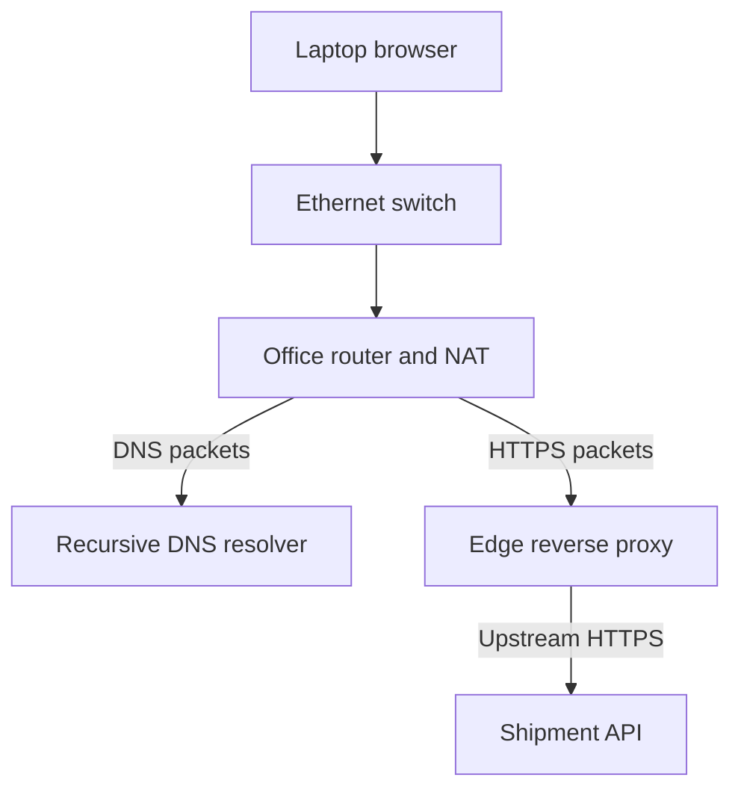

# 01 · Network layers and devices

A browser calls `https://api.example.com/shipments`. On the laptop’s Ethernet link, the destination is the local router’s **MAC address**. Inside that frame, the destination is the **IP address** of the edge, the public-facing server in front of the API. Inside the encrypted connection, the HTTP request names **`/shipments`**. All three destinations are correct. Each answers a different delivery question.

**Who forwards the packet, and who reads the request?** A switch forwards a frame within a local network. A router forwards the IP packet toward another network. In the deployment below, a reverse proxy terminates HTTPS and reads the HTTP request. The API reads the request forwarded by that proxy and decides which shipments the user may see.

This note accompanies the first topic in the [AppSec networking checklist](appsec-networking-checklist.md).

## 1. What a layer does

A **protocol** is an agreement about how to interpret bytes and what to do next. The Hypertext Transfer Protocol (HTTP) defines the meaning of a web request. The Internet Protocol (IP) defines how to address a packet across networks. Ethernet defines how to carry data on a local link. A layer uses the service below it, so a web developer can ask for a URL while the operating system handles packet delivery.

A **host** is a system that sends or receives traffic. A **network interface** is its point of attachment, such as Ethernet, Wi-Fi, or a virtual interface. A **link** connects network neighbors. A **routed hop** occurs when a router forwards an IP packet toward its destination. A laptop can have several interfaces, and a packet can cross several switches within one routed hop.

### The OSI and TCP/IP models

OSI (Open Systems Interconnection) is a seven-layer reference model. Engineers use shorthand such as *L2* for layer 2 and *L7* for layer 7. The Internet protocol suite, also called TCP/IP, is commonly taught with four layers. The mapping is approximate, especially at the top. A five-layer teaching model splits the TCP/IP link layer into physical and data link.

| OSI layer | The question it answers | Familiar example | TCP/IP layer |
| --- | --- | --- | --- |
| 7 · Application | What operation or information do these bytes represent? | An HTTP request for shipments or a DNS query for an address | Application |
| 6 · Presentation | How are the data represented so both sides can interpret them? | A text encoding such as UTF-8 or an agreed compression format | Application |
| 5 · Session | How is a dialogue organized, synchronized, or resumed? | A protocol that checkpoints a long exchange so peers can resume it | Application |
| 4 · Transport | How do two endpoints exchange bytes or messages, and which port receives them? | TCP streams and UDP datagrams | Transport |
| 3 · Network | Which IP destination is this packet going toward, and what is the next hop? | IPv4, IPv6, and routing | Internet |
| 2 · Data link | How does this frame reach a neighbor on this link? | Ethernet frames, Wi-Fi frames, and MAC addresses | Link |
| 1 · Physical | How do bits cross the medium? | Electrical signals on copper, light in fiber, or radio on Wi-Fi | Link |

In web systems, libraries and applications share many of the responsibilities described by OSI layers 5–7. A login session represented by a cookie is application state. For Transport Layer Security (TLS), describe its actual position and endpoints. With HTTP/2 over HTTPS, TLS protects HTTP/2 traffic and uses TCP to carry its records. That description tells you where the HTTP content becomes readable.

## 2. From an application message to a frame

**Encapsulation** means carrying one protocol’s data inside another protocol’s unit. Each outer header gives its receiver the information it needs to handle the contents. The receiver works back up the stack through **decapsulation**. At an HTTPS server using TCP, the interface receives a frame, IP hands its payload to TCP, TCP reconstructs the byte stream, TLS verifies and decrypts records, and the HTTP server interprets the request.

| Unit | What it carries or does | What to look for |
| --- | --- | --- |
| HTTP message | An application request or response | Method, target, headers, status, and body as applicable |
| TLS record | Protected data between TLS endpoints | An endpoint with the session keys can recover the protected content |
| TCP segment | The Transmission Control Protocol carries portions of a reliable, ordered **byte stream** and exchanges control information | Source and destination ports, sequence numbers, and acknowledgments |
| UDP datagram | The User Datagram Protocol carries one distinct transport message at a time | Source and destination ports and a length. Delivery guarantees, ordering, and duplicate handling are left to the application or a protocol above UDP |
| IP packet | Data for an IP destination across one or more networks | Source and destination IP, upper-layer protocol, and IPv4 TTL or IPv6 Hop Limit |
| Link-layer frame | A payload for delivery across a local link | On Ethernet, source and destination MAC addresses and an EtherType identifying the payload |
| Physical transmission | Bits encoded on the medium | Presence of an electrical or optical carrier, or radio signal quality |

TCP and UDP are alternative ways to use IP. Here are three actual stacks, written from the application down to an Ethernet link.

| Exchange | Stack |
| --- | --- |
| The dashboard loads shipments over HTTP/2 | HTTP/2 → TLS → TCP → IP → Ethernet |
| The laptop asks its resolver a conventional DNS question over UDP | DNS → UDP → IP → Ethernet |
| A browser uses HTTP/3 | HTTP/3 → QUIC → UDP → IP → Ethernet. QUIC uses TLS 1.3 for its handshake and provides reliable streams |

**Message boundaries and packet boundaries are independent.** A large HTTP response can span many TLS records and TCP segments. A link’s maximum transmission unit (MTU) limits how large an IP packet it can carry in one piece. A TCP segment can carry bytes from more than one TLS record. HTTP/2 can also interleave multiple requests on one connection. An HTTP/2 *frame* is an application-protocol unit, while an Ethernet *frame* delivers data over one local link. The protocol name gives the word *frame* its meaning.

This distinction matters during incident review. A TCP acknowledgment tells the sender which bytes the peer’s TCP stack has received. To find out whether a shipment was created, look for application evidence such as the HTTP response and the committed record.

## 3. Read the right address

| Identifier | Scope | Example in this note |
| --- | --- | --- |
| DNS name | The Domain Name System (DNS) lets a service name resolve to one or more addresses | `api.example.com` resolves to the public edge |
| IP address | An endpoint address used for routing on this part of the path | `203.0.113.80` is the edge’s public IPv4 address |
| MAC address | A Media Access Control address used for delivery on the local area network (LAN) | The laptop addresses its first Ethernet frame to the router’s LAN interface |
| Transport port | A number within TCP or UDP that helps the OS deliver traffic to a socket | The edge listens on TCP `443`. The browser uses a temporary source port |
| HTTP target | The resource requested from a service | The path is `/shipments` |
| Application identity | The user or workload whose permissions the application evaluates | The session identifies a dispatcher authorized to read particular shipments |

A **socket** is an operating-system endpoint used by a process. The **five-tuple** describes a TCP flow using the transport protocol, source IP, source port, destination IP, and destination port. Several authenticated users can reach the same destination IP and port. A reverse proxy can even carry their requests over one pooled backend connection. The API therefore needs application credentials and resource-level authorization.

The word *port* has two common meanings. A switch port connects a device or another switch to a local network. TCP port `443` is a number in a transport header. An Ethernet frame can enter switch port 8 with a TCP segment addressed to port 443 inside it.

## 4. What the devices actually do

A device’s role follows from the decision it makes. One home gateway can provide Wi-Fi, switch Ethernet frames, route IP packets, translate addresses, and filter connections. A virtual appliance can perform the same functions in software. A layer label also tells you which fields drive a decision. A packet capture taken on a router can still contain readable HTTP when that link carries plaintext.

| Component | How it makes its decision | What that means on the request path |
| --- | --- | --- |
| Network interface / NIC | A network interface controller sends and receives traffic on an attached link | Your laptop has an Ethernet or Wi-Fi interface. A virtual interface can connect software components. Loopback keeps traffic within the host’s network stack |
| Repeater / Ethernet hub | Repeats a physical signal toward other attached ports | A legacy hub shares the traffic on a segment. It has no MAC forwarding table |
| Bridge / Layer 2 switch | Learns the source MAC and incoming port. Looks up the destination MAC within the VLAN, a logical LAN | A known destination goes to its learned port. An unknown unicast destination is normally flooded to eligible ports in that VLAN. Ordinary Layer 2 switching preserves the IP hop count |
| Wi-Fi access point | In a common bridged deployment, connects wireless stations to a LAN | The radio hop uses Wi-Fi framing and the wired side can use Ethernet framing |
| Router / default gateway | Looks up the destination IP and selects a next hop using its routing table | The most specific matching route wins. A default route covers destinations with no more-specific match. The router reduces the packet’s TTL or Hop Limit and builds suitable framing for its outgoing link |
| NAT gateway | Network Address Translation uses a mapping to rewrite an address and, with port translation, a port | A home or office can share one public IPv4 address. Return packets are translated back to the originating private endpoint |
| Firewall | Evaluates configured rules. A stateful network firewall can track flows and their return traffic | A rule can admit TCP connections to port 443. To decide whether a user may open a shipment, a component also needs application identity and shipment permissions |
| Layer 4 load balancer | Selects a backend using transport or flow information | A TCP pass-through configuration can carry encrypted TLS bytes to the backend. Some products also offer a TLS-termination mode. Check the configured listener |
| Reverse proxy / HTTP gateway | Acts as the server facing the client and as a client toward a backend | When it terminates TLS, it can read HTTP, route by host or path, return a cached response, or issue a request upstream. Content delivery networks (CDNs), API gateways, and web application firewalls (WAFs) can perform parts of this role |
| Forward proxy | Acts on behalf of a client making outbound requests | With an HTTPS `CONNECT` tunnel, the proxy relays encrypted traffic. If the deployment performs TLS inspection, the proxy terminates a client-side TLS connection and establishes another one upstream |
| Origin application / API | Interprets the HTTP operation, credentials, and requested data | It can evaluate whether the signed-in dispatcher may read shipment 42 and produce the application response |

A **default gateway** is usually an IP router for hosts on a subnet. An **API gateway** processes application requests. Both may sit on the same path and make entirely different decisions. A **DNS resolver** also provides an application service. Its job here is to answer the browser’s name lookup, a separate exchange from forwarding the later HTTPS request.

## 5. Trace one browser request

The browser requests `https://api.example.com/shipments` over HTTP/2. Assume a wired IPv4 laptop, a fresh DNS lookup, a fresh browser connection, an office router performing source NAT, and a reverse proxy that uses HTTPS to reach the API. The public-facing IPs below are documentation addresses. The ports and private addresses are illustrative.



The arrows show the outbound path. The laptop initiates both the DNS lookup and the HTTPS connection. Additional internet routers are omitted. Each exchange also has a return path.

1. **Resolve the name.** The laptop asks its resolver at `192.0.2.53` for an IPv4 address for `api.example.com`. The answer is `203.0.113.80`. The lookup carries the hostname. The path `/shipments` belongs to the later HTTP exchange. In an ordinary browsing session a cached answer can satisfy the lookup.
2. **Select the local recipient.** The laptop is `10.0.1.25/24`, so its directly connected IPv4 subnet covers `10.0.1.0` through `10.0.1.255`. The edge is off that subnet. The laptop’s route selects gateway `10.0.1.1`. It gets the gateway’s MAC address from its neighbor cache or by using the Address Resolution Protocol (ARP). For an on-link destination such as `10.0.1.40`, the laptop would resolve that peer’s MAC directly. IPv6 uses Neighbor Discovery for this job.
3. **Switch the frame and route the packet.** The switch forwards the Ethernet frame toward the gateway. The router receives the frame, examines the IP destination, decrements the Time to Live (TTL), and sends the packet toward its next hop in new link-layer framing. TTL limits how long a packet can circulate in a routing loop. Ordinary routing preserves the source and destination IPs. This particular router also applies source NAT and port translation, as shown below.
4. **Establish TCP and TLS.** The browser establishes a TCP connection to the edge. In the normal TCP handshake the endpoints exchange SYN, SYN-ACK, and ACK. During TLS setup the browser verifies the certificate for `api.example.com` and the endpoints establish traffic keys. Now the browser sends the HTTP request. An observer on the path can see IPs, ports, sizes, and timing. The method, path, HTTP headers, and body are encrypted between the TLS endpoints.
5. **Cross the proxy boundary.** The edge decrypts the request and reads its host and path. It selects the shipment API, opens or reuses an independent upstream connection, and forwards the request over TLS. In this design the edge validates the upstream service’s certificate. TLS protection, peer identity, and logging can be evaluated separately on each connection.
6. **Authorize and respond.** The API reads the forwarded HTTP request, checks the dispatcher’s session and shipment permissions, and returns a response to the edge. The edge sends the response on the browser-facing connection. The office NAT uses its mapping to deliver returning packets to the laptop. Routing is directional, so the return path across the internet can use different routers.

### The same request at three observation points

| Observation point | TCP source | TCP destination | What happened |
| --- | --- | --- | --- |
| Laptop’s Ethernet LAN | `10.0.1.25:51514` | `203.0.113.80:443` | The IP destination is the edge. The Ethernet destination is the office router’s LAN MAC |
| Public side of office NAT | `198.51.100.24:62001` | `203.0.113.80:443` | NAT translated the source IP and port. The browser and edge are still the TLS endpoints |
| Edge’s upstream network | `10.20.0.5:41002` | `10.20.0.12:8443` | The edge is now a client of the API on a separate TCP and TLS connection |

The API’s socket reports `10.20.0.5` as its immediate peer. If the API uses a forwarded client address for rate limiting or audit, the team must know which proxy supplied it, how that proxy handles incoming forwarding headers, and which paths can reach the API. User identity still comes from the application’s authentication mechanism. [MDN on forwarded client addresses](https://developer.mozilla.org/en-US/docs/Web/HTTP/Reference/Headers/X-Forwarded-For)

**Change one assumption.** Suppose the edge uses a TCP pass-through listener and the API terminates the browser’s TLS connection. The edge can select a backend for the connection. The API holds the session keys and becomes the first server-side component that can read `/shipments`. To determine visibility in a real design, find the TLS endpoint and the configured listener mode. [AWS listener examples](https://docs.aws.amazon.com/elasticloadbalancing/latest/network/load-balancer-listeners.html)

## 6. Practice with a single frame, offline

This 75-byte Ethernet frame is the DNS query from the laptop’s LAN in the worked example. It contains an untagged Ethernet II header, IPv4, UDP, and one uncompressed DNS question. **Before decoding it, predict the Ethernet destination, the IP destination, and the application data you expect to find.**

Run this with Python 3.8 or later. It only reads the supplied bytes. The IPv4 header stores its length in four-byte words. UDP has an eight-byte header, and this DNS question starts after the twelve-byte DNS header.

```python
from ipaddress import IPv4Address
from struct import unpack_from

frame = bytes.fromhex(
    "0200000100010200000100250800"
    "4500003d1234400040115b2e0a000119c0000235"
    "cf0800350029d5b6"
    "4a210100000100000000000003617069076578616d706c6503636f6d0000010001"
)

ip = 14  # The untagged Ethernet header occupies the first 14 bytes.
udp = ip + 4 * (frame[ip] & 0x0F)
source_ip = IPv4Address(frame[ip + 12 : ip + 16])
destination_ip = IPv4Address(frame[ip + 16 : ip + 20])
source_port, destination_port = unpack_from("!HH", frame, udp)

print("Ethernet", frame[6:12].hex(":"), "to", frame[0:6].hex(":"))
print("IPv4", source_ip, "to", destination_ip)
print("UDP", source_port, "to", destination_port)

cursor = udp + 8 + 12
labels = []
while frame[cursor]:
    length = frame[cursor]
    cursor += 1
    labels.append(frame[cursor : cursor + length].decode("ascii"))
    cursor += length
print("DNS question", ".".join(labels))
```

| Observation | Result | Interpretation |
| --- | --- | --- |
| Ethernet | `02:00:00:01:00:25` to `02:00:00:01:00:01` | Laptop interface to gateway interface on this LAN |
| IPv4 | `10.0.1.25` to `192.0.2.53` | Laptop to the remote DNS resolver |
| UDP | `53000` to `53` | Temporary client port to the resolver’s DNS port |
| DNS question | `api.example.com` | The name the browser needs for its later HTTPS connection |

The destination MAC belongs to the gateway because the resolver is off-link. The destination IP belongs to the resolver because it should process this packet’s UDP payload. The API hostname appears inside that payload because it is the subject of the question. Someone observing this conventional DNS exchange can learn the queried name even though the later HTTP request is encrypted.

## 7. Use the model when something breaks

For a request in your own web app, open the browser’s **Network** panel. Select an API request and inspect its protocol, remote address, HTTP status, and Timing tab. The browser can show HTTP headers because it is a TLS endpoint. The remote address identifies the peer visible to the browser. To inspect what happened beyond a reverse proxy, correlate the request with edge and application logs. A warm connection, browser cache, or service worker can explain a missing DNS or connection phase. [Chrome DevTools Network reference](https://developer.chrome.com/docs/devtools/network/reference)

| Observation | What the evidence establishes | What to check next |
| --- | --- | --- |
| Interface reports no carrier | The wired interface reports no active physical link | Cable, switch port, and interface state |
| DNS returns `NXDOMAIN` | This resolver returned a negative answer for the queried name | Exact name, resolver, and whether the application expects an internal DNS view |
| TCP connection is refused | An endpoint or intermediary actively rejected the connection attempt | Destination IP and port, listening socket, and firewall reject policy |
| Connection times out | The client’s deadline expired before it completed the connection | Route and return route, firewall evidence, and peer availability. A timeout alone leaves several possibilities |
| Certificate hostname validation fails | The presented identity did not validate for the requested hostname | Requested hostname, certificate names, edge configuration, and peer address |
| Browser receives HTTP `403` | An HTTP-speaking component refused this request | Match the request in edge and application logs to locate the decision and its reason |

## 8. Check your understanding

1. A laptop and an API are on the same Ethernet VLAN and IP subnet. Which MAC address does the laptop use for ordinary direct delivery? What changes when the API moves to another routed network?
2. A path contains three ordinary Ethernet switches before its first router. How many of those switches decrement the IP TTL?
3. Two dispatchers in the same office appear under one public IP. What can explain this, and what should the API use to decide which shipments each person can read?
4. A team says that HTTPS at its CDN proves customer cookies are encrypted all the way to its backend. What evidence would establish protection on the second connection?
5. A browser received a 403, and the application team cannot find a matching request. Which component would you investigate next, and why?
6. A trace shows UDP port 443 while DevTools reports HTTP/3. How can the browser still receive an ordered, reliable response stream?

### Answer key

1. On-link, the laptop addresses the peer’s MAC. Off-link, the selected next-hop router supplies the destination MAC for the laptop’s first frame. The packet’s IP destination identifies the remote endpoint in both cases.
2. Zero. Ordinary Layer 2 switching forwards frames within the LAN. The first IP router decrements the TTL when it forwards the packet.
3. Source NAT can map connections from many clients to a shared public address. The API should authenticate each dispatcher and enforce permissions for the requested shipments.
4. Check the CDN’s configured upstream protocol, destination name, and certificate verification. Confirm the upstream connection actually negotiated TLS using edge or origin telemetry. A browser certificate establishes the identity of the browser-facing TLS endpoint.
5. Inspect the reverse proxy, gateway, CDN, or WAF that can read HTTP. An edge component can generate its own 403 before forwarding to the application. A shared request ID and timestamps help locate the responding component.
6. QUIC runs over UDP and supplies reliable streams with loss recovery. HTTP/3 uses those streams. The UDP header identifies how the packets are carried, while QUIC supplies the stream behavior.

## Further reading

| For a closer look at | Read |
| --- | --- |
| The two layer models | [Cloudflare’s illustrated OSI guide](https://www.cloudflare.com/learning/ddos/glossary/open-systems-interconnection-model-osi/) · [IETF Internet host layers, RFC 1122 §1.1.3](https://www.rfc-editor.org/rfc/rfc1122.html#section-1.1.3) |
| Switching, routing, and finding neighbors | [How a network switch works](https://www.cloudflare.com/learning/network-layer/what-is-a-network-switch/) · [IPv4 router forwarding, RFC 1812 §5.2](https://www.rfc-editor.org/rfc/rfc1812.html#section-5.2) · [IPv6 Neighbor Discovery, RFC 4861 §3](https://www.rfc-editor.org/rfc/rfc4861.html#section-3) |
| Transport units and modern HTTP | [TCP concepts, RFC 9293 §2](https://www.rfc-editor.org/rfc/rfc9293.html#section-2) · [UDP, RFC 768](https://www.rfc-editor.org/rfc/rfc768.html) · [HTTP/3 overview, RFC 9114 §2](https://www.rfc-editor.org/rfc/rfc9114.html#section-2) |
| Encryption and intermediaries | [TLS 1.3, RFC 9846 §1](https://datatracker.ietf.org/doc/html/rfc9846#section-1) · [HTTP intermediaries, RFC 9110 §3.7](https://www.rfc-editor.org/rfc/rfc9110.html#section-3.7) |
| Applying the model in a review | [OWASP Authorization Cheat Sheet](https://cheatsheetseries.owasp.org/cheatsheets/Authorization_Cheat_Sheet.html) · [Wireshark’s packet details pane](https://www.wireshark.org/docs/wsug_html_chunked/ChUsePacketDetailsPaneSection.html) |

---

[Course checklist](appsec-networking-checklist.md) · [Next · 02 IPv4, IPv6, and subnetting](02-ipv4-ipv6-and-subnetting.md)
