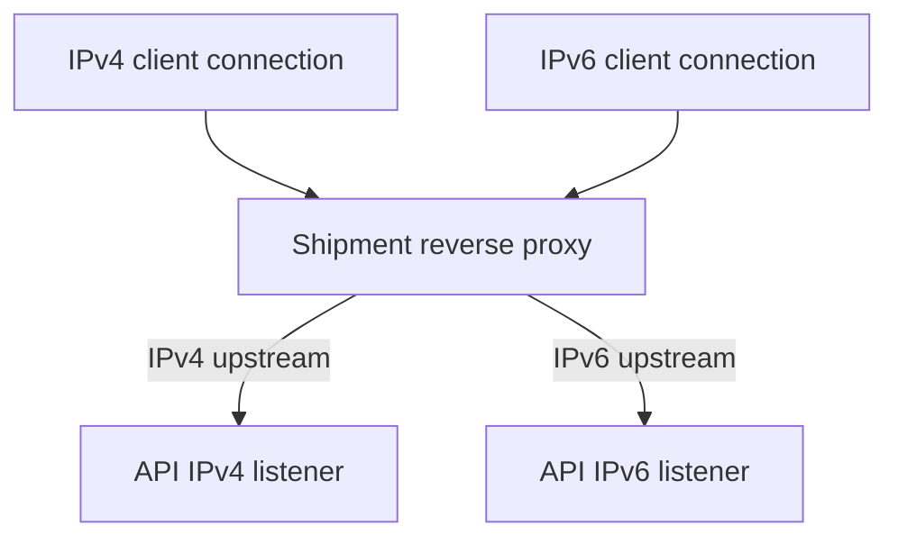

# 02 · IPv4, IPv6, and subnetting

A shipment API should accept backend connections from a proxy at `10.20.0.5`. Two proposed source rules are `10.20.0.5/32` and `10.20.0.0/16`. Both match the proxy. The first selects one address. The second selects 65,536. If the API also listens on IPv6, there is another set of addresses to review.

**The AppSec question is whether the effective policy admits every intended peer, and only those peers, on each address family the service uses.** To answer it, you need to read an address, calculate a prefix’s boundaries, and identify where on the connection path a rule is evaluated.

This lesson continues the browser, edge proxy, and shipment API example from the [AppSec networking checklist](appsec-networking-checklist.md) and [Network layers and devices](01-network-layers-and-devices.md).

## 1. Read an IP address

IP gives a packet a source and a destination that routers can use to forward it. An interface can have multiple addresses, and an address can change during the lifetime of a device. A service name can also resolve to several addresses. Keep three questions separate when reading a log entry. Which address did this component see? Which service was listening? Which user did the application authenticate?

| Property | IPv4 | IPv6 |
| --- | --- | --- |
| Address size | 32 bits, or 4 bytes | 128 bits, or 16 bytes |
| Written form | Four decimal octets separated by dots | Eight groups of four hexadecimal digits, separated by colons, before abbreviation |
| Example address | `10.20.7.141` | `2001:db8:1:2a::12` |
| Single-address prefix | `/32` | `/128` |
| DNS record carrying the address | A | AAAA |
| Common local neighbor lookup | ARP on Ethernet | IPv6 Neighbor Discovery using ICMPv6 |
| Hop counter reduced by each forwarding router | Time to Live (TTL) | Hop Limit |

An IPv4 **octet** contains eight bits, so its decimal value runs from 0 through 255. From left to right, its bit positions are worth 128, 64, 32, 16, 8, 4, 2, and 1. For example, 141 is 128 + 8 + 4 + 1, written `10001101`. This is enough binary to calculate an IPv4 subnet by hand.

### Reading IPv6 without counting the wrong groups

Each hexadecimal digit represents four bits. A full four-digit group represents 16 bits and is often called a **hextet**. Hex uses `0` through `9` and `a` through `f`, so `2a` means 2 × 16 + 10, or decimal 42.

| Form | The same IPv6 address |
| --- | --- |
| All eight groups | `2001:0db8:0001:002a:0000:0000:0000:0012` |
| Leading zeros removed within each group | `2001:db8:1:2a:0:0:0:12` |
| Canonical short form | `2001:db8:1:2a::12` |

The double colon fills in enough all-zero groups to bring the total back to eight. Here, five groups are written explicitly, so the double colon stands for three. It can appear at most once per address. For canonical output, use lowercase, compress the longest run of two or more zero groups, and choose the first run when lengths tie. Expand the address before counting prefix bits if you are unsure. [IPv6 text representation, RFC 5952](https://www.rfc-editor.org/rfc/rfc5952.html)

A **port** belongs to the transport endpoint. In a URL, brackets delimit an IPv6 literal so the port is unambiguous. For example, in `https://[2001:db8:1:2a::12]:8443/shipments`, the address ends at the closing bracket, the TCP port in the HTTP/2 example is 8443, and the HTTP path is `/shipments`. The `/64` you might see on an interface belongs to its network configuration.

## 2. Understand what the slash means

**CIDR** stands for Classless Inter-Domain Routing. In `address/p`, the prefix length `p` is the number of **leading bits that are fixed**. The remaining bits can vary. A canonical network prefix has all those remaining bits set to zero. An interface configuration can show a particular host’s address alongside its prefix length.

| Expression | How to read it |
| --- | --- |
| `10.20.7.141/26` on an interface | One assigned address with a 26-bit prefix. Its containing network is `10.20.7.128/26`. |
| `10.20.0.0/16` in a rule | The first 16 bits are fixed. It covers `10.20.0.0` through `10.20.255.255`. |
| `2001:db8:1::/64` in a rule | The first four hextets are fixed at `2001:0db8:0001:0000`. Its last address is `2001:db8:1:0:ffff:ffff:ffff:ffff`. |
| `0.0.0.0/0` and `::/0` | Zero fixed bits means every address in the respective family. As routes, these are defaults. As rule conditions, they match any address in that family. |
| `10.20.0.5/32` and `2001:db8:1::5/128` | All bits are fixed. Each prefix selects one address. |

Three calculations cover most subnet questions. Let `W` be the address width, 32 for IPv4 or 128 for IPv6.

- **Variable bits** = `W − p`.
- **Total addresses in a prefix** = 2 raised to the power `W − p`. An IPv4 `/26` has 2⁶ = 64 addresses. An IPv6 `/64` has 2⁶⁴ = 18,446,744,073,709,551,616 addresses.
- **Equal-sized child prefixes** = 2 raised to the power `q − p`, where `q` is the longer child prefix. Dividing a `/24` into `/26` networks yields 2² = 4 children.

Adding one prefix bit halves the address set. Removing one doubles it and can move its starting boundary. A prefix can describe a LAN, an allocation containing many LANs, a route, or a set of peers in a firewall rule. Its use comes from the surrounding configuration.

## 3. Calculate an IPv4 subnet by hand

### Worked example · Which subnet contains `10.20.7.141/26`?

1. **Write the mask.** Twenty-six leading ones fill three octets and the first two bits of the fourth. The mask is `255.255.255.192` because the last octet is `11000000`, or 128 + 64.
2. **Find the network address.** Keep the fixed bits of the address and zero the rest. In the last octet, `10001101` (141) bitwise AND `11000000` (192) gives `10000000` (128). The network is **`10.20.7.128/26`**.
3. **Find the last address.** Set the six variable bits to one. The final octet becomes `10111111`, or 191. The full block runs from **`10.20.7.128` through `10.20.7.191`**.
4. **Identify ordinary host addresses.** On a conventional IPv4 multi-access LAN, the first address identifies the network and the last is its directed broadcast address. The ordinary host range is **`10.20.7.129` through `10.20.7.190`**, or 62 addresses. A gateway assigned from this range uses one of them.

**Check your answer using the block size.** Subtract the partial mask octet from 256. Here, 256 − 192 = 64, so the block starts are 0, 64, 128, and 192. The last octet 141 falls in the block starting at 128. The next block begins at 192, which makes 191 the last address in this one.

### When the boundary is in another octet

Give the same address a `/23`. The mask becomes `255.255.254.0`. The third octet now advances in blocks of two, and the fourth octet can take any value. Third octet 7 falls in the pair 6–7. The result is **`10.20.6.0/23`**, spanning `10.20.6.0` through `10.20.7.255`. On this LAN, `10.20.6.255` and `10.20.7.0` are ordinary host addresses. Network and broadcast status depend on the whole prefix.

| IPv4 prefix | Dotted-decimal mask | Total addresses | Ordinary host capacity or common use |
| --- | --- | ---: | --- |
| `/16` | `255.255.0.0` | 65,536 | 65,534 on one conventional LAN |
| `/20` | `255.255.240.0` | 4,096 | 4,094 |
| `/23` | `255.255.254.0` | 512 | 510 |
| `/24` | `255.255.255.0` | 256 | 254 |
| `/25` | `255.255.255.128` | 128 | 126 |
| `/26` | `255.255.255.192` | 64 | 62 |
| `/27` | `255.255.255.224` | 32 | 30 |
| `/28` | `255.255.255.240` | 16 | 14 |
| `/30` | `255.255.255.252` | 4 | 2 |
| `/31` | `255.255.255.254` | 2 | Both addresses can identify endpoints on an RFC 3021 point-to-point link |
| `/32` | `255.255.255.255` | 1 | One address, useful for a host route or a single-peer rule |

The familiar “subtract two” calculation applies to ordinary IPv4 LAN host allocation. In a firewall rule, a source prefix matches its entire numerical range. Cloud platforms may reserve additional addresses inside a subnet, so use the platform’s allocation rules when sizing a real deployment. [IPv4 point-to-point prefixes](https://www.rfc-editor.org/rfc/rfc3021.html) · [AWS subnet sizing](https://docs.aws.amazon.com/vpc/latest/userguide/subnet-sizing.html)

## 4. Divide a block and combine prefixes

Suppose the platform team owns `10.20.8.0/24`. It needs space for 100 API addresses, 50 worker addresses, and 20 management addresses. For this exercise, the counts include gateway addresses and use conventional IPv4 LAN reservations. Assign the largest requirement first. Pick the smallest power-of-two block with enough usable addresses, then start the next subnet on a valid boundary.

| Purpose | Assigned prefix | Full range within `10.20.8.x` | Ordinary host range | Host capacity |
| --- | --- | --- | --- | ---: |
| APIs | `10.20.8.0/25` | .0–.127 | .1–.126 | 126 |
| Workers | `10.20.8.128/26` | .128–.191 | .129–.190 | 62 |
| Management | `10.20.8.192/27` | .192–.223 | .193–.222 | 30 |
| Reserved for growth | `10.20.8.224/27` | .224–.255 | .225–.254 | 30 |

Using different prefix lengths within one allocation is **variable-length subnet masking (VLSM)**. The sizes add up to 256 and the ranges fit together exactly. The API tier gets a `/25` because a `/26` offers only 62 ordinary host addresses. These subnets give the network distinct groups to route and filter. Whether workers can reach management services depends on the policies enforced between them.

The reverse operation is **aggregation**. For example, `10.20.8.0/24` and `10.20.9.0/24` are aligned siblings and combine exactly into `10.20.8.0/23`. A route covering both is useful when they share the same next hop. A policy covering both grants the same match to both populations. If only workers should connect, the source condition in the example above is `10.20.8.128/26`.

Routers generally select the **longest matching prefix** among installed routes in the applicable routing table. For `10.20.7.141`, a route for `10.20.7.128/26` is more specific than `10.20.0.0/16`, which is more specific than the default route. Firewall rule precedence is a separate property of the firewall. Read its ordering, priorities, and default action before predicting an access decision.

## 5. Subnet IPv6 using hexadecimal boundaries

Apply the same prefix arithmetic, starting from 128 bits. Every four prefix bits fix one hexadecimal digit. Every 16 fix one whole hextet.

| IPv6 prefix | Typical interpretation |
| --- | --- |
| `/48` | First three hextets fixed. An allocation of this size contains 65,536 distinct `/64` prefixes. |
| `/56` | First three hextets and the first two hexadecimal digits of the fourth fixed. Contains 256 `/64` prefixes. |
| `/60` | First 15 hexadecimal digits fixed. Contains 16 `/64` prefixes. |
| `/64` | First four hextets fixed. A common subnet size for an Ethernet or Wi-Fi LAN using IPv6 stateless address autoconfiguration (SLAAC). |
| `/127` | Two addresses. Used on appropriate inter-router point-to-point links. |
| `/128` | One address. Used for host routes and exact peer matches. |

### Worked example · Divide `2001:db8:42:ab00::/56` into LANs

The first 48 bits fix `2001:0db8:0042`. The next eight bits fix `ab` in the fourth hextet. To reach `/64`, choose the two remaining hexadecimal digits of that hextet. They run from `00` through `ff`.

| Candidate | Inside the delegated `/56`? | Reason |
| --- | --- | --- |
| `2001:db8:42:ab00::/64` | Yes | First possible LAN |
| `2001:db8:42:ab07::/64` | Yes | Subnet ID within this delegation is hexadecimal `07` |
| `2001:db8:42:abff::/64` | Yes | Last possible LAN |
| `2001:db8:42:ac00::/64` | No | The fixed byte changed from `ab` to `ac` |

The address `2001:db8:42:ab07::12/64` belongs to `2001:db8:42:ab07::/64`. On a typical SLAAC LAN, the remaining 64 bits form the interface identifier. A host can have several IPv6 addresses on one interface, including temporary addresses used for outbound connections. For address planning, count how many LAN prefixes the site needs. For a single-peer access rule, consider a `/128`.

**What if the boundary cuts through a hex digit?** Divide the same `/56` into two `/57` prefixes. The extra fixed bit splits the possible low byte of the fourth hextet into `00`–`7f` and `80`–`ff`. The first child is `2001:db8:42:ab00::/57` and the second is `2001:db8:42:ab80::/57`. Each holds 128 distinct `/64` LANs. An address with fourth hextet `ab7f` belongs to the first child. Changing that hextet to `ab80` moves it into the second.

IPv6 uses multicast for functions that need delivery to groups and has no broadcast address. Count the addresses in a prefix with 2 raised to its number of variable bits. Actual allocation also considers reserved uses, such as subnet-router anycast where applicable. [IPv6 subnet sizes](https://www.rfc-editor.org/rfc/rfc7421.html) · [IPv6 point-to-point links](https://www.rfc-editor.org/rfc/rfc6164.html)

## 6. Recognize address scope and special ranges

An address’s purpose, the routes installed for it, and the permissions on a service are three different facts. A private address can be reachable through a VPN. A globally assigned address can sit behind a firewall that admits only selected peers. **Unicast** delivers to one addressed interface. **Multicast** delivers to members of a group. With **anycast**, several interfaces can offer the same address and routing selects one of them.

| Purpose | IPv4 | IPv6 | What to infer |
| --- | --- | --- | --- |
| Ordinary public unicast | Globally assigned unicast ranges | Common global unicast allocations are within `2000::/3`, which also contains special-purpose prefixes | Check the actual allocation, routes, listener, and filtering to establish internet reachability. |
| Internal addressing | RFC 1918 space `10.0.0.0/8`, `172.16.0.0/12`, `192.168.0.0/16` | Unique-local addresses (ULAs) use `fc00::/7`. Locally generated prefixes use `fd00::/8`. | These ranges can be routed across internal networks. Independent environments can have overlapping internal address plans. |
| Loopback | `127.0.0.0/8`, commonly `127.0.0.1` | `::1/128` | The host’s own network stack. In a container, identify which network namespace the process shares. |
| Link-local | `169.254.0.0/16` | `fe80::/10` | Communication on one link. A local tool may show `fe80::1%en0`, where the zone identifies the interface used to reach that neighbor. |
| Unspecified | `0.0.0.0` | `::` | A special address. In a socket bind, it commonly requests all local addresses of that family. A bind and a `/0` route or rule have different meanings. |
| Multicast | `224.0.0.0/4` | `ff00::/8` | Delivery to a group. IPv6 Neighbor Discovery uses multicast on the local link. |
| Documentation examples | `192.0.2.0/24`, `198.51.100.0/24`, `203.0.113.0/24` | `2001:db8::/32` is a documentation prefix | These are suitable for examples. The public-facing addresses in this lesson are illustrative. |

Two IPv4 boundaries are especially useful in reviews. The RFC 1918 block beginning with 172 covers **`172.16.0.0` through `172.31.255.255`**. An address beginning with `172.32` falls outside it. **`100.64.0.0/10`** runs through `100.127.255.255` and is shared address space used for carrier-grade NAT. An address outside the three RFC 1918 blocks can still have a special purpose. [IANA IPv4 registry](https://www.iana.org/assignments/iana-ipv4-special-registry/) · [IANA IPv6 registry](https://www.iana.org/assignments/iana-ipv6-special-registry/)

A locally assigned ULA prefix contains a pseudo-random 40-bit Global ID after the initial `fd` byte. This reduces the chance of address collisions when private networks connect. In the example `fd42:7c3a:9b10::/48`, the next 16 bits are available for choosing `/64` subnets inside the site. [Unique-local IPv6 address format](https://www.rfc-editor.org/rfc/rfc4193.html#section-3.1)

**How a host chooses the next hop.** In the previous lesson, the laptop’s connected IPv4 route for `10.0.1.0/24` let it deliver directly to local peers. Off-link traffic went to its router. IPv6 hosts also consult routes and on-link information. A router advertisement can separately indicate that a prefix is on-link and that it can be used for autoconfiguration. Numerically sharing a prefix proves address membership. The host’s actual routing state tells you how it will deliver the packet. [IPv6 subnet model, RFC 5942](https://www.rfc-editor.org/rfc/rfc5942.html)

## 7. Review a dual-stack service

**Dual stack** means that IPv4 and IPv6 are both in use. For the shipment dashboard, suppose DNS publishes an A record for `203.0.113.80` and an AAAA record for `2001:db8:100::80` at the edge. A browser can try candidate addresses from both families. One successful page load tells you which path worked for that request. The reverse proxy independently chooses how to connect to the API.



An IPv6 browser can receive a successful response while the proxy talks IPv4 to the API. For the backend rule, inspect the proxy’s **upstream source address** and the API’s **destination listener**. The browser’s address belongs to the other connection.

### Worked review · Only the shipment proxy may reach the API

Assume that the proxy has one fixed upstream address per family, that the backend filter sees those addresses directly, and that the policy defaults to deny. The requirement is to allow this proxy to reach the API on **TCP 8443**.

| Family | Intended source | Intended destination | Protocol and port |
| --- | --- | --- | --- |
| IPv4 | `10.20.0.5/32` | `10.20.0.12/32` | TCP 8443 |
| IPv6 | `fd42:7c3a:9b10:20::5/128` | `fd42:7c3a:9b10:20::12/128` | TCP 8443 |

Now suppose the proposed IPv6 source condition is **`fd42:7c3a:9b10:20::/64`**. Both proposed rules allow the intended proxy. A positive test alone would pass. Examine neighboring addresses as well.

| Source presented to the backend filter | Intended decision | Proposed rules | Explanation |
| --- | --- | --- | --- |
| `10.20.0.5` | Allow | Allow | Exact IPv4 proxy address |
| `10.20.0.6` | Deny | Deny | Outside the allowed IPv4 `/32` |
| `fd42:7c3a:9b10:20::5` | Allow | Allow | Proxy is inside the proposed IPv6 `/64` |
| `fd42:7c3a:9b10:20::6` | Deny | **Allow** | Another source in the same IPv6 subnet also matches |

With the IPv6 source set to `fd42:7c3a:9b10:20::5/128`, all four cases match the stated intent. If the IPv6 permit were omitted entirely, the assumed default-deny policy would instead block the legitimate IPv6 upstream connection. The API still authenticates requests and authorizes access to individual shipments.

### Evidence for a real review

| Check | Evidence to collect |
| --- | --- |
| Name resolution | Which A and AAAA answers does the relevant client or proxy receive? The browser and the backend can use different resolvers. |
| Listener | Which local addresses and ports is the process bound to? An IPv6 wildcard listener may also accept IPv4 peers depending on the platform and the `IPV6_V6ONLY` setting. |
| Routes and filtering | For each family, identify the forward and return routes, the source visible after any translation, and the filter’s effective rules and default action. |
| Address handling in code | Parse addresses with a maintained IP library. Compare numeric addresses and prefixes. A dual-mode socket may report an IPv4 peer in IPv4-mapped form such as `::ffff:192.0.2.10`. Define how the application normalizes that representation before applying its policy. |
| Observed outcome | For each intended path, correlate the selected address family with edge and backend logs. Include an allowed and an excluded peer in the policy review. |

An IPv6 path also depends on control traffic. For example, a forwarding router that cannot fit a packet onto the next link drops it and sends an ICMPv6 **Packet Too Big** message to the source. That feedback lets the sender adapt to the path’s maximum transmission unit. When small replies succeed and large transfers stall on one family, inspect path MTU and the handling of that feedback alongside TCP filtering. [IPv6 packet size rules](https://www.rfc-editor.org/rfc/rfc8200.html#section-5)

On Linux, `ip -br address`, `ip route`, `ip -6 route`, and `ss -ltn` help inspect local state. On macOS, the corresponding observations are available with `ifconfig`, `netstat -rn -f inet`, `netstat -rn -f inet6`, and `lsof -nP -iTCP -sTCP:LISTEN`. A local listener is one piece of evidence. Firewall and application logs reveal the decision along the deployed path.

## 8. Practice offline with Python

Predict the network containing `10.20.7.141/26`, the number of LANs in the IPv6 `/56`, and whether each candidate peer matches the corrected source rules. Then run the block with Python 3. It uses the standard library and performs no network I/O.

```python
from ipaddress import ip_address, ip_interface, ip_network

interface = ip_interface("10.20.7.141/26")
subnet = interface.network
print("IPv4 network:", subnet)
print("Full range:", subnet.network_address, "through", subnet.broadcast_address)
print("Ordinary host range:", subnet.network_address + 1, "through", subnet.broadcast_address - 1)

site = ip_network("2001:db8:42:ab00::/56")
print("Number of /64 LANs:", 2 ** (64 - site.prefixlen))
for address in ("2001:db8:42:abff::12", "2001:db8:42:ac00::12"):
    print(address, "belongs to the site:", ip_address(address) in site)

allowed_sources = (
    ip_network("10.20.0.5/32"),
    ip_network("fd42:7c3a:9b10:20::5/128"),
)
peers = ("10.20.0.5", "10.20.0.6", "fd42:7c3a:9b10:20::5", "fd42:7c3a:9b10:20::6")
for text in peers:
    peer = ip_address(text)
    matches = any(peer.version == prefix.version and peer in prefix for prefix in allowed_sources)
    print(peer, "matches the source rule:", matches)
```

You should find the IPv4 block `10.20.7.128/26`, 256 IPv6 LANs, and source matches of **True, False, True, False** in the order shown. The program checks address membership. The deployment evidence in section 7 covers routing, listening sockets, and the complete filtering decision.

Use `ip_interface()` when the input includes an assigned host and its prefix. Use `ip_network()` for a canonical policy prefix. Its default strict mode catches host bits accidentally left in a network declaration. Membership and `num_addresses` work directly on the prefix, including an IPv6 `/64`, without enumerating its addresses. [Python ipaddress reference](https://docs.python.org/3/library/ipaddress.html)

If a policy specifically means “one of the three RFC 1918 networks,” compare against those three prefixes explicitly. Python’s `is_private` property classifies a broader set of special-purpose addresses. A policy for your organization’s own subnets should use the prefixes actually assigned to it.

## 9. Check your understanding

1. What exact range does `10.20.0.0/16` cover? Which source prefix selects only the proxy at `10.20.0.5`?
2. For `172.20.37.199/20`, find the mask, network address, broadcast address, and ordinary host range.
3. How many `/27` subnets fit in a `/24`? How many ordinary host addresses fit in each? Why can both addresses of `192.0.2.14/31` be used on a suitable point-to-point link?
4. Is `2001:db8:1:1::12` in `2001:db8:1::/64`? Expand the prefix just far enough to justify your answer.
5. A site owns `2001:db8:42:abc0::/60`. Give the first and last `/64` networks it can assign.
6. Classify `172.31.250.2`, `100.96.0.12`, `fe80::2%en0`, and `::1`. Which of them identifies the local host’s IPv6 loopback?
7. An application listens on `[::]:8443`. What evidence would establish that an IPv4 client can reach it?
8. The browser used IPv6 to load the shipment dashboard. What would demonstrate that the proxy also reached the API over IPv6 and that the source rule has the intended scope?

### Answer key

1. `10.20.0.0` through `10.20.255.255`. Use `10.20.0.5/32` for the single address.
2. The mask is `255.255.240.0`. The third-octet block size is 16, and 37 falls between 32 and 47. Network `172.20.32.0`, broadcast `172.20.47.255`, ordinary hosts `172.20.32.1` through `172.20.47.254`.
3. There are 2³ = 8 subnets, each with 32 addresses and 30 ordinary hosts. RFC 3021 assigns both `192.0.2.14` and `192.0.2.15` as endpoints on a point-to-point link, which has no need for a directed broadcast address.
4. No. The prefix fixes the first four groups to `2001:0db8:0001:0000`. The candidate’s fourth group is `0001`.
5. The first is `2001:db8:42:abc0::/64` and the last is `2001:db8:42:abcf::/64`. The last hexadecimal digit of the fourth hextet supplies four subnet bits, or 16 choices.
6. The addresses are RFC 1918 private IPv4, shared carrier-grade NAT space, IPv6 link-local on interface `en0`, and IPv6 loopback, respectively. The loopback is `::1`.
7. Inspect the socket’s IPv4 acceptance mode or a separate IPv4 listener, the client’s IPv4 route, the return path, and the effective firewall rules. An observed IPv4 connection at that listener confirms the path for that client.
8. Correlate an upstream connection at the proxy with the IPv6 peer and destination recorded at the backend. Check that the source condition selects the proxy’s `/128` under the stated policy, and verify the decision for both the intended peer and an excluded neighbor.

## Further reading

| When you want to go deeper | Reference |
| --- | --- |
| CIDR prefixes, routes, and aggregation | [IETF CIDR overview, RFC 4632](https://www.rfc-editor.org/rfc/rfc4632.html) |
| Address format, types, and interface identifiers | [IPv6 addressing architecture, RFC 4291](https://www.rfc-editor.org/rfc/rfc4291.html) · [IPv6 temporary addresses, RFC 8981](https://www.rfc-editor.org/rfc/rfc8981.html) |
| Internal address planning | [IPv4 private space, RFC 1918](https://www.rfc-editor.org/rfc/rfc1918.html) · [IPv6 unique-local addresses, RFC 4193](https://www.rfc-editor.org/rfc/rfc4193.html) |
| Host configuration and IPv6 sockets | [IPv6 SLAAC, RFC 4862](https://www.rfc-editor.org/rfc/rfc4862.html) · [Basic IPv6 socket API, RFC 3493](https://www.rfc-editor.org/rfc/rfc3493.html) |
| Dual-stack behavior and policy review | [Happy Eyeballs v2, RFC 8305](https://www.rfc-editor.org/rfc/rfc8305.html) · [Operational security considerations for IPv6, RFC 9099](https://www.rfc-editor.org/rfc/rfc9099.html) |

---

[Previous · 01 Network layers and devices](01-network-layers-and-devices.md) · [Course checklist](appsec-networking-checklist.md) · [Next · 03 Local networks](03-local-networks.md)
