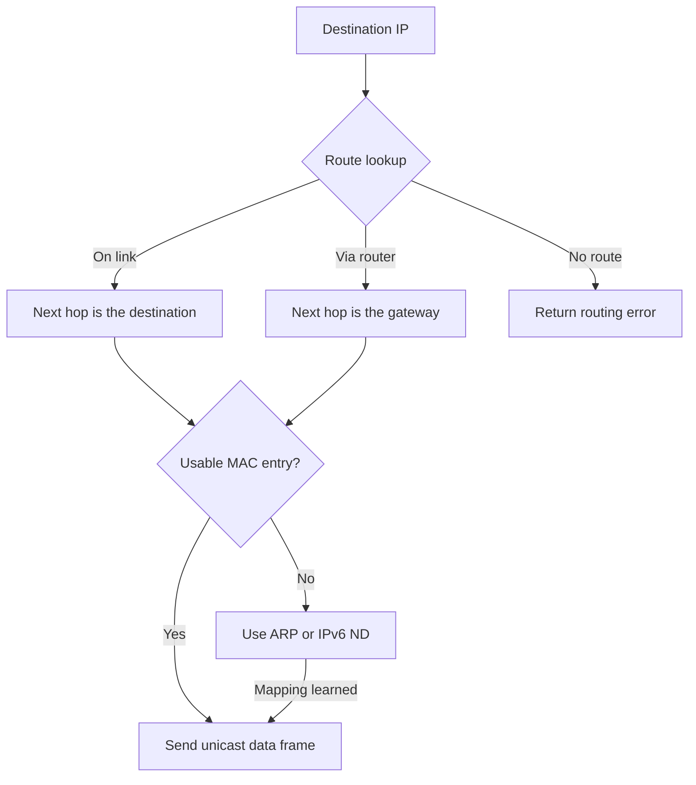

# Local networks

A dispatcher’s laptop sends a label to the printer at `10.0.1.40`, then loads `https://api.example.com/shipments`. Both transmissions leave through the same Ethernet interface and enter the same switch. The print job’s first data frame is addressed to the **printer’s MAC address**. The API request’s first data frame is addressed to the **router’s MAC address**, even though the IP packet is addressed to the API edge.

**How does the laptop know which device to send to?** It first looks up the destination IP in its routing state. A directly reachable destination is its own next hop. A route through a gateway supplies the gateway’s IP as the next hop. The laptop then looks up that neighbor’s link-layer address, using ARP for IPv4 or Neighbor Discovery for IPv6 when it needs a mapping. Finally, the switch uses the frame’s destination MAC to select an outgoing port.

This is the third topic in the [AppSec networking checklist](https://chatgpt.com/library?file_id=libfile_a587b9ac4b10819195b004ce505754a5&account_id=personal). It continues the office example from [Network layers and devices](https://chatgpt.com/library?file_id=libfile_e59488c781248191967d1805356b5448&account_id=personal) and uses the prefix calculations from [IPv4, IPv6, and subnetting](https://chatgpt.com/library?file_id=libfile_af22e7b9a23c8191b1feead127e36897&account_id=personal).

## 1. What counts as local?

A **local area network (LAN)** connects devices within a limited environment, such as an office. For a particular packet, the more useful question is whether its next recipient is **on-link**. Two interfaces are on the same link when the link-layer infrastructure can deliver traffic between them without an IP router forwarding the packet. A link can include several Ethernet switches and bridged Wi-Fi access points.

A **broadcast domain** is the set of interfaces that can receive a link-layer broadcast under the network’s forwarding policy. A **virtual LAN (VLAN)** creates a logical broadcast domain on a bridged network. An **IP subnet** groups addresses by prefix. Many offices assign one IPv4 subnet and one IPv6 LAN prefix to each VLAN. The VLAN determines where a frame can travel at Layer 2. Addresses, routes, and on-link information determine where a host tries to send an IP packet.

### The office used throughout the lesson

| Device on the staff LAN | IPv4 address | IPv6 address used in the example | MAC address |
| --- | --- | --- | --- |
| Dispatcher’s laptop | `10.0.1.25/24` | `2001:db8:42:ab07::25` | `02:00:00:01:00:25` |
| Label printer | `10.0.1.40/24` | `2001:db8:42:ab07::12:3456` | `02:00:00:01:00:40` |
| Router’s staff interface | `10.0.1.1/24` | `fe80::1` for the default router | `02:00:00:01:00:01` |

The staff LAN is VLAN 10. Its IPv6 router advertises `2001:db8:42:ab07::/64` as on-link. The DNS resolver at `192.0.2.53` and the API edge at `203.0.113.80` or `2001:db8:100::80` are off-link. The public-looking addresses are reserved for documentation. The MAC addresses and port assignments are illustrative.

## 2. Ethernet frames and MAC addresses

Ethernet carries data across a link in **frames**. The common Ethernet **Media Access Control (MAC) address** is 48 bits, written as six hexadecimal bytes. An interface can use a locally assigned address. For example, the first byte `02` in the laptop’s example MAC marks it as a locally administered individual address. Operating systems can also use private Wi-Fi addresses. Treat a MAC address as an observation tied to an interface, network, and time. [IEEE 802 address conventions](https://www.rfc-editor.org/rfc/rfc9542.html) · [Private Wi-Fi addresses on Apple devices](https://support.apple.com/en-us/102509)

| Part of an Ethernet II frame | What it tells you |
| --- | --- |
| Destination MAC | Which individual interface or group should receive it on this LAN. `ff:ff:ff:ff:ff:ff` is the Ethernet broadcast address. |
| Source MAC | Which link-layer address the sender used. A learning switch associates this address with the arriving port. |
| Optional 802.1Q tag | Carries VLAN information across a tagged link. A common tag adds four bytes and includes a 12-bit VLAN identifier. |
| EtherType and payload | Identifies what is carried. Common values are `0x0800` for IPv4, `0x86dd` for IPv6, and `0x0806` for ARP. |
| Frame check sequence (FCS) | Detects transmission errors. Capture hardware often strips this trailer before a host capture tool sees the frame. |

**Unicast** addresses one interface. **Broadcast** addresses the local broadcast domain. **Multicast** addresses a group. Switches can limit the distribution of some multicast traffic using group membership information. These delivery modes matter when reading a trace. An IPv4 ARP request can be an Ethernet broadcast even though the data packet sent afterward is unicast.

The laptop’s cable ends at the switch. For an off-link API destination, the **MAC inside the frame** belongs to the router. The switch receives the bits on its port, reads the destination field, and forwards the frame. An ordinary Layer 2 switch does not consume an IP hop. The router does when it forwards the packet onto its next link.

## 3. How a switch learns, and what a VLAN changes

A learning switch maintains a **forwarding database (FDB)**, often called its MAC address table. In this example its entries have the form `(VLAN, MAC address) → port`. Dynamic entries age out. A laptop’s neighbor cache and a switch’s FDB are maintained independently.

1. A frame arrives. The switch determines its VLAN from the port configuration or incoming tag.
2. It learns the **source** MAC on the incoming port for that VLAN.
3. It looks up the **destination** MAC. A known unicast destination on another port is forwarded there. A known destination on the incoming port requires no additional forwarding.
4. A broadcast, or an unknown unicast under ordinary flooding behavior, goes to the other eligible forwarding ports in that VLAN. The receiving interfaces then apply their own destination and protocol processing.

This explains how the first exchange can work when the switch has an empty table. Flooding delivers the initial frame to the destination’s port. The reply gives the switch a source address to learn in the opposite direction. A broadcast circulating through a Layer 2 loop can be replicated repeatedly. **Spanning Tree** lets switches keep redundant physical links while choosing a loop-free set of forwarding paths. [Layer 2 forwarding tables](https://www.juniper.net/documentation/us/en/software/junos/multicast-l2/topics/topic-map/layer-2-forwarding-tables.html)

### Access ports, trunks, and inter-VLAN routing

| Switch port | Connection | Example VLAN configuration |
| --- | --- | --- |
| P1 | Staff laptop | Access port, untagged staff traffic assigned to VLAN 10 |
| P2 | Staff label printer | Access port, VLAN 10 |
| P3 | Router/firewall uplink | 802.1Q trunk carrying VLANs 10 and 30, both tagged in this example |
| P4 | Guest device | Access port, untagged guest traffic assigned to VLAN 30 |

An **access port** commonly connects an endpoint that sends and receives untagged frames. A **trunk** carries multiple VLANs and uses tags to distinguish them. Some trunk configurations assign untagged traffic to a native VLAN. Both ends need a consistent understanding of tagging and permitted VLANs.

An ARP broadcast arriving on P1 goes to P2 and P3 in VLAN 10. On P3 it carries the staff VLAN tag. A guest broadcast arriving on P4 goes to P3 in VLAN 30. The router can participate in both VLANs through separate logical interfaces and can route between their IP networks according to policy.

This distinction surfaces in real outages. If the staff laptop is accidentally assigned to guest VLAN 30 while retaining its staff IPv4 configuration, it can still have a healthy physical link and a plausible-looking address. Its ARP requests for the staff gateway now travel in the guest broadcast domain. Checking the mask alone will miss the port assignment.

## 4. What changes on Wi-Fi?

A Wi-Fi station uses IEEE 802.11 to exchange frames over radio. A **Service Set Identifier (SSID)** is the wireless network name. A **Basic Service Set Identifier (BSSID)** identifies a particular basic service set, usually represented by a MAC address of the access point (AP) for that wireless network. Multiple APs can advertise the same SSID, allowing a laptop to move between them. Wireless clients also share airtime, so interference or contention can cause loss and delay while the IP configuration remains valid.

In a typical **bridged** deployment, the laptop associates with an AP, completes the configured network-access and key exchanges, and the AP bridges its traffic into an assigned VLAN. An SSID or an authenticated user policy can determine that assignment. Two SSID names can lead to the same VLAN, and one enterprise SSID can place different users into different VLANs. [Wi-Fi to VLAN mapping](https://documentation.meraki.com/Wireless/Design_and_Configure/Configuration_Guides/Client_Addressing_and_Bridging/VLAN_Tagging_on_MR_Access_Points)

**The AP and the router can both be recipients of the same transmission in different senses.** For an ordinary client-to-AP infrastructure data frame, the immediate radio receiver is the AP. The 802.11 header can also identify the logical LAN destination, such as the router’s MAC. The AP then bridges the traffic onto the wired side. This is why a Wi-Fi capture can show the AP’s BSSID alongside a different destination MAC.

Wi-Fi security also has distinct endpoints. WPA2-Personal uses a pre-shared key. WPA3-Personal uses Simultaneous Authentication of Equals (SAE) for password-based key establishment. Enterprise Wi-Fi commonly uses **802.1X** with the **Extensible Authentication Protocol (EAP)** for network admission. The client is the *supplicant*, the AP is the *authenticator*, and a back-end authentication service often uses RADIUS. Wireless encryption protects the radio link between the station and its AP. The dashboard’s HTTPS connection protects application data to its TLS endpoint, and the API checks the dispatcher’s permissions. [IEEE 802.1X network access control](https://1.ieee802.org/security/802-1x/) · [Wireless security modes](https://support.apple.com/en-ie/guide/security/sec8a67fa93d/web)

## 5. How a new laptop gets configured

Joining a cable or wireless network establishes link connectivity. An application that contacts a remote service also needs an IP address, suitable routes, and usually a resolver. IPv4 and IPv6 configuration can run in parallel.

### IPv4 with DHCP

The **Dynamic Host Configuration Protocol (DHCP)** can lease the laptop an IPv4 address and supply options such as the subnet mask, default router, and DNS resolver. A common initial exchange is remembered as **DORA**.

| Step | What happens in this office |
| --- | --- |
| **Discover** | A client starting without an IPv4 lease normally broadcasts a DHCPDISCOVER. It can use source IP `0.0.0.0` and destination `255.255.255.255`. Clients use UDP port 68 and servers use port 67. |
| **Offer** | A server offers an address such as `10.0.1.25`, a lease duration, and configuration options. |
| **Request** | In the initial selection exchange, the client broadcasts a DHCPREQUEST identifying its selected server and requested address. |
| **Acknowledge** | The selected server confirms the binding with a DHCPACK. The client checks the address for conflicts as appropriate and applies the confirmed configuration. |

In this example the laptop receives `10.0.1.25/24`, default router `10.0.1.1`, and DNS resolver `192.0.2.53`. DHCP supplies the resolver’s address. Later, the laptop asks that resolver for the IP of `api.example.com`. A **DHCP relay** can receive the local client broadcast and forward the request to a DHCP server on another network. This lets one server support several VLANs while the original broadcast stays local.

A client with an existing lease normally requests renewal from its server at **T1**. If that fails, it tries rebinding with any available server at **T2**. If the lease expires without renewal, the client must stop using that leased address. Seeing only a request and an acknowledgment can therefore be consistent with a healthy network. If the office expects a managed address but the laptop has only a `169.254.0.0/16` link-local IPv4 address, inspect its lease and DHCP path. [DHCPv4 exchanges and lease renewal](https://www.rfc-editor.org/rfc/rfc2131.html) · [IPv4 link-local configuration](https://www.rfc-editor.org/rfc/rfc3927.html)

### IPv6 with Router Advertisements, SLAAC, and DHCPv6

An IPv6 host normally forms a **link-local** address and performs **Duplicate Address Detection (DAD)** for tentative unicast addresses. During ordinary DAD it can send a Neighbor Solicitation from the unspecified source `::` while checking its tentative address. A conflicting response or competing solicitation can signal a duplicate. Once the checks complete without a conflict, the host can use the address. Seeing a `fe80::` address on a healthy dual-stack interface is expected.

A host can send a **Router Solicitation (RS)** to prompt a **Router Advertisement (RA)**. Routers also advertise periodically. Read these RA fields independently.

| Information | Meaning for the host |
| --- | --- |
| Router’s link-local source and Router Lifetime | A positive router lifetime advertises the sender as a default-router candidate. A lifetime of zero withdraws that role for this router. Prefix information in the same RA can still be useful. |
| Prefix Information Option, **L** flag | With L set and a valid lifetime, the advertised prefix can be learned as on-link. A clear L flag by itself makes no statement that the prefix is off-link. |
| Prefix Information Option, **A** flag | A suitable prefix with A set can be used for **Stateless Address Autoconfiguration (SLAAC)**. On a typical Ethernet or Wi-Fi LAN, the host combines a `/64` prefix with an interface identifier. |
| Preferred and valid lifetimes | These govern the preference and validity of an address formed from the prefix. A deprecated address can remain valid while a preferred address is used for new connections. |
| Resolver information | An RA can advertise recursive DNS servers through the RDNSS option. Deployments can also supply DNS settings using DHCPv6. |

In the staff example, the router at `fe80::1` advertises `2001:db8:42:ab07::/64` with L and A set. The laptop can form an address for that prefix and can learn a default route separately from the router lifetime. The short host IDs in the examples make the tables readable. Real clients can use stable or temporary interface identifiers. The notation `fe80::1%en0` identifies which interface, or zone, to use for a link-local neighbor.

**DHCPv6** can assign addresses or supply other configuration. An RA’s **M** flag signals that addresses are available through DHCPv6. Its **O** flag signals that other configuration is available through DHCPv6. A typical stateful exchange uses Solicit, Advertise, Request, and Reply, with UDP port 546 for the client and 547 for servers and relays. A client can also request configuration information without leasing an address. On an ordinary IPv6 LAN, the default router is learned through Router Advertisements. A valid DHCPv6 lease and a missing default route can therefore coexist. [IPv6 SLAAC and DAD](https://www.rfc-editor.org/rfc/rfc4862.html) · [RA DNS options](https://www.rfc-editor.org/rfc/rfc8106.html) · [DHCPv6, RFC 9915](https://www.rfc-editor.org/rfc/rfc9915.html)

## 6. Find the next device for a unicast packet

Once the laptop has configuration and a destination IP, it makes the following decision for ordinary unicast traffic leaving its LAN interface.



### IPv4 uses ARP

The **Address Resolution Protocol (ARP)** maps an on-link IPv4 address to a link-layer address. Suppose the laptop wants to contact the remote API at `203.0.113.80` and has an empty ARP cache.

1. The route selects the gateway `10.0.1.1`. That is the IPv4 address the laptop needs to resolve.
2. The laptop sends an Ethernet broadcast carrying an ARP request for `10.0.1.1`. The switch learns the laptop’s MAC on P1 and distributes the request within VLAN 10. ARP is carried directly in Ethernet.
3. The router ordinarily sends a unicast ARP reply giving its MAC, `02:00:00:01:00:01`. The reply arrives at the switch on P3. The switch learns the router’s MAC there and forwards the reply to P1.
4. The laptop caches the mapping and sends its data. The Ethernet destination is `02:00:00:01:00:01`. The IPv4 destination is `203.0.113.80`. Subsequent packets can reuse the cached mapping.

For the on-link printer at `10.0.1.40`, step one selects the printer itself. ARP therefore asks for `10.0.1.40`, and the data frame goes to `02:00:00:01:00:40`. You may also see ARP probes or announcements when an address is being checked or claimed. [ARP](https://www.rfc-editor.org/rfc/rfc826.html) · [IPv4 address conflict detection](https://datatracker.ietf.org/doc/html/rfc5227)

### IPv6 uses Neighbor Discovery

**Neighbor Discovery (ND or NDP)** uses ICMPv6. It covers both router discovery and neighbor address resolution. Its most common messages are easy to group by the question being answered.

| Message | Ordinary use |
| --- | --- |
| Router Solicitation / Router Advertisement, types 133 / 134 | Discover local routers, prefixes, and link parameters. |
| Neighbor Solicitation / Neighbor Advertisement, types 135 / 136 | Resolve a neighbor’s link-layer address, check reachability, or participate in DAD. The addresses and options in the message distinguish these cases. |
| Redirect, type 137 | A router can inform a host of a better first hop for a destination on the same link. |

To resolve the printer’s IPv6 address, `2001:db8:42:ab07::12:3456`, the laptop normally sends a Neighbor Solicitation to a **solicited-node multicast** group. Take the low 24 bits of the target address, `12:34:56`, and append them to the solicited-node prefix `ff02::1:ff00:0/104`. The resulting IPv6 multicast group is **`ff02::1:ff12:3456`**. On Ethernet, IPv6 multicast uses `33:33` followed by the low 32 bits of the multicast address, giving **`33:33:ff:12:34:56`**.

The printer recognizes its full target address in the solicitation and normally sends a unicast Neighbor Advertisement for this ordinary lookup. The laptop can then send unicast data frames to the printer’s MAC. The multicast group narrows the audience for the initial query. Multiple addresses can share that group, which is why the solicitation also carries the full target address.

For the remote IPv6 API edge, the selected neighbor is the router at `fe80::1`. A previous RA may already have supplied its link-layer address. A fresh Neighbor Solicitation is needed only when the host’s neighbor-discovery state calls for one. A cache entry marked **STALE** still has a usable mapping whose reachability may need to be reconfirmed. **INCOMPLETE** means address resolution is in progress. If resolution times out, queued traffic can fail before its first data frame reaches the gateway. [IPv6 Neighbor Discovery](https://www.rfc-editor.org/rfc/rfc4861.html) · [Solicited-node addresses](https://www.rfc-editor.org/rfc/rfc4291.html#section-2.7.1) · [IPv6 multicast over Ethernet](https://datatracker.ietf.org/doc/html/rfc2464#section-7)

### Five destinations from the laptop

The last column is the Ethernet destination of the **data frame after resolution**. The preceding discovery exchange can use broadcast or multicast.

| Intended IP destination | Selected local next hop | Lookup or cached neighbor entry | Ethernet destination |
| --- | --- | --- | --- |
| Printer `10.0.1.40` | Printer | ARP for `10.0.1.40` | `02:00:00:01:00:40` |
| DNS resolver `192.0.2.53` | Router | ARP for `10.0.1.1` | `02:00:00:01:00:01` |
| API edge `203.0.113.80` | Router | Same ARP entry for `10.0.1.1` | `02:00:00:01:00:01` |
| Printer `2001:db8:42:ab07::12:3456` | Printer | ND for the printer’s IPv6 address | `02:00:00:01:00:40` |
| API edge `2001:db8:100::80` | Router | ND entry for `fe80::1` on the staff interface | `02:00:00:01:00:01` |

The laptop can therefore reach many remote services while its neighbor table contains only a few local entries. When a router forwards one of those packets, it selects the next hop on its own outgoing link and builds the link-layer framing suitable for that link.

## 7. Where AppSec controls belong

Suppose guests may reach the internet, staff may reach the label printer, and shipment records require an authenticated dispatcher. Those requirements are enforced at different places.

| Review question | Control and evidence |
| --- | --- |
| Which network does a device join? | Inspect access-port and SSID-to-VLAN assignments, 802.1X policy where used, and the actually assigned VLAN. A Wi-Fi network name or a client’s MAC alone supplies weak evidence about the user. |
| Can a guest reach a staff service? | Trace the actual path. Routed guest-to-staff traffic can be filtered at the inter-VLAN router or firewall. Same-VLAN traffic can be switched directly, so inspect AP/client isolation, switch policy, or host firewalls if local peers also require isolation. Check both IP families. |
| Who may provide IPv4 configuration or neighbor bindings? | On managed switches, DHCP snooping can restrict where server replies are accepted and learn address bindings. Dynamic ARP Inspection can validate ARP on untrusted ports using those bindings or explicit entries for statically configured devices. |
| Who may advertise an IPv6 router or supply DHCPv6 information? | RA Guard and DHCPv6-Shield can limit the ports allowed to originate those messages. Preserve the legitimate ICMPv6 exchanges needed for neighbor discovery and autoconfiguration. |
| Who may see or change a shipment? | Verify TLS to the intended endpoint and enforce user or workload authentication and per-shipment authorization in the application. Network location gives context to that decision. |

As a concrete design review, trace a guest laptop to the printer in the switch and router configuration. If both endpoints actually land in VLAN 10 with ordinary peer forwarding, their frames can travel directly between switch ports. Changing the inter-VLAN firewall rule alone will have no effect on that path. [DHCP snooping](https://www.cisco.com/c/en/us/td/docs/switches/lan/c9000/sec-crypto/fhs-sisf/fhs-and-sisf-configuration-guide/dhcp-snooping.html) · [Dynamic ARP Inspection](https://www.cisco.com/c/en/us/td/docs/switches/lan/c9000/sec-crypto/fhs-sisf/fhs-and-sisf-configuration-guide/dynamic-arp-inspection.html) · [IPv6 RA Guard](https://www.rfc-editor.org/rfc/rfc6105.html) · [DHCPv6-Shield](https://www.rfc-editor.org/rfc/rfc7610.html)

## 8. Diagnose a LAN problem from the host

Inspect the interface actually carrying the traffic. Ethernet, Wi-Fi, VPN, and virtual interfaces can all appear on one computer. The example commands below read local state. Substitute the real interface name for `en0` when needed.

| Observation | Linux | macOS |
| --- | --- | --- |
| Interface state and assigned addresses | `ip -br link` and `ip -br address` | `ifconfig en0` |
| Route selected for the example IPv4 edge | `ip route get 203.0.113.80` | `route -n get 203.0.113.80` |
| IPv6 routing | `ip -6 route` | `netstat -rn -f inet6` |
| Cached IPv4 neighbors | `ip -4 neigh show` | `arp -an` |
| Cached IPv6 neighbors | `ip -6 neigh show` | `ndp -an` |
| DHCP details when available | `nmcli device show` on NetworkManager systems | `ipconfig getpacket en0` for DHCPv4 |

| Symptom | Evidence that narrows the cause |
| --- | --- |
| Wi-Fi is associated but the laptop has no expected IPv4 lease | Check admission and VLAN assignment, then client lease state, relay configuration, and DHCP server records. An AP association alone establishes only part of the path. |
| The IPv4 gateway’s neighbor entry stays incomplete | Confirm the selected gateway, interface, and VLAN. Look for the normal request and reply on the appropriate segment and verify the router interface is present there. |
| The laptop has an IPv6 address but cannot reach off-link IPv6 destinations | Check for an IPv6 default route, the advertising router and its lifetime, and the router’s neighbor state. A configured address and a learned default router have independent lifetimes. |
| The printer is accessible by IP but its local name is absent | Check name discovery. Systems using multicast DNS for `.local` names use link-local multicast on UDP 5353. Discovery across VLANs depends on an explicitly deployed discovery service or reflector. |
| External sites work but two Wi-Fi clients cannot talk to each other | Check client isolation, VLAN assignments, and host firewalls. Internet access demonstrates a path to the gateway, while direct peer access has its own policy. |

An empty cache can simply mean that an entry aged out or that no traffic has yet used the neighbor. Interpret cache state together with the selected route, the relevant interface, and recent activity. [Multicast DNS](https://www.rfc-editor.org/rfc/rfc6762.html)

## 9. Offline exercise · Predict the switch ports

Use the four ports in section 3. Start with an empty switch FDB. The laptop already has a valid neighbor mapping for the printer from earlier activity. Predict which ports receive the first and second unicast frames sent to the printer, and which port receives the guest DHCP broadcast. Then run this Python 3 example. It works entirely on the supplied table.

```python
members = {10: ("P1", "P2", "P3"), 30: ("P3", "P4")}
laptop = "02:00:00:01:00:25"
printer = "02:00:00:01:00:40"
router = "02:00:00:01:00:01"
guest = "02:00:00:30:00:25"
broadcast = "ff:ff:ff:ff:ff:ff"

# Each entry records the frame's VLAN, incoming port, MACs, and purpose.
events = [
    (10, "P1", laptop, broadcast, "ARP request for router"),
    (10, "P3", router, laptop, "ARP reply to laptop"),
    (10, "P1", laptop, router, "API data via router"),
    (10, "P1", laptop, printer, "First data to printer"),
    (10, "P2", printer, laptop, "Printer reply"),
    (10, "P1", laptop, printer, "Next data to printer"),
    (30, "P4", guest, broadcast, "Guest DHCP discover"),
]

learned = {}
for vlan, incoming, source, destination, label in events:
    learned[(vlan, source)] = incoming
    known_port = learned.get((vlan, destination))
    if destination == broadcast or known_port is None:
        outgoing = [port for port in members[vlan] if port != incoming]
    elif known_port == incoming:
        outgoing = []
    else:
        outgoing = [known_port]
    print(label, "->", ", ".join(outgoing) or "filtered")
```

| Event | Expected outgoing ports |
| --- | --- |
| ARP request for router | P2, P3 |
| ARP reply to laptop | P1 |
| API data via router | P3 |
| First data to printer | P2, P3 |
| Printer reply | P1 |
| Next data to printer | P2 |
| Guest DHCP discover | P3 |

The first printer frame already has the correct destination MAC. The switch floods it because **the switch** has yet to learn the printer’s port. The printer’s reply teaches the switch that mapping. Likewise, P3 can receive both staff and guest broadcasts while the two broadcasts remain in different VLANs. Each carries its own VLAN tag on that trunk.

## 10. Check your understanding

1. The laptop sends HTTPS data to the IPv4 API edge. What are the destination IP, local next-hop IP, and Ethernet destination MAC?
2. What information does the laptop’s neighbor cache store? What different information does the switch FDB store?
3. On staff Wi-Fi, the AP and the default router have different MAC addresses. How can both appear as relevant addresses for one outbound request?
4. A DHCP trace contains a DHCPREQUEST followed by a DHCPACK. Is a missing Discover sufficient evidence of failure? What would you examine next?
5. An IPv6 RA advertises a prefix with a positive valid lifetime, L set, A clear, and Router Lifetime zero. What can the host learn from this advertisement?
6. For the on-link IPv6 target `2001:db8:42:ab07::ab:cdef`, which solicited-node multicast group and Ethernet multicast MAC are used for ordinary initial resolution?
7. A guest and a staff device use different SSID names, yet a guest can reach the staff printer. Which two forwarding decisions would you investigate?
8. A colleague expects an ARP entry for the public API after a successful request. Which observed entries would you actually expect on the laptop and on the staff switch?

### Answer key

1. Destination IP `203.0.113.80`, next-hop IP `10.0.1.1`, Ethernet destination `02:00:00:01:00:01`. The route selects the router and ARP supplies its local address mapping.
2. The host records a neighbor’s IP-to-link-layer mapping on an interface. The switch records the VLAN and MAC-to-port association learned from source MACs.
3. The AP is the immediate receiver on the radio hop. In this bridged deployment the router is the logical LAN destination. The 802.11 frame has address fields for those different roles.
4. A renewal can produce this exchange. Check the client’s existing lease, the server identifier or destination where relevant, and whether the acknowledged configuration was applied.
5. The host can learn the on-link prefix. SLAAC needs A set on a suitable prefix, and learning a default router from this RA needs a positive Router Lifetime. Only the on-link condition is satisfied here. Other routers or configuration sources can supply the remaining information.
6. The low 24 target bits are `ab:cd:ef`. The IPv6 group is `ff02::1:ffab:cdef`, and the Ethernet destination is `33:33:ff:ab:cd:ef`.
7. First establish the actual VLAN assigned to each client and to the printer. Then trace whether the traffic is switched directly or routed through a policy boundary, and inspect the controls on that path.
8. For this IPv4 exchange, the laptop needs the ARP mapping for local gateway `10.0.1.1`. While the dynamic entries are current, the switch can have the laptop MAC on P1 and the router MAC on P3 in VLAN 10. The public edge’s IP remains visible in the IP header of the data packet.

## Further reading

| To study | Reference |
| --- | --- |
| Ethernet protocol identifiers | [IANA IEEE 802 numbers](https://www.iana.org/assignments/ieee-802-numbers/ieee-802-numbers.xhtml) |
| IPv4 configuration options | [DHCP options, RFC 2132](https://www.rfc-editor.org/rfc/rfc2132.html) |
| On-link decisions and address lifetimes | [IPv6 subnet model, RFC 5942](https://www.rfc-editor.org/rfc/rfc5942.html) · [IPv6 temporary addresses, RFC 8981](https://www.rfc-editor.org/rfc/rfc8981.html) |
| IPv6 operational security | [IPv6 network security considerations, RFC 9099](https://www.rfc-editor.org/rfc/rfc9099.html) |
