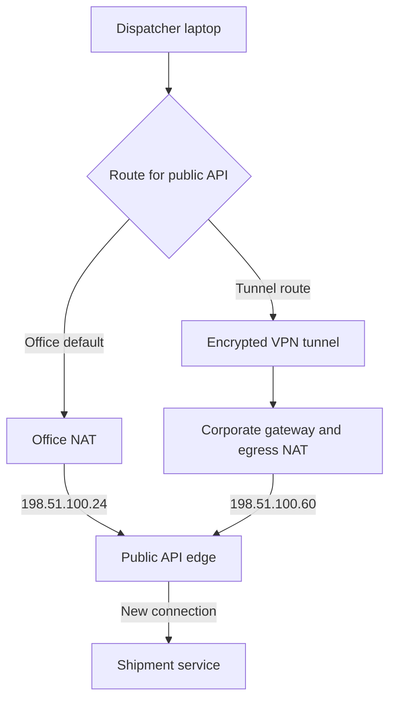

# 04 · Routing and NAT

A dispatcher opens `https://api.example.com/shipments`. The laptop’s address is `10.0.1.25`. The public API edge records a connection from `198.51.100.24`. The shipment service behind it records a connection from `10.20.0.5`. All three records can describe the same HTTP request. At each observation point, ask **where does this packet go next, and which source address will the receiver see?**

We will answer those questions for the office network, change the route by turning on a VPN, and diagnose a case where a small API call succeeds but a large transfer stalls. The IP addresses on the public side are reserved for documentation. The route tables and logs are worked examples you can use offline.

**Earlier lessons** · [Network layers and devices](https://chatgpt.com/library?file_id=libfile_e59488c781248191967d1805356b5448&account_id=personal) · [IPv4, IPv6, and subnetting](https://chatgpt.com/library?file_id=libfile_af22e7b9a23c8191b1feead127e36897&account_id=personal) · [Local networks](https://chatgpt.com/library?file_id=libfile_8693a991281481919c9bc67d8b8ffdf2&account_id=personal) · [AppSec networking checklist](https://chatgpt.com/library?file_id=libfile_a587b9ac4b10819195b004ce505754a5&account_id=personal)

## 1. Follow a packet past the first hop

Suppose DNS has returned `203.0.113.80` for the API. The laptop’s subnet is `10.0.1.0/24`. The destination is outside it, so the laptop checks its routes and selects office gateway `10.0.1.1`. On Ethernet it addresses the first **frame** to that gateway’s MAC. Inside the frame, the **IP packet** still names `203.0.113.80` as its destination.

The gateway removes the incoming link header and looks up the destination in **its own** forwarding table. It can send the packet toward an upstream router, which repeats the process. Each router knows the next step it selected. The laptop does not need a list of all routers between it and the API. At each routed hop a new link header is built for the outgoing link and the IPv4 TTL or IPv6 Hop Limit is reduced. Ordinary forwarding preserves the endpoint IP addresses. The office gateway in this example also performs a source translation.

| Function | Decision | What changes in this example? |
| --- | --- | --- |
| Routing and forwarding | Which next hop and interface should carry this destination? | The router sends the packet onward in a new link-layer frame |
| Network address translation (NAT) | Which address, and possibly port, should appear on the other side? | The office gateway rewrites the laptop’s source IP and TCP port |
| Firewall filtering | Is this traffic permitted under policy and connection state? | An allowed packet can proceed. A denied one is dropped or rejected |
| Reverse proxying | Where should this HTTP request be served? | The edge terminates the incoming TLS connection and opens or reuses a separate upstream connection |

One appliance can perform several of these jobs. When you read a diagram or a log, identify the job and the interface at the observation point. That tells you whether to expect the same packet addresses, translated addresses, or a new connection. [IPv4 router requirements](https://www.rfc-editor.org/rfc/rfc1812.html) · [Traditional NAT](https://www.rfc-editor.org/rfc/rfc3022.html)

## 2. Read a route table

A route describes a **destination prefix** and an **action**. Ordinary IP routing uses the destination IP in the packet. Two HTTPS requests to different paths on the same connection, such as `/shipments` and `/labels`, present the same IP destination to the router. A directly connected route sends to the destination on the local link. A gateway route names a reachable next-hop router. A point-to-point tunnel route may name only the tunnel interface. A machine also maintains local routes for addresses it owns, so traffic to the machine itself can be delivered locally.

Consider this simplified laptop table. The office network is on `en0`. A corporate split VPN uses `utun4`. A second office router at `10.0.1.254` provides a path to one branch. Each row is an installed IPv4 route.

| Destination prefix | Action | Meaning |
| --- | --- | --- |
| `10.0.1.0/24` | On-link through `en0` | The staff LAN, including the label printer |
| `10.20.0.0/16` | Through `utun4` | Corporate destinations use the VPN |
| `10.20.8.0/24` | Via `10.0.1.254` on `en0` | This branch has a more-specific office path |
| `10.20.8.77/32` | Unreachable | An explicit exception for one host |
| `0.0.0.0/0` | Via `10.0.1.1` on `en0` | Default for other IPv4 destinations |

**Longest-prefix match.** Within the selected forwarding table, consider the prefixes that contain the destination and use the one with the most matching leading bits. A `/0` matches every address of its family and is the least specific. A `/32` selects one IPv4 address. The row order above has no effect.

| Destination | Matching prefix lengths | Result |
| --- | --- | --- |
| Printer `10.0.1.40` | `/24`, `/0` | Deliver on-link. Resolve the printer’s MAC |
| Corporate service `10.20.0.12` | `/16`, `/0` | Send into the VPN. The service’s access policy still applies |
| Branch service `10.20.8.42` | `/24`, `/16`, `/0` | Send to the branch router at `10.0.1.254` |
| Retired branch host `10.20.8.77` | `/32`, `/24`, `/16`, `/0` | Return an unreachable error. The explicit action ends this lookup |
| Public edge `203.0.113.80` | `/0` | Send to the office gateway at `10.0.1.1` |

If no route matches and no default exists, forwarding fails. An explicit *unreachable* route can report an error. A *blackhole* route silently discards traffic. Likewise, if a selected gateway fails to answer ARP, that alone does not make the host retry a less-specific route. A failover mechanism or routing update may later change which route is installed.

### Where routes come from

- A **connected route** normally appears when an interface is configured with an on-link prefix. A default gateway can arrive through IPv4 DHCP, an IPv6 Router Advertisement, or static configuration.
- A **static route** is installed by configuration. **Dynamic routing** lets routers exchange reachability information. OSPF commonly distributes paths inside an administrative domain. BGP distributes prefix reachability and policy between networks and is also used internally. A laptop can use its default route without running either protocol.
- A router’s **routing information base (RIB)** holds routing information and candidate paths. The **forwarding information base (FIB)** supplies the installed decisions used for packets. For competing routes to the same prefix, route preference and applicable metrics can help choose what is installed. With equal-cost multipath (**ECMP**), more than one next hop can be installed, and implementations often distribute flows among them. A low metric on a default does not outrank an installed, more-specific route in the same ordinary lookup.
- **Policy routing** can select a table using the source address, an interface or a packet mark before that table’s destination lookup. A container, VPN client or application with a bound source address may therefore get a different result from an ordinary shell on the same machine.

IPv4 and IPv6 use separate routes. The office laptop might have an IPv6 default of `::/0` via `fe80::1` on `en0`. A request to the example edge’s AAAA address, `2001:db8:100::80`, uses the IPv6 decision. Inspect the address family the application actually selected. The presence of an IPv4 default proves nothing about IPv6 reachability. [CIDR and longest match](https://www.rfc-editor.org/rfc/rfc4632.html) · [Linux route types and metrics](https://man7.org/linux/man-pages/man8/ip-route.8.html) · [Policy routing](https://man7.org/linux/man-pages/man8/ip-rule.8.html)

## 3. Translate an outbound connection and its reply

**Source NAT (SNAT)** rewrites the source address as traffic crosses a boundary. An office might translate many RFC 1918 addresses into one public IPv4 address because the private addresses have no globally unique Internet return path. **Port address translation (PAT)**, also called **network address and port translation (NAPT)**, lets many transport endpoints share that address. A translator can preserve a source port when possible or allocate another one.

A TCP or UDP flow can be described by its **five-tuple**, consisting of the protocol, source IP, source port, destination IP and destination port. Ports belong to the transport protocol. TCP port 443 and UDP port 443 belong to different namespaces. Here the browser uses TCP. It picks local port `51514`, the edge listens on `443`, and the office NAT allocates external port `62001`.

| Direction and observation point | Source | Destination |
| --- | --- | --- |
| Request on the laptop’s LAN | `10.0.1.25:51514` | `203.0.113.80:443` |
| Same request after office PAT, as received at the edge | `198.51.100.24:62001` | `203.0.113.80:443` |
| Reply from the edge, before reverse translation | `203.0.113.80:443` | `198.51.100.24:62001` |
| Same reply on the office LAN | `203.0.113.80:443` | `10.0.1.25:51514` |

Read the table from top to bottom. The outbound translation changes the **source**. The edge replies to the endpoint it observed. On that return packet the gateway changes the **destination** back to the laptop’s endpoint, then routes the result to the LAN. The gateway updates affected header checksums. The browser and edge remain the TLS endpoints throughout this translation.

Suppose a second laptop, `10.0.1.26`, also chooses TCP source port `51514` for the **same** edge at the same time. If both connections use the same public IPv4 address, the translator needs distinct public source ports for these two flows. It could assign `62002` to the second one. The edge can now return traffic for each connection unambiguously.

| Protocol | Inside endpoint | Public endpoint | Remote endpoint |
| --- | --- | --- | --- |
| TCP | `10.0.1.25:51514` | `198.51.100.24:62001` | `203.0.113.80:443` |
| TCP | `10.0.1.26:51514` | `198.51.100.24:62002` | `203.0.113.80:443` |

### Why the translation needs state

A **stateful** translator retains the binding needed for replies. NAT devices vary in how they reuse bindings across remote endpoints and which inbound traffic they admit. TCP state and idle timers affect how long entries last. UDP has no TCP-style close handshake, so idle timeouts matter there too. A closed connection’s external port can later be assigned to a different client.

- **Return path.** Forward and return routes may use different Internet routers. The reply still has to reach a translator that knows the binding, such as the original gateway or a peer with synchronized state. A reply arriving at an independent gateway can fail even while both gateways have valid IP routes.
- **Idle connections.** An API or WebSocket connection that fails after a repeatable idle period may have lost state in a NAT, firewall or proxy. Compare their timers and logs with the application’s heartbeat before attributing the close to one device.
- **Capacity.** A busy egress can run out of usable port mappings or connection-tracking entries. New connections may fail while existing ones continue. The available capacity depends on the public address pool, destination mix, protocol and implementation.

The edge’s `198.51.100.24` identifies a shared egress. To relate a connection to an internal endpoint, correlate the protocol, translated IP **and port**, destination, and a precise timestamp with the translation log. A mapping can identify an endpoint during that interval. Identifying the dispatcher requires application authentication or session records. [Traditional NAT and NAPT](https://www.rfc-editor.org/rfc/rfc3022.html) · [UDP mapping and filtering](https://www.rfc-editor.org/rfc/rfc4787.html) · [TCP NAT behavior](https://www.rfc-editor.org/rfc/rfc5382.html) · [Logging with address sharing](https://www.rfc-editor.org/rfc/rfc6302.html)

## 4. Publish a service and identify what the backend sees

**Destination NAT (DNAT)** rewrites the destination address. A common use is **port forwarding**, which maps a public destination address and port to a private service, potentially on a different port. Consider a separate label-callback service with a permanent mapping from `203.0.113.90:443` to `10.30.0.7:8443`. Assume this gateway performs only DNAT on the incoming request, permits the flow, and handles the return path.

| Observation | Source | Destination |
| --- | --- | --- |
| Partner opens a connection to the public endpoint | `198.51.100.70:53000` | `203.0.113.90:443` |
| Gateway forwards it to the callback service | `198.51.100.70:53000` | `10.30.0.7:8443` |
| Callback service sends the reply | `10.30.0.7:8443` | `198.51.100.70:53000` |
| Gateway sends that reply to the partner | `203.0.113.90:443` | `198.51.100.70:53000` |

Here the callback service sees the partner’s IP and terminates TLS itself. If the gateway also applies SNAT, the service sees that translated source instead. A published mapping needs a route to the backend, a permitting network policy, a listening service and a working return path. When reviewing a firewall rule or log, check whether its address fields refer to the original or translated tuple. Devices expose these at different processing stages.

### Other NAT deployments

| Term | What it means | Practical consequence |
| --- | --- | --- |
| Static or dynamic NAT | A fixed address mapping versus a mapping allocated as needed, for example from a pool | A static one-to-one address mapping can preserve ports. An inbound port forward can translate one port without publishing every service |
| Double NAT and carrier-grade NAT (CGN) | Traffic crosses two translation boundaries, for example a home gateway and an ISP translator. An ISP may use `100.64.0.0/10` between them | The home gateway’s outside address and the Internet-facing source can differ. A port forward on the home gateway alone cannot create an upstream CGN mapping |
| Hairpin NAT | A client inside a network reaches an internal service using its externally mapped endpoint, and the gateway sends the traffic back inside | It needs support and a valid return path. Some deployments use internal DNS to direct local clients straight to the internal service |

### DNAT versus the shipment reverse proxy

Return to the original shipment API at `203.0.113.80`. Its **reverse proxy** accepts the browser’s TLS connection and makes a separate upstream connection from `10.20.0.5:41002` to `10.20.0.12:8443`. The application server’s socket therefore reports `10.20.0.5` as its peer. In the DNAT-only callback above, one transport conversation passed through the gateway. At the shipment proxy there are two conversations and potentially two independent TLS sessions.

Ordinary NAT does not insert HTTP forwarding headers. If the origin uses `Forwarded` or `X-Forwarded-For`, define the trusted proxy chain, account for how each proxy handles fields supplied by clients, and restrict or separately handle paths that can reach the origin directly. For example, the trusted public edge can record the office egress IP it actually saw. That header cannot recover the laptop’s private address from the office NAT. Shared egress also makes IP-only rate limits affect several users at once. [Forwarded header security considerations](https://www.rfc-editor.org/rfc/rfc7239.html) · [MDN on trusted proxies](https://developer.mozilla.org/en-US/docs/Web/HTTP/Reference/Headers/X-Forwarded-For) · [Address sharing at carriers](https://www.rfc-editor.org/rfc/rfc6888.html)

## 5. How a VPN changes the route and observed source

A **tunnel** carries an inner packet inside an outer packet. An encrypted VPN tunnel protects the encapsulated traffic between its endpoints. For a packet traveling from a laptop to a corporate service, the **inner destination** is the service’s IP. The **outer destination** is the VPN gateway. The laptop needs a working path to that gateway over its underlying network. At the far end, the gateway decapsulates the inner packet and routes it onward. It can apply NAT or forwarding policy there.

| VPN mode | Which traffic enters the tunnel? | Source seen by the public shipment edge in this example |
| --- | --- | --- |
| Split tunnel | Selected corporate prefixes, including `10.20.0.0/16`. The public edge follows the office default | `198.51.100.24`, the office’s translated IPv4 address |
| Full tunnel with corporate Internet egress | The policy sends the public API traffic through the tunnel as well. The VPN’s own carrier packets still need an underlying route to its endpoint | `198.51.100.60`, assuming the corporate exit translates Internet-bound traffic to this address |



The diagram follows the **inner API traffic**. For a closer look at the full-tunnel case, suppose the VPN assigns the laptop `10.250.0.25` and uses `192.0.2.200` as its tunnel endpoint.

| Where you observe the request | Source IP → destination IP |
| --- | --- |
| On the laptop’s VPN interface, before encapsulation | `10.250.0.25` → `203.0.113.80` (inner API packet) |
| On the laptop’s physical LAN, after encapsulation | `10.0.1.25` → `192.0.2.200` (outer VPN packet) |
| On the public side of the office NAT | `198.51.100.24` → `192.0.2.200` (outer VPN packet after office PAT) |
| At the public API edge | `198.51.100.60` → `203.0.113.80` (after corporate decapsulation and egress NAT) |

A capture on the physical LAN can identify the VPN endpoint while the encrypted tunnel conceals the inner destination there. With either path, the origin behind the same reverse proxy continues to see the proxy as its immediate peer.

Two details matter when a coworker reports “it only works on VPN.” First, **split DNS** can return different addresses for the same hostname. Compare the actual destination before comparing routes. Second, overlapping address space can send a private destination toward a local LAN instead of the intended tunnel. Check the selected prefix and interface for the specific IP. Verify IPv4 and IPv6 independently because their tunnel policies can differ. [VPN routing decisions](https://learn.microsoft.com/en-us/windows/security/operating-system-security/network-security/vpn/vpn-routing) · [IPsec tunnel architecture](https://www.rfc-editor.org/rfc/rfc4301.html)

## 6. What a dual-stack service sees

Suppose the laptop chooses `2001:db8:42:ab07::25` as its source and the public edge is `2001:db8:100::80`. With ordinary routed IPv6 and no intervening address translation or proxy, the edge sees **`2001:db8:42:ab07::25`**. The next-hop router can still be the link-local `fe80::1`. That gateway address belongs in the local route lookup and does not become the source of the connection. Another connection from the same host might use a temporary IPv6 address.

An IPv6-only client can also reach an IPv4-only service through **NAT64**. In a common deployment, a **DNS64** resolver synthesizes an AAAA answer using the service’s IPv4 address and a configured IPv6 prefix. Routing takes packets for that prefix to the translator. The translator produces IPv4 packets, and the IPv4 service sees a source from the translator’s IPv4 pool. DNS64 supplies an address. NAT64 performs the packet translation.

For an AppSec review, record the address family, intended ingress, firewall policy and application authorization for each reachable listener. Routed IPv6 can supply end-to-end addressability while a stateful firewall still blocks unsolicited inbound connections. An IPv4 service behind NAT can be publicly reachable through an allowed DNAT mapping. Decide exposure from the actual routes, mappings, policies and listeners. [IPv6 network protection](https://www.rfc-editor.org/rfc/rfc4864.html) · [Stateful NAT64](https://www.rfc-editor.org/rfc/rfc6146.html) · [DNS64](https://www.rfc-editor.org/rfc/rfc6147.html)

## 7. ICMP, packet loss and what a trace can establish

**Internet Control Message Protocol (ICMP)** carries network feedback directly in IP. Its type and code identify a message without TCP or UDP ports. ICMPv4 and ICMPv6 have different message numbers. An error normally quotes part of the offending packet, allowing the sender to associate it with a flow. This matters across NAT, where error handling has to associate the quoted addresses with the original flow too.

| Feedback | IPv4 | IPv6 | What it tells you |
| --- | --- | --- | --- |
| Echo Request / Reply | Types 8 / 0 | Types 128 / 129 | A responding endpoint exchanged these probes. Its HTTPS listener has not been tested |
| Time Exceeded in transit | Type 11, code 0 | Type 3, code 0 | The packet’s TTL or Hop Limit expired. The router discarded it and may return this message |
| Destination Unreachable | Type 3, code gives reason | Type 1, code gives reason | A sender or intermediary can report a routing, policy or delivery problem. Read the code and the quoted flow |
| Too large for the next link | Type 3, code 4 when fragmentation is needed but DF is set | Packet Too Big, type 2, code 0 | The sender needs a smaller packet size for this path |

**Traceroute** sends separate probes with successively larger TTL or Hop Limit values. Routers where those limits expire can return Time Exceeded. The round-trip time in a row covers the trip to the responding hop and the response back. Subtracting neighboring rows does not reliably give the latency of the link between them.

Imagine a trace that receives `10.0.1.1` at hop 1, gets `* * *` at hop 2, then receives replies at hops 3 and 4. The stars mean the probe responses for hop 2 did not arrive by the deadline. Routers can rate-limit these messages, reply on a different path, or forward traffic without answering probes. Different probes can also follow different ECMP paths. Later replies are evidence that at least those probes traveled farther. A trace alone cannot identify where a specific HTTPS request was lost.

**Packet loss** means a packet did not reach the observation point you care about. Possible causes include congestion, wireless errors, a full queue, a forwarding failure or an intentional policy drop. TCP can retransmit missing data, so an application might see latency instead of an immediate error. A retransmission can also follow a lost acknowledgment or significant reordering. For UDP, recovery depends on the application or higher-level transport, such as QUIC. Compare evidence from both ends of the affected flow before assigning a cause. [ICMPv4](https://www.rfc-editor.org/rfc/rfc792.html) · [ICMPv6](https://www.rfc-editor.org/rfc/rfc4443.html) · [How traceroute interprets its probes](https://man7.org/linux/man-pages/man8/traceroute.8.html)

## 8. MTU and the upload that stalls

The **maximum transmission unit (MTU)** of a link is the largest network-layer packet it can carry as one link-layer unit. On Ethernet with an IP MTU of 1,500 bytes, the IP **header and payload together** can occupy 1,500 bytes. The Ethernet header is outside that count. The **path MTU (PMTU)** is the smallest link MTU along a particular path in a particular direction. The return path or a newly selected route can have a different limit.

An encrypted tunnel spends part of the available space on outer headers and tunnel overhead. Suppose the outer path carries 1,500-byte IP packets and the tunnel in this example adds exactly 80 bytes. The numbers below assume no IP or TCP options, no IPv6 extension headers, and one inner IP packet per outer packet.

| Quantity | Calculation | Result |
| --- | --- | --- |
| Largest inner IP packet that fits | 1,500 − 80 | 1,420 bytes |
| TCP data that fits in that inner IPv4 packet | 1,420 − 20-byte IPv4 header − 20-byte TCP header | 1,380 bytes |
| TCP data that fits in that inner IPv6 packet | 1,420 − 40-byte IPv6 header − 20-byte TCP header | 1,360 bytes |

The **TCP maximum segment size (MSS)** is about TCP data per segment. Each endpoint can advertise the MSS it is prepared to receive. The sender also has to respect the path and actual header sizes. A 10 MB upload spans many packets. The relevant limit here is the size of each packet on the wire. Real tunnel overhead depends on the protocol, outer address family, options and padding. [TCP MSS and header sizing](https://www.rfc-editor.org/rfc/rfc6691.html)

### What happens to an oversized packet?

- **IPv4.** A router may fragment an oversized IPv4 packet when fragmentation is allowed. With **Don’t Fragment (DF)** set, a router that cannot forward it over the next link drops it and normally returns ICMP “fragmentation needed,” including the usable next-hop MTU. The sender can reduce packet size.
- **IPv6.** Forwarding routers do not fragment IPv6 packets. A router facing a smaller outgoing link drops the oversized packet and returns ICMPv6 **Packet Too Big**. The source can reduce packet size or perform source fragmentation where appropriate.
- **Path MTU discovery.** Classical PMTUD uses that feedback. When the feedback disappears, a sender can keep retransmitting data that is too large, creating a *PMTU black hole*. Packetization-layer approaches can also probe usable sizes with transport feedback. Blanket ICMP filtering can disrupt these mechanisms and, for IPv6, other essential functions.

**Worked diagnosis.** A dispatcher signs in over the VPN and small shipment queries succeed, yet a label upload stalls. The TCP handshake and small requests establish that some packets can pass. Larger transfers make full-sized data packets more likely. Compare the failing direction and packet sizes on the two tunnel boundaries. Check the configured inner MTU, retransmissions and whether relevant ICMP feedback reaches the sender. An explicit HTTP `413 Content Too Large` points to a size policy at an HTTP responder. A silent stall with repeated large segments and successful smaller transfers gives you a different lead. Either observation is more informative than “the VPN is slow.” [IPv4 PMTUD](https://www.rfc-editor.org/rfc/rfc1191.html) · [IPv6 PMTUD](https://www.rfc-editor.org/rfc/rfc8201.html) · [Packetization-layer discovery](https://www.rfc-editor.org/rfc/rfc8899.html) · [ICMPv6 filtering guidance](https://www.rfc-editor.org/rfc/rfc4890.html)

## 9. Investigate an API connection

Start with a **specific request**, ideally one with a known timestamp and request ID. Use the destination IP the client selected, including its address family. The following route queries inspect local state and can run without contacting the example endpoint. Interface names vary by machine.

| Question | Linux | macOS |
| --- | --- | --- |
| Which addresses and interfaces are available? | `ip -br address` | `ifconfig` |
| What IPv4 and IPv6 routes are installed? | `ip -4 route show` and `ip -6 route show` | `netstat -rn -f inet` and `netstat -rn -f inet6` |
| How would the host route this IPv4 destination? | `ip route get 203.0.113.80` | `route -n get 203.0.113.80` |
| How would the host route this IPv6 destination? | `ip -6 route get 2001:db8:100::80` | `route -n get -inet6 2001:db8:100::80` |
| What is the tunnel interface’s configured MTU? | `ip link show dev tun0` | `ifconfig utun4` |

A Linux result containing `203.0.113.80 via 10.0.1.1 dev eth0 src 10.0.1.25` identifies the **next hop**, **interface**, and **preferred source** for that lookup. The `src` value is upstream of office NAT. To see what reached the public edge, use an edge connection log or a record from the translator. When the application runs in a container, check routes in its network namespace. When Linux policy routing matters, `ip rule show` identifies the rules and `ip route show table all` exposes the additional tables. [Linux route lookup](https://man7.org/linux/man-pages/man8/ip-route.8.html)

| Observation | What to examine next |
| --- | --- |
| Host returns “network unreachable” before a connection starts | The destination family, selected route table, and whether the expected interface or tunnel is up |
| A request leaves the LAN but no reply reaches the laptop | Compare outbound and return tuples at the translator. Check return routing, filtering and binding state |
| Edge admits office users while some VPN users receive a denial | Compare resolved destinations and edge-observed source addresses. Check the allowlist against the intended egress for each family |
| Idle WebSockets fail but new connections succeed | Correlate idle durations with NAT, firewall and proxy logs. Identify which component first closes or forgets the connection |
| Small requests succeed but uploads stall only on VPN | Compare packet sizes and ICMP feedback with tunnel overhead and effective MTU. Also check the HTTP response and upload limits |
| Backend logs always show `10.20.0.5` | Confirm the edge-to-backend connection. Correlate an edge-generated request ID with the backend record and the authenticated session |

## 10. Practice offline

### Exercise A · Choose a route

Using the routing table in section 2, predict the winning prefix for `10.20.9.42`, `10.20.8.42`, `10.20.8.77`, `203.0.113.80` and `2001:db8:100::80`. Add an IPv6 default via the staff router. Run the optional Python 3 example to check your predictions. It reads literal addresses and performs no network calls.

```python
from ipaddress import ip_address, ip_network

routes = [
    (ip_network("0.0.0.0/0"), "office gateway"),
    (ip_network("10.0.1.0/24"), "staff LAN"),
    (ip_network("10.20.0.0/16"), "corporate VPN"),
    (ip_network("10.20.8.0/24"), "branch router"),
    (ip_network("10.20.8.77/32"), "unreachable"),
    (ip_network("::/0"), "IPv6 staff router"),
]
destinations = [
    "10.20.9.42", "10.20.8.42", "10.20.8.77",
    "203.0.113.80", "2001:db8:100::80",
]

for destination in destinations:
    address = ip_address(destination)
    matches = [
        (prefix, action) for prefix, action in routes
        if prefix.version == address.version and address in prefix
    ]
    if matches:
        prefix, action = max(matches, key=lambda row: row[0].prefixlen)
        print(f"{address} -> {prefix} -> {action}")
    else:
        print(f"{address} -> no route")
```

| Destination | Expected result |
| --- | --- |
| `10.20.9.42` | `10.20.0.0/16` → corporate VPN |
| `10.20.8.42` | `10.20.8.0/24` → branch router |
| `10.20.8.77` | `10.20.8.77/32` → unreachable |
| `203.0.113.80` | `0.0.0.0/0` → office gateway |
| `2001:db8:100::80` | `::/0` → IPv6 staff router |

Remove the IPv6 default from the **example list** and run it again. Only the last answer changes to `no route`. Moving the IPv4 default to the top or bottom makes no difference. This model covers one table with distinct prefixes. A real operating system can also apply policy rules and break ties between equal prefixes.

### Exercise B · Read a connection log backward

At `09:14:02 UTC` the public shipment edge accepts a TCP connection from **`198.51.100.24:62002`** to **`203.0.113.80:443`**. Both bindings in section 3 are active at that instant. Which laptop gets the reply? Which source does the API backend see if the edge uses the upstream connection in section 4?

**Answer.** Match protocol, public endpoint, remote endpoint and time to the second binding. The edge replies from `203.0.113.80:443` to `198.51.100.24:62002`. Office NAT restores the destination to **`10.0.1.26:51514`**. Independently, the API backend sees **`10.20.0.5:41002`** on its socket. To connect a particular HTTP action to a user, correlate the edge and backend request records with the authenticated session.

## 11. Check your understanding

| Question | Answer and reasoning |
| --- | --- |
| The office default has a better metric than the installed branch `/24`. Which wins for `10.20.8.42`? | The `/24` in the same table. Specificity is evaluated before a same-prefix tie matters |
| Which address does the edge reply to after office PAT? | It replies to `198.51.100.24:62001` for the first laptop. The stateful gateway maps the reply back to `10.0.1.25:51514` |
| Can an asymmetric return path work? | Yes. The two directions may traverse different routers. Each needed stateful boundary must still see the right flow or have access to its state |
| Does adding a DNAT mapping guarantee the service is reachable? | Reachability also depends on filtering, forwarding, a listening endpoint and the return path |
| The VPN icon is active. Which source should the public edge log? | Inspect the route for the selected public IP and the egress policy. In our examples the split path exposes the office address, while the full tunnel exposes the corporate address |
| Can a firewall allow ICMP Echo yet still break IPv6 PMTUD? | Yes. Echo and Packet Too Big are different ICMPv6 messages. Small probes can succeed while necessary size feedback disappears |
| A 1,450-byte inner IP packet enters the example tunnel. Does it fit intact? | It would need 1,530 outer bytes with the stated overhead, exceeding the 1,500-byte limit by 30. The effective inner MTU is 1,420 |
| A trusted edge reports one public IP for fifty dispatchers. What identifies a user’s shipment access? | The authenticated account or session and the authorization decision for that shipment. A NAT mapping can help correlate an endpoint at a time, and shared IP alone cannot select an individual |
