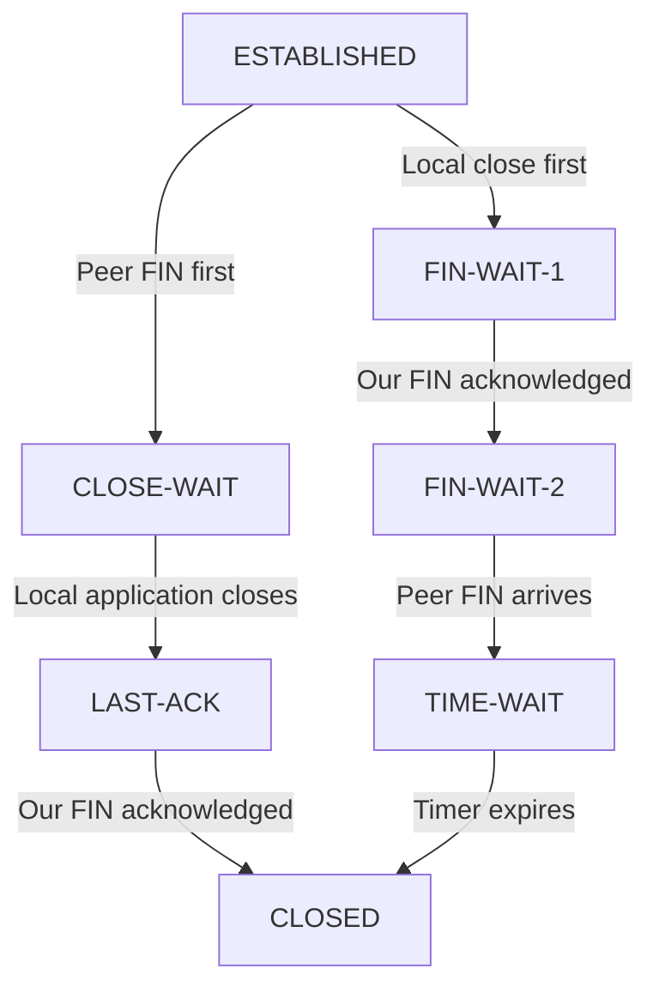

# 05 · Ports, sockets, TCP, and UDP

A dispatcher opens the shipment dashboard. The browser reaches the public edge on port 443. The edge tries to connect to the shipment API at `10.20.0.12:8443` and gets a refusal. On the API machine, a developer sees `127.0.0.1:8443 LISTEN`. How can a service be listening and still refuse the edge’s connection?

**The bind address matters as much as the port.** A TCP listener bound to `127.0.0.1:8443` accepts direct connections addressed to that loopback endpoint within its own network namespace. The edge in this example runs on another machine and connects to a different destination address. Binding to `0.0.0.0:8443` would also match the API machine’s other local IPv4 addresses. Which clients could then reach the listener would depend on routing, filtering, and any proxy or container port mapping in the path.

This lesson builds from that example to the TCP handshake, byte delivery, connection shutdown and UDP datagrams. It ends with a short experiment you can run on one computer.

**Course material** · [Checklist](https://chatgpt.com/library?file_id=libfile_a587b9ac4b10819195b004ce505754a5&account_id=personal) · [01 · Network layers and devices](https://chatgpt.com/library?file_id=libfile_e59488c781248191967d1805356b5448&account_id=personal) · [02 · IPv4, IPv6, and subnetting](https://chatgpt.com/library?file_id=libfile_af22e7b9a23c8191b1feead127e36897&account_id=personal) · [03 · Local networks](https://chatgpt.com/library?file_id=libfile_8693a991281481919c9bc67d8b8ffdf2&account_id=personal) · [04 · Routing and NAT](https://chatgpt.com/library?file_id=libfile_9037a1b2f728819192205007a9ef8f21&account_id=personal)

## 1. Read a transport endpoint

An IP destination tells the network where to deliver a packet. The IP header identifies the transport protocol, and the TCP or UDP header carries source and destination **port numbers**. The receiving operating system uses these fields, along with its socket bindings, to deliver data to the right socket. TCP port 443 and UDP port 443 are separate assignments. A host can serve both at once.

| Term | Meaning in this lesson | Shipment example |
| --- | --- | --- |
| Port | A 16-bit number in a transport protocol, from 0 to 65535 | The edge accepts TCP connections on port 443 |
| Endpoint | An address and port interpreted with their address family and transport | IPv4 TCP `203.0.113.80:443`. An IPv6 address with a port is written `[2001:db8:100::80]:443` |
| Socket | An operating-system communication endpoint that a process uses through a handle, usually a file descriptor on Unix | The API owns a listening socket and can own many accepted sockets |
| Ephemeral port | A local port allocated temporarily, commonly when a client starts a connection | The browser uses `51514` as its source port |
| Five-tuple | Protocol, source IP, source port, destination IP and destination port at one observation point | `TCP, 10.0.1.25, 51514, 203.0.113.80, 443` on the laptop’s LAN |

When TCP is already understood, people often say **four-tuple** for the two IP-and-port pairs of an established connection. A TCP listener can accept two clients on the same local port because their peer endpoints differ. A second connection from the same client IP to the same server endpoint normally has a different client port. One established connection can also carry many application requests.

### Which port should you expect?

| Service | Common destination | What to look for |
| --- | --- | --- |
| SSH | TCP 22 | An SSH transport exchange is evidence of SSH. A port number is only a clue |
| Conventional DNS | UDP 53 and TCP 53 | Many ordinary lookups use UDP. If a reply signals truncation, the client can retry over TCP. DNS can also use TCP from the start |
| HTTP | TCP 80 | The default port for an `http://` URL. The server can be configured to listen elsewhere |
| HTTPS | TCP 443 for HTTP/1.1 or HTTP/2 over TLS, commonly UDP 443 for HTTP/3 over QUIC | Check the negotiated protocol when explaining a browser request |
| Shipment API upstream | TCP 8443 in this deployment | The reverse proxy is configured to use TLS on this connection. The number 8443 alone makes no such guarantee |

IANA groups ports into system ports **0–1023**, user ports **1024–49151**, and dynamic/private ports **49152–65535**. Port 0 is reserved in the registry. In the sockets API, binding a new Internet socket to local port **0** asks the OS to choose an available port. The OS’s configured ephemeral range may differ from IANA’s dynamic range. Read the assigned port with `getsockname()`. [IANA port registry](https://www.iana.org/assignments/service-names-port-numbers/service-names-port-numbers.xhtml) · [Port range definitions](https://www.rfc-editor.org/rfc/rfc6335.html) · [DNS over TCP](https://www.rfc-editor.org/rfc/rfc7766.html)

## 2. Decide who can reach a listener

To **bind** a socket is to associate it with a local address and port. A **network namespace** contains interfaces, routes and transport sockets. A laptop usually presents one network namespace to ordinary applications. Containers can have separate ones. An address such as `127.0.0.1` refers back to the namespace of the process making the connection.

Assume the API machine owns IPv4 address `10.20.0.12`, and each row is a separate possible configuration.

| Bind address | Which local destinations match? | What it means for the edge |
| --- | --- | --- |
| `127.0.0.1:8443` | That IPv4 loopback address, in the API’s namespace | A proxy in that namespace can connect to `127.0.0.1:8443`. An edge on another host that uses `127.0.0.1` reaches its own loopback |
| `10.20.0.12:8443` | That specific local IPv4 address | A connection to `10.20.0.12:8443` can match. This bind does not select which client source IPs are allowed |
| `0.0.0.0:8443` | Any local IPv4 address in the namespace, including loopback | The edge can target `10.20.0.12:8443` if the path permits it. A client uses a concrete destination address |
| `[::1]:8443` | IPv6 loopback in that namespace | An IPv6 client in the same namespace can use `[::1]:8443` |
| `[::]:8443` | Local IPv6 addresses | Check the platform and the socket’s `IPV6_V6ONLY` setting. Some configurations also accept IPv4 through IPv4-mapped addresses |

**Direct reachability.** Work from a named client to a named destination. Confirm which IP family and protocol it uses, which namespace receives the packet, whether that local address and port match a running listener, and whether routing and filtering allow both directions. For a published container port, follow the host-to-container forwarding or proxy mapping to the **actual** destination inside the container. Publishing the host’s 8443 to the container’s 8080 will not select a service bound only to the container’s 8443.

**Indirect reachability.** A public reverse proxy in the API’s namespace may accept Internet traffic and then connect to the API’s loopback. Remote users can reach the application *through the proxy* while the API listener itself stays local. Containers in one Kubernetes Pod normally share a network namespace and can use one another’s loopback listeners. A process on the same node in a different namespace may have a different loopback. Assess authentication and authorization along the path that actually serves the request. [IPv4 socket bindings](https://man7.org/linux/man-pages/man7/ip.7.html) · [IPv6 socket behavior](https://man7.org/linux/man-pages/man7/ipv6.7.html) · [Kubernetes Pod networking](https://kubernetes.io/docs/concepts/workloads/pods/) · [Container port publishing](https://docs.docker.com/engine/network/port-publishing/)

## 3. Follow the sockets from browser to backend

| TCP server operation | What the OS or application does |
| --- | --- |
| `socket()` | Creates a stream socket for the address family and protocol |
| `bind()` | Selects its local address and listening port |
| `listen()` | Turns the socket into a passive listener. A backlog helps accommodate pending connections. It is separate from the total number of active clients |
| `accept()` | Returns a new connected socket and the peer’s address. The original socket keeps listening on the same port |
| Read, write, shut down, close | Exchanges bytes and releases the accepted socket when the conversation ends. Other accepted connections can continue |

The client usually calls `socket()` and `connect()`. The OS can choose its source address from the route and allocate an ephemeral source port. A blocking TCP `connect()` that succeeds tells the client that transport setup succeeded with the responding endpoint. The kernel can complete setup before the server application calls `accept()`. TLS verification, user authentication and the business operation come later. [Socket programming HOWTO](https://docs.python.org/3/howto/sockets.html) · [Accepting a connection](https://man7.org/linux/man-pages/man2/accept.2.html)

This distinction matters when planning capacity. A larger backlog can absorb a burst while the application gets around to accepting connections. Each accepted socket then needs resources such as a descriptor and buffers, even before the user signs in. Limits on concurrent connections, read deadlines and idle timeouts govern how long the service commits those resources.

### Which connection is in the log?

For this successful request, the API listens on `10.20.0.12:8443` and ingress policy permits the edge. The office uses port address translation. The public edge terminates TLS and makes a separate upstream connection. These are the address pairs from the earlier lessons.

| Observation point | Source → destination | How to interpret it |
| --- | --- | --- |
| Browser’s LAN | `10.0.1.25:51514` → `203.0.113.80:443` | Browser’s TCP connection to the edge |
| Public side of office NAT | `198.51.100.24:62001` → `203.0.113.80:443` | Same connection after the gateway rewrites the source endpoint |
| Edge’s upstream interface | `10.20.0.5:41002` → `10.20.0.12:8443` | A different TCP connection. Here the edge is the client |
| Accepted API socket | Local `10.20.0.12:8443`, peer `10.20.0.5:41002` | The API can identify the edge as its transport peer. To attribute a shipment action, use trusted request and session records |

If the edge reuses an upstream connection, several browser requests may correspond to one backend socket. A connection count, a request count and a signed-in user count answer three different questions.

## 4. Read a TCP handshake and a byte stream

TCP provides an ordered byte stream in each direction. The peers exchange initial **sequence numbers** during a three-way handshake. A sequence number identifies a byte position in one direction. An **acknowledgment number** names the next sequence position expected from the other direction. Each direction has its own numbering space.

For the arithmetic below, use a small example stream with client initial sequence number 1000 and server initial sequence number 7000. The numbers and byte counts are illustrative. Capture tools sometimes display relative numbers starting at zero.

| Step | Direction and flags | Sequence | Acknowledgment | Interpretation |
| --- | --- | ---: | ---: | --- |
| 1 | Client → server, SYN | 1000 | — | Client requests a connection. Its SYN consumes one sequence position |
| 2 | Server → client, SYN + ACK | 7000 | 1001 | Server acknowledges the client’s SYN and sends its own |
| 3 | Client → server, ACK | 1001 | 7001 | Client acknowledges the server’s SYN. A pure ACK consumes no sequence position |
| 4 | Client → server, 80 data bytes + ACK | 1001 | 7001 | Client data occupies positions 1001 through 1080 |
| 5 | Client → server, 40 data bytes + ACK | 1081 | 7001 | The next 40 bytes occupy positions 1081 through 1120 |
| 6 | Server → client, ACK | 7001 | 1121 | The server TCP has received the contiguous sequence through 1120. Its application may still be waiting to read it |

A TCP header also carries flags, the receive window and a checksum. Options exchanged during setup can advertise how much TCP data a peer is prepared to receive in one segment (its maximum segment size, or MSS), enable window scaling, and indicate support for selective acknowledgments (SACK). An application message can span many segments.

**Retransmission.** Suppose step 4 is lost and step 5 arrives first. The receiver can buffer the 40 later bytes, but its cumulative ACK remains **1001** because byte 1001 is still missing. If SACK was negotiated, it can also report the later range it holds. The sender can retransmit missing bytes when loss is inferred from acknowledgments or when a retransmission timer expires. The timeout is based on observed round-trip times and backs off after repeated timeouts. After the missing bytes arrive, the cumulative ACK can advance to **1121**. The application sees an ordered stream with duplicate transport bytes removed.

**Framing.** TCP preserves byte order across the connection. The boundaries between application writes can change on reads. A sender that writes `b"OK\n"` and `b"NEXT\n"` could produce reads of `b"OK\nNE"` and `b"XT\n"`. A stream protocol must define how a receiver recognizes a complete message, for example with a length field, delimiter, or protocol-defined frame. A parser needs to handle a partial frame and several frames arriving together. Check declared lengths before allocating storage. TLS records and WebSocket frames each define their own boundaries above the transport.

**Why a retry can create two shipments.** A successful socket write can mean bytes entered a local send buffer. A TCP ACK can mean the peer’s transport received them. A service may commit a `POST /shipments` and lose the connection before its response reaches the browser. The browser then has an uncertain outcome. A retry with the same application-level idempotency key, where the API implements one, can recover the original result. TCP retransmits bytes within a connection. Retrying an HTTP operation creates a separate application request. [TCP specification](https://www.rfc-editor.org/rfc/rfc9293.html) · [TCP selective acknowledgments](https://www.rfc-editor.org/rfc/rfc2018.html) · [TCP retransmission timer](https://www.rfc-editor.org/rfc/rfc6298.html) · [HTTP retry semantics](https://www.rfc-editor.org/rfc/rfc9110.html#section-9.2.2)

## 5. Explain why a TCP sender slows down

| Mechanism | What limits the sender? | Evidence you might see |
| --- | --- | --- |
| **Flow control** | The receiver advertises a receive window (`rwnd`) based on the space it is prepared to accept. A slow application reader can fill its socket buffer | A shrinking advertised window or a zero-window advertisement |
| **Congestion control** | The sender maintains a congestion window (`cwnd`) to limit outstanding data based on its estimate of path capacity. Different algorithms respond to delivery, loss, delay or explicit congestion signals | Sender-side congestion-window changes, changes in flight size, or retransmissions |
| **Application backpressure** | Producers and consumers above the socket have their own queues and processing rates | A growing queue of shipment events, increasing memory use or a UI that falls behind while the network connection remains healthy |

For a simplified established connection, new data in flight is bounded by the smaller of `rwnd` and `cwnd`. If the receiver offers **64 KiB**, the sender’s congestion window is **24 KiB**, and **16 KiB** is already in flight, the sender has roughly **8 KiB** of room before either window advances. Actual sending also depends on queued data, pacing and acknowledgments. A zero advertised receive window and a congested path call for different investigations.

On the dashboard, the browser may accept WebSocket data while JavaScript is still rendering older updates. The classic browser `WebSocket` API provides no automatic incoming-message backpressure. Its `bufferedAmount` measures **outgoing** data queued by `send()`. If shipment events arrive too fast, bound application queues. Coalescing by shipment ID works for replaceable state snapshots. For required transitions, use sequence tracking and a way to recover missing events. [TCP congestion control](https://www.rfc-editor.org/rfc/rfc5681.html) · [Browser WebSocket behavior](https://developer.mozilla.org/en-US/docs/Web/API/WebSocket) · [WebSocket bufferedAmount](https://developer.mozilla.org/en-US/docs/Web/API/WebSocket/bufferedAmount)

## 6. Close a TCP connection and interpret its state

TCP is **full duplex**. Each direction closes independently. A **FIN** says the sender has finished its byte stream in that direction. Once earlier bytes have been delivered, the peer sees end-of-stream on a positive-length read. The peer can still send its own remaining data. A client can explicitly do this with `shutdown(SHUT_WR)`, a *half-close*. An **RST** signals a reset and can abort the connection abruptly. An application that sees a reset should treat any unfinished request outcome as uncertain.

Continue the sequence numbers from section 4. The client’s 120 data bytes ended at 1120. Its FIN uses sequence **1121**, so the server acknowledges **1122**. The server can still send a 30-byte reply at sequences **7001–7030**. Its FIN then uses **7031**, which the client acknowledges with **7032**. FIN and ACK flags can travel in the same segment, so the exact packet count varies.

The diagram follows **one endpoint**. Choose the left or right branch according to which application initiates the close.



| State or event | What it means when investigating a service |
| --- | --- |
| `LISTEN` | A passive socket is available. It has no established peer yet |
| `SYN-SENT` / `SYN-RECEIVED` | Connection setup is in progress. The active opener is waiting for a response, or the responder is waiting for the final acknowledgment |
| `ESTABLISHED` | Transport setup completed. The application may still be negotiating TLS, waiting for work, or stalled |
| `CLOSE-WAIT` | This host received the peer’s FIN. Its application still holds its side open. A growing collection of long-lived entries is a reason to inspect socket cleanup |
| `FIN-WAIT-1` / `FIN-WAIT-2` | This host initiated the close. Its FIN is awaiting acknowledgment, or has been acknowledged and the host awaits the peer’s FIN |
| `LAST-ACK` / `CLOSING` | The passive closer is waiting for its FIN to be acknowledged, or the two FINs crossed during simultaneous close |
| `TIME-WAIT` | Usually the active closer retains enough state to handle a repeated peer FIN and keep delayed old segments apart from a later connection. It can persist after the application closes its handle |

A dashboard WebSocket that disappears after a fixed idle interval might encounter a proxy timeout or an expired network mapping. TCP keepalive probes can test whether an idle peer still responds at the transport layer. HTTP connection reuse lets later requests use an existing connection. An application heartbeat can check whether the service responds at its own protocol layer. Compare the timing and the endpoint that first sent a FIN or RST with proxy and application logs. [TCP connection states and closing](https://www.rfc-editor.org/rfc/rfc9293.html#section-3.6)

## 7. Read a UDP datagram and compare the transports

UDP sends **datagrams**, each with its own message boundary. Its 8-byte header contains the source port, destination port, length and checksum. A datagram with 24 bytes of application data has a UDP length of **32 bytes**. The checksum can detect corruption. It supplies no proof of sender identity. It can be omitted in IPv4 and is normally required for UDP over IPv6.

A typical UDP server binds a datagram socket and calls `recvfrom()`. Each ordinary receive returns one datagram and its source address. It can reply with `sendto()`. If the receive buffer supplied for that call is too small, excess bytes can be discarded and the API may report truncation. A later receive reads the next datagram. A zero-length UDP datagram is a valid message. By contrast, a stream `recv()` that requested at least one byte and returns zero bytes reports end-of-stream.

A UDP client can also call `connect()`. For a normal Internet datagram socket, this selects a default peer and filters received datagrams to that peer. It performs no transport handshake. Success does not tell you whether a remote application is listening. A stateful firewall or NAT can still create temporary state when datagrams pass through it. [UDP specification](https://www.rfc-editor.org/rfc/rfc768.html) · [UDP socket behavior](https://man7.org/linux/man-pages/man7/udp.7.html) · [IPv6 upper-layer checksums](https://www.rfc-editor.org/rfc/rfc8200.html#section-8.1)

| Property | TCP | UDP |
| --- | --- | --- |
| What the application receives | An ordered sequence of bytes in each direction. The application defines message boundaries | Individual datagrams. Loss, duplication and reordering are possible |
| Setup and shutdown | The peers establish connection state. FIN and RST communicate shutdown or reset | No built-in handshake or close exchange. A local socket can be closed independently |
| Loss and pacing | TCP retransmits, orders data, and applies flow and congestion control | UDP supplies none of those services itself. The protocol using UDP chooses its recovery and congestion behavior |
| Consequence of one missing unit | Later bytes in the same direction wait for the gap to be filled before ordered delivery | A later datagram can be delivered despite a missing earlier one |
| Evidence at the sender | A TCP ACK reports receipt by the peer’s transport | Successful `sendto()` commonly means the local stack accepted a datagram. Delivery evidence must come from another source |

**Size matters for datagrams.** Using the previous lesson’s 1,420-byte inner IP MTU, an IPv4 UDP packet fits **1,392 bytes** of UDP payload with a 20-byte IP header and an 8-byte UDP header. IPv6 fits **1,372 bytes** with its 40-byte base header and no extension headers. A large datagram that requires fragmentation becomes vulnerable to loss of any one fragment. A protocol that uses UDP should choose sizes and sending rates suitable for its path and handle missing or duplicate messages as its application requires. [UDP usage guidelines](https://www.rfc-editor.org/rfc/rfc8085.html)

### How can HTTP/3 be reliable over UDP?

In typical browser deployments, HTTP/1.1 and HTTP/2 over HTTPS use TLS over TCP. HTTP/2 multiplexes request streams over one TCP connection, so a gap in that TCP byte stream can delay delivery for several requests.

HTTP/3 uses **QUIC over UDP**. QUIC integrates TLS 1.3 and implements loss recovery, congestion control, flow control, and ordered delivery within its reliable streams. Missing data on one stream does not by itself require ordered delivery on another stream to wait. Streams still share connection and network resources. An operating-system listing may therefore show a UDP socket on port 443 while a browser shows a reliable HTTP/3 response. A policy allowing TCP 443 and dropping UDP 443 can affect those two paths differently. [HTTP/2](https://www.rfc-editor.org/rfc/rfc9113.html) · [QUIC transport](https://www.rfc-editor.org/rfc/rfc9000.html) · [HTTP/3](https://www.rfc-editor.org/rfc/rfc9114.html)

## 8. Inspect a listener and interpret failures

These commands inspect **local** sockets. Run them in the namespace or container that owns the service. On a shared machine the OS may restrict which process names or sockets your account can see. The `-n` or `-nP` flags keep addresses and ports numeric where applicable.

| Question | Linux | macOS |
| --- | --- | --- |
| Which TCP sockets are listening? | `ss -lntp` | `lsof -nP -iTCP -sTCP:LISTEN` |
| Which TCP connections are established? | `ss -ntp state established` | `lsof -nP -iTCP -sTCP:ESTABLISHED` |
| Which UDP sockets are present? | `ss -aunp` | `lsof -nP -iUDP` |
| Is the API listening specifically on TCP port 8443? | `ss -lntp 'sport = :8443'` | `lsof -nP -iTCP:8443 -sTCP:LISTEN` |

A UDP socket may be displayed as `UNCONN` and still receive datagrams. In a local socket listing, an asterisk for the peer on a listener means no particular remote endpoint has been selected. The local address and family tell you which destinations the listener matches. [Linux ss manual](https://man7.org/linux/man-pages/man8/ss.8.html) · [lsof options](https://man7.org/linux/man-pages/man8/lsof.8.html)

Try reading these selected columns from two example snapshots of the API host. In the second snapshot the service was rebound and the edge connected.

| Snapshot | State | Local endpoint | Peer endpoint | Interpretation |
| --- | --- | --- | --- | --- |
| Before | `LISTEN` | `127.0.0.1:8443` | `0.0.0.0:*` | The wildcard is in the **peer** column. The bind is loopback-only |
| After | `LISTEN` | `10.20.0.12:8443` | `0.0.0.0:*` | New connections to the API’s private address can match |
| After | `ESTAB` | `10.20.0.12:8443` | `10.20.0.5:41002` | A separate connected socket on the same server port belongs to the edge connection |

| Observation | What the evidence establishes | What to inspect next |
| --- | --- | --- |
| Server startup reports “address already in use” | Its attempted bind conflicted with local socket state | Check the requested address, protocol and namespace, including any wildcard listener that covers that address |
| Name resolution fails before any connection attempt | The client lacks a usable destination from that lookup | Resolver output, address family and the name the app actually used |
| TCP connection refused | The attempt received an active refusal, often a reset for a destination with no matching TCP listener. Filtering policy can also reject explicitly | Destination IP, family, protocol, listener binding and policy at the time |
| TCP connect times out | Setup did not finish by the deadline. Silent filtering, loss, an unavailable return path or an overloaded endpoint can look similar | Whether the SYN and any reply appeared at the client, edge and destination |
| Established connection resets | A reset ended the transport abruptly. A peer or an intermediary can be involved | Which side observed the first reset, what data preceded it, and whether a deployment or timeout coincided |
| TCP connects, then certificate validation fails | A TCP peer responded and TLS validation encountered a problem | Hostname, certificate chain and the component terminating TLS |
| The browser receives HTTP 403 over the expected TLS connection | An HTTP responder processed enough of this request to deny it | Identify the proxy or application that issued the response and examine its access policy |
| UDP request gets no reply | No matching response arrived by that deadline. UDP has no connection refusal handshake | Protocol-specific server behavior, socket binding, return path, and any ICMP error associated with this datagram |

**Resolve the opening case.** The edge connects to TCP `10.20.0.12:8443` while the API listens on TCP `127.0.0.1:8443`. Under ordinary routing the destination does not match that listener. If the design calls for a separate trusted edge, one option is to bind the API to `10.20.0.12:8443` and permit inbound TCP 8443 only from the intended edge. If the public proxy runs alongside the API in the same namespace, it can instead target `127.0.0.1:8443`. In either design, the API still needs to authorize the caller to access the particular shipment.

## 9. Run a local socket experiment

**Predict first.** When a server accepts a connection, will the accepted socket have a new server port? If a TCP client sends two writes and half-closes, can it still receive a reply? What will an empty UDP datagram look like?

Run the following as a Python 3 script. It uses only the standard library, binds IPv4 loopback, and asks the OS for free ports. The TCP and UDP parts run sequentially on one computer. The small `recv(3)` deliberately lets the receiver consume at most three stream bytes per read.

```python
from socket import AF_INET, SHUT_WR, SOCK_DGRAM, SOCK_STREAM, socket


def read_to_eof(connection):
    parts = []
    while True:
        chunk = connection.recv(3)
        if not chunk:
            return b"".join(parts)
        parts.append(chunk)


with socket(AF_INET, SOCK_STREAM) as listener, socket(AF_INET, SOCK_STREAM) as client:
    listener.settimeout(5)
    client.settimeout(5)
    listener.bind(("127.0.0.1", 0))
    listener.listen(1)
    client.connect(listener.getsockname())
    accepted, peer = listener.accept()

    with accepted:
        accepted.settimeout(5)
        print("Same server endpoint:", accepted.getsockname() == listener.getsockname())
        print("Peer matches client endpoint:", peer == client.getsockname())
        client.sendall(b"PACK")
        client.sendall(b"ED\n")
        client.shutdown(SHUT_WR)
        print("TCP stream:", read_to_eof(accepted))
        accepted.sendall(b"OK")

    print("Reply after half-close:", read_to_eof(client))

with socket(AF_INET, SOCK_DGRAM) as receiver, socket(AF_INET, SOCK_DGRAM) as sender:
    receiver.settimeout(5)
    receiver.bind(("127.0.0.1", 0))
    messages = []
    for payload in (b"PACK", b"ED\n", b""):
        sender.sendto(payload, receiver.getsockname())
        message, peer = receiver.recvfrom(64)
        messages.append(message)
    print("UDP datagrams:", messages)
```

### Expected output on loopback

```text
Same server endpoint: True
Peer matches client endpoint: True
TCP stream: b'PACKED\n'
Reply after half-close: b'OK'
UDP datagrams: [b'PACK', b'ED\n', b'']
```

The server retained its listening port and acquired a separate connected socket. The TCP reader reconstructed seven ordered bytes and saw EOF after the client finished writing. The client then read the server’s reply. The UDP receiver made three independent receives, including one valid empty datagram. The experiment waits for each datagram before sending the next so its output does not depend on a network ordering guarantee.

Change the stream reader’s `recv(3)` to `recv(1)` or `recv(64)`. The printed stream and reply stay the same because `read_to_eof()` collects every chunk. The size you pass to `recv()` is the maximum number of bytes to return in a call.

## 10. Check your understanding

1. A teammate on another laptop types `https://127.0.0.1:8443` to reach your development API. Which network stack receives that connection? Under what arrangement could remote users still reach an API bound to your loopback?
2. A process listens on `0.0.0.0:8443`. Can you conclude that it accepts IPv6 connections or that it is reachable from the Internet?
3. Two browsers open separate TCP connections to one API on port 443 and a third uses UDP 443. How does the OS distinguish the traffic?
4. The server received 40 bytes beginning at sequence 1081, but bytes 1001–1080 are missing. What cumulative ACK can it send, and when can it deliver those later bytes through the stream?
5. A receiver advertises 64 KiB, the congestion window is 24 KiB, and 16 KiB is in flight. What limits new data here? Which mechanism would signal an application that stopped draining its receive buffer?
6. One side sent a FIN. Can the peer still send a reply? What could many persistent `CLOSE-WAIT` entries tell you?
7. A call to UDP `connect()` succeeded and the next request received no response. What do you know about the remote listener?
8. The dashboard timed out after submitting a shipment. Which evidence could establish that the shipment was created?

### Answers

1. The teammate’s loopback belongs to the teammate’s namespace. A reachable intermediary in your API’s namespace, such as a reverse proxy with a public listener, can accept remote requests and open a separate loopback connection to your API.
2. The bind covers local IPv4 destinations in that namespace. Check the IPv6 listener separately. For Internet reachability, trace the address, protocol, routes, forwarding mappings and firewall policy from an external client.
3. TCP and UDP have separate port spaces. Within TCP, the local and peer address-and-port pairs distinguish established connections. A listener remains available for new connections while its accepted sockets carry existing ones.
4. It can continue acknowledging **1001** and, with negotiated SACK, report the later block. When the gap is filled it can deliver the contiguous bytes in order and acknowledge **1121**.
5. Congestion control is the tighter constraint in this snapshot, leaving roughly **8 KiB**. A receiver running out of buffer space advertises a smaller receive window through flow control.
6. Yes. A FIN closes one direction. Long-lived `CLOSE-WAIT` entries mean the local application still holds sockets whose peers finished sending. Inspect whether the program is still legitimately producing output or has missed a cleanup path.
7. The local socket selected its peer. A missing reply leaves several possibilities, including loss, a silent service, filtering, or no listener. A valid protocol-level response or correlated server-side observation gives stronger evidence.
8. An authenticated lookup of the resulting shipment, a durable application record correlated with the request, or the API’s stored idempotency result can establish the outcome. The transport ACK and the client timeout alone cannot.
