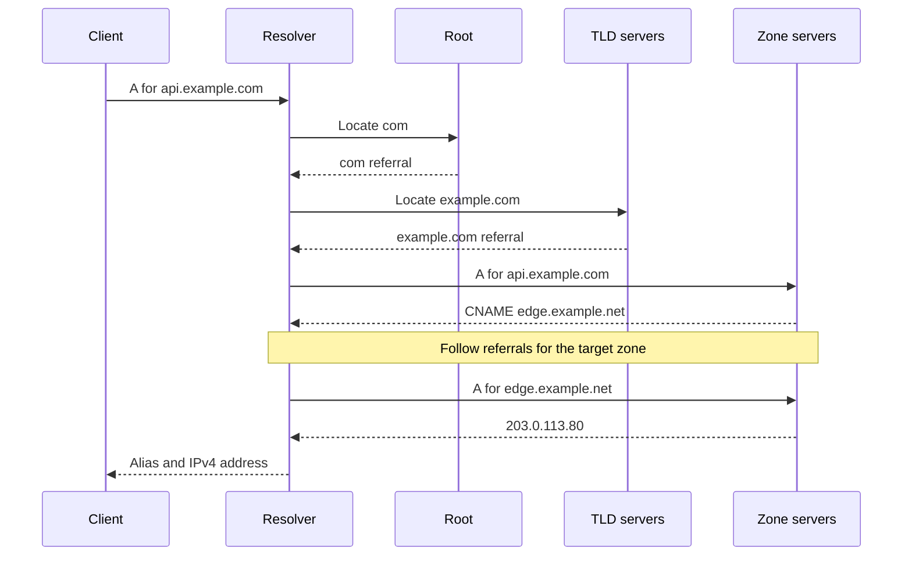

# 06 · DNS and service discovery

A developer’s laptop looks up `api.example.com` and gets `203.0.113.80`. At the same moment, a shipment worker in production looks up the same name and gets `10.20.0.8`. Both HTTPS requests succeed. Which DNS answer is correct?

**Both can be correct.** The laptop may see a public DNS view that sends it to the Internet-facing edge. Production may see a private view that sends it to an internal ingress. Even two clients using the same public view can temporarily get different answers after an address change because their resolvers cached the record at different times. To distinguish these cases, record **the exact name and record type, the resolver used, the answer and its remaining lifetime, and the address the application actually connected to**.

This lesson follows `https://api.example.com/shipments` from a lookup through a DNS change and an incident investigation. The names and addresses below form a fictional deployment. The public edge addresses match the earlier lessons. The private ingress at `10.20.0.8` is an additional example endpoint.

**Course material** · [Networking checklist](https://chatgpt.com/library?file_id=libfile_a587b9ac4b10819195b004ce505754a5&account_id=personal) · [01 · Network layers and devices](https://chatgpt.com/library?file_id=libfile_e59488c781248191967d1805356b5448&account_id=personal) · [02 · IPv4, IPv6, and subnetting](https://chatgpt.com/library?file_id=libfile_af22e7b9a23c8191b1feead127e36897&account_id=personal) · [03 · Local networks](https://chatgpt.com/library?file_id=libfile_8693a991281481919c9bc67d8b8ffdf2&account_id=personal) · [04 · Routing and NAT](https://chatgpt.com/library?file_id=libfile_9037a1b2f728819192205007a9ef8f21&account_id=personal) · [05 · Ports, sockets, TCP, and UDP](https://chatgpt.com/library?file_id=libfile_7565d39efd548191a4143e5087d272ef&account_id=personal)

## 1. What question does DNS answer?

The **Domain Name System (DNS)** is a distributed database of typed records under names. In the shipment URL, the hostname is `api.example.com`. An address lookup can ask for its IPv4 addresses with type **A**, or its IPv6 addresses with type **AAAA**. The scheme `https`, path `/shipments`, query parameters, cookies and user identity are outside that address lookup.

| Part of a DNS question | Example | Why it matters |
| --- | --- | --- |
| QNAME, the queried name | `api.example.com.` | The final dot represents the root and makes the name absolute |
| QTYPE, the requested record type | `A` | A separate AAAA query can have a different answer, or have no data |
| QCLASS, the record class | `IN` | Internet is the class used in these examples |

Read the name from right to left. Start at the root `.`, then move to the top-level domain `com.`, the domain `example.com.`, and finally `api.example.com.`. The leftmost label can name a service with several addresses or an alias. An unqualified name such as `api` can acquire a search suffix supplied by the OS, VPN or container. Two programs that display the string `api` might therefore ask different DNS questions.

After lookup, the client chooses an address, gets a route, opens a transport connection, and verifies the TLS identity for the hostname in the URL. An answer can be correct while routing, port 443, certificate verification or the HTTP request fails. A browser reusing an existing connection may send the request without a fresh lookup. [DNS terminology](https://www.rfc-editor.org/rfc/rfc9499.html) · [TLS service identity](https://www.rfc-editor.org/rfc/rfc9525.html)

## 2. Who answers, and who owns the answer?

| Role | What it does for the shipment lookup |
| --- | --- |
| Application and stub resolver | The browser or runtime asks for addresses. It may use the OS resolver, an application cache, or a configured secure DNS service |
| Recursive resolver | Accepts the client’s question, checks its cache and obtains the final result. Our laptop uses `192.0.2.53` |
| Forwarder | Passes a question to another resolver. A company can forward selected private domains to corporate DNS and other names to an upstream recursive service |
| Root and top-level domain (TLD) servers | Supply **referrals** that say which nameservers are responsible for the next delegated zone |
| Authoritative nameserver | Serves the published data for a zone it hosts. A recursive resolver can cache its answer and later return it to many clients |

A **domain** is a branch of the namespace. A **zone** is the part administered as one unit, down to any delegated children. If `example.com.` delegates `ops.example.com.`, the parent publishes NS records referring clients to the child’s nameservers. The child serves its own records, including its apex NS and SOA records. Creating a name such as `api.example.com.` inside a zone does not by itself create another zone.

**Glue solves a bootstrap problem.** Suppose the `.com` delegation lists `ns1.example.com.` as a server for `example.com.`. How would a resolver find that server’s address before it could enter the child zone? The parent can include its address as *glue* with the referral. That address helps the resolver reach the child authority. The registrar typically provides the domain owner’s way to change parent delegation settings, while the DNS hosting provider serves the child zone. The two roles can be operated by different companies. [DNS concepts and delegation](https://www.rfc-editor.org/rfc/rfc1034.html) · [Glue in referral responses](https://www.rfc-editor.org/rfc/rfc9471.html)

### Follow a lookup with an empty cache

Assume the resolver knows how to reach a root server, has no cached referrals or answers for this example, and performs iteration itself. The public zone holds a CNAME from `api.example.com.` to `edge.example.net.`. The target zone holds the address. The diagram groups multiple TLD servers and multiple zone servers by role.



The client requests **recursion** by asking the resolver to finish the job. The resolver uses **iteration** when it receives a referral and asks the next server itself. In the second part of the diagram it follows the root and `.net` referrals to the authority for `example.net.`. With a warm cache it can start from a known delegation, reuse a still-valid target address, or answer the client immediately. With *QNAME minimisation*, the resolver can send an upstream server only the portion of the name it needs at that stage. [Resolver algorithm](https://www.rfc-editor.org/rfc/rfc1034.html#section-5.3.3) · [QNAME minimisation](https://www.rfc-editor.org/rfc/rfc9156.html)

## 3. Read the records behind a service

A **resource record (RR)** has an owner name, a time to live (TTL) in seconds, a class, a type and type-specific data. The records with the same owner, class and type form a **record set (RRset)**. One name can have several A records and a separate AAAA set. Returning several addresses gives the client candidates. It does not guarantee that every candidate is healthy or that clients select them in the listed order.

These are three public records in zone-file notation. The first is published in `example.com.` and the other two in `example.net.`.

```text
api.example.com.    300  IN  CNAME  edge.example.net.
edge.example.net.   120  IN  A      203.0.113.80
edge.example.net.   120  IN  AAAA   2001:db8:100::80
```

| Type | What the data means | Example or consequence |
| --- | --- | --- |
| A / AAAA | IPv4 or IPv6 addresses of the owner | The public edge above serves both families. An AAAA question can travel over an IPv4 connection to the resolver |
| CNAME | The owner is an alias for another DNS name | `api.example.com.` points to `edge.example.net.`. The alias and target address have independent TTLs |
| NS | Names of the authoritative servers for a zone or delegated child | The parent’s delegation and the child zone’s apex NS set should identify the intended servers |
| SOA | Zone metadata including a primary nameserver name, responsible mailbox, serial number and timing fields | Secondaries use the serial when checking for updates. The SOA also supplies information used in negative caching |
| MX | Mail exchanger preference and target hostname | `10 mail.example.com.` is preferred to an available target with preference 20. The sending mail system still needs the exchanger’s address |
| TXT | Text interpreted by the consuming protocol or service | Domain verification and email policies use TXT. Public TXT values are readable by anyone querying that data |
| PTR | A name associated with an address in a reverse DNS zone | IPv4 uses `in-addr.arpa.` and IPv6 uses `ip6.arpa.`. Treat a reverse name as a label supplied by that zone’s operator |
| SRV | Priority, weight, port and hostname for a named service and transport | An SRV-aware client can discover a nondefault port. Lower priority values are preferred, and weights guide selection within the same priority |
| CAA | Which certificate authorities may issue certificates for the applicable domain under CAA policy | This constrains issuance. The HTTPS client still validates the certificate it receives |
| HTTPS / SVCB | Service bindings and connection parameters for clients that support them | An HTTPS record can advertise protocol options such as HTTP/3. The URL continues to identify the requested origin |

**Two CNAME details explain many surprises.** An ordinary CNAME owner cannot also carry ordinary A, AAAA, MX or TXT data at that same name in the same view. DNSSEC metadata has special rules. A zone apex already needs SOA and NS records, so providers that offer an “alias at the apex” often synthesize address answers using a provider-specific feature. Second, a DNS alias leaves the browser’s URL intact. For the public example the browser still verifies TLS for `api.example.com` and uses that hostname in the HTTP authority. An HTTP redirect would be a later application response. [DNS record formats](https://www.rfc-editor.org/rfc/rfc1035.html) · [RRsets and aliases](https://www.rfc-editor.org/rfc/rfc2181.html) · [SRV](https://www.rfc-editor.org/rfc/rfc2782.html) · [CAA](https://www.rfc-editor.org/rfc/rfc8659.html) · [HTTPS and SVCB records](https://www.rfc-editor.org/rfc/rfc9460.html)

## 4. Read a DNS reply before drawing a conclusion

Here is a condensed `dig` reply from the fictional public resolver. Its cache has already held both records for 60 seconds.

```text
;; ->>HEADER<<- opcode: QUERY, status: NOERROR, id: 4200
;; flags: qr rd ra; QUERY: 1, ANSWER: 2, AUTHORITY: 0, ADDITIONAL: 0
;; QUESTION SECTION:
;api.example.com.        IN  A

;; ANSWER SECTION:
api.example.com.   240   IN  CNAME  edge.example.net.
edge.example.net.   60   IN  A      203.0.113.80
```

Start with the **question** to confirm the name, type and class. Read the response code, flags and **answer** together. An **authority** section may contain NS records for a referral or an SOA for a negative answer. **Additional** data can include glue or an EDNS OPT pseudo-record. In this reply the alias has 240 seconds left and the target’s A record has 60. The query ID helps pair a response with a question. It does not establish who is authorized to publish the records.

| Flag | Meaning |
| --- | --- |
| `qr` | This message is a response |
| `rd` / `ra` | Recursion was desired by the requester / is available at the responding server. Neither flag tells you whether this answer came from cache |
| `aa` | The responder identifies itself as authoritative for the name at issue. An authoritative reply containing an alias can refer to data in another zone |
| `tc` | The message was truncated. The client needs a complete response, typically by retrying a classic UDP query over TCP |
| `ad` | A validating resolver asserts authenticated DNS data. Rely on that assertion only across a trusted path to that resolver |

| Result | Interpretation |
| --- | --- |
| `NOERROR` and an answer RRset | DNS returned data for the question, possibly after following an alias |
| `NOERROR` with no requested data, and a negative SOA from the relevant authority | **NODATA**. The name exists but lacks that type in this view. A private API can have A and no AAAA. The numeric response code remains NOERROR |
| `NOERROR` with a referral | The authority section directs the resolver to a child zone. An empty answer section alone is insufficient to infer NODATA |
| `NXDOMAIN` | The name does not exist in this view. If the reply includes a CNAME, the missing name can be the terminal target even though the alias exists |
| `SERVFAIL` | Resolution failed. An unreachable authority, inconsistent delegation or failed DNSSEC validation are possibilities. There is no conclusion about the name’s existence |
| `REFUSED` | The server declined this operation under its policy. A resolver may restrict recursion to particular clients |
| Timeout | The client received no usable reply by its deadline. There is no DNS response code to interpret |

Compare the public answer with a private resolver’s reply to an **AAAA** question. A blank result from `dig +short` would hide the difference between this and NXDOMAIN.

```text
;; ->>HEADER<<- opcode: QUERY, status: NOERROR, id: 4201
;; flags: qr rd ra; QUERY: 1, ANSWER: 0, AUTHORITY: 1, ADDITIONAL: 0
;; QUESTION SECTION:
;api.example.com.        IN  AAAA

;; AUTHORITY SECTION:
example.com.  120  IN  SOA  ns1.private.example.com. hostmaster.example.com. 42 3600 600 86400 120
```

Here the negative SOA belongs to the private zone. The first `120` is the returned TTL. The SOA data then names the primary server, encodes the contact mailbox (`hostmaster@example.com`), and gives serial **42**, refresh **3600**, retry **600**, expire **86400**, and MINIMUM **120**. The refresh, retry and expire fields concern secondary servers. The negative-cache calculation uses the SOA TTL and MINIMUM. [DNS message fields and SOA format](https://www.rfc-editor.org/rfc/rfc1035.html) · [Negative answers](https://www.rfc-editor.org/rfc/rfc2308.html)

## 5. Predict what a cache will return

A TTL is the ordinary reuse lifetime of a cached RRset, counted from when that cache learned it. Each recursive resolver can fill its cache at a different time. Applications and OS resolvers may also cache results. An edit at an authoritative server does not push a replacement into those caches. An authoritative data change, a DNS cache expiry and the end of an existing HTTPS connection are three separate events.

### A public address changes

Assume the authoritative servers already agree, no prefetch or serve-stale policy is active, and the resolver keeps records for their published TTLs. Time is shown in seconds from the first lookup.

| Time | Event | What the client can receive |
| --- | --- | --- |
| `t=0` | Resolver A caches the 300-second CNAME and the 120-second A record for `203.0.113.80` | The alias and `.80` |
| `t=30` | The target zone changes its A record to `203.0.113.81` | Resolver A can still serve `.80` for another 90 seconds |
| `t=60` | A client asks Resolver A, while another asks a public resolver with an empty cache | Resolver A returns `.80` with TTL 60. The fresh resolver can return `.81` with TTL 120 |
| `t=120` | Resolver A receives another query | Its target A has expired, so it can fetch `.81`. Its original CNAME still has 180 seconds left |

For a planned cutover, lower a long TTL early enough that copies cached with the **old** TTL can age out. Keep both service endpoints functional through the overlap when possible. Changing the TTL from an hour to a minute at cutover does not shorten a one-hour answer issued just before the edit. Some resolvers cap TTLs, refresh proactively or, under defined failure conditions, serve stale data. An existing HTTP/2, HTTP/3 or WebSocket connection can also keep using the old peer after DNS has refreshed.

If two authoritative servers for the **same view** still disagree, compare their SOA serials and the RRset each actually serves. Publication to secondary servers happens separately from expiry in recursive caches. A stale secondary can give a resolver a fresh TTL on old data. [Serving stale DNS data](https://www.rfc-editor.org/rfc/rfc8767.html) · [DNS server roles](https://www.rfc-editor.org/rfc/rfc9499.html)

### A newly created name still looks missing

Negative results can also be cached. For an authoritative negative with an SOA, its cache lifetime is the smaller of the SOA record’s own TTL and the SOA’s **MINIMUM** field. Suppose those values are **600** and **120** seconds. The negative lifetime is **120 seconds**. The SOA returned with that negative answer has its TTL reduced accordingly.

A resolver gets NXDOMAIN for `preview.example.com.` at `t=10`. The team creates the name at `t=40`. At `t=60`, the resolver can still return the cached negative for **70 more seconds**. At `t=130` it can look up the new record. A fresh resolver can find it sooner. An NXDOMAIN result concerns the missing name across record types in that class. NODATA concerns the particular name **and** requested type. An AAAA NODATA result does not invalidate a usable A record.

Resolution failures can also be cached briefly to prevent repeated failing work. A cached SERVFAIL still means resolution failed. It does not become authoritative evidence of absence. [Negative cache keys and TTLs](https://www.rfc-editor.org/rfc/rfc2308.html#section-5) · [Caching of resolution failures](https://www.rfc-editor.org/rfc/rfc9520.html)

## 6. Compare the laptop’s view with production

**Split DNS**, also called *split-horizon DNS*, lets different populations receive different DNS data for the same name. An organization might serve a private copy of a zone internally, or use a resolver that forwards certain suffixes to an internal authority. A VPN can install a rule that directs queries for one domain to corporate DNS. The route used for the DNS query and the route later used to reach the API are separate decisions. [Split DNS terminology](https://www.rfc-editor.org/rfc/rfc9499.html)

| Observation before the cutover | Developer laptop | Production shipment worker |
| --- | --- | --- |
| Question | `api.example.com. IN A` | `api.example.com. IN A` |
| Resolver used | `192.0.2.53`, public view | `10.20.0.53`, private view |
| Answer | `api.example.com.` CNAME `edge.example.net.`, then A `203.0.113.80` | A `10.20.0.8`, an internal HTTPS ingress |
| Separate AAAA lookup | CNAME, then `2001:db8:100::80` | NOERROR with NODATA in this example |
| TLS reference hostname | `api.example.com` | `api.example.com` |

Both ingress endpoints must present a certificate valid for the service hostname for these HTTPS calls to succeed. The private ingress can forward requests to the protected shipment service. Knowing its private address alone grants no access to a shipment.

### Other reasons answers or connections differ

- **Different questions.** An unqualified `shipments` can expand to a cluster service name in a production container. Compare the fully qualified name and record type.
- **Different lookup mechanisms.** An OS can consult its hosts file before DNS. A browser can use its own DNS service. A forward proxy can resolve the destination on behalf of the client. Identify the component that opened the connection.
- **Same public zone, different data or timing.** Caches can have different ages. Even the same public resolver IP can be served by different instances through anycast. A CDN can choose edges according to resolver location or an optional EDNS Client Subnet signal. Compare whole RRsets, since the order of identical candidates can also vary. [Anycast](https://www.rfc-editor.org/rfc/rfc4786.html) · [EDNS Client Subnet](https://www.rfc-editor.org/rfc/rfc7871.html)
- **Different address families.** A dual-stack client can receive the same candidates as another client and still choose a different peer. Separately, a DNS64 resolver in an IPv6-only deployment can synthesize an AAAA answer for an IPv4-only service. Record the connected peer as well as the DNS answer. [Dual-stack connection selection](https://www.rfc-editor.org/rfc/rfc8305.html) · [DNS64](https://www.rfc-editor.org/rfc/rfc6147.html)

### How services discover one another

A Kubernetes Pod in namespace `dispatch` might resolve `shipments` as `shipments.dispatch.svc.cluster.local.` through its search list. The cluster domain is configurable. A normal Service has DNS records for its configured cluster IP address or addresses. A headless Service can instead return addresses of individual endpoints. In the latter case, how the client chooses an address and refreshes its connection matters when endpoints change.

Some clients also discover a port with an **SRV** question for a service name and transport. For example, the data `10 20 8443 api-internal.example.com.` means priority 10, weight 20, port 8443 and the named target. The client must support this discovery mechanism and still needs an address for the target. An ordinary browser visiting an HTTPS URL cannot be assumed to consult an arbitrary SRV record. [Kubernetes DNS for Services and Pods](https://kubernetes.io/docs/concepts/services-networking/dns-pod-service/) · [SRV record semantics](https://www.rfc-editor.org/rfc/rfc2782.html)

## 7. Understand how the DNS message travels

| Transport | Usual server port | What matters when reading evidence |
| --- | --- | --- |
| Conventional DNS over UDP | UDP 53 | Often one query and one response. Loss or oversized packets can require a retry |
| Conventional DNS over TCP | TCP 53 | Carries length-prefixed DNS messages. A connection can be reused. Clients may start with TCP or retry a truncated UDP response over TCP |
| DNS over TLS (DoT) | TCP 853 | Encrypts DNS between the client and the chosen DNS service, with TLS authentication when configured for an authenticated service |
| DNS over HTTPS (DoH) | HTTPS, normally 443 | Carries DNS messages over HTTPS. The HTTP version determines the underlying transport, which can include HTTP/3 over QUIC |
| DNS over QUIC (DoQ) | UDP 853 | Uses a dedicated encrypted QUIC connection for DNS. DoH over HTTP/3 uses HTTP semantics instead |

Classic DNS originally allowed 512-byte UDP messages. **EDNS(0)** lets the requester advertise a larger UDP payload size and communicate options. The advertised size is a receive capability. The actual path MTU and filtering still matter. If a server returns `TC=1`, the UDP result is incomplete. Ordinary DNS deployments need a working TCP/53 path as well. A dropped large UDP response can also leave the client with a timeout and no TC flag to inspect.

For the shipment laptop, the DNS exchange might go to `192.0.2.53:53`, followed by a separate HTTPS connection to `203.0.113.80:443`. With DoH, a capture may show one HTTPS connection to the DNS service and another to the API edge. Encryption protects the query on the client-to-resolver hop. The resolver can still see the question, and its upstream exchanges have their own transport properties. [DNS over TCP](https://www.rfc-editor.org/rfc/rfc7766.html) · [EDNS(0)](https://www.rfc-editor.org/rfc/rfc6891.html) · [DoT](https://www.rfc-editor.org/rfc/rfc7858.html) · [DoH](https://www.rfc-editor.org/rfc/rfc8484.html) · [DoQ](https://www.rfc-editor.org/rfc/rfc9250.html)

## 8. Identify what is trusted

| Question | Mechanism that can answer it |
| --- | --- |
| Was this signed DNS data published under the expected zone’s authority and preserved intact? | **DNSSEC** validation of the RRset and its chain of trust |
| Who can observe the DNS question between the client and resolver? | The selected DNS transport, its encryption, and which resolver receives it |
| Is the connected HTTPS endpoint authenticated for `api.example.com`? | TLS certificate and hostname verification against the service identity |
| May this dispatcher read this shipment? | Application authentication and authorization for that object |

**DNSSEC in one delegation.** A validating resolver starts from a configured trust anchor, normally for the root. A signed parent publishes a **DS** record identifying a key for the child. The child publishes **DNSKEY** records and **RRSIG** signatures. The validator checks the links down to the signed RRset. Signed denial records, **NSEC** or **NSEC3**, can also authenticate that a name or type is absent. Each zone in a cross-zone CNAME chain has its own validation status.

An authenticated absence of a DS at a delegation can lead to an **insecure** unsigned child. A chain expected to validate but broken by a mismatched key, expired signature or stale parent DS is **bogus**. A validating recursive resolver normally returns SERVFAIL for bogus data. For `dig`, `+dnssec` requests DNSSEC records by setting the EDNS DO bit. Requesting signatures alone does not perform independent validation. The AD flag from a trusted validating resolver is different evidence from the AA flag set by an authority. [DNSSEC overview](https://www.rfc-editor.org/rfc/rfc4033.html) · [Validation and the AD flag](https://www.rfc-editor.org/rfc/rfc4035.html)

### Retire an alias without leaving the hostname exposed

Suppose `labels.example.com.` points to a tenant-specific hostname at a hosted label provider. Deleting the tenant can leave the DNS alias in place. Traffic and the organization’s trusted name may then point to a resource it no longer controls. Whether another tenant can attach that hostname depends on the provider’s ownership and reservation rules. A failed lookup alone does not establish that control has changed. DNSSEC can authenticate an obsolete CNAME just as faithfully as a current one.

1. Record who owns the DNS entry, which provider binding it depends on, and which callers still use it.
2. While the team still controls the provider resource, move the alias to its replacement or remove it from every relevant DNS view. Check related custom-domain mappings and delegated zones.
3. Allow previously issued answers to age out and account for active connections. Verify the result through the intended client resolvers before relinquishing the old binding or resource. Use provider-supported domain verification or reservations where available.

Protect access to both the registrar and the DNS hosting account. A change to parent delegation can affect an entire zone. A change to one service alias can redirect the clients that depend on that hostname. For outbound features such as a shipment webhook, enforce the allowed destinations at connection time and at the network egress boundary. A hostname lookup provides candidate addresses, while permission to contact a destination belongs to the application’s outbound policy. [Guidance on dangling DNS entries](https://learn.microsoft.com/en-us/azure/security/fundamentals/subdomain-takeover)

## 9. Diagnose the lookup from the failing client

Start inside the runtime that makes the failed request. Record the timestamp, exact hostname, query type, resolver address, response code, alias chain, returned addresses, remaining TTLs and eventual connected peer. A DNS answer from an engineer’s laptop is a useful comparison only after you identify how the worker performed its lookup.

| Question | Linux | macOS |
| --- | --- | --- |
| Which resolvers and domain-specific routes are configured? | `resolvectl status` on systems using systemd-resolved. Inspect the workload’s own `/etc/resolv.conf` as well | `scutil --dns` shows resolver configurations, including scoped ones |
| What does the native host lookup return? | `getent ahosts api.example.com` uses the host’s configured name-service sources | `dscacheutil -q host -a name api.example.com` queries the native host lookup path |
| What did one specific DNS server say? | `dig` with an explicit `@server`, absolute QNAME and type | Same syntax. On macOS, `dig` does not reproduce all the native resolver’s per-domain routing decisions |

These examples use the lesson’s documentation addresses. Substitute a known resolver and service name from your environment for a live check. Each command asks about one named record or RRset.

```sh
dig @192.0.2.53 api.example.com. A +noall +comments +question +answer +authority +stats
dig @10.20.0.53 api.example.com. A +noall +comments +answer +authority
dig @10.20.0.53 api.example.com. AAAA +noall +comments +answer +authority
dig @192.0.2.53 api.example.com. A +tcp
dig @192.0.2.54 api.example.com. A +norecurse
```

The first two calls compare the **same question** across the public and private views. The third changes only the type at the private resolver. The fourth tests the client-to-resolver TCP path. The fifth asks a known authoritative server for `example.com.` with recursion disabled. In this setup the authority can return the alias it owns. To check the final target’s address at its source, ask the authority for `example.net.`. Check the response flags whenever interpreting the result. [BIND dig manual](https://bind9.readthedocs.io/en/stable/manpages.html#dig-dns-lookup-utility) · [resolvectl manual](https://www.freedesktop.org/software/systemd/man/latest/resolvectl.html)

| Observation | Next piece of evidence |
| --- | --- |
| Laptop gets public IPv4, worker gets private IPv4 | Check the exact query, resolver selection and configured views in both places. Then check whether each expected ingress is reachable |
| Resolver returns yesterday’s address but the authority returns today’s | Compare the remaining TTL on **each** alias and address RRset. Check authority agreement and whether the application reused an established connection |
| A succeeds, AAAA gives NODATA | Check whether the service publishes IPv6 in that view. If AAAA returns an address but the connection fails, inspect IPv6 routing and listening policy |
| A validating resolver returns SERVFAIL after a DNS provider migration | Check parent delegation and DS, child DNSKEY and signatures, and authority reachability. A SERVFAIL alone does not identify which failed |
| UDP replies are truncated and a forced TCP query times out | Investigate TCP/53 on the tested hop. Large DNS answers can fail while small lookups succeed |
| DNS returns the expected address, but TLS fails or HTTP returns 403 | Record the actual peer and the TLS identity or HTTP responder. Resume at that layer. A DNS change alone cannot establish who issued an HTTP denial |

## 10. Practice with a cache you can run offline

Predict what a warm resolver returns one minute after the exercise begins. The public target changes at `t=30`. A separate preview name is created at `t=40`. The model uses a fake clock and two independent caches. It only asks A questions for two fixed names, so a name is sufficient as the key **in this exercise**. A real resolver must also handle types, classes, aliases, views, validation and distinct negative-cache rules.

```python
def lookup(cache, name, now, authority):
    if name in cache:
        value, expires = cache[name]
        if now < expires:
            return value, expires - now, "cache"
    value, ttl = authority(now)
    cache[name] = (value, now + ttl)
    return value, ttl, "authority"


def edge_address(now):
    if now < 30:
        return "203.0.113.80", 120
    return "203.0.113.81", 120


def preview_address(now):
    if now < 40:
        return "NXDOMAIN", min(600, 120)
    return "203.0.113.90", 60


warm, fresh = {}, {}
edge, preview = "edge.example.net.", "preview.example.com."
events = [
    (0,   "warm",  warm,  edge,    edge_address),
    (10,  "warm",  warm,  preview, preview_address),
    (60,  "warm",  warm,  edge,    edge_address),
    (60,  "fresh", fresh, edge,    edge_address),
    (60,  "warm",  warm,  preview, preview_address),
    (120, "warm",  warm,  edge,    edge_address),
    (130, "warm",  warm,  preview, preview_address),
]

for now, resolver, cache, name, authority in events:
    value, ttl, source = lookup(cache, name, now, authority)
    print(now, resolver, name, value, ttl, source)
```

| Time | Resolver | Name | Answer | TTL left | Source |
| ---: | --- | --- | --- | ---: | --- |
| 0 | warm | `edge.example.net.` | `203.0.113.80` | 120 | authority |
| 10 | warm | `preview.example.com.` | NXDOMAIN | 120 | authority |
| 60 | warm | `edge.example.net.` | `203.0.113.80` | 60 | cache |
| 60 | fresh | `edge.example.net.` | `203.0.113.81` | 120 | authority |
| 60 | warm | `preview.example.com.` | NXDOMAIN | 70 | cache |
| 120 | warm | `edge.example.net.` | `203.0.113.81` | 120 | authority |
| 130 | warm | `preview.example.com.` | `203.0.113.90` | 60 | authority |

Move the last two events to `t=119` and `t=129`. Both old answers now have one second remaining. The cache may reuse an entry until its expiry instant, even though querying its authority at that same moment would produce a new answer.

## 11. Check your understanding

1. The laptop gets `203.0.113.80` and production gets `10.20.0.8`. What would you collect before changing a record?
2. The parent referral lists `ns1.example.com.` for `example.com.`. Why can the address in the additional section be important?
3. The API is a CNAME for `edge.example.net.`. Which name does the browser authenticate when opening `https://api.example.com/shipments`? Does the address lookup include the path?
4. A resolver learned a CNAME with TTL 300 and its target A with TTL 120 at the same instant. Which record needs refreshing first for an A lookup at `t=125`?
5. A private AAAA lookup returns NOERROR with no AAAA and a negative SOA. What can an A lookup for the same name still return?
6. UDP/53 works for a small answer. A larger query returns `TC=1` and then the application times out. Which transport path should you check?
7. A client uses DoH and receives unsigned DNS data from a legitimate unsigned zone. Which hop gained privacy, and what would establish the identity of the eventual HTTPS service?
8. A hosted label integration is being retired. In what order should the team handle the alias and provider resource?

### Answers

1. Capture the QNAME, QTYPE, effective resolver, view, CNAME chain, answer set and TTLs from each runtime at roughly the same time. Compare the expected views with the actual connected peers. An intentional private ingress and cache age are different explanations.
2. The child’s nameserver name is itself inside the delegated child. Parent-supplied glue provides a starting address so the resolver can reach that nameserver.
3. TLS verifies `api.example.com`, the hostname from the URL. DNS used the name to find a connection target. The `/shipments` path is sent later in the HTTP request.
4. Refresh the target A. The original CNAME still has 175 seconds left. A fresh A may point to a different edge while the alias remains valid.
5. A valid IPv4 address. NODATA for AAAA is scoped to that type. NXDOMAIN would instead describe absence of the name or, after an alias, of its terminal target in that view.
6. Check TCP/53 from the requester to the resolver that returned the truncated reply. Also identify whether the recursive resolver itself has a transport problem reaching an authority.
7. The HTTPS connection to the chosen resolver protected the client’s DNS exchange on that hop. TLS certificate and hostname verification on the later API connection establish the service identity. DNSSEC addresses the separate question of authenticity of signed DNS data.
8. While retaining control of the provider binding, replace or remove the alias from relevant views. Verify the new answers and allow old references and active traffic to drain. Then release the old resource under the provider’s domain-ownership process.
