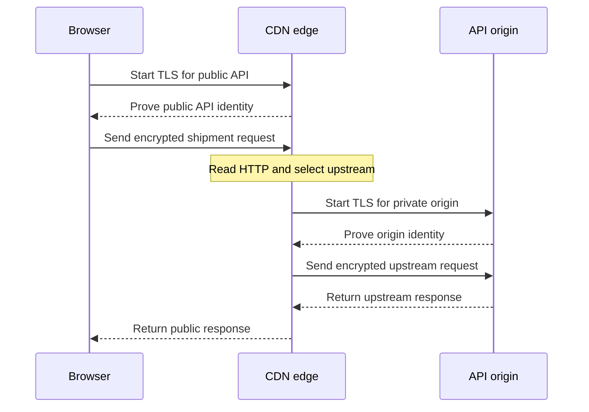

# 07 · TLS, HTTPS, and certificates

A dispatcher opens `https://api.example.com/shipments`. The browser accepts the certificate, but the CDN returns **502 Bad Gateway**. Its origin log says that certificate verification failed. How can the certificate be valid and the request still fail?

**The browser verified the CDN. The CDN has a separate peer to verify.** When HTTPS terminates at an edge, that edge can read the HTTP request. The next connection is protected according to the edge’s upstream configuration. If the edge uses HTTPS to the origin, it must also verify the origin’s identity. If the origin requires mutual TLS, it verifies the edge’s client identity as well. A valid public certificate tells you about the browser-facing connection.

**Jump to** · [TLS 1.3 handshake](#2-follow-a-full-tls-13-handshake) · [Certificate validation](#4-read-and-validate-an-x509-certificate-chain) · [CDN and origin](#6-protect-the-connection-from-the-cdn-to-the-origin) · [Troubleshooting](#9-diagnose-failures-from-the-client-that-observed-them) · [Local OpenSSL lab](#10-lab-with-a-private-ca-and-mtls)

**Course material** · [Networking checklist](appsec-networking-checklist.md) · [01 · Network layers and devices](01-network-layers-and-devices.md) · [02 · IPv4, IPv6, and subnetting](02-ipv4-ipv6-and-subnetting.md) · [03 · Local networks](03-local-networks.md) · [04 · Routing and NAT](04-routing-and-nat.md) · [05 · Ports, sockets, TCP, and UDP](05-ports-sockets-tcp-and-udp.md) · [06 · DNS](06-dns.md)

## 1. Mark the endpoints of each protected connection

**Transport Layer Security (TLS)** establishes a channel with confidentiality, integrity and peer authentication. Confidentiality protects content in transit from passive observers. Integrity lets a receiver detect modified protected data. Authentication lets a client establish which service holds the other end of the channel. Most public HTTPS deployments authenticate the server with a certificate. Authenticating the human dispatcher and authorizing access to a shipment remain application responsibilities.

For the examples, the public DNS name `api.example.com` aliases `edge.example.net` and resolves to `203.0.113.80`. The edge has private address `10.20.0.5`. It connects to the origin at `10.20.0.12:8443` and is configured to expect the name `origin.shipments.example.com`. The public addresses are documentation examples.



| Connection | TLS client and expected identity | What success establishes |
| --- | --- | --- |
| Browser → edge at `203.0.113.80:443` | The browser expects `api.example.com` from the URL | The browser has an authenticated channel to the public endpoint. The edge can read the path, headers and body |
| Edge → origin at `10.20.0.12:8443` | The edge expects `origin.shipments.example.com` from its upstream configuration | The edge has authenticated the intended origin. This connection has independent traffic keys and can use a different CA, TLS version or HTTP protocol |

The diagram shows fresh connections. In practice, either connection can be reused. Office NAT can change the browser’s visible source IP and port while leaving the TLS endpoints intact. An intermediary that terminates TLS becomes an endpoint and can read the plaintext it needs to process. Network observers still see IP addresses, ports, packet sizes and timing. An edge or origin log can also contain data that was encrypted on the wire. [TLS security properties](https://datatracker.ietf.org/doc/html/rfc9846) · [HTTPS origin authentication](https://www.rfc-editor.org/rfc/rfc9110.html#section-4.3.4)

## 2. Follow a full TLS 1.3 handshake

For HTTPS over TCP, the client first establishes TCP to the selected address. TLS then negotiates a version and cryptographic parameters, establishes shared secrets, and authenticates the handshake. The example below uses a fresh certificate-authenticated connection with ephemeral Diffie–Hellman key agreement. There is no resumption or early data in this example.

| Stage | What happens | Why it matters |
| --- | --- | --- |
| 1. ClientHello | The browser offers TLS versions, cipher suites, supported key-exchange groups, a public key share, and signature algorithms. It can also send SNI and ALPN | The server learns which choices the client supports and which virtual host it wants |
| 2. ServerHello | The server selects TLS 1.3, a cipher suite and a compatible key share. Both endpoints combine the peer’s public share with their own ephemeral private contribution | Both can derive handshake keys without transmitting the shared secret. A HelloRetryRequest can add a round trip if another key share is needed |
| 3. EncryptedExtensions | The server sends negotiated extensions, including the selected application protocol if ALPN is used | In this handshake, messages after ServerHello are encrypted. Much of the handshake is already protected before application data flows |
| 4. Certificate and CertificateVerify | The server sends its certificate list and signs the handshake transcript using the private key corresponding to the leaf certificate | The client can check the credential and verify that the live peer controls its private key |
| 5. Finished messages | The server sends a keyed check over the transcript. The client verifies the server’s authentication, then sends its own Finished. If client authentication was requested, the client’s certificate messages precede its Finished | Each side confirms its view of the handshake and its possession of the corresponding secrets |
| 6. Application data | For an ordinary request, the browser now sends protected HTTP data. Each direction uses its own application traffic keys | Someone who captures the bytes on the network cannot ordinarily read a shipment cookie or change the request undetected |

Three operations are easy to mix up. **The issuer’s signature** on the certificate binds the subject’s public key to names and attributes under that issuer’s policy. **The server’s CertificateVerify signature** proves possession of the leaf private key in this particular handshake. **The traffic keys** encrypt and authenticate the HTTP exchange using authenticated encryption, such as AES-GCM or ChaCha20-Poly1305. The certificate itself is public and can be distributed freely. Possession of its bytes alone is insufficient to act as the server.

**Forward secrecy** explains the use of ephemeral keys. In a full handshake with ephemeral key agreement, later disclosure of the server’s long-term signing key alone does not reveal earlier recorded sessions if the ephemeral and traffic secrets were erased. The endpoints can still read their own traffic while the session is active. [TLS 1.3 handshake overview](https://datatracker.ietf.org/doc/html/rfc9846#section-2) · [Authentication messages](https://datatracker.ietf.org/doc/html/rfc9846#section-4.4)

## 3. Compare TLS versions, reuse and resumption

| Property | TLS 1.2 | TLS 1.3 |
| --- | --- | --- |
| Secure configuration | Modern deployments can use ephemeral key agreement and authenticated encryption. The version also defined older options that require explicit exclusion | The cipher suites use authenticated encryption. Static RSA key transport was removed |
| Reading a suite name | In `TLS_ECDHE_RSA_WITH_AES_128_GCM_SHA256`, ECDHE is the key exchange and RSA describes server authentication | `TLS_AES_128_GCM_SHA256` describes the record-protection algorithm and the hash used by the key schedule. Key exchange and certificate signature algorithms are negotiated separately |
| Full handshake over existing TCP | A conventional full handshake generally takes two TLS round trips before a normal client request | A typical full handshake permits the client request after one TLS round trip. A retry or other conditions can add time |
| What a passive capture shows | In a typical full certificate handshake, the server certificate is visible | The certificate and selected ALPN are encrypted after ServerHello. The initial ClientHello normally exposes some metadata unless protected by ECH |

Prefer TLS 1.3 for modern deployments. Where existing clients require TLS 1.2, use a maintained TLS implementation and a current policy with ephemeral key exchange and authenticated encryption. TLS 1.0 and 1.1 are deprecated. For new application protocols using TLS, the IETF requires TLS 1.3 support. A TLS version by itself does not establish that the application verified its peer. [TLS deployment recommendations](https://www.rfc-editor.org/rfc/rfc9325.html) · [Legacy version deprecation](https://www.rfc-editor.org/rfc/rfc8996.html) · [TLS in new application protocols](https://www.rfc-editor.org/rfc/rfc9852.html)

**Connection reuse** sends another HTTP request over an already established channel. **Session resumption** establishes a new TLS connection using state from an earlier one, commonly through a ticket and a resumption pre-shared key. A resumed TLS 1.3 handshake can omit a fresh certificate exchange. When diagnosing a renewal, observe a new full handshake at each relevant endpoint.

**0-RTT early data** is an optional resumption feature. It lets a client send some application data before the new handshake finishes. Early data can be replayed and has different protection from ordinary application data. A request that creates a shipment or charges a customer should wait for the handshake under the service’s early-data policy. Consider the operation’s actual effects even if its HTTP method looks read-only. HTTP `425 Too Early` allows a responder to decline a request it is unwilling to process as early data. Application idempotency and authorization still apply. [TLS early data](https://datatracker.ietf.org/doc/html/rfc9846#section-8) · [Early data in HTTP](https://www.rfc-editor.org/rfc/rfc8470.html)

## 4. Read and validate an X.509 certificate chain

A **certificate authority (CA)** signs certificates. A **trust anchor** is a key or certificate the client has chosen to trust through its local policy. A common deployment has a root CA, an issuing intermediate CA, and a leaf certificate for the API. The root signs the intermediate, and the intermediate signs the leaf. The server usually presents the leaf first, followed by the necessary intermediates. The client builds a path to an anchor in its trust store. Sending a self-signed root in the handshake cannot make a client trust that root.

| Field or artifact | How to read it |
| --- | --- |
| Leaf public key | The key associated with the endpoint’s identity. The corresponding private key stays with the endpoint or its managed signer |
| Subject Alternative Name (SAN) | The typed identifiers the certificate covers, such as a DNS name or an IP address. This is where a modern HTTPS client checks the service name |
| Issuer and subject | Human-readable names useful for debugging. Cryptographic signature verification and path policy establish the chain |
| Validity | `notBefore` and `notAfter` bound the certificate’s validity. Check the client’s clock and the validity of the leaf and intermediates |
| Basic Constraints and Key Usage | Indicate whether a certificate is a CA and what its key may do. A leaf with a matching name cannot substitute for an authorized issuer |
| Extended Key Usage (EKU) | If present, constrains the purposes for which the key can be accepted. Common TLS purposes include `serverAuth` and `clientAuth` |
| Serial number and fingerprint | Issuer plus serial identifies an issued certificate. A SHA-256 fingerprint identifies the particular certificate bytes and helps compare what two clients received |
| PEM, DER and CSR | DER is a binary encoding. PEM wraps encoded data in labeled text blocks. A certificate signing request (CSR) contains the public key and requested attributes, signed by the requester. The CA must still validate the request before issuing |

### What the client must establish

1. **An expected identity.** Start with the hostname in the HTTPS URL or the service name configured for the upstream. Establish this independently of what the peer sends.
2. **A valid certification path.** Build a path from the leaf through suitable issuers to a locally trusted anchor. Verify signatures, issuer authority, relevant constraints, permitted algorithms and intended usage.
3. **Validity at the verification time.** Check the certificates’ date windows under the client’s policy. A correct leaf can still have an expired intermediate. A wrong system clock can make a newly issued certificate appear premature.
4. **An identity match.** Match the expected DNS name or IP address to the corresponding SAN type. A valid path alone can authenticate a certificate for an entirely different service.
5. **Proof from the live peer.** Verify the handshake signature and Finished as appropriate for the negotiated mode. An offline certificate inspection can establish path and name properties. A handshake adds evidence that this peer holds the necessary key.

Browsers, OS tools, container images, language runtimes and CDN origin clients may consult different trust stores. Some clients can use cached or fetched intermediates while others rely on the presented list. A browser succeeding and a fresh service container failing can therefore expose a missing intermediate or trust-bundle difference. Examine the path each client actually used. [X.509 path validation](https://www.rfc-editor.org/rfc/rfc5280.html#section-6) · [Service identity verification](https://www.rfc-editor.org/rfc/rfc9525.html)

## 5. Distinguish DNS, SNI, SAN, ALPN and HTTP authority

One IP address can serve several HTTPS sites. Keep the names at each stage straight when investigating a wrong certificate.

| Item | Value in the public shipment example | Who uses it? |
| --- | --- | --- |
| URL hostname | `api.example.com` | The browser derives the expected TLS service identity and HTTP origin from the URL |
| DNS alias and final address | `edge.example.net`, then `203.0.113.80` | The resolver and network stack find a connection destination. The original service name remains the reference identity |
| SNI, Server Name Indication | `api.example.com` | A ClientHello extension helps the edge select a virtual host, certificate and TLS configuration |
| Certificate SAN | For example, `DNS:api.example.com` | The browser checks whether the presented identity matches the expected service |
| ALPN, Application-Layer Protocol Negotiation | The browser might offer `h2` and `http/1.1`. The edge selects one it supports | Both endpoints agree how to interpret subsequent application data, such as HTTP/2 frames |
| HTTP authority | `Host: api.example.com` in HTTP/1.1 or `:authority` in HTTP/2 or HTTP/3 | The HTTP component routes the request after the protected channel is established |

**Name matching in practice.** Under modern service-identity rules, DNS names come from SAN entries. The legacy subject Common Name (CN) is insufficient. Where wildcard matching is supported, a wildcard occupies the complete leftmost label and matches exactly one label. An IP literal in a URL needs a matching `iPAddress` SAN. A certificate for a DNS name can still work when the TCP connection is directed to a fixed IP, provided the client continues to verify the intended DNS name.

| Expected identity | Identifier in the leaf | Result of the identity check |
| --- | --- | --- |
| `api.example.com` | `DNS:api.example.com` | Match |
| `api.example.com` | `DNS:*.example.com` | Match under normal HTTPS wildcard rules |
| `example.com` or `v2.api.example.com` | `DNS:*.example.com` | Mismatch for both |
| `api.example.com` | `DNS:edge.example.net` only | Mismatch even when DNS returns this alias target |
| `203.0.113.80` | `DNS:api.example.com` only | Mismatch for an IP-literal URL. An exact IP SAN would match |

With an ordinary ClientHello, a passive observer can generally see the offered SNI and ALPN values. When **Encrypted ClientHello (ECH)** is successfully used, sensitive parameters can be carried in an encrypted inner ClientHello while an outer ClientHello remains visible. Destination IP and traffic patterns are still observable. For HTTP/3, ALPN commonly selects `h3` during the TLS 1.3 handshake integrated into QUIC. QUIC protects its packets over UDP using secrets derived from TLS. HTTP/1.1 and HTTP/2 over HTTPS commonly use TLS records over TCP. [SNI](https://www.rfc-editor.org/rfc/rfc6066.html#section-3) · [ALPN](https://www.rfc-editor.org/rfc/rfc7301.html) · [SAN matching](https://www.rfc-editor.org/rfc/rfc9525.html#section-6) · [ECH](https://www.rfc-editor.org/rfc/rfc9849.html) · [QUIC and TLS](https://www.rfc-editor.org/rfc/rfc9001.html)

## 6. Protect the connection from the CDN to the origin

To review this architecture, draw a mark wherever a component decrypts HTTP. At each mark, identify who opens the next connection, what name it expects and which credentials it trusts. A setting that enables HTTPS for visitors answers only the first of those questions for the public side.

| Deployment | Where HTTP is readable | What protects the route to the application? |
| --- | --- | --- |
| Edge terminates TLS and forwards HTTP | At the edge, at the origin, and to observers with access to the plaintext hop | The upstream hop has no TLS protection. A private subnet limits reachability. Any separate encryption provided by a tunnel has its own endpoints |
| Edge terminates TLS and opens verified HTTPS | At the edge and at the component that terminates upstream TLS | A second TLS connection protects that hop. The edge validates the origin chain against its trust store and verifies the configured origin name |
| Edge uses verified HTTPS and the origin requires mTLS | At the same termination points | The origin also validates the edge’s client certificate and proof of key possession. Origin policy can restrict which authenticated workloads may call it |
| A load balancer passes TCP through to the origin | At the origin for this TLS session | The browser negotiates TLS directly with the origin through the balancer. The origin presents a certificate valid for the public name, and the balancer can forward traffic without decrypting HTTP |

If a service-mesh proxy or sidecar terminates upstream TLS, trace the remaining connection from that component to the application process. Its transport and access controls determine who can observe or send traffic on that last segment.

**How mutual TLS authenticates a client.** In a full TLS 1.3 handshake, the origin requests a client certificate with `CertificateRequest`. The edge validates the origin and sends its own certificate chain and a `CertificateVerify` signature made with its client private key. The origin validates the client chain under its client trust policy, checks validity and permitted usage, and verifies the handshake signature and Finished. An origin that requires mTLS rejects peers that cannot supply an acceptable credential. The parties can use different CAs for their two roles. [TLS 1.3 client authentication](https://datatracker.ietf.org/doc/html/rfc9846#section-4.4)

An origin can map a verified client SAN such as `URI:urn:example:shipments:edge` to the shipment edge workload. The request still needs an authorized dispatcher to read a particular shipment. If the application consumes identity information forwarded by a proxy, the proxy should remove incoming copies of those headers and supply its own verified values. Restrict access to the receiving application to the intended authenticated proxy path. An HTTP header by itself supplies no proof that its sender completed mTLS.

**Resolve the opening incident.** The browser receives a leaf covering `api.example.com` and completes TLS. The edge then connects to `10.20.0.12:8443`, expecting `origin.shipments.example.com`. That listener presents a current, trusted certificate whose only DNS SAN is `old-origin.shipments.example.com`. The edge records a hostname mismatch and, in this deployment, sends the browser a 502 over the working public connection. Repair the origin certificate or its virtual-host binding so the intended name is served. Then confirm a fresh, verified connection from the edge’s network. Reissuing the public certificate would leave this failure in place. [Upstream TLS name and verification settings in NGINX](https://nginx.org/en/docs/http/ngx_http_proxy_module.html#proxy_ssl_verify)

## 7. Issue, deploy and retire certificates

| Stage | What an AppSec engineer should be able to explain |
| --- | --- |
| Issue | A service generates a key pair or uses a managed signer. The CA validates the requested identity under its policy and issues a leaf for the public key, names, lifetime and purpose. For public domain-validated certificates, the applicant demonstrates control of the domain. ACME automates the order and challenge workflow |
| Deploy | Install the leaf and required intermediates on the correct listener and SNI binding. Ensure the endpoint can use the matching private key. The client needs a suitable trust anchor. Protect private keys and keep them out of source control and logs |
| Renew | Automate renewal with time to retry. After the new certificate is deployed or reloaded, use fresh handshakes to check the served serial or fingerprint, SANs, issuer and expiration. Check relevant edge and origin pools, including IPv4 and IPv6 listeners if they differ |
| Rotate a CA | Distribute the new trust anchor to affected clients first, verify adoption, then roll out certificates that chain to it. Retire the old anchor after migration. A compromised anchor requires separate incident handling |
| Respond to key compromise | Generate a new private key, replace the affected certificate, request revocation through the issuer, and investigate where the old key was accessible. A new certificate using the exposed key would preserve the exposure |

**Expiration and revocation answer different questions.** Expiration is determined from the certificate and the verifier’s clock. Revocation is an issuer’s indication that a certificate should no longer be accepted before its scheduled end. CRLs publish lists of revoked certificates. OCSP reports status for an individual certificate, and OCSP stapling allows a server to send a signed status response during the handshake. Clients vary in which mechanisms they use and how they handle unavailable status information. Monitor the certificate actually being served as well as the renewal job. [ACME](https://www.rfc-editor.org/rfc/rfc8555.html) · [Certificate and CRL profile](https://www.rfc-editor.org/rfc/rfc5280.html) · [OCSP](https://www.rfc-editor.org/rfc/rfc6960.html)

Two related controls operate at issuance time. A domain owner can publish **CAA** DNS records identifying issuers authorized to issue for that domain. **Certificate Transparency (CT)** logs make publicly logged certificates or precertificates discoverable, which lets owners monitor for unexpected issuance. A logged entry alone does not establish that the certificate is currently trusted or deployed. Private PKIs can have different logging policies. [CAA](https://www.rfc-editor.org/rfc/rfc8659.html) · [How Certificate Transparency works](https://certificate.transparency.dev/howctworks/)

## 8. Understand what the browser enforces

| Mechanism | What it changes for the shipment dashboard |
| --- | --- |
| HTTP redirect to HTTPS | A redirect can move the browser to HTTPS. If the visit started over plain HTTP, the initial request has already crossed that connection before the redirect arrives |
| HTTP Strict Transport Security (HSTS) | After receiving `Strict-Transport-Security: max-age=31536000` over valid HTTPS, the browser remembers the host’s policy for one year, upgrades future HTTP visits locally and treats certificate errors as fatal. A preload entry can protect a first visit. Confirm all affected subdomains support HTTPS before enabling `includeSubDomains` |
| Mixed content | An HTTPS dashboard that fetches `http://api.example.com/shipments` attempts an insecure active request. Browsers block such fetches. Some other resource types may be upgraded automatically. Use HTTPS for the API and `wss://` for the dashboard’s secure WebSocket |
| Cookies | The `Secure` attribute restricts cookie transmission to secure channels in normal HTTPS deployments. `HttpOnly` controls script access and `SameSite` governs sending in cross-site contexts. Each addresses a different property of the session |
| Same-origin policy and CORS | `https://app.example.com` and `https://api.example.com` are distinct origins because their hosts differ, even though both use HTTPS and are same-site. A browser can complete TLS and still withhold a cross-origin response from JavaScript under CORS. The API must still authorize the caller |

When the console reports a CORS or mixed-content error, use the Network panel to see whether a request was issued and whether an HTTP response arrived. A certificate error has a different remedy. [HSTS](https://www.rfc-editor.org/rfc/rfc6797.html) · [Mixed content](https://developer.mozilla.org/en-US/docs/Web/Security/Defenses/Mixed_content) · [Cookie attributes](https://developer.mozilla.org/en-US/docs/Web/HTTP/Reference/Headers/Set-Cookie) · [CORS](https://developer.mozilla.org/en-US/docs/Web/HTTP/Guides/CORS)

## 9. Diagnose failures from the client that observed them

In the browser’s connection information or certificate viewer, record the page hostname, leaf SANs, issuer, validity dates and certificate path. The Network panel can also report the negotiated HTTP protocol. For an upstream failure, collect the edge’s origin error, upstream address, configured verification name and trust bundle. Record the time and correlate the two sides with a request identifier if available. Cases involving multiple listeners are easier to compare if you also record the destination IP and leaf fingerprint.

These commands show what to ask on each hop. The public address is reserved for documentation and the private address represents the course topology. Substitute your own service when applying the templates. Section 10 runs entirely on loopback.

```sh
# Public hop using this OpenSSL installation's configured CA store
openssl s_client -connect 203.0.113.80:443 \
  -servername api.example.com -verify_hostname api.example.com \
  -verify_return_error -alpn 'h2,http/1.1' -showcerts </dev/null
```

```sh
# Origin hop from the edge's network, using its intended origin CA bundle
openssl s_client -connect 10.20.0.12:8443 \
  -servername origin.shipments.example.com -verify_hostname origin.shipments.example.com \
  -verify_return_error -CAfile origin-roots.pem -alpn http/1.1 -showcerts </dev/null
```

`-connect` selects the network destination. `-servername` sends SNI for virtual-host selection. `-verify_hostname` sets the DNS identity to check, and `-verify_return_error` makes a verification failure stop the handshake. The diagnostic client can otherwise report an error and continue. `-showcerts` shows certificates the peer sent. The trust path the client builds can differ. Look for the selected TLS version, cipher, ALPN, and a successful verification result together. A successful run describes **this client, name, trust configuration and address at this time**. The origin template assumes server-only TLS and an available `origin-roots.pem`. Section 10 adds a client credential for mTLS. [OpenSSL s_client](https://docs.openssl.org/3.5/man1/openssl-s_client/)

For legacy certificates, a further difference matters. Some OpenSSL configurations fall back to the subject CN when a DNS SAN is absent. Modern HTTPS service-identity rules require a matching SAN. Inspect that field explicitly when comparing a command-line result with a browser. [OpenSSL hostname checks](https://docs.openssl.org/3.5/man3/X509_check_host/) · [Service identity rules](https://www.rfc-editor.org/rfc/rfc9525.html#section-6)

| Symptom | Next observation that separates likely causes |
| --- | --- |
| Name resolution fails, TCP times out, or the connection is refused | Check the resolved address, route and listener from the failing client. Identify whether a TLS handshake actually began |
| Protocol-version or no-common-application-protocol alert | Compare the versions or ALPN identifiers offered and accepted on that hop. A browser can use HTTP/2 to an edge that uses HTTP/1.1 upstream |
| Hostname mismatch | Compare the expected URL or upstream name, SNI sent and the leaf SANs. A default virtual host can serve a valid certificate for another name |
| Unable to get local issuer or unknown CA | Compare the peer’s sent intermediates with the issuer path. Confirm the client trusts the intended root. A missing intermediate and an untrusted private CA call for different changes |
| Expired or not yet valid | Inspect the complete path at the failing client’s UTC time. Compare fresh handshakes across listeners to find an old deployment |
| Server rejects the client certificate or requires one | Inspect the origin’s mTLS log, whether a client chain was sent, its issuing CA, the client-auth purpose and the identity policy |
| Valid browser HTTPS with an HTTP 502 | Identify which component generated the response. Check its upstream DNS, connectivity and TLS logs. Several upstream failures can produce the same status |
| HTTP 401 or 403 over verified HTTPS | The responding HTTP component could read the request. Inspect its authentication or authorization decision and check whether it forwarded the request to the origin |

## 10. Lab with a private CA and mTLS

You will play both roles on your own computer. First, a client will verify a server named `api.shipments.test`. Then the server will require the client to present a certificate of its own. Predict which check will fail each time you change one input.

**Requirements.** Use two POSIX-compatible terminal sessions and the OpenSSL 3.x or later CLI. Run `openssl version` to check which implementation your shell selects. The optional HTTP check uses curl. The exercise uses a temporary directory, a loopback listener and an explicit CA file. The temporary CA is trusted only by the commands that use it.

### A. Make the certificates in terminal A

Create the directory and print its path. You will use that path in terminal B. The configuration assigns distinct purposes to the CA, the HTTPS server and the mTLS client.

```sh
umask 077
tls_lab=$(mktemp -d)
cd "$tls_lab" || exit 1
pwd

cat > lesson.cnf <<'CONF'
[req]
distinguished_name = dn
prompt = no
[dn]
CN = Shipment Lesson

[root_ca]
basicConstraints = critical,CA:TRUE,pathlen:1
keyUsage = critical,keyCertSign,cRLSign
subjectKeyIdentifier = hash

[issuing_ca]
basicConstraints = critical,CA:TRUE,pathlen:0
keyUsage = critical,keyCertSign,cRLSign
subjectKeyIdentifier = hash
authorityKeyIdentifier = keyid:always

[server_leaf]
basicConstraints = critical,CA:FALSE
keyUsage = critical,digitalSignature
extendedKeyUsage = serverAuth
subjectAltName = DNS:api.shipments.test
subjectKeyIdentifier = hash
authorityKeyIdentifier = keyid:always

[client_leaf]
basicConstraints = critical,CA:FALSE
keyUsage = critical,digitalSignature
extendedKeyUsage = clientAuth
subjectAltName = URI:urn:example:shipments:edge
subjectKeyIdentifier = hash
authorityKeyIdentifier = keyid:always
CONF
```

Create the self-signed root and use it to sign the intermediate. Only the root will be supplied as a trust anchor. The short lifetimes and unencrypted, locally restricted test keys keep this exercise self-contained.

```sh
openssl req -new -x509 -newkey rsa:2048 -noenc -sha256 -days 7 -set_serial 1 \
  -config lesson.cnf -extensions root_ca -subj '/CN=Shipment Lesson Root' \
  -keyout root.key -out root.pem

openssl req -new -newkey rsa:2048 -noenc -config lesson.cnf \
  -subj '/CN=Shipment Lesson Issuer' -keyout issuer.key -out issuer.csr
openssl x509 -req -in issuer.csr -CA root.pem -CAkey root.key \
  -set_serial 2 -days 4 -sha256 -extfile lesson.cnf -extensions issuing_ca -out issuer.pem
```

Use the intermediate to issue two leaves. Each leaf gets its own key, serial number and certificate purpose. The server’s DNS name comes from the SAN in the configuration.

```sh
issue_leaf() {
  leaf_name=$1
  profile=$2
  serial=$3
  openssl req -new -newkey rsa:2048 -noenc -config lesson.cnf \
    -subj "/CN=Shipment Lesson $leaf_name" -keyout "$leaf_name.key" -out "$leaf_name.csr" &&
  openssl x509 -req -in "$leaf_name.csr" -CA issuer.pem -CAkey issuer.key \
    -set_serial "$serial" -days 2 -sha256 -extfile lesson.cnf \
    -extensions "$profile" -out "$leaf_name.pem"
}
issue_leaf server server_leaf 3
issue_leaf edge client_leaf 4
```

### B. Isolate the checks before opening a socket

Inspect the server leaf, then ask OpenSSL to verify it for its intended purpose and name. `-untrusted issuer.pem` supplies an intermediate to help build the path. The local decision to trust the path comes from `root.pem`.

```sh
openssl x509 -in server.pem -noout -subject -issuer -dates -ext subjectAltName
openssl verify -purpose sslserver -CAfile root.pem -untrusted issuer.pem \
  -verify_hostname api.shipments.test server.pem
```

The second command should print `server.pem: OK`. Run the four checks below **individually**. A nonzero exit status is the expected result in each case.

| Change | Command | What the result establishes |
| --- | --- | --- |
| Ask for a different name | `openssl verify -purpose sslserver -CAfile root.pem -untrusted issuer.pem -verify_hostname orders.shipments.test server.pem` | The CA path is usable, but the requested DNS name is absent from the SAN |
| Omit the intermediate | `openssl verify -purpose sslserver -CAfile root.pem -verify_hostname api.shipments.test server.pem` | This isolated client cannot connect the leaf to its root without the issuing certificate |
| Ask to use the server leaf as a client | `openssl verify -purpose sslclient -CAfile root.pem -untrusted issuer.pem server.pem` | The server-only EKU excludes client authentication |
| Ask whether the leaf will still be valid in 72 hours | `openssl x509 -in server.pem -noout -checkend 259200` | A two-day leaf is already inside the warning window. It can still be valid today |

### C. Complete an authenticated HTTPS connection

Start the loopback server in **terminal A**. It presents its leaf and intermediate. Leave it running. If port 9443 is occupied, choose another unused local port and make the same substitution in every command below.

```sh
openssl s_server -accept 127.0.0.1:9443 -cert server.pem -key server.key \
  -cert_chain issuer.pem -alpn http/1.1 -www
```

In **terminal B**, change to the directory printed by `pwd` in step A, then connect. Observe the two certificates sent by the server, the selected protocol `http/1.1` and the successful verification result.

```sh
openssl s_client -connect 127.0.0.1:9443 -servername api.shipments.test \
  -verify_hostname api.shipments.test -verify_return_error -CAfile root.pem \
  -alpn http/1.1 -showcerts </dev/null
```

To see HTTP travel over the verified channel, send one request with curl. `--resolve` directs this host and port to loopback while keeping the URL hostname for SNI, certificate verification and HTTP. Expect `HTTP 200`.

```sh
curl --noproxy '*' --resolve api.shipments.test:9443:127.0.0.1 --cacert root.pem \
  --http1.1 --silent --show-error --output /dev/null --write-out 'HTTP %{http_code}\n' \
  https://api.shipments.test:9443/
```

### D. Make client authentication mandatory

Stop the server in terminal A with Ctrl-C and restart it with the command below. Capital `-Verify` requires a client certificate. Here the server uses `root.pem` to verify the client’s chain.

```sh
openssl s_server -accept 127.0.0.1:9443 -cert server.pem -key server.key \
  -cert_chain issuer.pem -alpn http/1.1 -www \
  -Verify 2 -verify_return_error -CAfile root.pem
```

In terminal B, repeat the previous curl request without changing it. The client still trusts the server, but this time it cannot obtain the page because it supplied no client credential. Now send the request below with the edge’s client certificate, its key and its issuer. To compare the two outcomes using only OpenSSL, also run it with the three client options removed (`-cert edge.pem`, `-key edge.key` and `-cert_chain issuer.pem`).

```sh
printf 'GET / HTTP/1.1\r\nHost: api.shipments.test\r\nConnection: close\r\n\r\n' |
  openssl s_client -quiet -connect 127.0.0.1:9443 -servername api.shipments.test \
    -verify_hostname api.shipments.test -verify_return_error -CAfile root.pem \
    -alpn http/1.1 -cert edge.pem -key edge.key -cert_chain issuer.pem
```

The successful request returns an HTTP 200 response. Look in terminal A for the client certificate verification. You have now observed both directions of authentication. The demo server accepts a suitable certificate from its trusted CA. A production shipment API would separately authorize the specific client identity and the operation it requested. Stop the server with Ctrl-C. The temporary directory contains all the lab keys and certificates and can be discarded when you finish. [OpenSSL verify](https://docs.openssl.org/3.5/man1/openssl-verify/) · [OpenSSL s_server](https://docs.openssl.org/3.5/man1/openssl-s_server/) · [curl certificate verification](https://curl.se/docs/sslcerts.html)

## 11. Check your understanding

1. DNS points `api.example.com` to `edge.example.net`. The edge presents a trusted certificate covering only `edge.example.net`. Should the browser accept it for the API URL?
2. A colleague says the CA’s signature on the leaf proves the running server holds its private key. Which handshake messages provide the missing evidence in a full TLS 1.3 connection?
3. A certificate covers `*.example.com`. Which of `api.example.com`, `v2.api.example.com` and `example.com` does it cover? What if the URL contains an IP literal?
4. One edge IP serves several sites and offers HTTP/1.1 and HTTP/2. Which mechanisms select the TLS virtual host and the application protocol?
5. A browser loads the API, but a newly built container reports a missing issuer. Which two pieces of evidence should you compare before changing trust?
6. A browser receives a 502 over verified HTTPS. The edge reports that the origin certificate expired. Which listener, clock and connection should you inspect?
7. The origin has authenticated the edge using mTLS. What else must it establish before returning a single customer’s shipment?
8. A resumed TLS session offers 0-RTT for `POST /shipments`. What property of early data affects this choice?

### Answer key

1. **No.** The reference identity comes from the URL, so the certificate must cover `api.example.com`. The DNS alias tells the client where to connect.
2. **CertificateVerify** signs this handshake’s transcript using the leaf private key. **Finished** authenticates the transcript with a handshake-derived secret. Checking the CA’s signature alone can be done on a copy of the certificate.
3. **Only `api.example.com`** matches the wildcard. A URL with an IP literal requires the exact address in an IP SAN.
4. **SNI** carries the requested server name in the ClientHello. **ALPN** negotiates an application protocol such as `h2`.
5. **The intermediate certificates sent by the listener and the trust anchors available to the container.** A browser might already have the issuer cached or obtain it independently. Determine which link is missing for the failing client.
6. **Inspect the origin listener and the edge’s verification clock.** From the edge’s network, use its expected origin name and trust store, then check the validity of the actual leaf and intermediates on a fresh handshake.
7. **The origin needs an authorization decision.** Establish which authenticated workload may call the endpoint and which user or delegated identity may read this particular shipment.
8. **Early data can be replayed.** A service that creates a shipment should defer the operation until the handshake completes or reject the early request so the client can retry after the handshake.

---

[Previous · 06 DNS and service discovery](06-dns.md) · [Course checklist](appsec-networking-checklist.md) · [Next · 08 URLs and HTTP semantics](08-urls-and-http-semantics.md)
