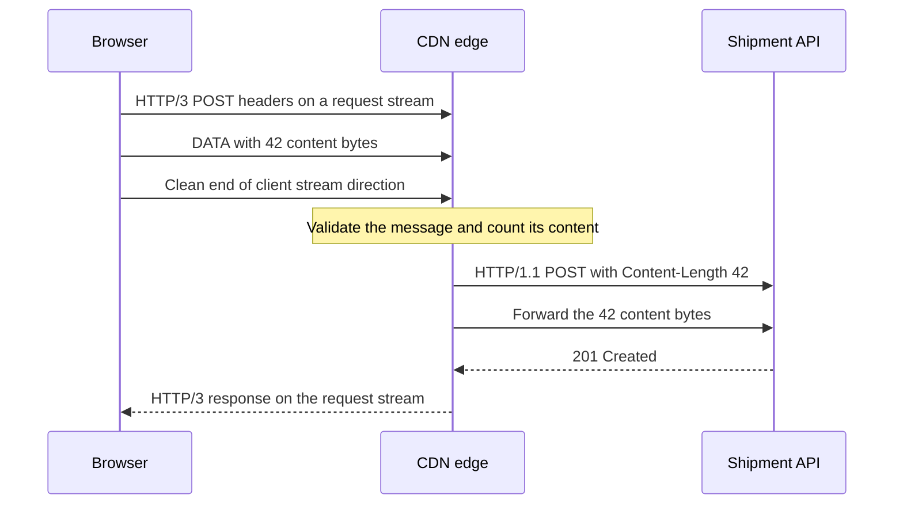

# 09 · HTTP versions and request boundaries

A dispatcher creates a shipment. DevTools shows `h3` for `POST /shipments`. The API logs `HTTP/1.1` and `Content-Length: 42`. Both observations can describe the same operation. The browser finished sending an HTTP/3 request on a QUIC stream. The CDN received its 42 content bytes and sent them to the API in a new HTTP/1.1 request.

**How does each receiver know where the request ends?** HTTP/1.1 uses a byte count or chunked transfer coding for a request with a body. HTTP/2 marks the end of the sender's side of an HTTP stream. HTTP/3 uses the clean end of the sender's side of a QUIC stream. A proxy that translates versions must preserve the intended request across those different rules.

**Jump to** · [HTTP/1.1 byte counts](#2-count-an-http11-request-body) · [Chunked bodies](#3-read-a-chunked-upload) · [HTTP/2 streams](#4-follow-two-http2-streams) · [HTTP/3 streams](#5-follow-an-http3-request-over-quic) · [Proxy translation](#6-translate-a-request-at-the-edge) · [Local lab](#9-observe-request-completion-on-loopback) · [Self-check](#10-check-your-understanding)

**Course material** · [AppSec networking checklist](https://chatgpt.com/library?file_id=libfile_a587b9ac4b10819195b004ce505754a5&account_id=personal) · [05 · Ports, sockets, TCP, and UDP](https://chatgpt.com/library?file_id=libfile_7565d39efd548191a4143e5087d272ef&account_id=personal) · [07 · TLS, HTTPS, and certificates](https://chatgpt.com/library?file_id=libfile_cea672efcaf48191871c267844a6056e&account_id=personal) · [08 · URLs and HTTP semantics](https://chatgpt.com/library?file_id=libfile_d78890543454819199535d49b9c64747&account_id=personal)

## 1. Identify what is ending

**Framing** is the set of rules that tells a receiver which bytes belong to a unit of data and when that unit is complete. This lesson uses the same compact JSON from lesson 08. It consists of exactly 42 UTF-8 bytes, with no trailing newline.

```json
{"origin":"Tabriz","destination":"Tehran"}
```

The closing brace completes the JSON object. The HTTP implementation must establish a separate fact before reporting a complete request. It needs to know that all the content and any trailers belonging to this message arrived. A single request can span several socket reads, and one read can contain the end of one protocol unit and the start of the next. A quiet connection can simply mean the sender is waiting for more data.

| Version | How requests share a connection | Where this 42-byte request ends |
| --- | --- | --- |
| HTTP/1.1 | An ordered TCP byte stream carries successive messages. Their boundaries let the connection be reused. | After 42 body bytes when a valid `Content-Length: 42` is used, or after the chunked coding's terminator and trailer section. |
| HTTP/2 | Frames for concurrent HTTP streams can interleave on one TCP connection. Each ordinary request/response exchange has its own stream ID. | A valid message sequence ends with `END_STREAM` on the request side. The server can still send a response on the same stream. |
| HTTP/3 | One QUIC connection, carried over UDP, provides multiple independently ordered streams. Each request uses a client-initiated bidirectional stream. | The receiver obtains a complete HTTP/3 frame sequence and a clean end of the client's sending direction, through the stream's final byte. |

Keep three questions separate when reading a trace. **Did the request arrive in full?** The receiving HTTP implementation can answer this. **Did a final response arrive?** Look at the response side of the exchange. **Was shipment S42 created?** Look at the application's result or committed record. A TCP acknowledgment, a QUIC acknowledgment, or a complete upload cannot establish the third fact. [HTTP messages and completeness](https://www.rfc-editor.org/rfc/rfc9110.html#section-6.1) · [TCP byte-stream service](https://www.rfc-editor.org/rfc/rfc9293.html#section-2.2)

### How a connection gets its version

The first web protocol, HTTP/0.9, supported a simple retrieval with a response ending at connection close. HTTP/1.0 introduced headers and status codes and commonly used a separate connection per exchange. HTTP/1.1 made persistent connections the default. HTTP/2 added multiplexing over TCP. HTTP/3 moved stream delivery into QUIC. Methods such as `POST` and status codes such as `201` retain their meanings across the three modern versions. [Evolution of HTTP](https://developer.mozilla.org/en-US/docs/Web/HTTP/Guides/Evolution_of_HTTP)

For HTTPS over TCP, the client and endpoint can negotiate `h2` or `http/1.1` using TLS ALPN (Application-Layer Protocol Negotiation). HTTP/3 uses `h3` in the handshake for a QUIC connection, with TLS 1.3 integrated into QUIC. A browser can discover an HTTP/3 service through `Alt-Svc` or a DNS HTTPS record. An advertisement shows availability. The protocol actually negotiated, or the protocol recorded for the individual request, shows what was used. If UDP is unavailable and the service also offers HTTPS over TCP, a client may succeed using HTTP/2 or HTTP/1.1. [HTTP/2 connection setup](https://www.rfc-editor.org/rfc/rfc9113.html#section-3) · [HTTP/3 endpoint discovery](https://www.rfc-editor.org/rfc/rfc9114.html#section-3.1) · [DNS HTTPS records](https://www.rfc-editor.org/rfc/rfc9460.html)

## 2. Count an HTTP/1.1 request body

Read this request as a receiver on a persistent connection. HTTP/1.1 terminates the request line and each header line with CRLF (carriage return followed by line feed). The blank line ends the headers. The next byte, `{`, starts the body.

```http
POST /shipments HTTP/1.1
Host: api.example.com
Content-Type: application/json
Content-Length: 42

{"origin":"Tabriz","destination":"Tehran"}
```

1. The request line identifies the method, target, and HTTP version. The headers identify the host, content type, and framing.
2. `Content-Length` is a **decimal count of octets**. An octet is one byte. Count the 42 content bytes after the header section. Exclude the start line, header bytes, and their delimiters.
3. Suppose the TCP stack delivers the first 19 body bytes now and the last 23 later. After 19, the receiver is still waiting for 23. After the 42nd byte, the request is complete. The connection can stay open for another exchange.

If the connection closes after only 19 bytes, the receiver has an **incomplete request**. The close does not turn it into a valid 19-byte body. For an ordinary HTTP/1.1 request with neither a length field nor transfer coding, the framed body length is **zero**. This also applies to `POST`. An endpoint can reject a missing business payload or require a length, but the method name does not supply a byte count. [HTTP/1.1 message syntax](https://www.rfc-editor.org/rfc/rfc9112.html#section-2.1) · [Body-length rules](https://www.rfc-editor.org/rfc/rfc9112.html#section-6.3)

**Why bytes matter.** The city name `قم` contains two Unicode code points and occupies four bytes in UTF-8. A character count is an unreliable way to populate `Content-Length`. If the sender applies `Content-Encoding: gzip`, a length on the resulting message counts the compressed content bytes. In application code, give the HTTP library the serialized bytes and let it calculate the length.

### Persistence, pipelining, and responses

HTTP/1.1 can reuse a connection for many messages. A server that answers before consuming an entire request must either finish reading the request body or close that connection after responding. Unconsumed bytes cannot be safely assigned to a later request. **Pipelining** permits a client to send another complete request before the previous response arrives. Final responses on that connection must still come back in request order. A slow first response can delay the second. [Connection persistence and pipelining](https://www.rfc-editor.org/rfc/rfc9112.html#section-9.3)

Responses have additional framing rules. Use the request method and response status when diagnosing the return path.

| Response case | How to recognize its boundary in HTTP/1.1 |
| --- | --- |
| Response to `HEAD`, or a `1xx`, `204`, or `304` response | The response ends at the empty line after its headers. A length on a permitted `HEAD` or `304` response can describe content a corresponding `GET` would have returned. There are no such body bytes to wait for. |
| `100 Continue` during an upload | This interim response permits the client to continue sending the request. The request body can still be in progress and a final response follows. |
| An ordinary response with no other applicable delimiter | In permitted cases the server can delimit the response by closing the connection. This consumes the connection and makes a clean ending harder to distinguish from a network interruption. |
| Successful classic `CONNECT` | After the response headers, subsequent bytes belong to the tunnel. The response has switched how the connection is used. |

## 3. Read a chunked upload

A sender might begin uploading before it knows the final byte count. With `Transfer-Encoding: chunked` on an HTTP/1.1 hop, the sender omits `Content-Length`. Each nonempty chunk declares the size of its own data in **hexadecimal**. The receiver combines the data from the chunks, preserving its order.

Here is one valid way to encode the same shipment. The two rows split it at the comma for readability. A real sender can choose different chunk sizes.

| Piece on the connection | Bytes represented | What happens at the receiver |
| --- | ---: | --- |
| `13\r\n` then `{"origin":"Tabriz",` then `\r\n` | 19 content bytes | Hex `13` equals decimal 19. Keep those 19 bytes. |
| `17\r\n` then `"destination":"Tehran"}` then `\r\n` | 23 content bytes | Hex `17` equals decimal 23. Append those 23 bytes. |
| `0\r\n\r\n` | 0 content bytes | The zero-size chunk announces the end of the chunk data. With no trailers, the following empty line completes the request. |

Here `\r\n` stands for the two delimiter bytes. The chunked portion occupies **59 HTTP/1.1 bytes**, including size lines and delimiters. The application receives **42 content bytes**. Both counts exclude the request headers. The JSON parser sees the original object and has no reason to know where a chunk ended.

**Trailers** are fields sent after the content, for example a supported integrity field whose value becomes known after streaming. If present on this hop, they follow the zero-size chunk and precede the final empty line. Routing and framing decisions needed before reading the body must already be available. A stream that ends before its chunked terminator is incomplete, even if the bytes already seen look like valid JSON. [Chunked transfer coding](https://www.rfc-editor.org/rfc/rfc9112.html#section-7.1) · [HTTP trailer fields](https://www.rfc-editor.org/rfc/rfc9110.html#section-6.5)

| Similar-looking unit | What determines its boundary? |
| --- | --- |
| HTTP/1.1 chunk | The HTTP sender chooses a chunk size. The recipient removes the coding. |
| TCP segment or TLS record | The transport or TLS implementation divides bytes for its own purposes. One HTTP chunk can span several records or segments. |
| A buffer passed to an application's read callback | The HTTP library, operating system, and scheduling affect when bytes become available. Several chunks can appear in one read, and one chunk can require several reads. |
| A JSON object or application event | The application's format defines its own unit. One HTTP message can carry several such units. |

## 4. Follow two HTTP/2 streams

HTTP/2 still uses TCP. Its binary **frames** add a type, payload length, flags, and stream identifier. A frame's length describes **one frame**. The stream identifier associates frames with an exchange, so the receiver can separate a small read request from an upload sharing the same TCP connection.

A browser expresses the shipment request using the pseudo-fields `:method = POST`, `:scheme = https`, `:authority = api.example.com`, and `:path = /shipments`. It sends the request fields in `HEADERS` and the content in `DATA` frames. HTTP/2 uses **HPACK** to compress the fields. The request has no textual HTTP/1.1 start line or chunk-size lines.

This is a **decoded example** in the client-to-server direction. Ordinary client-initiated HTTP/2 streams have odd IDs. Connection setup and acknowledgments are omitted.

| Order | Stream | Frame and flags | What the receiver knows |
| ---: | ---: | --- | --- |
| 1 | 1 | `HEADERS` with `END_HEADERS` for `POST /shipments` | The initial field block is complete. Request content may follow. |
| 2 | 1 | `DATA` with 19 content bytes | Stream 1 has a partial upload. |
| 3 | 3 | `HEADERS` with `END_HEADERS` and `END_STREAM` for `GET /labels/S17` | Stream 3's request is complete with no body. The server can answer it while stream 1 is still open. |
| 4 | 1 | `DATA` with 23 content bytes and `END_STREAM` | Stream 1's request is complete with 42 content bytes. Its response uses stream 1. |

**`END_HEADERS` and `END_STREAM` answer different questions.** A large field block can span `HEADERS` and `CONTINUATION` frames. `END_HEADERS` marks the end of that block. `END_STREAM` marks the end of the sender's side of the stream and may be on the initial `HEADERS`, a final `DATA`, or a trailing `HEADERS` frame. The receiver must also finish decoding any continuations belonging to that final field block. Trailers can therefore arrive after the last body byte.

An ordinary request can carry `content-length` as a consistency check. If present, it must match the content bytes carried in `DATA`. A receiver that has counted 42 still needs a valid end of the request direction. A reset aborts a stream and cannot certify a complete upload. HTTP/2 does not use HTTP/1.1 chunked transfer coding. [HTTP/2 frames and streams](https://www.rfc-editor.org/rfc/rfc9113.html#section-4) · [HTTP/2 message framing](https://www.rfc-editor.org/rfc/rfc9113.html#section-8.1) · [HPACK](https://www.rfc-editor.org/rfc/rfc7541.html)

**Why loss still matters.** HTTP/2 lets different streams make progress without waiting for earlier *HTTP responses*. But TCP delivers a single ordered sequence to HTTP/2. When a TCP segment is lost, later bytes beyond that gap wait for recovery, even if they belong to another HTTP/2 stream. This is transport-level **head-of-line blocking**. HTTP/2 also has flow control for `DATA` at both the stream and connection level, so a pause can reflect a receiver's available capacity.

## 5. Follow an HTTP/3 request over QUIC

QUIC runs over UDP and supplies reliable ordered delivery **within each stream**, loss recovery, congestion control, and encryption. HTTP/3 uses one client-initiated bidirectional QUIC stream for an ordinary request and all its responses. Separate streams carry connection control and field-compression information. A UDP datagram can carry QUIC data from more than one stream, and an HTTP/3 frame can span multiple datagrams.

The browser sends HTTP fields in `HEADERS` and content in `DATA`. **QPACK** compresses the fields. HTTP/3 frames have a type and length. The QUIC stream carrying each frame identifies its exchange. There is no HTTP/2-style `END_STREAM` flag on an HTTP/3 `DATA` frame.

| Observation on one client request stream | Has the request been received in full? |
| --- | --- |
| The initial `HEADERS` decode. | The receiver knows the operation and target. Content or trailers can still follow. |
| A `DATA` frame supplies 42 shipment bytes. | The content count matches the example. The request direction may still be open. |
| Optional trailing `HEADERS` decode. | The receiver has the trailer fields. It still needs a clean stream end. |
| QUIC signals FIN and all stream bytes through the final offset have arrived and form a valid message. | Yes. The server can finish the response on its own sending side of the same stream. |

**FIN belongs to one direction of one QUIC stream.** It is a flag on a QUIC `STREAM` frame and can accompany the last stream data. If it arrives before earlier bytes, the receiver knows the final stream size but must still fill the gap. That final size counts encoded HTTP/3 frame bytes too, so it generally exceeds the JSON size. A QUIC `RESET_STREAM` terminates delivery abnormally. As in HTTP/2, a supplied `content-length` must agree with ordinary request content, and chunked coding has no role. [HTTP/3 request framing](https://www.rfc-editor.org/rfc/rfc9114.html#section-4.1) · [QUIC stream final size](https://www.rfc-editor.org/rfc/rfc9000.html#section-4.5) · [QUIC and TLS](https://www.rfc-editor.org/rfc/rfc9001.html)

**What changes under loss?** Suppose only a byte range for a label download is lost. QUIC can continue delivering available data for an independent shipment stream. The label stream itself still waits for its missing bytes. The streams share connection-level congestion and flow-control limits. A request's fields can also wait for QPACK table updates. HTTP/3 removes the shared TCP ordering dependency while retaining these other possible causes of delay. [QUIC streams](https://www.rfc-editor.org/rfc/rfc9000.html#section-2) · [QPACK blocked streams](https://www.rfc-editor.org/rfc/rfc9204.html#section-2.1.2)

## 6. Translate a request at the edge

Return to the deployment from lesson 07. The public name `api.example.com` resolves to an edge at `203.0.113.80`. The edge terminates the browser's HTTPS connection and opens or reuses a separate HTTPS connection to the shipment API at `10.20.0.12:8443`. Each connection has its own protocol negotiation and its own framing.

In this example the CDN **buffers** the small create request. It receives the entire HTTP/3 message before generating an HTTP/1.1 request.



| Incoming HTTP/3 exchange | Outgoing HTTP/1.1 exchange in this example |
| --- | --- |
| `:method = POST` and `:path = /shipments` | `POST /shipments HTTP/1.1`, assuming the configured route preserves the path. |
| `:authority = api.example.com` | The proxy generates `Host` from the intended upstream request authority. The deployment can preserve the public name or explicitly rewrite it for the origin. |
| `HEADERS`, `DATA` and a clean QUIC stream end | The edge has 42 content bytes. Its HTTP/1.1 library generates `Content-Length: 42` and sends those bytes. |
| A browser-side QUIC stream ID | The origin sees a new request on an HTTP/1.1 connection. A request ID propagated by the edge can correlate the two observations. Stream IDs are local to their connection. |

**What if the edge streams a large upload?** It may begin the upstream request before the client finishes. If the outgoing HTTP/1.1 content length is unknown, a proxy can use chunked coding on that hop. It emits the final chunk only after valid incoming completion, with appropriate handling for any permitted trailers. In the opposite direction, an edge can decode an HTTP/1.1 chunked upload and send its content as HTTP/2 `DATA`. The output frames can split the content differently. A buffering decision affects memory, latency, and when an upstream can observe a failure.

If the client abandons a streamed upload midway, the proxy may already have sent content upstream. It must handle that upstream attempt as incomplete. An HTTP/1.1 connection whose message boundary is uncertain must be retired from the reuse pool. An application that writes incoming bytes to temporary storage can wait for complete input and validation before committing the shipment. [HTTP intermediaries and forwarding](https://www.rfc-editor.org/rfc/rfc9110.html#section-7.6) · [HTTP/2 message handling](https://www.rfc-editor.org/rfc/rfc9113.html#section-8.1) · [HTTP/3 message handling](https://www.rfc-editor.org/rfc/rfc9114.html#section-4.1)

## 7. Keep the edge and origin in agreement

**Request smuggling** is a security failure in which components handling the same traffic disagree about which bytes belong to a request. A gateway can then apply routing, access controls, or logging to a different operation from the one an origin processes. With a shared upstream connection, that disagreement can affect another user's exchange. Multiplexing at the browser-facing hop still leaves the proxy responsible for generating a well-defined upstream message.

| Design review question | What to look for |
| --- | --- |
| Can each accepted request have one clear boundary on every hop? | Maintained HTTP libraries with strict parsing. At the edge, reject ambiguous or conflicting framing. An outgoing HTTP/1.1 request with content uses one valid framing choice. |
| What crosses a protocol translation? | The validated method, target, appropriate metadata, and content. Generate fresh outgoing framing. Connection-specific fields such as `Connection` and `Transfer-Encoding` belong to their hop. HTTP/2 and HTTP/3 prohibit those fields. The separate request field `TE: trailers` can advertise willingness to receive response trailers. |
| How are declared sizes and actual completion checked? | Count content bytes at the same processing stage, enforce size and time limits, and check a declared length when applicable. Validate trailers under the protocol's rules. For streamed operations, record and propagate an incomplete end. |
| When is a connection eligible for reuse? | On HTTP/1.1, reuse requires confidence that the prior message was fully consumed. Close a connection with an unrecoverable framing error. For HTTP/2 or HTTP/3, let the protocol implementation apply the appropriate stream- or connection-level error handling. |
| Do these rules hold along every supported route? | Check the configurations and versions of the CDN, gateway, and backend that actually serve the route, including internal hops using a different protocol. A client-facing `h3` label describes only the first connection. |

One edge event and one origin event can support an explanation of a **particular forwarding attempt**. They cannot establish how all routes handle all traffic. Account for intentional retries, cache hits, and requests answered at the edge when comparing counts. [HTTP/1.1 security considerations](https://www.rfc-editor.org/rfc/rfc9112.html#section-11.2) · [HTTP/2 connection-specific fields](https://www.rfc-editor.org/rfc/rfc9113.html#section-8.2.2) · [HTTP/3 fields](https://www.rfc-editor.org/rfc/rfc9114.html#section-4.2)

## 8. Collect evidence on each hop

Start with one request, its timestamp, route, and an edge-assigned request ID. In a browser, enable the **Protocol** column in DevTools **Network**. Select the actual API fetch. The HTML document may have come from a different host or connection. The headers display is a decoded view, and the response's transferred size can include different overhead from a server's request-content count. [Chrome DevTools Network reference](https://developer.chrome.com/docs/devtools/network/reference)

| Observation | Evidence it gives | What to check next |
| --- | --- | --- |
| DevTools reports `h3`, or curl reports HTTP version `3` on a successful transfer. | The client used HTTP/3 to the endpoint it reached for that request. | Check the edge's upstream protocol for the same request ID. |
| A packet capture shows UDP traffic on port 443. | This is consistent with QUIC. Ports, timing, or datagram lengths alone cannot show the end of an encrypted HTTP request. | Use endpoint protocol telemetry or an authorized decoded trace for this connection. |
| A streamed upload receives `411 Length Required`. | The responder requires a declared length for this request. A valid streamed body can have an unknown length at the start. | Identify which component issued `411`, its length policy for this route, and the actual framing on the hop it received. |
| The origin reports a partial upload and the edge returned an error. | The two events may belong to the same failed forwarding attempt. | Correlate the attempt, incoming end or reset, upstream cancellation, bytes accepted, and whether the application committed. |
| The client sends the whole body and times out waiting for the response. | The client observed a timeout. The server may already have committed the create. | Check the origin outcome or the API's documented idempotency mechanism before repeating the operation. |

These **illustrative log entries** describe the buffered example. The `end` fields represent observations from the local HTTP implementation. Access logs vary in which fields they expose.

```text
edge-in   id=r71  protocol=h3        stream=0  method=POST  path=/shipments  content_bytes=42  end=clean
edge-out  id=r71  attempt=1  protocol=http/1.1  upstream=10.20.0.12:8443  framing=length  declared=42
origin    id=r71  protocol=http/1.1  path=/shipments  content_bytes=42  end=complete  status=201
```

The request ID links the observations. The upstream attempt explains the count. The two receivers recorded completion according to their respective rules. Equal counts alone cannot establish byte-for-byte identity. When investigating size differences, first identify whether each number includes header bytes, chunk metadata, compression, or only the content. Log only the metadata needed for the investigation.

For a **live HTTP/3 observation**, set `H3_URL` to a known read-only HTTPS endpoint that offers HTTP/3. With an HTTP/3-capable curl, the following command requires HTTP/3 and prints the negotiated version and response status. A successful transfer showing `HTTP 3` distinguishes actual use from an `Alt-Svc` advertisement. The local Node listeners in the next section exercise HTTP/1.1 and HTTP/2.

```sh
curl --http3-only --silent --show-error --output /dev/null \
  --write-out 'HTTP %{http_version}, status %{response_code}\n' "$H3_URL"
```

Check `curl -V` for `HTTP3` support if the option is unavailable. A failed HTTP/3-only attempt can reflect client support, endpoint configuration, or UDP reachability. [curl HTTP versions](https://everything.curl.dev/http/versions/index.html) · [curl options](https://curl.se/docs/manpage.html#--http3-only)

## 9. Observe request completion on loopback

**Prediction.** Send the identical 42-byte shipment in three ways. Which receiver will see `Content-Length`? Which will see `Transfer-Encoding`? Will an HTTP/2 upload with no declared length still deliver all 42 bytes? Write down your answers before running the commands.

The lab uses Node.js 24 and curl. Node's standard HTTP implementations handle the wire formats. Port `9271` acts as an HTTP/1.1 origin. Port `9272` acts as a cleartext HTTP/2 edge, buffers the fixed sample, and forwards it to that origin. Both listen only on `127.0.0.1` and return measurement receipts. The cleartext HTTP/2 listener lets a local client start HTTP/2 with prior knowledge, without a certificate or an ALPN handshake.

### Start both listeners in terminal A

Paste the entire block into Bash or Zsh. It requires no package installation.

```sh
node --input-type=module <<'JS'
import { createServer as http1Server } from "node:http";
import { createServer as http2Server } from "node:http2";

const sample = Buffer.from('{"origin":"Tabriz","destination":"Tehran"}');
const originURL = "http://127.0.0.1:9271/shipments";

function sendJSON(res, status, value) {
  res.writeHead(status, { "content-type": "application/json" });
  res.end(JSON.stringify(value) + "\n");
}

async function measure(req, res) {
  if (req.url !== "/shipments") return sendJSON(res, 404, { error: "Unknown path" });
  if (req.method !== "POST") {
    res.setHeader("allow", "POST");
    return sendJSON(res, 405, { error: "Use POST" });
  }

  const parts = [];
  let bytes = 0;
  try {
    for await (const part of req) {
      bytes += part.length;
      if (bytes <= sample.length) parts.push(part);
    }
  } catch {
    res.destroy();
    return;
  }
  if (req.aborted) return;
  const body = Buffer.concat(parts);
  if (bytes !== sample.length || !body.equals(sample)) {
    return sendJSON(res, 400, { error: "Use the exact shipment sample" });
  }

  const receipt = {
    http: req.httpVersion,
    declared: req.headers["content-length"] ?? null,
    transfer: req.headers["transfer-encoding"] ?? null,
    contentBytes: bytes,
  };
  if (req.httpVersionMajor === 2) {
    receipt.stream = req.stream.id;
    try {
      const upstream = await fetch(originURL, {
        method: "POST",
        headers: { "content-type": "application/json" },
        body,
        redirect: "error",
        signal: AbortSignal.timeout(5000),
      });
      if (!upstream.ok) return sendJSON(res, 502, { originStatus: upstream.status });
      receipt.origin = await upstream.json();
    } catch {
      return sendJSON(res, 502, { error: "Origin request did not complete" });
    }
  }
  sendJSON(res, 200, receipt);
}

http1Server(measure).listen(9271, "127.0.0.1", () => console.log("HTTP/1.1 origin ready"));
http2Server(measure).listen(9272, "127.0.0.1", () => console.log("HTTP/2 edge ready"));
JS
```

### Send the same content three ways in terminal B

The first command gives curl the whole body. The other two stream it from standard input. `printf '%s'` avoids appending a newline. Let the HTTP clients generate their own framing.

```sh
body='{"origin":"Tabriz","destination":"Tehran"}'
origin_url='http://127.0.0.1:9271/shipments'
edge_url='http://127.0.0.1:9272/shipments'

curl --noproxy '*' -fsS --http1.1 -H 'Content-Type: application/json' \
  --data-binary "$body" "$origin_url"

printf '%s' "$body" | curl --noproxy '*' -fsS --http1.1 \
  -H 'Content-Type: application/json' --upload-file - --request POST "$origin_url"

printf '%s' "$body" | curl --noproxy '*' -fsS --http2-prior-knowledge \
  -H 'Content-Type: application/json' --upload-file - --request POST "$edge_url"
```

| Call | What the receipt should show | Why |
| --- | --- | --- |
| Known-size HTTP/1.1 upload | `http: "1.1"`, `declared: "42"`, `transfer: null`, `contentBytes: 42` | curl knew the whole content length before sending. |
| Streamed HTTP/1.1 upload | `http: "1.1"`, `declared: null`, `transfer: "chunked"`, `contentBytes: 42` | curl streamed from the pipe. Node removed the chunk coding before handing content to the application. |
| Streamed HTTP/2 upload to the edge | `http: "2.0"`, `declared: null`, `transfer: null`, `contentBytes: 42`, plus a stream ID | The edge's HTTP/2 implementation delivered a complete body without either HTTP/1.1 framing field. |
| Nested `origin` receipt from the third call | `http: "1.1"`, `declared: "42"`, `transfer: null`, `contentBytes: 42` | The edge had buffered and checked the exact body. Its upstream client sent a known-length HTTP/1.1 request. |

Here is the third receipt from a local run with Node.js 24.22.3 and curl 8.14.1. The two receivers checked the actual bytes against the sample before reporting success.

```json
{
  "http": "2.0", "declared": null, "transfer": null, "contentBytes": 42, "stream": 1,
  "origin": { "http": "1.1", "declared": "42", "transfer": null, "contentBytes": 42 }
}
```

The receipts summarize what the libraries delivered to the application. Observing individual frame flags or the number of chunks chosen by curl requires a lower-level trace. The 19/23 split in section 3 is one valid encoding of the sample. If your curl lacks HTTP/2 support, run the Node client below to observe the HTTP/2-to-HTTP/1.1 exchange.

### Put two requests on one HTTP/2 session

In terminal B, run this client against the same listeners. It opens one connection and starts two measurement requests before waiting for either response.

```sh
node --input-type=module <<'JS'
import { connect } from "node:http2";

const session = connect("http://127.0.0.1:9272");
async function measureOne() {
  const stream = session.request({
    ":method": "POST", ":path": "/shipments", "content-type": "application/json",
  });
  stream.setEncoding("utf8");
  stream.end('{"origin":"Tabriz","destination":"Tehran"}');
  let text = "";
  for await (const part of stream) text += part;
  return JSON.parse(text);
}

try {
  const results = await Promise.all([measureOne(), measureOne()]);
  console.table(results.map(row => ({
    stream: row.stream, edgeBytes: row.contentBytes, originBytes: row.origin.contentBytes,
  })));
} finally {
  session.close();
}
JS
```

A fresh session should report distinct stream IDs `1` and `3`. Both rows should show 42 bytes at the edge and 42 at the origin. The shared session and different stream IDs establish multiplexing. How the frames were scheduled on this particular run would require a decoded frame trace. Stop the listeners with **Ctrl-C** in terminal A. [Node HTTP API](https://nodejs.org/api/http.html) · [Node HTTP/2 API](https://nodejs.org/api/http2.html)

## 10. Check your understanding

1. An HTTP/1.1 receiver has read the headers and 19 of 42 declared content bytes. The sender pauses for two seconds. Has the request ended? What if the TCP connection now closes?
2. Why can the chunked shipment example occupy 59 bytes on the connection while the JSON parser receives only 42? After the zero-size chunk, what remains to be read?
3. An HTTP/1.1 `POST` contains no framing fields. An HTTP/2 `POST` also contains no length field. What does each receiver know about the possible body?
4. In the HTTP/2 example, stream 1 carries `END_HEADERS` while stream 3 carries both `END_HEADERS` and `END_STREAM`. Which request can the server regard as complete at that moment? Can its response finish first?
5. A missing TCP segment carries part of an HTTP/2 label download. How can this delay a shipment update on another stream? What would change if the two exchanges used independent QUIC streams?
6. On an HTTP/3 request stream you see a FIN with a known final offset, but an earlier byte range is missing. Is the request complete? Should the final offset equal `Content-Length`?
7. The browser reports `h3`. The origin reports `HTTP/1.1` and a length field. Which piece of evidence would link them? Could an unbuffered edge have made a different framing choice?
8. An edge saw a clean upload, forwarded it, and timed out waiting for a response. Which evidence would you need before repeating a create? Which evidence would help determine whether the two hops agreed on its boundary?

### Answer key

1. **It is still waiting for 23 bytes.** Silence supplies no boundary. Closure at 19 makes this request incomplete, and the HTTP/1.1 connection is finished.
2. **The 17 extra bytes belong to chunk framing.** The two hexadecimal size lines and their delimiters, the delimiters after the data, and the final terminator account for the difference. After the zero-size line, read any trailer fields and the empty line that ends the trailer section.
3. **HTTP/1.1 assigns this request a zero-length body.** HTTP/2 can carry content in `DATA` until the request side ends. An omitted length on HTTP/2 tells you nothing about how many content bytes will ultimately arrive.
4. **Stream 3's request is complete.** Stream 1 ended only its initial field block and still has data to send. The response on stream 3 can finish first.
5. **TCP delivers bytes in order across the connection.** If later shipment bytes fall beyond a lost byte range, TCP holds them until recovery. QUIC can deliver available shipment bytes on their own stream while recovering the label stream. Shared congestion and compression dependencies can still affect timing.
6. **Wait for the missing range and validate the full HTTP message.** The QUIC final offset covers all the encoded bytes on that stream direction, including HTTP/3 framing and fields. `Content-Length` describes the content.
7. **Correlate the edge's incoming request, upstream attempt, and origin log.** A buffering edge can compute a length. A streaming edge with an unknown final length can send a properly chunked HTTP/1.1 request.
8. **For retry, establish the application outcome** from the committed record, application log, or an idempotency key under the API's contract. **For framing, compare both receivers' protocol, content bytes, completion or reset, and the proxy's outgoing framing for the same attempt.** A response timeout alone answers neither question.
