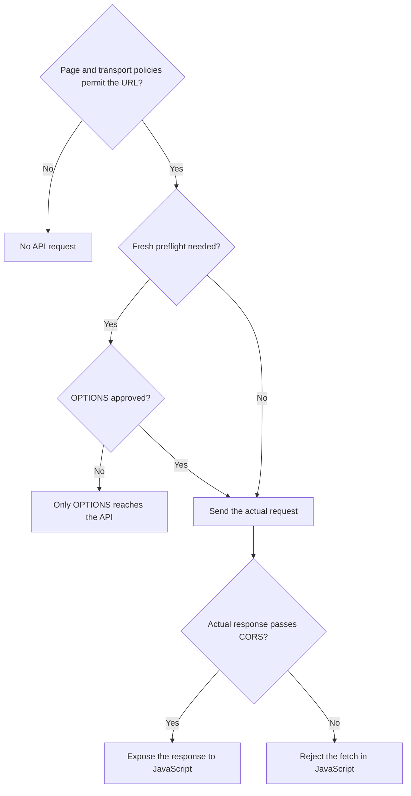

# 10 · Browser security for web apps and APIs

A dispatcher opens `https://app.example.com`. The dashboard calls `https://api.example.com/shipments`. The API logs `200 OK` and the correct shipment IDs, yet the page reports “Failed to fetch.” How can both be true?

**Sending a request and reading its response are separate browser decisions.** A cross-origin `GET` can reach the API, carry an eligible session cookie, and succeed. If the response lacks the CORS headers the browser requires, the browser withholds it from the dashboard's JavaScript. A different outcome is possible when a request needs a preflight. The API may receive only `OPTIONS`, with the intended operation never sent.

**Jump to** · [Origins and sites](#1-compare-origins-and-sites) · [The browser's decisions](#2-what-the-same-origin-policy-protects) · [Credentialed fetch](#3-trace-a-credentialed-shipment-read) · [Preflights](#4-predict-when-a-preflight-runs) · [Cookies and credentials](#5-decide-which-credentials-travel) · [Mixed content, HSTS, and CSP](#6-check-the-page-and-transport-policies) · [Local lab](#9-observe-the-decisions-on-loopback) · [Self-check](#10-check-your-understanding)

**Course material** · [AppSec networking checklist](appsec-networking-checklist.md) · [07 · TLS and HTTPS](07-tls-https-and-certificates.md) · [08 · URLs and HTTP semantics](08-urls-and-http-semantics.md) · [09 · HTTP versions and request boundaries](09-http-versions-and-request-boundaries.md)

## 1. Compare origins and sites

For an ordinary HTTP(S) URL, its **origin** is the combination of **scheme, hostname, and effective port**. The path, query, and fragment select content within that origin. Omitting the default port has the same effect as writing it explicitly. You can inspect the browser's calculation with `new URL("https://app.example.com:443/shipments?page=2").origin`. The result is `https://app.example.com`.

A **schemeful site** usually consists of the scheme and the **registrable domain**. For `app.example.com` the registrable domain is `example.com`. For `dispatch.example.co.uk` it is `example.co.uk` because `co.uk` is a public suffix. Use public-suffix-aware rules for this calculation. Ports do not distinguish sites. For an IP-address host the site uses that host.

Use `https://app.example.com/shipments` as the reference page. These comparisons describe ordinary top-level web pages.

| Compare the page with | Same origin? | Same site? | What changed? |
| --- | --- | --- | --- |
| `https://app.example.com:443/reports?day=1` | Yes | Yes | The explicit default port, path, and query preserve the origin. |
| `https://api.example.com/shipments` | No | Yes | Sibling hostname under the same HTTPS site. This is the course example. |
| `https://app.example.com:8443/shipments` | No | Yes | The effective port changed. |
| `http://app.example.com/shipments` | No | No | The scheme changed. A secure page also faces mixed-content rules for this target. |
| `https://dispatch.example.net/shipments` | No | No | The registrable domain changed. |

DNS, certificates, and routing answer different questions. Two names can resolve to the same CDN address, use the same certificate, and reach the same backend while remaining distinct web origins. Conversely, `https://app.example.com/api/shipments` stays on the dashboard's origin even if a reverse proxy forwards it to a private API. Browser origin checks use the URL the browser requests.

Some documents have an **opaque origin**, including a sandboxed iframe without `allow-same-origin`. Several unrelated opaque origins serialize as `null`. That string does not identify a particular trusted application. Local `file:` behavior can also vary, which is why the lab serves pages over HTTP. [HTML origins and sites](https://html.spec.whatwg.org/multipage/browsers.html#origins) · [Same-site and same-origin examples](https://web.dev/articles/same-site-same-origin)

## 2. What the same-origin policy protects

The **same-origin policy (SOP)** limits how a document or script from one origin can interact with another origin's data. Without this boundary, a page open in one tab could read private material the user is signed into on another site. Browsers still support links, forms, embedded media, and cross-origin communication through specific mechanisms.

| What the dashboard tries to do | Ordinary browser behavior |
| --- | --- |
| Follow a link or submit an HTML form to another origin | Navigation and many submissions are allowed. The original page does not gain DOM access to the resulting cross-origin document. |
| Display a cross-origin image | Display is often allowed, subject to the page and resource policies. Reading its pixels through a canvas requires an appropriately CORS-enabled image load. |
| Read another origin's iframe DOM, local storage, or IndexedDB | Direct access is isolated by origin. Browsers can additionally partition storage in embedded contexts. |
| Read another origin's JSON using `fetch` or XHR | The target origin can opt into sharing its response through **Cross-Origin Resource Sharing (CORS)**. The browser enforces that decision. |
| Exchange selected data with a cooperating iframe | `postMessage` gives the two documents an explicit communication channel. Each side can validate who sent the message and what data it contains. |

For a cross-origin `fetch` in CORS mode, trace one direct request through these decisions. Assume a working network, no redirect or service worker, and no HTTP response already in a cache.



At **send the actual request**, eligible credentials may accompany it. At the API, authentication identifies the dispatcher and authorization determines which shipments they may access. A successful CORS check can therefore expose a `401` or `403` as readily as a `200`. [Same-origin policy](https://developer.mozilla.org/en-US/docs/Web/Security/Defenses/Same-origin_policy) · [Fetch CORS protocol](https://fetch.spec.whatwg.org/#http-cors-protocol)

## 3. Trace a credentialed shipment read

Suppose the dashboard is the top-level page, the API previously set a valid host-only session cookie, and the dashboard's policies permit the HTTPS connection. This code asks the browser to include eligible credentials on a cross-origin read.

```js
const response = await fetch("https://api.example.com/shipments", {
  credentials: "include",
  headers: { Accept: "application/json" },
});
if (!response.ok) throw new Error("Shipment API returned " + response.status);
const shipments = await response.json();
const requestId = response.headers.get("X-Request-ID");
```

Here are selected HTTP fields. The `GET` and the application's `Accept` header qualify for the CORS safelist, so this example does not need a preflight. The request's `Origin` identifies the **page**. `Host` identifies the **destination**. The browser supplies `Origin` and chooses the cookie. The application should never treat a reported origin as proof of a user's identity.

```http
GET /shipments HTTP/1.1
Host: api.example.com
Origin: https://app.example.com
Accept: application/json
Cookie: __Host-session=<redacted>
```

The API checks the session and the dispatcher's access to the records. The API or its configured edge then returns the response to be shared.

```http
HTTP/1.1 200 OK
Content-Type: application/json
Access-Control-Allow-Origin: https://app.example.com
Access-Control-Allow-Credentials: true
Access-Control-Expose-Headers: X-Request-ID
Vary: Origin
Cache-Control: no-store
X-Request-ID: r41

[{"id":"S42","status":"in_transit"}]
```

| Response field | What it does here |
| --- | --- |
| `Access-Control-Allow-Origin` | Names the single origin permitted to read this response. Use the serialized origin with scheme and any nondefault port, without a path or trailing slash. An API serving several trusted dashboards selects the matching origin from its allowlist. |
| `Access-Control-Allow-Credentials: true` | Permits response sharing when the fetch credentials mode is `include`. The value is the literal lowercase `true`. The browser also requires an exact allowed origin. `*` fails this check even if the cookie jar happens to be empty. |
| `Access-Control-Expose-Headers` | Makes `X-Request-ID` readable by the dashboard. A CORS-readable response exposes certain headers such as `Content-Type` by default. The JavaScript-visible headers can be a subset of those shown in DevTools. `Set-Cookie` is never exposed to page JavaScript through `Response.headers`. |
| `Vary: Origin` | When the response headers depend on the requesting origin, caches must distinguish those variants. This does not isolate different signed-in users. Here `Cache-Control: no-store` also directs caches not to store this personalized response. |

For a public resource intended for any origin to read without credentials, `Access-Control-Allow-Origin: *` can be appropriate. For a credentialed API, configure the approved origins explicitly and give the edge or application clear ownership of the CORS headers. Two independent layers adding `Access-Control-Allow-Origin` can produce a response the browser rejects. The frontend cannot grant itself read access by putting an allow header in its outgoing request. [CORS protocol and credentials](https://fetch.spec.whatwg.org/#cors-protocol-and-credentials) · [CORS response headers](https://developer.mozilla.org/en-US/docs/Web/HTTP/Guides/CORS) · [Exposing response headers](https://developer.mozilla.org/en-US/docs/Web/HTTP/Reference/Headers/Access-Control-Expose-Headers)

## 4. Predict when a preflight runs

A **preflight** is a browser-generated `OPTIONS` request asking whether an origin may use a proposed method and request headers. It gives the endpoint a chance to decline before the browser sends the operation. Older web mechanisms, especially HTML forms, could already send some cross-origin requests. The CORS safelist reflects this history. A request that skips preflight can still change server state.

| Ordinary cross-origin fetch from the dashboard | Fresh preflight? | Deciding detail |
| --- | --- | --- |
| `GET /shipments` with `Accept: application/json` | No | The method and this header value are safelisted. The response's JSON content type does not trigger a preflight. |
| The same `GET` with `credentials: "include"` | No | The credentials mode alone does not trigger one. |
| `POST` with standard browser-generated form fields and no extra author headers | Usually no | The method and form encoding can qualify for the safelist. |
| `POST` with `Content-Type: application/json` | Yes | JSON is outside the safelisted **request** media types. |
| `GET` with an application header such as `X-View` or `Authorization` | Yes | The author supplied a header outside the safelist. |
| `PATCH` or `DELETE` | Yes | The method is outside the safelist. |

The safelisted methods are `GET`, `HEAD`, and `POST`. Common safelisted request headers include `Accept`, `Accept-Language`, `Content-Language`, and `Content-Type` for `application/x-www-form-urlencoded`, `multipart/form-data`, or `text/plain`. A `Range` header requesting a single byte range, such as `bytes=0-99`, can also qualify. Header values have syntax and length limits. Streaming request bodies and certain XHR upload listeners have extra rules. The table assumes ordinary non-streaming Fetch calls and no cached preflight permission. [CORS-safelisted request headers](https://developer.mozilla.org/en-US/docs/Glossary/CORS-safelisted_request_header) · [Preflight requests](https://developer.mozilla.org/en-US/docs/Glossary/Preflight_request)

### Follow a JSON create through both exchanges

The dashboard wants to submit the shipment object from lessons 08 and 09 using `POST`, `Content-Type: application/json`, and `credentials: "include"`. It sends the application's `X-CSRF-Token` for the cookie-authenticated write and an `Idempotency-Key` that identifies this create across retries. The first exchange asks about the **method and header names**. It carries neither the JSON nor the user's session cookie.

```http
OPTIONS /shipments HTTP/1.1
Host: api.example.com
Origin: https://app.example.com
Access-Control-Request-Method: POST
Access-Control-Request-Headers: content-type, idempotency-key, x-csrf-token
```

```http
HTTP/1.1 204 No Content
Access-Control-Allow-Origin: https://app.example.com
Access-Control-Allow-Credentials: true
Access-Control-Allow-Methods: POST
Access-Control-Allow-Headers: Content-Type, Idempotency-Key, X-CSRF-Token
Access-Control-Max-Age: 600
Vary: Origin
```

1. **Evaluate the preflight.** The browser expects a successful HTTP status and permission for the origin, credentials mode, method, and proposed headers where required. A bare `204` is insufficient. Requiring a session cookie to answer this `OPTIONS` request prevents the subsequent credentialed operation.
2. **Send the actual `POST` if permitted.** The API now checks the session, CSRF token, business rules, and the user's permission to create the shipment. Preflight approval decides none of those questions.
3. **Evaluate the actual response.** A `201` or a validation error such as `422` needs the appropriate `Access-Control-Allow-Origin` and `Access-Control-Allow-Credentials` for this page to read it. If they are missing, the create could already have committed. On a retry, reuse the key so the API can return the original creation receipt. [Shipment retry contract](18-availability-and-retries.md#4-make-a-shipment-create-safe-to-repeat)

`Access-Control-Allow-Headers` refers to headers the browser may **send**. `Access-Control-Expose-Headers` refers to response headers the script may **read**. If the client explicitly sends `Authorization`, list it by name in the preflight permission. The ordinary HTTP `Allow` header describes methods supported by a resource and does not grant CORS permission.

The browser can reuse a successful preflight decision for matching requests, subject to its own time cap. `Access-Control-Max-Age` governs this separate permission cache. A later `POST` may therefore appear without a fresh `OPTIONS`, while its actual response still needs to pass CORS. [Fetch preflight processing](https://fetch.spec.whatwg.org/#cors-preflight-fetch) · [CORS preflight cache](https://fetch.spec.whatwg.org/#cors-preflight-cache)

## 5. Decide which credentials travel

`mode` and `credentials` control different aspects of Fetch. The usual `mode: "cors"` permits a cross-origin attempt subject to the CORS protocol. `mode: "same-origin"` rejects a cross-origin target. A successful cross-origin `mode: "no-cors"` request gives the page an **opaque** response with status `0`, inaccessible headers, and no readable body. That mode also restricts request methods and headers. An opaque response is unusable for a dashboard that needs to parse shipment JSON.

| Fetch credentials mode | Effect on browser-managed credentials such as cookies |
| --- | --- |
| `"omit"` | Omit credentials, including on a same-origin call. |
| `"same-origin"` (default) | Include eligible credentials on same-origin calls. A sibling API host is cross-origin, so an ordinary fetch there omits its session cookie. |
| `"include"` | Also permit eligible credentials on cross-origin calls. The cookie's own rules and the browser's privacy settings still apply. |

The credentials mode also affects whether the browser honors `Set-Cookie`. A bearer token explicitly added by application code in `Authorization` is a separate request header. Scope it to the intended API. Adding it to a cross-origin fetch ordinarily requires preflight permission for that header. The API still validates the token and authorizes each operation. [Request modes](https://developer.mozilla.org/en-US/docs/Web/API/Request/mode) · [Request credentials](https://developer.mozilla.org/en-US/docs/Web/API/Request/credentials) · [Allowing request headers](https://developer.mozilla.org/en-US/docs/Web/HTTP/Reference/Headers/Access-Control-Allow-Headers)

### Work through one API cookie

Suppose this header arrived from `https://api.example.com` when the dispatcher signed in. The value below stands in for an opaque session identifier.

```http
Set-Cookie: __Host-session=<redacted>; Path=/; Secure; HttpOnly; SameSite=Lax
```

1. **Match the destination.** Omitting `Domain` creates a host-only cookie for `api.example.com`. That is exactly the host receiving the dashboard's API request. There is no need to broaden the cookie to `example.com` merely because the page making the call lives on `app.example.com`. Omitting `Domain`, using `Path=/`, and setting `Secure` are also requirements of the `__Host-` prefix.
2. **Check path, transport, and lifetime.** `Path=/` covers `/shipments`. `Secure` permits the cookie on the example's HTTPS connection. An expired cookie cannot accompany it. Cookies generally span ports on a matching host, even though origin comparisons distinguish ports.
3. **Check the site context.** With the dashboard as the top-level page, both URLs belong to the HTTPS site `example.com`. The same-site context permits this `Lax` cookie on the API fetch. A fetch initiated from a different top-level site generally excludes a `Lax` or `Strict` cookie. `Lax` has a separate allowance for eligible cross-site top-level navigations. `SameSite=None; Secure` makes a cookie eligible for cross-site use, subject to third-party cookie blocking or partitioning.
4. **Check Fetch and the session.** The dashboard uses `credentials: "include"` because the request is cross-origin. `HttpOnly` prevents page script from reading the cookie value, while the browser can attach it to eligible requests. The API must then look up a valid, unexpired session and decide which shipment records it may return.

**Predict the symptom.** Remove `credentials: "include"` from the dashboard code. The browser can still send the `GET`. The API receives no session cookie from that default cross-origin fetch and may return `401`. If that error response has the appropriate CORS headers, the page sees a readable `401` and can ask the dispatcher to sign in. If the browser reports a CORS failure, inspect the error response as well as the cookie selection. [Cookie attributes](https://developer.mozilla.org/en-US/docs/Web/HTTP/Reference/Headers/Set-Cookie) · [HTTP cookie scope](https://www.rfc-editor.org/rfc/rfc6265.html#section-8.5)

## 6. Check the page and transport policies

The API team can configure CORS correctly and still receive no request. Start with the URL the browser is trying to use and the policy on the **calling document**.

### Mixed content

A dashboard delivered over `https://app.example.com` tries to fetch `http://api.example.com/shipments`. If that public API URL remains HTTP, the browser blocks the fetch as **mixed content**. The unprotected connection could change data the secure page relies on. A CORS header on the HTTP endpoint has no opportunity to fix this. Use an HTTPS API URL with a valid certificate.

Browsers can automatically upgrade some image, audio, and video loads to HTTPS. Fetch, scripts, and many other resource types are blockable when the target remains insecure. A top-level navigation has different rules from a subresource fetch. Loopback addresses also receive special treatment as potentially trustworthy contexts in development. A successful local test on HTTP says little about a public HTTPS dashboard calling an HTTP service. [Mixed content](https://developer.mozilla.org/en-US/docs/Web/Security/Defenses/Mixed_content) · [Secure contexts](https://developer.mozilla.org/en-US/docs/Web/Security/Defenses/Secure_Contexts)

### HTTP Strict Transport Security

**HSTS** lets a host tell the browser to use HTTPS for future connections. For example, a valid HTTPS response from `api.example.com` can include the following header.

```http
Strict-Transport-Security: max-age=31536000
```

While the policy is active, the browser upgrades an HTTP URL for that host to HTTPS before sending an HTTP request and enforces valid TLS. With a normal HTTP redirect, the redirecting server would first have to receive the HTTP request. Browsers learn a dynamic HSTS policy from a valid HTTPS response. A preloaded entry can cover the first visit before the browser has learned the policy this way.

The policy belongs to a hostname. `includeSubDomains` on `example.com` also covers its descendants. The same directive on `app.example.com` covers descendants of `app.example.com`, leaving its sibling `api.example.com` outside that policy. Plan the domain coverage before enabling it. The dashboard and API still have different origins after HTTPS is established. [HSTS behavior and scope](https://developer.mozilla.org/en-US/docs/Web/HTTP/Reference/Headers/Strict-Transport-Security) · [HSTS specification](https://www.rfc-editor.org/rfc/rfc6797.html)

### Content Security Policy and `connect-src`

**Content Security Policy (CSP)** lets a document restrict its own resource loads and connections. For this dashboard, the response serving the HTML could carry this policy. It allows same-origin scripts and explicitly names the HTTPS API and secure WebSocket.

```http
Content-Security-Policy: default-src 'self'; connect-src 'self' https://api.example.com wss://api.example.com; object-src 'none'; base-uri 'self'; frame-ancestors 'none'
```

`connect-src` applies to script-initiated connections including `fetch`, XHR, `EventSource`, WebSocket, and `sendBeacon`. If `connect-src` is absent, `default-src` supplies its fallback when present. A policy of only `connect-src 'self'` on the dashboard blocks the sibling API fetch before the API receives it. Adding the API to this policy lets the attempt proceed. The API's CORS decision still controls whether the dashboard can read the HTTP response.

Inspect the enforced policies on the dashboard document. A CSP on a JSON response does not grant the calling page permission to connect. Multiple enforced policies must all permit the action. `Content-Security-Policy-Report-Only` can report a violation while allowing the action to proceed. [CSP `connect-src`](https://developer.mozilla.org/en-US/docs/Web/HTTP/Reference/Headers/Content-Security-Policy/connect-src) · [CSP specification](https://www.w3.org/TR/CSP3/#directive-connect-src) · [Report-only policy](https://developer.mozilla.org/en-US/docs/Web/HTTP/Reference/Headers/Content-Security-Policy-Report-Only)

## 7. Match the protection to the problem

| Situation | Protection and its owner |
| --- | --- |
| A signed-in browser can submit a state-changing request the user did not intend. | **Cross-site request forgery (CSRF).** The API can require a session-bound CSRF token on cookie-authenticated writes and validate the expected `Origin` where appropriate. `SameSite` adds protection. Keep reads free of state changes. Hiding a response with CORS cannot undo an operation the server already performed. |
| A shipment note contains customer-supplied text that the dashboard renders. | **Cross-site scripting (XSS).** Render it as text, for example with `textContent` or normal escaped React text children. Sanitize intentionally supported rich HTML with a maintained sanitizer. A restrictive script CSP is an additional defense. Code executing in the dashboard origin gains that origin's privileges, including the ability to initiate eligible requests. |
| Another page wants to frame the dashboard or exchange messages with it. | **Framing and messaging.** `frame-ancestors` on the dashboard controls who may embed it. This helps prevent clickjacking, where a deceptive interface leads a user to click a control they did not mean to use. `frame-src` on the parent controls which frames the parent loads. For a cooperating frame, send `postMessage` to an exact `targetOrigin` and validate the received `event.origin`, expected window where applicable, and message structure. |
| A cross-origin resource is embedded without a CORS-readable response. | **Resource and document isolation.** A resource owner can restrict applicable `no-cors` loads with Cross-Origin Resource Policy (CORP). A document can use Cross-Origin Embedder Policy (COEP) and Cross-Origin Opener Policy (COOP) for stronger isolation. These policies address embedding and browsing-context relationships. CORS remains the mechanism for sharing API responses with page script. |

[OWASP CSRF prevention](https://cheatsheetseries.owasp.org/cheatsheets/Cross-Site_Request_Forgery_Prevention_Cheat_Sheet.html) · [XSS defenses](https://developer.mozilla.org/en-US/docs/Web/Security/Attacks/XSS) · [Framing policy](https://developer.mozilla.org/en-US/docs/Web/HTTP/Reference/Headers/Content-Security-Policy/frame-ancestors) · [Window messaging](https://developer.mozilla.org/en-US/docs/Web/API/Window/postMessage) · [Cross-origin isolation](https://developer.mozilla.org/en-US/docs/Web/API/Window/crossOriginIsolated)

**Apply this to the live shipment feed.** A browser opening `wss://api.example.com/ws/events` checks the page's `connect-src` policy and establishes a secure connection. A native WebSocket handshake does not use the ordinary Fetch CORS preflight and response-sharing checks. The WebSocket service should validate the browser's `Origin` against its approved origins, authenticate the session, and authorize the requested shipment subscriptions. It also needs to remove access or close the subscription when the dispatcher loses permission. An approved origin identifies a page allowed to connect. It says nothing about which customer's events this dispatcher may receive. [WebSockets Standard](https://websockets.spec.whatwg.org/#opening-handshake) · [OWASP WebSocket security](https://cheatsheetseries.owasp.org/cheatsheets/WebSocket_Security_Cheat_Sheet.html)

## 8. Diagnose a failed fetch

Open DevTools **Network** and **Console**, preserve the log, and reproduce one action. Select the shipment **fetch**, its **OPTIONS** if present, and any redirects. Record the page origin, request URL and method, credential mode used by the frontend, relevant request and response headers, and any console policy message. Compare them with the edge and API logs for that attempt. Redact cookie values, tokens, and personal data before sharing a trace.

| Situation | What can reach the API? | What does page JavaScript get? | Evidence to compare |
| --- | --- | --- | --- |
| Cross-origin `GET` qualifies for the safelist. Actual response lacks a matching allow-origin. | The `GET`, including any eligible credentials. | Rejected fetch. No response object with a readable status or body. | Actual `GET` in the API log, response headers in Network, CORS detail in Console. |
| Fresh preflight is refused. | `OPTIONS` only. | Rejected fetch. | Proposed method and header names, preflight status and permissions, absence of the actual operation in a complete trace. |
| Preflight passes, but the actual response lacks the required CORS permission. | `OPTIONS` and the operation. | Rejected fetch even if the server changed state. | Inspect the actual response, especially error and redirect paths. |
| Session is missing or expired and CORS permits the error response. | The actual request. | A `Response` with `status === 401` and `ok === false`. | Cookie eligibility or expiry and the API's authentication result. A readable `403` points to an explicit refusal. |
| The dashboard's enforced `connect-src` or mixed-content policy blocks the initial fetch. | No HTTP request for that fetch reaches the API. | Rejected fetch. | The document's CSP, target scheme, and Console. DevTools may display a locally blocked row. |
| DNS resolution or TLS verification fails. | No application HTTP request reaches the intended endpoint via that failed connection. | A fetch error can look similar to a policy error in application code. | Resolver result, TLS error, and browser diagnostics from the failing client. |

**Why “curl works” is incomplete evidence.** curl can inspect a server's status and headers. A Node server-side fetch can also read a response according to its own client configuration. Neither runs the calling document's browser SOP, CORS, or CSP checks. In development, a Vite proxy can also make `/api/shipments` same-origin from the browser's perspective, while a production build may call a separate origin directly. Compare the actual URLs first. [Chrome DevTools Network reference](https://developer.chrome.com/docs/devtools/network/reference) · [Using Fetch and checking HTTP errors](https://developer.mozilla.org/en-US/docs/Web/API/Fetch_API/Using_Fetch)

## 9. Observe the decisions on loopback

The dashboard at `http://127.0.0.1:9380` and API at `http://127.0.0.1:9381` are **same-site and cross-origin**. Both use the same scheme and host. Their ports differ. The API serves one fictional shipment and a simulated expired-session response. The page uses `credentials: "omit"` throughout, so you can observe the sharing decisions independently of any existing cookies.

### Start the dashboard and API

Paste this block into Bash or Zsh with Node.js installed. It starts both listeners on IPv4 loopback. No packages, hosts-file changes, or certificates are needed.

```sh
node --input-type=module <<'JS'
import { createServer } from "node:http";

const dashboard = "http://127.0.0.1:9380";
const api = "http://127.0.0.1:9381";
const page = `<!doctype html><html lang="en"><meta charset="utf-8">
<title>Shipment origin lab</title><h1>Shipment origin lab</h1>
<button data-path="/shared">Shared GET</button>
<button data-path="/unshared">Unshared GET</button>
<button data-path="/shared" data-view>Approved preflight</button>
<button data-path="/unshared" data-view>Denied preflight</button>
<button data-path="/expired">Readable 401</button>
<p><a href="/">Allow the API in CSP</a> · <a href="/self-only">Use self-only CSP</a></p>
<pre id="result" aria-live="polite">Choose a request.</pre>
<script src="/lab.js" defer></script></html>`;

const client = `const output = document.querySelector("#result");
for (const button of document.querySelectorAll("button[data-path]")) {
  button.addEventListener("click", async () => {
    const options = { credentials: "omit" };
    if (button.hasAttribute("data-view")) options.headers = { "X-View": "summary" };
    try {
      const url = new URL(button.dataset.path, "http://127.0.0.1:9381");
      const response = await fetch(url, options);
      const payload = await response.json();
      output.textContent = "HTTP " + response.status + " " + JSON.stringify(payload);
    } catch (error) {
      output.textContent = "Fetch rejected (" + error.name + ")";
    }
  });
}`;

createServer((req, res) => {
  res.setHeader("Cache-Control", "no-store");
  if (req.url === "/lab.js") {
    res.writeHead(200, { "Content-Type": "text/javascript; charset=utf-8" });
    return res.end(client);
  }
  if (req.url !== "/" && req.url !== "/self-only") return res.writeHead(404).end();
  const destinations = req.url === "/self-only" ? "'self'" : "'self' " + api;
  res.writeHead(200, {
    "Content-Type": "text/html; charset=utf-8",
    "Content-Security-Policy": "default-src 'self'; connect-src " + destinations +
      "; object-src 'none'; base-uri 'none'; frame-ancestors 'none'",
  });
  res.end(page);
}).listen(9380, "127.0.0.1", () => console.log("Dashboard", dashboard));

createServer((req, res) => {
  const route = req.url;
  const approvedOrigin = req.headers.origin === dashboard;
  res.setHeader("Cache-Control", "no-store");
  res.setHeader("Vary", "Origin");
  if (approvedOrigin && (route === "/shared" || route === "/expired")) {
    res.setHeader("Access-Control-Allow-Origin", dashboard);
  }

  function finish(status, value) {
    console.log(req.method, route, status);
    if (value === undefined) return res.writeHead(status).end();
    res.writeHead(status, { "Content-Type": "application/json" });
    res.end(JSON.stringify(value));
  }

  if (req.method === "OPTIONS") {
    const requestedMethod = req.headers["access-control-request-method"];
    if (!approvedOrigin || route !== "/shared" || requestedMethod !== "GET") {
      return finish(403);
    }
    res.setHeader("Access-Control-Allow-Methods", "GET");
    res.setHeader("Access-Control-Allow-Headers", "X-View");
    res.setHeader("Access-Control-Max-Age", "0");
    return finish(204);
  }
  if (req.method !== "GET") {
    res.setHeader("Allow", "GET, OPTIONS");
    return finish(405);
  }
  if (route === "/expired") {
    res.setHeader("WWW-Authenticate", 'Bearer realm="demo"');
    return finish(401, { error: "demo_session_expired" });
  }
  if (route === "/shared" || route === "/unshared") return finish(200, [{ id: "S42" }]);
  finish(404);
}).listen(9381, "127.0.0.1", () => console.log("API", api));
JS
```

### Predict, click, and compare

Open `http://127.0.0.1:9380/` using that exact host spelling. Open DevTools **Network** and **Console**. Click one button at a time while watching the API's terminal. The expected observations below assume the dashboard's initial CSP and no prior cached preflight permission. The exercise sets the preflight max age to zero.

| Browser action | Expected API log | Expected page result |
| --- | --- | --- |
| **Shared GET** | `GET /shared 200` | `HTTP 200 [{"id":"S42"}]`. The API shared this response with the dashboard. |
| **Unshared GET** | `GET /unshared 200` | Fetch rejects. The same JSON exists at the server, and the response lacks allow-origin. |
| **Approved preflight** | `OPTIONS /shared 204`, then `GET /shared 200` | Readable `200`. Inspect `Access-Control-Request-Headers: x-view` on the preflight. |
| **Denied preflight** | `OPTIONS /unshared 403` only | Fetch rejects. Compare this log with **Unshared GET**. One button delivered a `GET` to the API, the other delivered only `OPTIONS`. |
| **Readable 401** | `GET /expired 401` | `HTTP 401 {"error":"demo_session_expired"}`. The page could inspect an error response that passed CORS. |
| Follow **Use self-only CSP**, then click **Shared GET** | No new API log entry for the click | Fetch rejects. The Console should identify `connect-src`. The API's allow-origin configuration is the same as on the successful first run. |

For a final comparison, run this command in a second terminal. curl can read the unshared resource's synthetic JSON. The browser's **Unshared GET** also reaches the server. The observable difference is who can read the returned bytes.

```sh
curl --noproxy '*' --silent --show-error --include 'http://127.0.0.1:9381/unshared'
```

Click **Allow the API in CSP** to restore the initial document policy. Stop the two listeners with **Ctrl-C** in the server terminal.

## 10. Check your understanding

1. The dashboard and API resolve to the same CDN address and use the same certificate. Why are `https://app.example.com` and `https://api.example.com` cross-origin? Why are they same-site?
2. The API sees a plain cross-origin `GET /shipments` with a valid session and returns `200`. The page catches a `TypeError`. Name a response-header explanation. Could the API already have recorded the read?
3. A dispatcher submits JSON with `credentials: "include"`. The only API entry is `OPTIONS /shipments 401`. Was the JSON sent? Where should the service evaluate the user's session?
4. The API returns `Access-Control-Allow-Origin: *` and `Access-Control-Allow-Credentials: true`. The dashboard uses `include`, but the user has no cookies. Can the page read the response?
5. The API's host-only session cookie is `Secure; HttpOnly; SameSite=Lax`. Must it set `Domain=example.com`, use `SameSite=None`, or expose the cookie to JavaScript for this top-level dashboard to read shipments?
6. The dashboard uses HTTPS and enforces `connect-src 'self'`. Someone changes the API URL to `https://api.example.com` and adds correct CORS headers. Why can the browser still block it? Would HSTS on `app.example.com` cover the sibling API?
7. The page can parse the shipment JSON. DevTools shows `X-Request-ID: r41`, but `response.headers.get("X-Request-ID")` returns `null`. Which header is relevant?
8. A credentialed create received a successful preflight. Its final response failed CORS. What should be checked before retrying, and which controls on the server protect the write?
9. A WebSocket at `wss://api.example.com/ws/events` opens successfully. The dispatcher's permission for one customer is then revoked. Which component must stop those shipment updates?

### Answer key

1. The hostnames differ, so the origin tuples differ. Both use HTTPS and share the registrable domain `example.com`, so they are same-site. The network address and certificate do not enter either URL comparison.
2. The actual response could lack an exact `Access-Control-Allow-Origin` or the required `Access-Control-Allow-Credentials: true`. Yes, the API could have processed and logged the read. Compare the actual response with the page origin and Fetch credentials mode.
3. With a failed fresh preflight, the browser withholds the actual `POST`. The service should answer the preflight according to its origin, method, and header policy and check the user session on the actual protected operation.
4. No. Fetch uses the configured credentials **mode** when deciding if the wildcard is valid. An empty cookie jar does not change that mode.
5. No to all three. The cookie matches the API destination, and this top-level dashboard makes a same-site request. Use `credentials: "include"` for the cross-origin fetch, send valid credentialed CORS headers, and authorize the dispatcher at the API.
6. The dashboard's enforced CSP must permit the API destination. HTTPS and CORS solve other parts of the exchange. HSTS on `app.example.com` does not extend to its sibling `api.example.com`.
7. `Access-Control-Expose-Headers: X-Request-ID` on the actual response exposes the response header to script. `Access-Control-Allow-Headers` governs headers proposed for the outgoing request.
8. The operation may have committed. Check the application outcome or use the API's documented idempotency mechanism. The API verifies the session, the CSRF protection for the write, and the user's permission. The browser's CORS error only describes access to the response.
9. The WebSocket service must revoke the affected subscription or close the connection as appropriate and stop delivering those records. The opening origin check and the page's CSP do not track later changes to user permissions.

---

[Previous · 09 HTTP versions and request boundaries](09-http-versions-and-request-boundaries.md) · [Course checklist](appsec-networking-checklist.md) · [Next · 11 Cookies and credentials](11-cookies-and-credentials.md)
