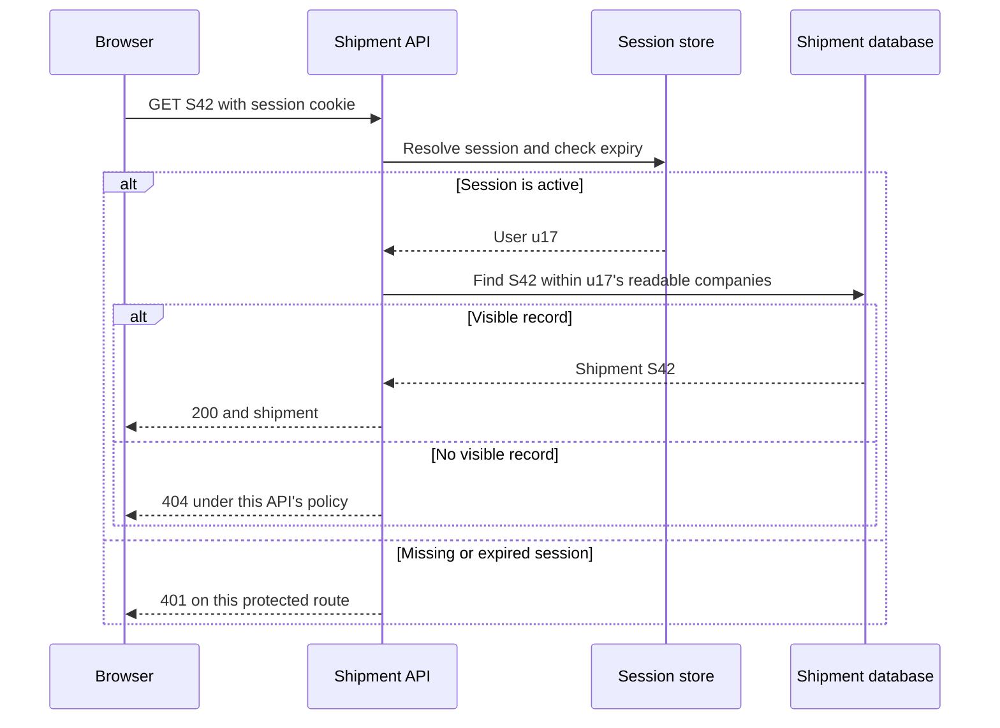

# 11 · Cookies and credentials

Dana signs in to a shipment dashboard. She can open shipment `S42`, but another shipment, `S77`, is outside her company. Her browser sends the **same session cookie** on both requests. How can the API return one record and keep the other private?

The cookie lets the API look up Dana’s session. The session identifies her as user `u17`. To read a shipment, the API also checks her current membership against the company that owns the requested record. In the example, `S42` belongs to North, where Dana is a dispatcher. `S77` belongs to South, where she has no membership. Following one request from the browser’s cookie jar to that database decision answers the checklist’s question.

**Jump to** · [Sign-in and first read](#1-follow-a-sign-in-and-one-shipment-read) · [Cookie scope](#2-predict-which-cookies-travel) · [Fetch and CORS](#3-work-out-what-fetch-will-send) · [Session lifetime and logout](#4-manage-the-session-lifetime) · [Bearer tokens](#5-use-a-bearer-access-token) · [CSRF](#6-protect-a-cookie-authenticated-write) · [Record permissions](#7-authorize-the-action-on-the-record) · [Diagnosis](#8-read-the-evidence) · [Offline exercise](#9-try-the-record-check-in-sqlite) · [Self-check](#10-check-your-understanding)

**Course connections** · [AppSec networking checklist](https://chatgpt.com/library?file_id=libfile_a587b9ac4b10819195b004ce505754a5&account_id=personal) · [07 · TLS and HTTPS](https://chatgpt.com/library?file_id=libfile_cea672efcaf48191871c267844a6056e&account_id=personal) · [08 · URLs and HTTP](https://chatgpt.com/library?file_id=libfile_d78890543454819199535d49b9c64747&account_id=personal) · [10 · Browser security](https://chatgpt.com/library?file_id=libfile_1e1aa473cebc8191a2cd45fdb3c83bd0&account_id=personal)

## 1. Follow a sign-in and one shipment read

A **credential** is evidence a caller presents to establish an identity or delegated access. A **cookie** is a named value a browser can store and attach to matching HTTP requests. A language preference can be a cookie. A cookie whose value identifies a live signed-in session is also a credential. **Authentication** establishes who the caller is. **Authorization** decides whether that caller may perform this action on this resource.

The top-level dashboard is `https://app.example.com`. Its frontend calls `https://api.example.com` over HTTPS. The API owns the session cookie. These fictional hosts illustrate the exchange, and the SQLite exercise in section 9 runs locally. Values in angle brackets stand in for secrets. The HTTP examples show selected fields and use HTTP/1.1 notation for readability. The same cookie and authorization semantics apply over HTTP/2 and HTTP/3.

### The API establishes a session

1. Dana completes the application’s sign-in flow, for example with a passkey. Once her identity has been verified, the API creates a fresh, unpredictable **session ID** with a cryptographically secure random generator. It stores a session record associated with `u17`, its creation time, last activity and expiry. An **opaque** ID has meaning through that lookup. Possession of the ID is enough to present this session on later requests, so the ID itself is a secret.
2. The dashboard made the cross-origin sign-in request with `credentials: "include"`. The API returns the following response. The browser processes `Set-Cookie` and puts the accepted cookie in its cookie jar. The dashboard can read the JSON body under the CORS policy shown.

```http
HTTP/1.1 200 OK
Content-Type: application/json
Cache-Control: no-store
Access-Control-Allow-Origin: https://app.example.com
Access-Control-Allow-Credentials: true
Set-Cookie: __Host-session=<opaque-id>; Path=/; Secure; HttpOnly; SameSite=Lax; Max-Age=28800

{"displayName":"Dana"}
```

### The browser uses the session

The dashboard requests `GET /shipments/S42` with `credentials: "include"`. The destination matches the cookie, so the browser adds it to the request.

```http
GET /shipments/S42 HTTP/1.1
Host: api.example.com
Origin: https://app.example.com
Cookie: __Host-session=<opaque-id>
```

Read the headers in the two directions. **`Set-Cookie`** carries a name, a value and the storage rules from the server to the browser. **`Cookie`** carries the selected name and value back. Attributes such as `HttpOnly`, `SameSite` and `Path` stay in the cookie jar. A request can carry several pairs in one `Cookie` field. To set several cookies, send a separate `Set-Cookie` field for each. [HTTP cookie guide](https://developer.mozilla.org/en-US/docs/Web/HTTP/Guides/Cookies) · [Cookie request syntax](https://www.rfc-editor.org/rfc/rfc6265.html#section-4.2)



The API can perform the session and shipment lookups against one database. The diagram separates the questions they answer. Several dispatchers can share an office NAT address, and one browser connection can carry many requests. The service uses the credential on each request to establish the caller.

## 2. Predict which cookies travel

Start with the **destination URL**. Then consider the page that initiated the request, how it initiated it, the request’s credentials mode and the browser’s privacy settings. These answer different parts of cookie selection.

| Setting | What the browser does | Consequence for the shipment API |
| --- | --- | --- |
| `Domain` omitted | Creates a **host-only** cookie for the host that set it. | A cookie from `api.example.com` matches that exact hostname. The dashboard can initiate a request **to** that host while the cookie stays scoped to the API. |
| `Domain=example.com` | Matches `example.com` and its subdomains. A server can generally set a cookie for its own host or a qualifying parent. Browsers reject an unrelated domain or a shared public suffix such as `com` in this scenario. A leading dot has no effect. | Both `app.example.com` and `api.example.com` would receive an otherwise eligible cookie. Even `Domain=api.example.com` extends to descendants of the API host. Omit `Domain` when only the exact API host needs the session. |
| `Path` | Matches the exact path or a qualifying subpath. If omitted, the browser derives a default from the setting URL’s directory. | `Path=/api` matches `/api` and `/api/shipments`. It skips `/apiv2` and `/shipments`. A cookie set at `/auth/login` with its default path can therefore miss the shipment route. Paths help select requests. Applications sharing a host need stronger isolation for secrets. |
| `Secure` | Limits delivery to secure transport in ordinary HTTPS deployments. | The session can travel on HTTPS to the API. Every component that terminates TLS and receives that header can read the credential. Protect the next hop where the edge forwards it. |
| `HttpOnly` | Keeps the value out of page APIs such as `document.cookie`. The browser can still attach it to HTTP requests initiated by JavaScript. | The dashboard can get a signed-in shipment response without reading the session ID. Script running with the dashboard’s privileges can still make requests as the user. |
| `SameSite` | Uses the site context and, for `Lax`, the navigation type and HTTP method to decide cross-site delivery. | The dashboard and API are same-site under HTTPS. An unrelated site embedding the dashboard presents a different context. |
| `Max-Age` and `Expires` | `Max-Age` is a lifetime in seconds. `Expires` is an absolute date. A valid `Max-Age` takes precedence when both are present. Without either, the cookie is a browser-session cookie. | `28800` is eight hours. Browser session restore can retain session cookies after a restart. The server enforces its own deadline even if the browser still has the value. |
| `__Host-` name prefix | Supporting browsers require a secure origin, `Secure`, `Path=/` and an omitted `Domain`. The prefix is part of the cookie’s name. | `__Host-session` makes the host-only intent enforceable at set time. Add `HttpOnly` explicitly for a session ID. HTTPS ports on the same hostname share cookie scope. |

A browser can store two ordinary cookies with the same name under different paths or domain scopes. Both can appear on one request, which carries only their name/value pairs. Give an authentication cookie an unambiguous name and scope. If migrating a cookie, explicitly expire the old scope. [Set-Cookie attributes and prefixes](https://developer.mozilla.org/en-US/docs/Web/HTTP/Reference/Headers/Set-Cookie) · [Domain and path matching](https://www.rfc-editor.org/rfc/rfc6265.html#section-5.1)

### SameSite in three ordinary contexts

An **origin** combines scheme, hostname and effective port. For ordinary web domains, a **site** combines scheme and registrable domain, such as `https` and `example.com`. The HTTPS dashboard and API have different hosts and therefore different origins. They share a site. Port changes can change the origin while leaving cookie host scope and site the same. The registrable domain follows public-suffix rules, so for `shop.example.co.uk` it is `example.co.uk`. [Definition of site](https://developer.mozilla.org/en-US/docs/Glossary/Site)

Assume an existing API cookie, a matching URL, a top-level initiating page, and ordinary navigation or a fetch configured to include cookies. The table shows what **SameSite itself** permits.

| Context | `Strict` | Explicit `Lax` | `None; Secure` |
| --- | --- | --- | --- |
| Dashboard fetches the same-site HTTPS API | Eligible | Eligible | Eligible |
| User follows a link from an unrelated site to a top-level API `GET` | Withheld on the incoming cross-site navigation | Eligible | Eligible |
| An unrelated site makes an embedded request to the API, or initiates a cross-site top-level `POST` | Withheld | Withheld | Eligible, subject to browser privacy policy |

Set the intended value explicitly. Many browsers apply a Lax-style default when the attribute is missing, and some have a short exception for recently set cookies on top-level `POST`. `SameSite=None` requires `Secure`. Browsers can still restrict third-party cookies. For a deliberately embedded service, `Partitioned; Secure` gives a cookie separate storage per top-level site in supporting browsers. An embed used on two customers’ sites can therefore have two different cookie values. [SameSite behavior](https://developer.mozilla.org/en-US/docs/Web/HTTP/Reference/Headers/Set-Cookie#samesitesamesite-value) · [Partitioned cookies](https://developer.mozilla.org/en-US/docs/Web/Privacy/Guides/Privacy_sandbox/Partitioned_cookies)

## 3. Work out what Fetch will send

`fetch` defaults to `credentials: "same-origin"`. The dashboard’s call to the sibling API is cross-origin, even though it is same-site. The following read opts in to browser-managed credentials.

```js
const response = await fetch("https://api.example.com/shipments/S42", {
  credentials: "include",
});
if (!response.ok) throw new Error("Shipment API returned " + response.status);
const shipment = await response.json();
```

| Credentials mode | Applied to browser-managed credentials such as cookies |
| --- | --- |
| `"omit"` | Fetch omits them and ignores `Set-Cookie` for this request. |
| `"same-origin"` | Fetch uses them and respects `Set-Cookie` for same-origin requests. This is the default. |
| `"include"` | Fetch permits them on a cross-origin request too. Cookie scope, expiry, SameSite and browser privacy rules still apply. Use this on the cross-origin request that **establishes** the cookie as well as later reads. |

Predict the outgoing header in each case. Assume Dana’s API cookie from section 1 is stored and active, the dashboard is the top-level page, and the page and network allow the request.

| Request the dashboard makes | Does the API session cookie travel? | Deciding fact |
| --- | --- | --- |
| `fetch("https://api.example.com/shipments/S42")` | No | The default credentials mode excludes browser-managed cookies on this cross-origin call. |
| The same fetch with `credentials: "include"` | Yes | The destination matches the API cookie, and the context is same-site. |
| `fetch("/shipments/S42")` from `app.example.com` | No | The relative URL goes to the dashboard’s host. An API host-only cookie misses that destination. |
| Fetch to `https://api.example.com:8443/shipments/S42` with `"include"` | Yes, if the HTTPS endpoint is reached | Cookie host matching ignores ports. A different HTTPS service on that port can receive it. |

For the frontend to **read the cross-origin response** in the `"include"` example, the response must allow `https://app.example.com` explicitly with `Access-Control-Allow-Origin` and include `Access-Control-Allow-Credentials: true`. A wildcard origin fails for that credentials mode. If the server selects the allowed origin dynamically, send `Vary: Origin` on responses that vary with it. A basic `GET` with no author-supplied non-safelisted headers can carry a cookie without a preflight. CORS can hide the response after the API has processed the request. Page JavaScript cannot set the `Cookie` header manually or read `Set-Cookie` from `response.headers`. DevTools can show both directions. [Fetch credentials and CORS](https://fetch.spec.whatwg.org/#cors-protocol-and-credentials) · [MDN CORS guide](https://developer.mozilla.org/en-US/docs/Web/HTTP/Guides/CORS)

## 4. Manage the session lifetime

The browser and the server keep different clocks. **Session cookie** describes how long the browser keeps a cookie. **Session ID** describes what its value does. Dana’s cookie contains a session ID and has an explicit eight-hour browser lifetime. The API can expire or revoke that session earlier.

| Event | What the API does | What Dana observes |
| --- | --- | --- |
| Successful sign-in | Generates a new session ID and invalidates any pre-sign-in ID that would otherwise gain privileges. This rotation prevents **session fixation**, where an ID known before sign-in remains usable afterward. | The browser accepts the new `Set-Cookie`. |
| Authenticated use | Looks up the session, checks revocation and deadlines, and records accepted activity according to policy. | Requests work while the session and permissions are valid. |
| Idle timeout | Expires a session after a configured period without qualifying activity. | With a 20-minute idle limit and last activity at 09:12, a request at 09:33 needs a new sign-in. The browser may still have the cookie. |
| Absolute timeout | Enforces a maximum session age measured from creation, regardless of activity. | With an eight-hour limit, a session created at 09:00 expires by 17:00 even if used at 16:59. These example times are application policy. |
| Privilege or account change | Rechecks current access, rotates the ID on privilege elevation, and revokes affected sessions when policy requires it. | Removing Dana’s North membership takes away her shipment access even while she can still be signed in to her account. |
| Sign-out | Invalidates the server’s session record and sends an expiring cookie with the original name, host/domain scope and path. | A later protected request needs an active credential. Other devices have their own sessions unless sign-out policy revokes those too. |

For the active host-only cookie in section 1, a successful sign-out response from `api.example.com` can include the following. Its `Max-Age=0` removes the browser’s copy. Clearing the cookie through browser settings alone leaves the server record subject to its existing expiry or revocation policy.

```http
Set-Cookie: __Host-session=; Path=/; Secure; HttpOnly; SameSite=Lax; Max-Age=0
```

Use the framework’s session facility for ID generation, rotation and invalidation. Keep identifying data and mutable permissions on the server for this design. A deployment that stores sessions across several API instances needs those instances to agree on expiry and revocation. A browser restart, a disabled button or a redirect to the sign-in page provides insufficient evidence that a server session was revoked. [OWASP session lifecycle](https://cheatsheetseries.owasp.org/cheatsheets/Session_Management_Cheat_Sheet.html)

## 5. Use a bearer access token

Suppose a dispatch integration has been granted access to read shipments. It calls the API using an **access token** issued for that API. With the **Bearer** scheme, possession of a valid token is sufficient to present the grant. Treat the value as a secret throughout its lifetime. Here the client deliberately supplies the header.

```http
GET /shipments/S42 HTTP/1.1
Host: api.example.com
Authorization: Bearer <access-token>
```

The resource server, here the shipment API, validates the token and establishes a **principal**, the user or service whose access it will evaluate. For a delegated user token, the app’s granted scope and the user’s own permissions both limit the action. A token issued to a background service identifies that service and is evaluated against its own permissions. A scope such as `shipments:read` can permit this category of operation. The API still checks which companies and records the principal can read.

### Know what each value is for

| Value | Intended recipient and use | How it is evaluated |
| --- | --- | --- |
| Opaque session ID | The application that established the browser session, usually via `Cookie`. | The application looks up an active session and its associated user. |
| Opaque access token | The intended resource server, normally via `Authorization: Bearer`. | The API looks up trusted token metadata, locally or through a protected **introspection** service that reports whether the token is active and what was granted. |
| Signed JWT access token | The intended resource server using the same bearer header. JWT stands for JSON Web Token. | The API verifies the signature with trusted issuer keys and allowed algorithms. It checks token type, issuer (`iss`), intended audience (`aud`), expiry (`exp`) and any applicable start time (`nbf`). It applies the granted scopes and the record policy. A signed JWT’s claims are ordinarily readable by its holder. |
| OAuth refresh token | The authorization server’s token endpoint, where a client requests a new access token. | The authorization server checks the client, grant and refresh-token policy. Refresh tokens require protected storage and may rotate. Shipment endpoints accept access tokens. |
| OpenID Connect ID token | The client application that requested sign-in. It describes an authentication event for that client. | The client validates it for its own audience. The shipment API expects an access token intended for the API. |

**Credential format and transport are separate choices.** An opaque value can travel in a bearer header. A JWT can travel in a cookie, in which case the browser’s cookie delivery rules and the application’s CSRF protections apply. Decoding a JWT displays its claims. Trust comes from verifying the token and its context. An API key is another common credential for integrations. If a key identifies an application, the API still needs a source of user identity for operations performed on a particular user’s behalf. [Bearer token use](https://www.rfc-editor.org/rfc/rfc6750.html#section-2.1) · [JWT access-token validation](https://www.rfc-editor.org/rfc/rfc9068.html#section-4) · [OAuth token security](https://www.rfc-editor.org/rfc/rfc9700.html)

To see the audience distinction, suppose the dashboard has client ID `dispatch-web` and the shipment API has audience `shipments-api`. An ID token issued for `dispatch-web` proves a sign-in to that client. The API expects a token issued for `shipments-api`. The same identity provider can sign both, so the signature alone cannot tell the API which token it received. [OpenID Connect ID tokens](https://openid.net/specs/openid-connect-core-1_0.html#IDToken) · [OAuth token introspection](https://www.rfc-editor.org/rfc/rfc7662.html#section-2.2)

### Choose who holds the secret

- **Browser with a server-side session.** An `HttpOnly` cookie keeps the ID out of frontend JavaScript. In a backend-for-frontend design, the browser sends that cookie to its own backend, which keeps any upstream access and refresh tokens server-side. Browser writes using the cookie need CSRF protection.
- **Browser that calls a bearer-token API directly.** The frontend explicitly adds `Authorization` for the intended API. A token held in memory disappears when that JavaScript context ends. `localStorage` persists across browser sessions, while `sessionStorage` is scoped to the origin and tab’s page session. Script running with access to that origin can read either web storage area. Cross-site scripting (XSS) gives injected script the page’s privileges, which can also let it act through the authenticated page. [Web storage lifetime](https://developer.mozilla.org/en-US/docs/Web/API/Window/sessionStorage)
- **Server-to-server client.** A backend can obtain its own short-lived token, keep it in protected server-side storage and send it over TLS. Giving a shared integration secret to code shipped to every browser gives every recipient access to it.

In browser Fetch, `credentials: "omit"` suppresses browser-managed credentials. An `Authorization` header explicitly supplied by the application can still travel. On a cross-origin browser call, that header triggers a preflight unless a matching permission is already cached. The API must explicitly allow the `Authorization` header for that origin. A standalone server client does not perform a browser CORS preflight. Keep bearer credentials out of URLs, where they can enter access logs, history and telemetry. [Fetch request headers and CORS](https://fetch.spec.whatwg.org/#cors-non-wildcard-request-header-name) · [Web storage and sensitive information](https://cheatsheetseries.owasp.org/cheatsheets/HTML5_Security_Cheat_Sheet.html#storage-apis) · [Bearer token security](https://www.rfc-editor.org/rfc/rfc6750.html#section-5)

**What happens at logout?** An opaque token can stop working when its authoritative record is revoked and the API observes that change. A signed access token validated locally can remain usable until expiry unless the API also consults revocation state or another current policy. Revoking a refresh grant prevents future renewal under that grant. Already-issued access tokens have their own validity rules. Short lifetimes bound that interval. [OAuth refresh-token protection](https://www.rfc-editor.org/rfc/rfc9700.html#section-4.14)

## 6. Protect a cookie-authenticated write

**Cross-site request forgery (CSRF)** occurs when another site induces a user’s browser to perform an unwanted action at an application where the user is signed in. The underlying problem is **automatic credential attachment**. If a request is eligible to carry Dana’s cookie, her valid session can accompany an action she never intended. Some cross-origin form submissions reach a server without preflight. A site can cause an unwanted change even when the browser prevents it from reading the response.

Consider Dana pressing **Dispatch** for `S42`. This example uses a **synchronizer token**, a random secret tied to her current session and checked on state-changing requests.

1. The dashboard reads `GET /session` with `credentials: "include"`. The API includes the CSRF token in a private, `Cache-Control: no-store` JSON response readable by the trusted dashboard origin. The dashboard keeps the CSRF token available to its code while the session ID stays in its `HttpOnly` cookie.
2. When Dana presses **Dispatch**, the dashboard makes a credentialed `PATCH`, sends the CSRF token in `X-CSRF-Token` and includes a JSON body. This cross-origin method and custom header require a preflight unless a matching grant is already cached. The browser’s `OPTIONS` preflight carries the proposed method and header names and omits the session cookie. The API can answer it from its allowed-origin, method and header policy.
3. On the actual request, the API validates the live session, checks the exact browser origin against its allowlist, verifies the submitted CSRF token against the session, and authorizes the `dispatch` action for `S42`. Only then does it commit the state change.

```http
PATCH /shipments/S42 HTTP/1.1
Host: api.example.com
Origin: https://app.example.com
Cookie: __Host-session=<opaque-id>
X-CSRF-Token: <token-for-this-session>
Content-Type: application/json

{"status":"dispatched"}
```

For this request the preflight response allows `https://app.example.com`, credentials, method `PATCH` and headers `Content-Type, X-CSRF-Token`. The actual response also needs the origin and credential-sharing headers for the dashboard to read it. A CSRF token in a hidden field serves a similar purpose on a traditional HTML form. Use a maintained framework’s CSRF facility. One alternative for a stateless design is **signed double-submit**. It puts a CSRF token in a separate cookie and asks the client to submit its value again in a header or form field. The server checks both copies and verifies the signature that binds the token to the login session.

| Control | Which decision it supports |
| --- | --- |
| Session cookie | Identifies the signed-in session when the browser attaches it. |
| CSRF token | Supplies evidence that the caller could obtain a value issued for this session through the trusted app. Its protection depends on the trusted app keeping that value private. |
| `Origin` check | Verifies the expected source origin on browser writes. Define a deliberate fallback for an absent `Origin`, such as checking the full origin of a trusted `Referer` or rejecting an unverifiable browser write. |
| `SameSite` | Reduces cross-site cookie delivery. Sibling HTTPS subdomains can share a site while belonging to different applications, so this boundary is broader than the dashboard’s origin. |
| Record permission | Determines whether this dispatcher is allowed to change this shipment, even with a valid session and CSRF token. |

Keep reads such as `GET /shipments/S42` free of state-changing actions. Explicit `SameSite=Lax` permits cookies on some top-level `GET` navigations. Protect cookie-authenticated writes, including `POST`, `PUT`, `PATCH` and `DELETE`. A `POST /session/logout` is one such write. Sign-in also needs CSRF consideration when a browser could otherwise be signed in to an unintended account. An API that accepts **only** an explicit bearer header avoids the ordinary cookie-attachment mechanism behind CSRF. For a route that accepts either credential, define how it selects one identity, reject conflicting principals, and apply CSRF checks whenever a cookie authenticates the action. [OWASP CSRF prevention](https://cheatsheetseries.owasp.org/cheatsheets/Cross-Site_Request_Forgery_Prevention_Cheat_Sheet.html) · [Safe HTTP methods](https://www.rfc-editor.org/rfc/rfc9110.html#section-9.2.1)

## 7. Authorize the action on the record

A **tenant** is a customer organization whose data the application keeps separate. This example has a small policy. A North viewer can read North shipments. A North dispatcher can also dispatch them. Each shipment has a tenant recorded in the database. The API gets the caller’s identity from a verified credential and checks that identity’s current membership and role.

| Caller and request | Server-side facts | Decision under this example policy |
| --- | --- | --- |
| Dana reads `S42` | `u17` is a North dispatcher. `S42` belongs to North. | Return the shipment. |
| Dana reads `S77` | The same active session identifies `u17`. `S77` belongs to South, where she has no membership. | Return the same `404` used for an unknown shipment, keeping other tenants’ records private. |
| Lee reads `S42` | Lee (`u29`) is a North viewer. | Return the shipment. |
| Lee tries to dispatch `S42` | Lee can see the record. The `dispatch` action requires the dispatcher role. | Return `403` and leave the shipment in its current state. |
| An integration presents a `shipments:read` token for a write | The token is valid for this API, but its grant covers reads. | Deny the write on scope, even if the represented user is a dispatcher. |

Put the check at the API’s data access or policy layer, where it has both the **trusted principal** and the **requested operation and object**. In an update, use the permission predicate in the mutation itself, or enforce it with an equivalent transaction or database policy. This keeps authorization tied to the row that actually changes. Apply the same visibility rule before pagination, counts and exports. Otherwise a list or count can reveal records that the detail route would hide.

An ID such as `S42` selects a candidate record. A route prefix, a tenant ID supplied by the frontend, a disabled button and an unguessable record ID each leave the API’s permission question open. A gateway may verify the credential once, provided the API can trust the resulting identity and the path by which it arrives. The component with authoritative object and membership data must still enforce record access. Skipping that check is called **broken object-level authorization**. [OWASP authorization guidance](https://cheatsheetseries.owasp.org/cheatsheets/Authorization_Cheat_Sheet.html) · [OWASP API object-level authorization](https://owasp.org/API-Security/editions/2023/en/0xa1-broken-object-level-authorization/)

## 8. Read the evidence

On a training app you control, follow a normal sign-in, an allowed read and sign-out with DevTools open. If you have access to application logs, correlate the same read with its request ID. These observations answer different questions.

| Observation | Evidence to inspect | What it establishes |
| --- | --- | --- |
| Sign-in succeeded, but no cookie appears | In **Network**, inspect the sign-in response’s `Set-Cookie` and any blocked-cookie reason. In **Application** or **Storage**, inspect the cookie under the **API host**. | Emission, acceptance and storage are distinct. Record the name and attributes without copying the value. |
| The API cookie is stored, but the protected request has no `Cookie` | Check the actual request URL, scheme, host, path, initiator, Fetch credentials mode, cookie expiry and DevTools’ inclusion/exclusion reason. | A stored cookie can be ineligible for a particular request. Also distinguish the `OPTIONS` row from the actual operation. |
| A credential reached the service, which returned `401` | Correlate the protected route with session lookup, token validation, expiry and revocation. A Bearer API can challenge with `WWW-Authenticate: Bearer` and use `error="invalid_token"` for an expired or invalid token. | Presence of a header establishes delivery. Successful authentication requires a valid credential for this API. |
| An authenticated request returned `403` or `404` | Check the route, principal, action, CSRF outcome for a write, and the object-policy decision. | `403` can indicate insufficient scope, role or a failed write protection. A deliberate `404` can conceal an out-of-scope record. The status alone cannot identify the failed check. |
| The page reports a fetch error | Inspect the preflight and actual request separately. Compare the service’s response with the browser’s CORS messages. | A denied preflight can stop the actual request. A response-sharing failure can hide a completed operation. Confirm the outcome before repeating a write. |
| Sign-out appears successful | Check the sign-out response’s deletion attributes and the authoritative session-revocation event. | The browser’s cookie view and server’s session record provide evidence for their respective sides of logout. |

For an allowed read, an internal log entry might record `request_id=r42 user=u17 action=shipment.read resource=S42 decision=allow status=200`. A matching Network row identifies which credential **type** travelled. The API log or the scoped query explains **why** Dana received `S42`. Redact `Cookie`, `Set-Cookie`, `Authorization`, CSRF tokens and passwords from shared traces. Treat “copy as cURL” output and exported network recordings as potentially credential-bearing. [Chrome DevTools Network reference](https://developer.chrome.com/docs/devtools/network/reference/) · [HTTP authorization responses](https://www.rfc-editor.org/rfc/rfc9110.html#section-15.5.2) · [Bearer authentication errors](https://www.rfc-editor.org/rfc/rfc6750.html#section-3.1)

## 9. Try the record check in SQLite

This exercise begins **after authentication**. You can run it offline with the `sqlite3` command-line program. All rows are fictional, and the database exists only for this run. Predict three things first. Which shipment can Dana see? Can Lee see that same shipment after Dana dispatches it? How many rows can Lee update?

Open an in-memory database with column headings.

```sh
sqlite3 -header -column :memory:
```

Paste the SQL below into that prompt. `request_context` holds one already-verified user for the exercise. In an application the authentication layer supplies that identity. The join to `memberships` is the record check. Matching the tenant alone gives read access under this policy. A write also tests the role.

```sql
CREATE TABLE shipments (
  id TEXT PRIMARY KEY,
  tenant TEXT NOT NULL,
  status TEXT NOT NULL
);
CREATE TABLE memberships (
  user_id TEXT NOT NULL,
  tenant TEXT NOT NULL,
  role TEXT NOT NULL CHECK (role IN ('viewer', 'dispatcher')),
  PRIMARY KEY (user_id, tenant)
);
CREATE TEMP TABLE request_context (user_id TEXT NOT NULL);

INSERT INTO shipments VALUES
  ('S42', 'north', 'ready'), ('S77', 'south', 'ready');
INSERT INTO memberships VALUES
  ('u17', 'north', 'dispatcher'), ('u29', 'north', 'viewer');
INSERT INTO request_context VALUES ('u17');

CREATE TEMP VIEW visible_shipments AS
SELECT s.id, s.status, m.role
FROM request_context AS c
JOIN memberships AS m ON m.user_id = c.user_id
JOIN shipments AS s ON s.tenant = m.tenant;

-- Dana reads her list, then dispatches her North shipment.
SELECT id, status, role FROM visible_shipments ORDER BY id;
UPDATE shipments SET status = 'dispatched'
WHERE id = 'S42'
  AND id IN (SELECT id FROM visible_shipments WHERE role = 'dispatcher');
SELECT changes() AS rows_changed_by_dana;

-- A separate authenticated request now belongs to Lee.
UPDATE request_context SET user_id = 'u29';
SELECT id, status, role FROM visible_shipments ORDER BY id;
UPDATE shipments SET status = 'ready'
WHERE id = 'S42'
  AND id IN (SELECT id FROM visible_shipments WHERE role = 'dispatcher');
SELECT changes() AS rows_changed_by_lee;
SELECT status AS final_s42_status FROM shipments WHERE id = 'S42';

-- The administrator removes Lee's membership while Lee is still signed in.
DELETE FROM memberships WHERE user_id = 'u29' AND tenant = 'north';
SELECT count(*) AS visible_after_removal FROM visible_shipments;
```

| Observation | Expected result | Why |
| --- | --- | --- |
| Dana’s list | `S42 / ready / dispatcher` | South’s `S77` has no join to Dana’s membership. |
| Rows changed by Dana | `1` | Both tenant and action match. |
| Lee’s list | `S42 / dispatched / viewer` | Lee can read the change to a North shipment. |
| Rows changed by Lee and final state | `0` and `dispatched` | The role predicate excludes Lee’s write. |
| Lee’s visible count after removal | `0` | The identity in `request_context` still says `u29`. The membership that gave access is gone. |

Enter `.quit` to close SQLite. The exercise demonstrates the server’s permission decision. To observe cookie selection, use the Network and Storage views in section 8.

## 10. Check your understanding

1. The API sets a host-only session cookie. Someone proposes `Domain=example.com` so the dashboard can fetch shipments. Does the dashboard need that change?
2. The dashboard can read shipment JSON but sees no session ID in `document.cookie` or `response.headers.get("Set-Cookie")`. Can this be a successful design?
3. A session cookie is stored with `Path=/api`. Which of `/api`, `/api/shipments` and `/apiary` are eligible?
4. A cookie is eligible for eight hours. The API starts returning `401` after Dana leaves the page idle for half an hour. What evidence would distinguish an idle timeout from a missing cookie?
5. An integration has a valid, correctly signed token for the shipment API with `shipments:read`. What else must be true before it receives `S42`?
6. The API receives a cookie-authenticated write, commits it, and the browser withholds the response because its CORS headers are missing. Which protections should have determined whether the write could commit?
7. What two pieces of evidence would let you mark the checklist item complete for your own app?

### Answers

1. **No.** The destination of the fetch is the API, which already matches the cookie. The cross-origin fetch needs `credentials: "include"`, the cookie must meet its other eligibility rules, and the response needs credentialed CORS permission for the dashboard to read it.
2. **Yes.** The browser can attach the API’s `HttpOnly` cookie. Its host scope and `HttpOnly` restrict script access, and Fetch filters `Set-Cookie` from responses exposed to page code. Inspect the actual request in DevTools.
3. **`/api` and `/api/shipments`.** After `/api`, a slash qualifies the latter as a subpath. The next character in `/apiary` is a letter.
4. **Inspect the actual request and the session decision.** A request with the cookie present and a correlated `idle_expired` result establishes server-side expiry. A request with the cookie withheld calls for the browser’s eligibility or credentials-mode evidence.
5. **The represented principal needs current read permission for that particular shipment.** The API validates token type, issuer, audience, time and scope, then checks the shipment’s tenant or assignment against that principal.
6. **The session, CSRF and action-on-record checks.** The server must enforce them before changing data. CORS response headers govern whether page code can read the result.
7. **One redacted request and its matching authorization decision.** For the dashboard example, identify the session cookie on the `GET`, show that the API resolved it to `u17`, and identify the membership and shipment predicate that allowed the read of `S42`. For a bearer client, trace the validated token and its scope to the same record check.
