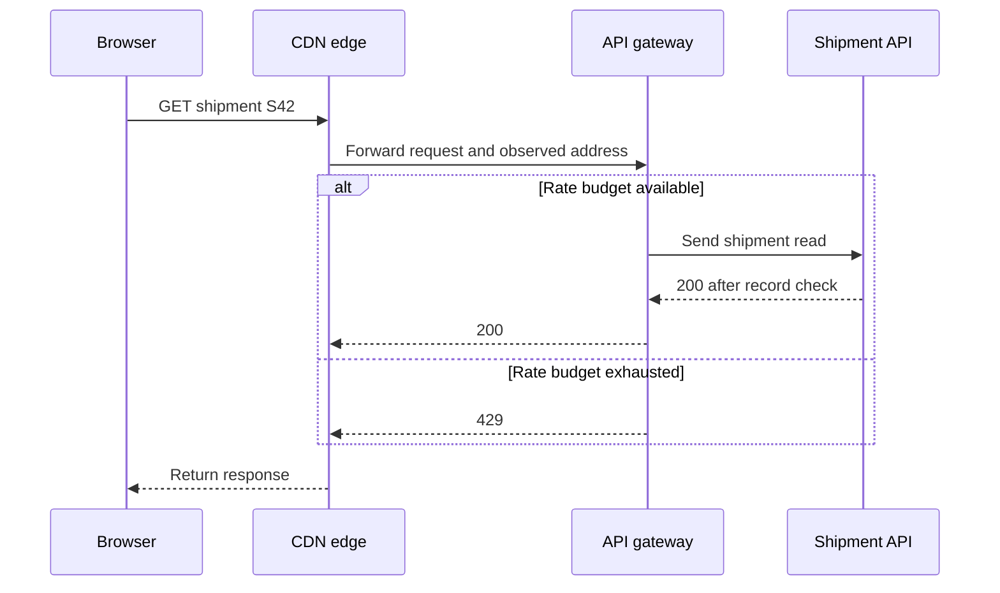

# 12 · Proxies and gateways

Dana opens shipment `S42`. The CDN records the client as `198.51.100.24`, the API gateway records a connection from `10.20.0.5`, and the shipment API records one from `10.20.0.8`. All three log entries describe the same request. Which address should count toward Dana’s IP rate limit? What evidence shows that all shipment requests pass through that limit?

In this deployment, **the CDN edge records the address it observes, and the API gateway uses that value for its rate limit after verifying the edge**. The API’s socket peer is the gateway. To answer the second question, inspect the listeners, network rules and service identities that admit traffic to the API. One successful request trace shows which path *that request* took.

**Jump to** · [Proxy roles](#1-understand-whom-a-proxy-represents) · [Load balancers and gateways](#2-compare-load-balancers-cdns-wafs-and-api-gateways) · [Shipment trace](#3-follow-one-shipment-request) · [TLS](#4-locate-each-tls-endpoint) · [Headers](#5-read-the-host-and-forwarding-headers) · [Rate limiting](#6-choose-the-address-for-rate-limiting) · [Backend reachability](#7-decide-which-paths-can-reach-the-api) · [Diagnosis](#8-find-which-hop-made-a-decision) · [Offline exercise](#9-work-through-an-offline-request-trace) · [Self-check](#10-check-your-understanding)

**Course connections** · [AppSec networking checklist](https://chatgpt.com/library?file_id=libfile_a587b9ac4b10819195b004ce505754a5&account_id=personal) · [04 · Routing and NAT](https://chatgpt.com/library?file_id=libfile_9037a1b2f728819192205007a9ef8f21&account_id=personal) · [07 · TLS and HTTPS](https://chatgpt.com/library?file_id=libfile_cea672efcaf48191871c267844a6056e&account_id=personal) · [09 · HTTP versions](https://chatgpt.com/library?file_id=libfile_bf388af4b6f081918187c153952908cd&account_id=personal) · [11 · Cookies and credentials](https://chatgpt.com/library?file_id=libfile_5cf660f9af788191a4d3864310d2538f&account_id=personal)

## 1. Understand whom a proxy represents

A proxy receives traffic on one side and communicates on the other side on someone’s behalf. **Forward** and **reverse** describe which party it represents. Both carry responses back to the caller.

| Component | Who uses it and why | What happens on the shipment request |
| --- | --- | --- |
| **Forward proxy** | A client or its administrator selects an intermediary for outbound access. One company proxy can serve employees visiting many destinations. | An office laptop configured to use the proxy asks it to reach `api.example.com`. The public API edge may observe the company proxy’s egress address. |
| **Reverse proxy**, also called an HTTP **gateway** | A service operator places an intermediary in front of one or more backends. To the browser it acts as the server for the public name. | The browser requests `https://api.example.com/shipments/S42`. The edge accepts the request and selects a configured upstream service. |
| **Default network gateway** | A host sends packets for other networks to a router. It may also perform NAT, which rewrites network addresses or ports. | Dana’s laptop sends off-network traffic to its router. Ordinary routing or NAT can occur without parsing `GET`, terminating TLS or creating HTTP forwarding headers. |

In proxy configurations such as NGINX, the **upstream** is the service the proxy calls. This note uses **downstream** for its client-facing side. An API gateway can be the CDN’s upstream and the shipment API’s client. When reading RFC 9110, watch the direction of the individual message. That specification uses *upstream* and *downstream* relative to message flow. The **origin server** handles the resource behind the intermediaries. In a CDN’s configuration, *origin* can also mean its immediate destination, such as an internal gateway, with the application one hop farther away. [NGINX upstreams](https://nginx.org/en/docs/http/ngx_http_upstream_module.html) · [HTTP intermediaries and directional terms](https://www.rfc-editor.org/rfc/rfc9110.html#section-3.7)

### What an HTTPS forward proxy can see

For an ordinary unencrypted HTTP/1.1 request through an explicit forward proxy, the client sends the absolute target URI in the request line. For HTTPS, a common arrangement is an HTTP **CONNECT** tunnel. The client asks the proxy for a tunnel to a host and port such as `api.example.com:443`. After a successful response, the client conducts TLS with the destination through that tunnel. The proxy knows the requested destination, timing and traffic volume. The TLS endpoints can read the shipment path, session cookie and response body.

| Example HTTP/1.1 request line | How the receiver interprets the target |
| --- | --- |
| `GET http://docs.example.com/guide HTTP/1.1` | A forward proxy has the absolute HTTP URL needed to fetch a public guide on the client’s behalf. |
| `CONNECT api.example.com:443 HTTP/1.1` | The forward proxy has a host and port for the requested tunnel. The later HTTPS request carries the shipment path inside TLS. |
| `GET /shipments/S42 HTTP/1.1` | A reverse proxy terminating HTTPS sees the path. Together with `Host: api.example.com` it can choose the public service route. |

A managed organization can instead deploy TLS inspection on devices configured to trust its inspection CA. The inspection proxy then terminates one TLS session and creates another, giving it access to the HTTP contents. Also distinguish the two possible credentials. `Proxy-Authorization` can authenticate the client to the next forward proxy, often after a `407` challenge. `Authorization` can carry the client’s credential for the target API. [HTTP/1.1 request-target forms](https://www.rfc-editor.org/rfc/rfc9112.html#section-3.2) · [CONNECT](https://www.rfc-editor.org/rfc/rfc9110.html#section-9.3.6) · [Proxy authentication](https://www.rfc-editor.org/rfc/rfc9110.html#section-11.7)

## 2. Compare load balancers, CDNs, WAFs and API gateways

A reverse proxy describes a position in the request path. The following names describe decisions a component can make there. One managed edge can provide several of these functions under a single hostname.

| Component | What it inspects or distributes | A decision it can make |
| --- | --- | --- |
| **Layer 4 (L4) load balancer** | Transport flows, commonly TCP connections or UDP flows. Selection can use addresses, ports and transport protocol. | Assign an incoming connection on port 443 to a healthy TLS endpoint. A pass-through listener can carry encrypted HTTP without reading its path or cookies. |
| **Layer 7 (L7) HTTP load balancer** | Parsed HTTP requests, including authority, path, method and configured headers. An HTTPS deployment must make cleartext HTTP available at this layer. | Route `api.example.com/shipments` to the shipment pool and `api.example.com/billing` to a different pool, even when both use port 443. |
| **Content delivery network (CDN)** | A distributed set of edge locations. Depending on policy, the edge serves a cached response or forwards toward an origin. | Serve a versioned dashboard JavaScript bundle from an edge cache. Forward Dana’s private shipment read under an explicit shared-cache policy. |
| **Web application firewall (WAF)** | HTTP requests evaluated against configured rules, within the product’s inspection limits. | Record or block a request matching a rule before it reaches the gateway. Whether Dana may read `S42` still depends on the application’s authorization data. |
| **API gateway** | API routes and policies, often covering authentication, quotas, request limits, routing and observability. | Admit the shipment route, enforce a rate limit, choose an upstream, and attach a request ID that the service can log. |

For a load balancer, a **listener** accepts a protocol on an address and port. A **target pool** is the set of backends eligible to receive traffic. Round robin rotates among targets. Least-connections policies use active connection counts. A **health check** helps the balancer decide which targets are ready for its traffic. A successful `/ready` response only establishes that the configured check passed. The shipment route can still fail on its database or its authorization check. [Load balancing and health checks](https://docs.aws.amazon.com/elasticloadbalancing/latest/userguide/how-elastic-load-balancing-works.html) · [CDN operation](https://www.cloudflare.com/learning/cdn/what-is-a-cdn/) · [OWASP on WAFs](https://community.owasp.org/Web_Application_Firewall) · [API gateway capabilities](https://docs.aws.amazon.com/apigateway/latest/developerguide/welcome.html)

For example, one HTTP/2 connection can carry concurrent requests for `/shipments` and `/billing`. A connection-based L4 balancer has already chosen one target for that transport connection. An HTTP-aware L7 proxy at the target can read each stream and send the two requests to different service pools. This also explains why counting active connections can give a different picture from counting active requests. [HTTP/2 streams and multiplexing](https://www.rfc-editor.org/rfc/rfc9113.html#section-5)

**Who sees the source IP at L4?** That depends on the forwarding mode. Some designs preserve the client’s source address at the target. Source NAT or a full proxy can make the balancer the target’s socket peer. When supported at both ends, the **PROXY protocol** can convey connection addresses in a preamble on the upstream connection. This is connection-level metadata, distinct from a per-request HTTP header. Configure the receiving listener for that protocol and admit only designated senders. The preamble itself does not authenticate its claims. [Client IP preservation](https://docs.aws.amazon.com/elasticloadbalancing/latest/network/edit-target-group-attributes.html#client-ip-preservation) · [PROXY protocol](https://www.haproxy.com/documentation/haproxy-configuration-tutorials/proxying-essentials/client-ip-preservation/enable-proxy-protocol/)

## 3. Follow one shipment request

The top-level page at `https://app.example.com` calls `https://api.example.com/shipments/S42` with Dana’s API session cookie. This example adds an internal API gateway to the earlier edge-to-API topology. The office uses NAT. The public edge combines CDN and WAF functions. The shipment response uses `Cache-Control: no-store` and the route is configured to bypass shared caching. The addresses and records are fictional.

| Receiving component | Destination reached | Peer it observes on this leg | HTTP operation |
| --- | --- | --- | --- |
| Public CDN edge | `203.0.113.80:443` for `api.example.com` | `198.51.100.24`, the office’s public egress | Receives the browser’s HTTP/3 request over QUIC, checks the public route and records the observed address. |
| Private API gateway | `10.20.0.8:443` for `gateway.ingress.example.com` | `10.20.0.5`, the edge’s private egress | Accepts HTTP/2 over TLS from the edge, checks its identity and applies the request’s rate limit. |
| Shipment API | `10.20.0.12:8443` for `origin.shipments.example.com` | `10.20.0.8`, the gateway’s egress | Accepts HTTP/1.1 over TLS from the gateway. It resolves Dana’s session and checks her permission for `S42`. |



Dana’s laptop has local address `10.0.1.25`. The CDN sees the office egress because NAT has already translated the source. The next two source addresses change for a different reason. Each reverse proxy acts as a client of the next service. A proxy can reuse an upstream connection for many requests, and HTTP/2 can multiplex them. The API associates Dana with the credential on this request. The gateway’s socket address is shared by many users.

There are also three different uses of a hostname here. The browser’s `Origin: https://app.example.com` identifies the page making the cross-origin fetch. The requested API authority is `api.example.com`. The backend configured as the CDN’s origin is `gateway.ingress.example.com`. A CORS allowlist, a public route and an upstream TLS verifier each use a different one.

## 4. Locate each TLS endpoint

**TLS termination** is where a participant decrypts incoming TLS traffic. A terminating HTTP proxy can inspect fields, choose a route and create a new upstream request. Each TLS connection has its own keys, certificate checks and protocol negotiation.

| Deployment mode | Where HTTP is readable | What the operator must account for |
| --- | --- | --- |
| **TLS pass-through** | At the service terminating the client’s TLS session behind the balancer. | The pass-through stage can make transport-level decisions. HTTP path routing, cookie inspection and HTTP header changes require a later terminating component. |
| **TLS termination with cleartext upstream** | At the terminator, the backend and any component able to observe that unencrypted leg. | Credentials and shipment data traverse the next leg in cleartext. Establish whether that transport meets the deployment’s protection requirements. |
| **Termination and new TLS upstream** | At the edge or gateway after decryption, and at the next receiving endpoint. | The proxy must verify the upstream certificate chain and expected service name. Its client-facing HTTPS configuration covers only its downstream side. |
| **Mutual TLS (mTLS) on a service leg** | At both TLS endpoints, as above. | The upstream additionally authenticates the calling service’s client certificate and admits the intended service identity. The application still checks the user’s shipment permission. |

In the example, the browser verifies `api.example.com`. On the next leg the edge verifies `gateway.ingress.example.com` and the gateway requires an edge service credential, identified here as `edge-prod`. On the last leg the gateway verifies `origin.shipments.example.com` and the API requires `gateway-prod`. A certificate can be valid for the browser-facing name while upstream verification fails for a different name. The edge can then return a gateway error even though the browser’s TLS connection succeeded.

**SNI** supplies a server name during TLS setup, **ALPN** negotiates an application protocol for that connection, and the HTTP **authority** selects the requested service in the subsequent HTTP exchange. The edge can resolve a private address, verify a configured upstream name, and rewrite the HTTP authority according to its route. Configure these choices together. DevTools showing `h3` identifies the browser’s connection to the edge. Learn the upstream protocol from the proxy or backend. [TLS service identity](https://www.rfc-editor.org/rfc/rfc9525.html) · [HTTP/2 request fields](https://www.rfc-editor.org/rfc/rfc9113.html#section-8.3.1) · [HTTP/3](https://www.rfc-editor.org/rfc/rfc9114.html) · [An example of mutual TLS to an origin](https://developers.cloudflare.com/ssl/origin-configuration/authenticated-origin-pull/)

## 5. Read the host and forwarding headers

**Provenance** means knowing who supplied a value, how they obtained it, and why the receiver trusts them. The kernel can report which address is on the other side of the local connection. A forwarding header is an assertion inside HTTP. Its value becomes useful for a security decision when the receiver can identify the sender and knows how that sender constructs it.

| Field or observation | What it describes | Who supplies it in this deployment |
| --- | --- | --- |
| **Transport peer** | The other endpoint as seen on this connection, after any network translation. | The local transport stack. At the API this is `10.20.0.8`. Keep the original peer available in logs when software also exposes a derived client address. |
| `Host` or `:authority` | The authority targeted by **this** HTTP request, optionally including a port. HTTP/1.1 typically uses `Host`, while HTTP/2 and HTTP/3 normally convey it in `:authority`. | The browser initially targets `api.example.com`. The edge accepts configured public authorities and rewrites the upstream authority for its selected route. |
| `X-Forwarded-For` (XFF) | A widely used list of addresses representing prior peers. In an append-based chain, later proxies append on the right. | The first trusted edge starts a clean list from its observed peer. The gateway appends the edge peer it actually observed. |
| `X-Forwarded-Proto` and `X-Forwarded-Host` | Common conventions for carrying the original public scheme and authority. | The edge sets `https` from its accepted connection and `api.example.com` from its validated public route. The gateway preserves those trusted values. |
| `Forwarded` | The standardized alternative. Each comma-separated element describes a hop. Parameters can include `for` for the preceding node, `by` for the forwarding node, `proto` for the incoming scheme and `host` for the incoming authority. | Each participating proxy creates its element according to policy. All parameters are optional. Use one documented convention consistently. |
| `Via` and a request ID | `Via` records forwarding intermediaries and the protocols in which they received a message. A request ID correlates events for one logical request. | HTTP proxies append their Via information on forwarded messages. An HTTP-to-HTTP gateway also adds it on inbound requests. In this example the edge generates `r42` and the gateway propagates it for correlation. [RFC 9110 on Via](https://www.rfc-editor.org/rfc/rfc9110.html#section-7.6.3) |

### Read the actual fields at the API

The first public edge discards incoming client-address assertions for the outbound shipment route and generates its own values. On the edge-to-gateway leg, XFF contains just `198.51.100.24`. The following selected fields arrive on the **gateway-to-API** leg after the gateway appends `10.20.0.5`. The gateway leaves the request path intact and rewrites the authority to match the configured upstream.

```http
GET /shipments/S42 HTTP/1.1
Host: origin.shipments.example.com:8443
X-Forwarded-For: 198.51.100.24, 10.20.0.5
X-Forwarded-Proto: https
X-Forwarded-Host: api.example.com
X-Request-ID: r42
Cookie: __Host-session=<redacted>
```

The API learns `10.20.0.8` from its socket. That address does not appear in this XFF value because the gateway appended **its incoming peer**. If the deployment used the standardized convention instead, the same forwarding history could be expressed as follows.

```http
Forwarded: for=198.51.100.24;proto=https;host=api.example.com, for=10.20.0.5;proto=https;host=gateway.ingress.example.com
```

`Forwarded` has a grammar of its own. For example, `for="[2001:db8::24]:51320"` is a quoted IPv6 node with a port. A node can also be `unknown` or an obfuscated identifier. Use a parser that supports the chosen field and define what the application does when an address is unavailable. In an XFF deployment, repeated field lines belong to one ordered list. Mixing the beginning of one header convention with the end of another loses provenance. [Forwarded syntax and integrity](https://www.rfc-editor.org/rfc/rfc7239.html) · [X-Forwarded-For parsing and trust](https://developer.mozilla.org/en-US/docs/Web/HTTP/Reference/Headers/X-Forwarded-For) · [HTTP authority](https://www.rfc-editor.org/rfc/rfc9110.html#section-7.2)

**Why preserve the public host and scheme?** The API might need to generate an absolute link back to `https://api.example.com`. Its own `Host` names the private origin. Use a configured public base URL, or reconstruct it from validated fields sent by the designated proxy. Apply the public-host allowlist before routing or generating links. Likewise, a trusted `X-Forwarded-Proto: https` describes the original client-facing scheme. Evidence for encryption on the *current* leg comes from that leg’s TLS configuration and connection telemetry. [Forwarded protocol](https://developer.mozilla.org/en-US/docs/Web/HTTP/Reference/Headers/X-Forwarded-Proto)

**What if the route rewrites the path?** A gateway might expose `/api/shipments/S42` publicly, strip `/api`, and forward `/shipments/S42`. Record both paths when diagnosing route decisions. The gateway’s policy must apply to the operation it will actually forward, and the API must authorize the record its own router resolves. When a proxy translates between HTTP versions, it also builds the message framing for the next hop and handles connection-specific fields there. [NGINX upstream URI mapping](https://nginx.org/en/docs/http/ngx_http_proxy_module.html#proxy_pass) · [HTTP connection fields](https://www.rfc-editor.org/rfc/rfc9110.html#section-7.6.1)

## 6. Choose the address for rate limiting

The gateway enforces a coarse limit for the shipment-read route. It groups requests by **route and observed client address**. Here is how it derives the address and how the API can reach the same result for its logs.

1. **Establish the immediate peer.** The gateway sees `10.20.0.5` on an admitted connection with the `edge-prod` identity. The API sees `10.20.0.8` on an admitted connection with the `gateway-prod` identity. Each receiver knows which forwarding convention its predecessor implements.
2. **Start on the receiving side of the chain.** At the gateway, the trusted edge supplied one XFF entry, `198.51.100.24`. At the API, the ordered header entries are `198.51.100.24, 10.20.0.5`, followed logically by the actual socket peer `10.20.0.8`.
3. **Walk toward the client while the current hop is a designated proxy.** At the API, move past the gateway and the edge. Stop at `198.51.100.24`, the first address outside that trusted proxy set. The trusted edge observed that peer. If the office used a forward proxy, it could be the forward proxy’s public address.
4. **Use the result for the stated policy.** The gateway’s example key is `shipment-read | 198.51.100.24`. If its budget is exhausted, the gateway returns `429 Too Many Requests` and can supply `Retry-After`. The API receives no shipment request for that decision.

The stopping rule depends on **verified ingress and a known append policy**. A gateway-only listener rejects other peers. A listener designed to accept ordinary clients directly can use the socket peer and ignore forwarding claims on those connections. Choosing the leftmost entry without that context gives an incoming client assertion the same weight as the edge’s observation. Counting a fixed number of hops depends on *every* permitted path having exactly that shape. A shorter internal route breaks that assumption. Use trusted peers that match deployed proxies. Define an explicit outcome for missing or malformed metadata, such as declining a request that requires edge attribution or applying a separate conservative budget. Preserve the reason in telemetry. [Trusted proxies and XFF](https://developer.mozilla.org/en-US/docs/Web/HTTP/Reference/Headers/X-Forwarded-For#selecting_an_ip_address) · [HTTP 429](https://www.rfc-editor.org/rfc/rfc6585.html#section-4)

### What this looks like in a real server

If NGINX with the HTTP Real IP module terminates the origin connection at `10.20.0.12:8443`, this fragment expresses the **address interpretation** for the example. The two addresses are individual infrastructure peers. Section 7 supplies the separate network and identity controls that admit connections.

```nginx
set_real_ip_from 10.20.0.8;
set_real_ip_from 10.20.0.5;
real_ip_header X-Forwarded-For;
real_ip_recursive on;
```

With the request in section 5, `$realip_remote_addr` retains the original socket peer `10.20.0.8`, and `$remote_addr` becomes `198.51.100.24`. Both are useful log fields. The edge address belongs in the recursive trust set because it appears **inside** the chain. Only the gateway needs permission to connect to the origin’s data listener. The gateway in this example enforces the limit one hop earlier. [NGINX HTTP Real IP module](https://nginx.org/en/docs/http/ngx_http_realip_module.html)

**What an IP budget measures.** Two dispatchers behind the same office NAT share its public address and can consume the same budget. Mobile routing and IPv6 privacy addresses can give one user different addresses over time. Use an address-based limit for the network-level concern it measures. For a per-user or per-tenant quota, use a verified application identity at a component that can validate it. Define whether limits are per gateway instance or shared across replicas. That choice determines how many requests a fleet of gateways will admit.

## 7. Decide which paths can reach the API

Start with the specific destination and operation. “Can anything else reach the backend?” has two answers in this design. **Only the gateway can deliver a shipment-data request to port 8443. A monitoring service can reach readiness on port 9443.** The second listener exposes a health handler and has its own network and identity policies.

| Listener in this example | Network admission | Identity and HTTP policy |
| --- | --- | --- |
| Public edge on `443` | Public HTTPS entry for the API | Accept the configured public authority. Apply edge policy, establish a fresh client-address record, and forward the shipment route to the named gateway. |
| Private gateway at `10.20.0.8:443` | Permit edge egress `10.20.0.5/32` | Require `edge-prod` by mTLS. Accept the agreed forwarding metadata and apply the route’s rate limit. |
| API data at `10.20.0.12:8443` | Permit gateway egress `10.20.0.8/32` | Require `gateway-prod` by mTLS. Enforce user and object authorization before returning shipment data. |
| Readiness at `10.20.0.12:9443` | Permit the designated monitoring workload | Require the monitoring identity. Serve the readiness handler on this listener. |

The example’s private tier has only the listed IPv4 listeners, with other ingress denied. For a real deployment, build this table from **effective configuration**. For each service and replica, check the listening addresses and ports, public or internal load balancer attachments, network routes, ingress firewall policy and accepted workload identities. Account for IPv6 and legitimate alternate callers such as internal services. A traffic rule that covers an IPv4 address says nothing about a separately enabled IPv6 listener.

| Evidence | What you can conclude |
| --- | --- |
| Public and private DNS records | Which address a caller is directed toward. DNS alone supplies no admission rule for the listener. |
| Listener bindings and routes | Where a connection can be delivered in principle. A private network can contain several callers. |
| Deployed ingress and mTLS policies | Which peers can establish transport and which identities can complete the service handshake. Scope a client certificate to the service allowed to call this origin. |
| Gateway and application route configuration | Which handler and controls run after admission. Check the data and readiness listeners independently. |
| Flow logs, TLS events and correlated HTTP logs | Which peers and decisions were actually observed during a time interval. Combine these with configuration to reason about unobserved paths. |

An IP range shared by a CDN provider can include many customers. Likewise, a provider-wide client certificate can identify the provider’s network while proving little about the customer configuration that initiated a request. Where the origin needs the identity of **your** deployment, use a suitably scoped origin credential and enforce that identity. If a worker legitimately needs its own API route, document its service identity, quota and authorization policy as another intentional path. [Example of provider-wide and customer-scoped origin certificates](https://developers.cloudflare.com/ssl/origin-configuration/authenticated-origin-pull/)

## 8. Find which hop made a decision

Start with one request ID and record the **local action** at each hop. An edge can log `429` because it forwarded the gateway’s `429`, or because its own rule stopped a request. A status in the edge access log alone cannot distinguish them. Useful fields include local peer, authenticated service identity, validated public authority, selected route, effective client address, upstream target, upstream status, local action and timing.

| Symptom | What to inspect | What would explain it |
| --- | --- | --- |
| Everyone in one office gets `429` | Gateway’s rate-limit rule and key, edge’s observed peer, actual gateway peers | If the key is the public office egress, users may legitimately share a bucket. If independent offices all key to `10.20.0.5`, the gateway may be counting its edge connection peer. |
| `401`, `403` or `404` | Edge/WAF action, gateway route and auth result, API’s signed-in user and record decision | A WAF or gateway can stop a request early. The API can also deny an authenticated user access to `S42`. A `404` may come from a missing gateway route or the application’s visibility policy. |
| `502 Bad Gateway` | Which proxy generated it, upstream connection outcome, certificate verification, HTTP/protocol error | The responding proxy failed to obtain a usable upstream response. Some proxies report an upstream TLS verification failure this way. |
| `503 Service Unavailable` | Target readiness, capacity, maintenance and the emitting component | The service may be overloaded or a proxy may have no eligible target under its policy. |
| `504 Gateway Timeout` | Gateway’s upstream timeout, timings for connection and response, application completion record | A gateway timed out waiting for an upstream. A write may still have committed. Reconcile the operation before retrying it. |
| Unexpected internal hostname in a redirect or a redirect loop | Public route, `Host` rewrite, forwarded scheme/host, configured public base URL | A component may be constructing links from its private upstream view or treating an originally secure request as HTTP. |
| An expected read has no application log | Edge cache result, WAF action, gateway rate-limit result, upstream TLS events and log coverage | A response can come from a cache or an earlier policy decision. An upstream handshake can also fail before an HTTP request exists at the application. |

For the dashboard’s **WebSocket** updates, observe both the opening handshake and the established connection. An HTTP/1.1 upgrade needs proxy support on each applicable hop because `Connection` and `Upgrade` are hop-by-hop. HTTP/2 has a distinct extended CONNECT mechanism when negotiated. Idle timeouts and connection draining can close a healthy but quiet stream later. The service still needs to authorize its subscriptions as user permissions change. [Hop-by-hop handling](https://www.rfc-editor.org/rfc/rfc9110.html#section-7.6.1) · [WebSocket proxying](https://nginx.org/en/docs/http/websocket.html) · [WebSockets over HTTP/2](https://www.rfc-editor.org/rfc/rfc8441.html)

When comparing logs, keep the request ID across hops and give upstream retries separate attempt identifiers. Use method, route template and status where they suffice. Access logs and shared traces should exclude session cookie values and bearer tokens. Limit the retention and visibility of client addresses to what the operational purpose needs. [Gateway status codes](https://www.rfc-editor.org/rfc/rfc9110.html#section-15.6) · [Idempotent methods and retries](https://www.rfc-editor.org/rfc/rfc9110.html#section-9.2.2) · [Forwarded information and privacy](https://www.rfc-editor.org/rfc/rfc7239.html#section-8)

## 9. Work through an offline request trace

The following exercise uses Python 3’s standard library and fictional log records. Each row represents a normal observation at one component. The list in `prior` contains the incoming XFF entries **already parsed** from the agreed, sanitized forwarding convention. The private peers have passed the admission rules from section 7. This lets you practice reading evidence without running a proxy or contacting a service.

Before running it, predict the client address the API will attribute to `r42`, which component generated the `429` on `r43`, and how far the HTTP request got on `r44`. Paste the full block into a macOS or Linux shell.

```sh
python3 - <<'PY'
from ipaddress import ip_address

trusted_proxies = {ip_address("10.20.0.5"), ip_address("10.20.0.8")}

# Request ID, hop, observed peer, incoming prior peers, status, local action.
rows = [
    ("r42", "edge",    "198.51.100.24", (),                              200, "forwarded"),
    ("r42", "gateway", "10.20.0.5",     ("198.51.100.24",),             200, "forwarded"),
    ("r42", "api",     "10.20.0.8",     ("198.51.100.24", "10.20.0.5"), 200, "read S42"),
    ("r43", "edge",    "198.51.100.24", (),                              429, "forwarded"),
    ("r43", "gateway", "10.20.0.5",     ("198.51.100.24",),             429, "rate limit"),
    ("r44", "edge",    "198.51.100.24", (),                              502, "upstream TLS failed"),
]

def observed_client(peer, prior):
    for value in reversed((*prior, peer)):
        address = ip_address(value)
        if address not in trusted_proxies:
            return str(address)
    return "unknown"

print(f"{'id':<4} {'hop':<8} {'socket peer':<15} {'client':<15} {'code':<5} action")
for request_id, hop, peer, prior, status, action in rows:
    client = observed_client(peer, prior)
    print(f"{request_id:<4} {hop:<8} {peer:<15} {client:<15} {status:<5} {action}")
PY
```

| Question | Expected observation | Interpretation |
| --- | --- | --- |
| Why does `r42` have three different peer entries? | Edge `198.51.100.24`, gateway `10.20.0.5`, API `10.20.0.8`. All three derive `198.51.100.24` in the client column. | Each local connection has a different peer. The forwarded history leads back to the office egress observed at the public edge. |
| Who generated `r43`’s `429`? | The gateway row says `rate limit`. The edge row says `forwarded`. | The gateway made the decision and the edge relayed the result. The request stopped before the shipment API. |
| Where did `r44` stop? | The edge records `502` and `upstream TLS failed`. | The browser got an HTTP response from the edge. The failed gateway TLS leg carried no shipment HTTP request. A gateway TLS log may still record the handshake attempt. |
| Do these records establish that only the gateway can reach the shipment handler? | They establish the path of `r42` and the stopping points of the other two records. | Use the deployed listener, network and identity policies to establish which other paths are permitted. |

## 10. Check your understanding

1. A laptop uses an office HTTPS tunnel on its way to the public shipment CDN. Which component represents the client, which represents the service, and who can read the shipment path?
2. A team wants to route `/shipments` and `/billing` to different targets. Its current edge passes encrypted TLS through. Where must the new decision run?
3. The browser validates `api.example.com` and shows `h3`. Which facts about the gateway-to-API leg still need independent evidence?
4. The API’s peer is `10.20.0.8`, its `Host` is `origin.shipments.example.com:8443`, and its XFF is `198.51.100.24, 10.20.0.5`. Identify the immediate caller, the authority for this hop, and the public address used for rate limiting.
5. Two dispatchers behind one NAT are counted together. What rate-limit policy would distinguish them, and where could it run?
6. The origin accepts a certificate trusted across an entire CDN provider. What additional identity evidence matters if it should accept traffic only from your deployment?
7. A monitoring workload can reach readiness while shipment data is gateway-only. What evidence would let you make both claims to a reviewer?

### Answers

1. The office forward proxy represents the client. The CDN is a reverse proxy for the service. With ordinary CONNECT tunneling, the browser and terminating CDN can read the shipment path. Each later HTTP terminator on the service side can also read its forwarded request. TLS inspection at the office would create another termination point.
2. At a component that terminates TLS and parses HTTP. The L4 stage can continue to select a transport destination, while an L7 stage uses the path to select the correct pool.
3. Identify the upstream target, protocol, encryption, verified server name, and any client service identity required there. Check the gateway’s upstream settings and the connection telemetry for that leg.
4. The gateway at `10.20.0.8` is the immediate caller. The private origin authority identifies this HTTP hop’s target. The edge observed `198.51.100.24`, and the gateway used that validated value for the example limit. The API reaches the same value by walking the trusted chain from its peer.
5. Use a quota keyed by a verified user or tenant identifier. Enforce it at the gateway if it can validate that identity, or at the service after authentication. The public IP budget can continue to cover aggregate traffic from the office.
6. The origin needs a credential bound to the intended customer configuration or service, plus a policy that requires it. Verify which identity the certificate actually proves and which identities the origin admits.
7. Show separate data and readiness listeners, their route mappings, effective ingress rules for each address family, and required service identities. Then show a correlated gateway-to-data request and a monitoring-to-readiness event as examples of those policies in use.
