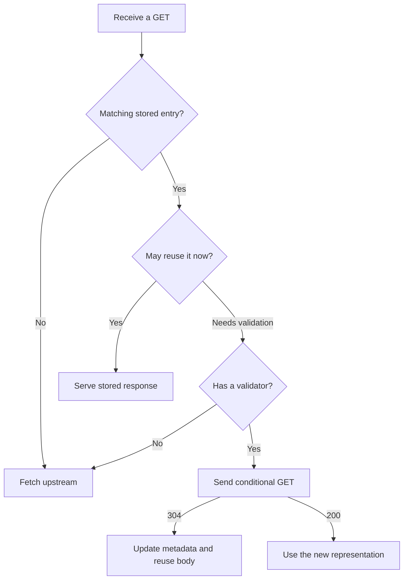

# 13 · HTTP caching

Dana opens the shipment dashboard twice. On the second visit, the browser loads the JavaScript bundle without sending a request. The CDN answers a request for public shipment-status labels. The API still checks Dana’s session before returning her list of shipments. All three resources used HTTPS. Why did they take different paths?

**A cache makes two decisions. May it store this response? May it use that stored response for this request now?** In the course dashboard, the versioned JavaScript bundle can be reused by anyone. The public labels also depend on the requested language. Dana’s shipment list depends on her identity and current permissions, so the API sends `Cache-Control: no-store` and the CDN bypasses caching for the route. The public resources save network trips without making one dispatcher’s shipments available to another.

**Jump to** · [Cache locations](#1-what-an-http-cache-keeps) · [Keys and Vary](#2-match-the-request-to-a-stored-representation) · [Cache-Control](#3-read-cache-control-as-a-policy) · [Freshness and Age](#4-calculate-when-the-copy-becomes-stale) · [ETags and 304](#5-revalidate-with-etag-and-last-modified) · [Signed-in responses](#6-protect-signed-in-responses) · [Invalidation](#7-change-data-and-invalidate-old-copies) · [Browser and CDN evidence](#8-read-browser-and-cdn-evidence) · [Local exercise](#9-run-a-local-conditional-get-exercise) · [Self-check](#10-check-your-understanding)

**Course connections** · [AppSec networking checklist](appsec-networking-checklist.md) · [08 · URLs and HTTP](08-urls-and-http-semantics.md) · [10 · Browser security](10-browser-security.md) · [11 · Cookies and credentials](11-cookies-and-credentials.md) · [12 · Proxies and gateways](12-proxies-and-gateways.md)

## 1. What an HTTP cache keeps

A **resource** has a URL. A **representation** is one version of what that resource returns, such as the English or Persian labels for shipment statuses. An HTTP cache keeps a response’s status, reusable headers, body when present, and metadata such as when it arrived and which request fields selected it. It can then answer a later request from that stored copy.

| Where the response is kept | Who can benefit | What a hit means |
| --- | --- | --- |
| **Browser HTTP cache**, a private cache | The browser’s user, subject to profile and browser partitioning rules | A fresh, matching entry can satisfy the request locally. The CDN and API may see no HTTP request. Several application accounts can use the same browser profile. |
| **CDN or caching reverse proxy**, a shared cache | Multiple clients that reach that cache | The browser made a network request, but the edge can answer it without contacting the API. The response can still be `200 OK`. |
| **Application or database cache** inside the API | Requests that reach the application | The API still received an HTTP request. Reusing a database result is an application decision with its own keys, permissions and expiry. |

The usual cache candidate is a successful `GET`. A cache also needs to understand the request method and response status, and the storage rules must allow it. Some redirects such as `301` and some negative results such as `404` can be cached. Even without explicit freshness headers, eligible responses can receive a **heuristic** lifetime. Give personalized successes, errors and redirects an explicit policy. A cache may also evict an entry early to free space. These HTTP rules apply across HTTP/1.1, HTTP/2 and HTTP/3. A CDN that terminates TLS can read the response and apply its caching policy. [HTTP cache storage rules](https://www.rfc-editor.org/rfc/rfc9111.html#section-3) · [MDN HTTP caching guide](https://developer.mozilla.org/en-US/docs/Web/HTTP/Guides/Caching)

A `HEAD` request returns metadata without a body and can help a cache update or invalidate a stored `GET`. `POST` has a narrower rule. Its response can be stored for a later `GET` or `HEAD` when it includes explicit freshness and `Content-Location` equal to the `POST` target URI, subject to the other storage rules. A new `POST` still needs its own processing. [Freshening responses with HEAD](https://www.rfc-editor.org/rfc/rfc9111.html#section-4.3.5) · [POST response caching](https://www.rfc-editor.org/rfc/rfc9110.html#section-9.3.3)

The diagram follows a cacheable read. A route set to bypass the CDN cache goes straight upstream. **Upstream** means the next service in the request path, which might itself be another cache.



For a **shared hit**, the response must have been eligible for shared storage, the new request must match the method, target and selected variant, and the audience and directives must permit reuse. Then freshness, successful validation, or an applicable stale-use rule determines whether this copy can answer now. A cache that fetches a new response evaluates its storage policy again. [When a stored response can be reused](https://www.rfc-editor.org/rfc/rfc9111.html#section-4)

## 2. Match the request to a stored representation

A **cache key** identifies candidate entries. HTTP’s basic key includes the request method and target URI. For an ordinary `GET`, think about the scheme, authority, path and query. The URL fragment stays in the browser. The `Vary` response header tells a cache which additional **request header fields** selected the representation. Even an otherwise fresh entry needs the right variant.

| Two requests differ in… | What the cache should consider |
| --- | --- |
| `/shipments?page=1` versus `/shipments?page=2` | These target URIs differ. On any cacheable paged endpoint, keep inputs that change the result, including filters, sort order and page. The course shipment endpoint itself has a private-data policy. |
| `/guide#routes` versus `/guide#labels` | The HTTP target in both cases is `/guide`. The browser handles the fragment after loading the document. |
| `Accept-Language: en` versus `Accept-Language: fa` | If the public labels endpoint chooses a language from this header, send `Vary: Accept-Language`. The English response cannot serve as the Persian variant just because the URL matches. |
| `Accept-Encoding: gzip` versus a request for the uncompressed form | When the representation changes with the accepted content coding, account for `Accept-Encoding` at the component doing the encoding or caching. |
| Different frontend `Origin` values | If the API dynamically selects `Access-Control-Allow-Origin`, send `Vary: Origin` on those responses. This separates CORS response variants. Both Dana and another dispatcher can use the same frontend origin. |

For example, a response to `GET /reference/shipment-statuses` can contain all three lines below.

```http
Content-Language: en
Vary: Accept-Language
ETag: "labels-en-v7"
```

`Content-Language` describes what the server selected. `Vary` tells the cache which incoming field influenced that selection. `ETag` identifies this version of the selected representation. Send consistent `Vary` metadata for all negotiable variants, including the default, and on their `304` responses. `Vary: *` means a cache cannot establish a match from named request fields alone. An unqualified `private` or `no-store` directive is the clearer way to express a privacy requirement.

A managed CDN can have a custom key that drops query parameters, normalizes them, or includes selected headers. Review the **effective key and origin behavior together**. Ignoring a campaign parameter is reasonable when it never changes the response. Ignoring a language or region parameter that selects different public data can return the wrong representation. Include response headers such as CORS and redirects when deciding whether two responses are interchangeable. [HTTP variant matching](https://www.rfc-editor.org/rfc/rfc9111.html#section-4.1) · [MDN on Vary](https://developer.mozilla.org/en-US/docs/Web/HTTP/Reference/Headers/Vary) · [Example CDN cache-key settings](https://developers.cloudflare.com/cache/how-to/cache-keys/)

## 3. Read Cache-Control as a policy

The origin sends **response directives** to caches along the path. Directives combine with commas. In this response, the browser can treat the public representation as fresh for 30 seconds and a shared cache can treat it as fresh for 120.

```http
Cache-Control: public, max-age=30, s-maxage=120
```

| Response directive | Storage and reuse behavior |
| --- | --- |
| `public` | Explicitly permits shared caching when the other rules allow it, including some responses to authenticated requests. Use it for a representation whose permitted audience really can share it. A CDN can still choose to bypass it. |
| `private` | The unqualified directive prohibits a shared cache from storing the response. A private browser cache may store it. Add a freshness or validation policy to say when the browser may use it. |
| `no-cache` | A cache may store the response, but must obtain successful validation before using it to answer another request. Keeping the body allows an unchanged response to be confirmed cheaply. |
| `no-store` | Directs both private and shared HTTP caches to refrain from storing this transaction for later reuse. Use it for sensitive responses whose bodies should stay out of HTTP caches. It does not purge previously stored copies. |
| `max-age=N` | Gives a freshness lifetime of `N` seconds based on the response’s age. `max-age=0` makes the response immediately stale. Storage is still possible, and stale-use rules matter. |
| `s-maxage=N` | Overrides `max-age` and `Expires` for a **shared** cache. Once stale, the shared copy requires successful validation under this directive. A private cache ignores `s-maxage`. |
| `must-revalidate` and `proxy-revalidate` | Once the response is stale, successful validation is required before reuse. `must-revalidate` applies to both cache types, and `proxy-revalidate` to shared caches. A fresh matching copy can still be used. |
| `immutable` | Signals that the representation is expected to stay unchanged throughout its freshness lifetime. Pair it with a long `max-age` and content-versioned URLs when you control the release process. It supplies no lifetime by itself. |

**Two policies worth remembering.** With `private, no-cache` the browser can keep a body and validate it on every reuse, while the CDN must decline storage. With `no-store` the response should stay out of both HTTP caches. Pick the first only when retaining the bytes in a browser profile is acceptable. [Cache-Control response directives](https://www.rfc-editor.org/rfc/rfc9111.html#section-5.2.2) · [Immutable responses](https://www.rfc-editor.org/rfc/rfc8246.html)

**Requests can also carry `Cache-Control`.** A request with `no-cache` asks caches along the path to validate before serving a stored response. A request with `no-store` forbids storage of the new transaction. It can still be satisfied by an already stored response. In frontend code, Fetch’s `cache` option additionally controls how the browser consults its own HTTP cache. Section 8 shows the difference. [Cache-Control request directives](https://www.rfc-editor.org/rfc/rfc9111.html#section-5.2.1)

## 4. Calculate when the copy becomes stale

A response is **fresh** while its current age is **less than** its freshness lifetime. At equality it is **stale**. Stale describes eligibility for reuse. The bytes might still match the origin exactly.

- **`Date`** records when the response message was generated. **`Age`** estimates how many seconds have elapsed since the origin generated or validated the response. Age can include time spent in upstream caches and in transit.
- For an ordinary private cache, use `max-age` when present. Otherwise an explicit `Expires` date can supply a lifetime relative to `Date`. In a shared cache, `s-maxage` takes precedence over both. Eligible responses without explicit freshness may receive a heuristic lifetime.
- For a quick calculation, take the lifetime minus current age and floor the result at zero. Real caches also account for response delay, clock differences and time spent in local storage. A downstream browser inherits the response’s age when it receives it from a CDN.

### A timeline with two clocks

At 10:00:00 GMT the origin produces English labels with `public, max-age=30, s-maxage=120`. Assume synchronized clocks, negligible transit time, ordinary reads, and no eviction. The times below refer to the same unchanged representation.

| Time | What happens | Why |
| --- | --- | --- |
| 10:00:00 | The CDN fetches the labels and stores them. | Its shared freshness lifetime is 120 seconds. |
| 10:00:25 | A new browser receives an edge hit with `Age: 25`. | The browser has **5 seconds** of freshness left. The CDN has **95 seconds**. Downloading from the CDN does not restart either clock. |
| 10:00:29 | A repeat browser read can be entirely local. | Age is 29, below the browser’s limit of 30. |
| 10:00:30 | The browser entry is stale. It can send a conditional `GET` to the CDN. | A matching CDN entry is still fresh there. The CDN can answer the condition without reaching the origin. |
| 10:02:05 | On the next read, the CDN’s original entry is stale too. | If it still has its validator, it can ask the origin whether the selected representation changed. |

**When may a stale response be served?** Some public resources deliberately tolerate a bounded delay. For example, `Cache-Control: public, max-age=60, stale-while-revalidate=20` lets a supporting cache serve a stale copy for up to 20 further seconds while it attempts background validation. `stale-if-error=300` can allow up to 300 seconds of staleness during qualifying upstream failures such as `503 Service Unavailable`. These are optional allowances measured from when freshness ends. HTTP also permits some stale use when a cache is disconnected, provided the applicable directives allow it. If successful validation is mandatory and unavailable, the cache must return an error. For a shipment whose visibility can change with permissions, the course uses `no-store`. [Freshness, age and stale use](https://www.rfc-editor.org/rfc/rfc9111.html#section-4.2) · [Age header](https://developer.mozilla.org/en-US/docs/Web/HTTP/Reference/Headers/Age) · [Stale-response extensions](https://www.rfc-editor.org/rfc/rfc5861.html)

## 5. Revalidate with ETag and Last-Modified

**Revalidation** asks whether a selected stored representation is still current. A **validator** gives the server something to compare. This exchange shows selected HTTP fields for the public English labels. Its three steps apply to a browser validating with a server or a CDN validating with its origin.

**1. Store the first successful read.**

```http
HTTP/1.1 200 OK
Date: Mon, 23 Nov 2026 10:00:00 GMT
Content-Type: application/json
Content-Language: en
Vary: Accept-Language
Cache-Control: public, max-age=30, s-maxage=120
ETag: "labels-en-v7"

{"dispatched":"Dispatched"}
```

**2. Send the validator for the selected variant.** On a later request, the cache still has both that tag and the English body.

```http
GET /reference/shipment-statuses HTTP/1.1
Host: api.example.com
Accept-Language: en
If-None-Match: "labels-en-v7"
```

**3. Interpret the result.** If the current English representation still matches, the origin can answer as follows.

```http
HTTP/1.1 304 Not Modified
Date: Mon, 23 Nov 2026 10:02:05 GMT
ETag: "labels-en-v7"
Vary: Accept-Language
Cache-Control: public, max-age=30, s-maxage=120
```

A `304` answers a conditional `GET` or `HEAD` and has **zero bytes of response content**. For this `GET`, the receiving cache updates the applicable metadata on the matching stored response and uses the body it already holds. If the labels changed, the normal outcome is `200 OK` with the new representation and its new tag. Without a usable stored body, a `304` alone cannot reconstruct the labels.

| Validator | Conditional read | What the comparison means |
| --- | --- | --- |
| `ETag: "labels-en-v7"` | `If-None-Match: "labels-en-v7"` | An ETag is an opaque identifier chosen by the server. A strong tag identifies byte-equivalent representation data. A change to a strong-tagged representation’s bytes requires a new tag. |
| `ETag: W/"labels-en-v7"` | `If-None-Match: W/"labels-en-v7"` | A weak tag can represent versions the server considers semantically equivalent despite byte differences. `If-None-Match` uses weak comparison, which is sufficient for ordinary cache validation. |
| `Last-Modified: Mon, 23 Nov 2026 09:45:00 GMT` | `If-Modified-Since: Mon, 23 Nov 2026 09:45:00 GMT` | The server compares the selected representation’s modification time. HTTP dates have one-second resolution. When both conditional fields are present, `If-None-Match` takes precedence. |

Generate validators for the representation actually selected. English and Persian bodies, or gzip and uncompressed bodies with different bytes, need different strong tags. A tag can be a revision identifier or a content hash. The client returns it with its quotes intact. A related feature from lesson 08 uses a strong `If-Match` precondition on a write to prevent overwriting a newer version. A failed write precondition can return `412 Precondition Failed`. [ETag and content negotiation](https://www.rfc-editor.org/rfc/rfc9110.html#section-8.8.3) · [HTTP conditional requests](https://developer.mozilla.org/en-US/docs/Web/HTTP/Guides/Conditional_requests) · [304 semantics](https://www.rfc-editor.org/rfc/rfc9110.html#section-15.4.5)

## 6. Protect signed-in responses

A shared cache hit can return data before the request reaches the service that checks user permissions. Start with the audience for the **whole response**, including its headers. Would each person eligible for this cache hit be entitled to these bytes for the whole reuse period? If access requires a current membership check, identify where that check runs on a hit.

| Dashboard resource | Example response policy | What may happen |
| --- | --- | --- |
| `/assets/dashboard.a61e7b90.js`, identical public bytes at a content-versioned URL | `public, max-age=31536000, immutable` | Both caches can reuse it while fresh. A release that changes those bytes publishes a different URL. |
| Generic dashboard HTML shell with no embedded user or tenant data | `no-cache` plus an ETag | Caches may keep the shell, but validate every reuse. A new HTML version can point to new asset URLs. |
| `/reference/shipment-statuses`, public labels selected by language | `public, max-age=30, s-maxage=120` plus `Vary: Accept-Language` | The CDN can reuse the matching language safely for its shared lifetime. The endpoint returns the same public content and public headers regardless of who is signed in. |
| `/me/preferences`, in an application that permits local retention | `private, no-cache` plus a validator for the selected user representation | Only the private cache may store it. Every reuse requires validation, including a current permission check. |
| `/shipments`, `/shipments/S42` and `/session` in the course dashboard | `no-store`, with the CDN route set to bypass both cache lookup and storage | Each read goes through the service’s access checks. Apply the policy to sensitive error responses and redirects on these routes too. |

### Cookies and Authorization have different HTTP caching rules

- A request’s **`Cookie`** header does not, by itself, prohibit shared storage. A **`Set-Cookie`** response header also leaves HTTP caching possible under the standard. A CDN may apply stricter defaults. Express the intended policy explicitly, especially for sign-in, session and personalized responses.
- A request with **`Authorization`** has an extra shared-cache restriction. RFC 9111 identifies `public`, `s-maxage` and `must-revalidate` as response directives that can lift that restriction, subject to all other storage and reuse rules. **`max-age` alone is insufficient.** In particular, `must-revalidate` requires validation *once stale*. A fresh response may still be reused. None of these directives verifies the next caller’s entitlement.
- **`Vary: Cookie`** asks a cache to match a request header. It can create many variants, and an unchanged cookie can outlive a change in permissions. **`Vary: Origin`** tells the cache to match the request’s `Origin` header. Two dashboard origins on the same site can select different CORS variants, while two users on the same origin can still have different shipment permissions. The API checks those permissions.
- Even if all current members of one organization would receive identical bytes, a cache in front of the membership check can also receive requests from other callers. A design that intentionally shares protected data needs authentication and authorization **before every reuse**, plus a trusted way to select exactly the permitted representation. The sensitive shipment routes above instead bypass shared storage and reuse.

**Authorization also applies to `304`.** Suppose Dana opens her preferences, then loses access or changes accounts. If her browser later sends an old ETag, the service first checks the current session, permission and selected representation. It can return an appropriate denial or a new authorized `200`. Returning `304` solely because the client supplied a familiar tag would tell the client to reuse an old body. [Caching authenticated requests](https://www.rfc-editor.org/rfc/rfc9111.html#section-3.5) · [Caching sensitive information](https://www.rfc-editor.org/rfc/rfc9111.html#section-7.3) · [When to evaluate HTTP preconditions](https://www.rfc-editor.org/rfc/rfc9110.html#section-13.2.1)

**Check the deployed CDN behavior.** Inspect both the origin headers and the effective edge rule on the route. For example, CloudFront documents that a positive minimum TTL in a cache policy can cause it to cache a response even when the origin sends `private`, `no-cache` or `no-store`. For a sensitive shipment route, verify the configured bypass, the headers returned to the browser, and the actual upstream decision in logs. [CloudFront cache policy and minimum TTL](https://docs.aws.amazon.com/AmazonCloudFront/latest/DeveloperGuide/cache-key-understand-cache-policy.html)

## 7. Change data and invalidate old copies

**Expiration** ends ordinary fresh reuse. **Revalidation** checks whether a stored entry can still be used. **Invalidation** makes an entry unusable without another check, or removes it. A **purge** is an operator action that removes or invalidates entries at a managed cache. Which layer received the instruction matters.

| Event | What changes | What the application must account for |
| --- | --- | --- |
| An authorized `PATCH /shipments/S42` succeeds | A cache that sees a non-error response to an unsafe method must invalidate entries for the target URI. | The edited detail URI differs from `/shipments?status=ready&page=1`. Related lists, counts and application query results need their own update or invalidation strategy. In this course both HTTP shipment routes already use `no-store`. |
| A release changes the JavaScript bundle | The new HTML references a new content-versioned asset URL. | Keep older referenced assets available for clients still running an older page. Publishing different bytes at an existing immutable URL leaves some clients with the old bytes. |
| Public reference labels change immediately after a CDN fill | A fresh cached entry can remain valid until its lifetime ends. | If the change must take effect sooner, invalidate the affected CDN variants or publish a new versioned URL. A CDN purge cannot recall bytes already fresh in a browser. |
| A previously cacheable route becomes private | Future responses can carry the new policy after the request reaches the updated service. | Apply the bypass to stored lookups as well as new storage, invalidate old shared entries, and account for any previously issued browser lifetime. Sending a new header cannot retroactively contact every browser. |
| A dispatcher signs out, switches tenant or receives a WebSocket update | Identity or application data changed. | Clear or re-key private frontend query data as appropriate. A WebSocket event can trigger a refetch or update the shipment list. HTTP freshness and in-memory application freshness are separate decisions. |

An HTTP cache can invalidate only traffic and entries within its scope. It may also invalidate certain related same-origin URIs after a successful write, but HTTP supplies no automatic dependency map for every collection or every CDN location. [Invalidation after unsafe methods](https://www.rfc-editor.org/rfc/rfc9111.html#section-4.4)

**Other places a page can reappear.** A service worker can answer from the script-managed **Cache Storage API**, whose entries follow the worker’s code rather than automatic HTTP expiration. The browser’s **back/forward cache** can restore an entire page and its JavaScript state from a navigation snapshot. An application can also keep data in memory or persistent storage. For a signed-in dashboard, review which requests the worker stores and how the UI refreshes user-specific state on logout or restoration. `Cache-Control: no-store` governs HTTP caching. It cannot erase a response already displayed or saved by application code. [Cache Storage API](https://developer.mozilla.org/en-US/docs/Web/API/Cache) · [Browser back/forward cache](https://web.dev/articles/bfcache)

## 8. Read browser and CDN evidence

Start with an ordinary read in the browser’s **Network** panel. Leave **Disable cache** unchecked to observe normal reuse. Inspect the request method, full URL, credentials type, negotiation headers, response policy, validators, `Age`, transfer size and source. Then correlate the request with the CDN and origin logs. Use a request ID where the deployment provides one and redact credential values from any trace you share.

| Observation | What it establishes | What to check next |
| --- | --- | --- |
| DevTools indicates memory cache or disk cache | The browser supplied a stored HTTP response for that read. | Check the stored policy, selected variant and age. A matching new CDN log is unnecessary for a local hit. |
| A browser network request receives `200` and `Age: 25` | A full representation was delivered, and its reported age was already 25 seconds. | Inspect the CDN’s decision to identify which shared cache served it and whether the origin was contacted. `Age: 0` alone cannot distinguish a young hit from a newly fetched representation. |
| `If-None-Match` on the request and `304` on the wire | A recipient evaluated a conditional read and the response carried no body. | The recipient could be the CDN or origin. During automatic browser validation, frontend `fetch` can still receive the usable cached `200` response and read its body. |
| `Cache-Status: Edge; hit; ttl=95` | A cache using the standard diagnostic field reports a hit and 95 seconds of remaining freshness. | Match the named cache to the logs. Vendor-specific hit/miss headers have product-specific meanings. |
| `Cache-Status: Edge; fwd=stale; fwd-status=304` | The edge forwarded because its copy was stale and received a `304` upstream. | The downstream result can be a `200` with the stored body for an unconditional client read. |
| DevTools indicates a service worker, or a screen reappears through the Back button | Worker code or page restoration may explain what the user sees. | Check the worker, navigation record and frontend state before drawing conclusions about CDN reuse. |

An absent `Age` or `Cache-Status` header, or a missing line in a sampled origin log, is weak evidence by itself. Compare an origin log with an edge decision that explicitly says *hit*, *forwarded* or *bypass*. A reload, hard reload and a DevTools session with caching disabled can produce different requests from normal navigation. A plain `curl` invocation usually lacks a persistent browser-style response cache. Its requests can still hit a CDN. [Cache-Status](https://www.rfc-editor.org/rfc/rfc9211.html) · [Chrome DevTools Network reference](https://developer.chrome.com/docs/devtools/network/reference/) · [Fetch handling of cache validation](https://fetch.spec.whatwg.org/#http-network-or-cache-fetch)

In the course dashboard, the page at `app.example.com` and the API at `api.example.com` are cross-origin. DevTools can show an `ETag` that `response.headers.get("ETag")` cannot read. If the frontend needs that field, the API can add `Access-Control-Expose-Headers: ETag` to its allowed CORS response. The browser’s HTTP cache can use the validator independently of whether page JavaScript can read it. [CORS response-header exposure](https://developer.mozilla.org/en-US/docs/Web/HTTP/Reference/Headers/Access-Control-Expose-Headers)

### What the frontend can request

| Fetch option | Effect on the browser’s HTTP cache for this fetch |
| --- | --- |
| `cache: "default"` | Follow normal HTTP lookup, freshness, validation and storage behavior. |
| `cache: "no-cache"` | If a match exists, check it with a conditional request when possible. An eligible result can be stored. |
| `cache: "reload"` | Skip the local lookup and fetch through the network. An eligible new response can update the local HTTP cache. |
| `cache: "no-store"` | Skip the local HTTP cache lookup and its update for this fetch. The server’s response and CDN route policy still determine protection for other callers. |
| `cache: "force-cache"` | Prefer a matching cached response, including a stale one. On a miss, fetch through the network. |
| `cache: "only-if-cached"` | Use a matching cached response or fail on a miss. Fetch permits this mode only with `mode: "same-origin"`. |

For `fetch("https://api.example.com/shipments", { credentials: "include" })`, `credentials` governs eligible credentials. The HTTP cache option and the response’s `Cache-Control` govern different parts of reuse. A frontend data library’s own stale time adds another choice about whether the code calls `fetch` at all. [Fetch cache modes](https://developer.mozilla.org/en-US/docs/Web/API/Request/cache)

## 9. Run a local conditional GET exercise

Run this block in a macOS or Linux shell with Python 3. It starts a temporary HTTP origin on loopback, makes four requests to `/reference/shipment-statuses`, and closes the listener. The fixture serves one status label as plain text in English or Persian. The client keeps the English body and tag so you can compare the bytes on the wire with the body a cache can reuse.

Predict the status and body for each read. First request English. Validate it without changing anything. Request Persian for the same URL. Finally, edit the English label at the origin and send the old English tag again.

```sh
python3 - <<'PY'
from hashlib import sha256
from http.client import HTTPConnection
from http.server import BaseHTTPRequestHandler, HTTPServer
from threading import Thread

labels_path = "/reference/shipment-statuses"
labels = {"en": "Dispatched", "fa": "ارسال شد"}

class LabelsHandler(BaseHTTPRequestHandler):
    def do_GET(self):
        lang = self.headers.get("Accept-Language", "en")
        if self.path != labels_path or lang not in labels:
            self.send_error(404)
            return

        body = labels[lang].encode("utf-8")
        tag = '"' + sha256(body).hexdigest() + '"'
        unchanged = self.headers.get("If-None-Match") == tag
        self.send_response(304 if unchanged else 200)
        self.send_header("ETag", tag)
        self.send_header("Vary", "Accept-Language")
        self.send_header("Cache-Control", "public, no-cache")
        if not unchanged:
            self.send_header("Content-Type", "text/plain; charset=utf-8")
            self.send_header("Content-Language", lang)
            self.send_header("Content-Length", str(len(body)))
        self.end_headers()
        if not unchanged:
            self.wfile.write(body)

    def log_message(self, *args):
        pass

def read(address, lang, tag=None):
    headers = {"Accept-Language": lang}
    if tag is not None:
        headers["If-None-Match"] = tag
    connection = HTTPConnection(*address, timeout=5)
    try:
        connection.request("GET", labels_path, headers=headers)
        response = connection.getresponse()
        body = response.read()
        print(lang, response.status, len(body), body.decode() or "(empty)")
        return response.getheader("ETag"), body
    finally:
        connection.close()

with HTTPServer(("127.0.0.1", 0), LabelsHandler) as origin:
    worker = Thread(target=origin.serve_forever, daemon=True)
    worker.start()
    try:
        tag, saved = read(origin.server_address, "en")
        read(origin.server_address, "en", tag)
        print("Saved English body:", saved.decode())
        read(origin.server_address, "fa")
        labels["en"] = "Sent"
        read(origin.server_address, "en", tag)
    finally:
        origin.shutdown()
        worker.join()
PY
```

| Read | Expected wire result | What you learned |
| --- | --- | --- |
| First English read | `200`, `Dispatched`, 10 bytes | The client now has an English body and a validator. |
| Immediate English validation | `304`, zero body bytes | The saved English body is still `Dispatched`. The response headers identified the unchanged variant. |
| First Persian read | `200`, `ارسال شد`, 15 UTF-8 bytes | The URL is identical, but this language selects different bytes and a different tag. |
| English read after the edit | `200`, `Sent`, 4 bytes | The old English tag no longer matches. The client gets a replacement body and tag. |

All four requests intentionally reach the local origin. To practice the **fresh-hit** decision, return to the timeline in section 4. At age 29, the browser could avoid the network entirely. In this exercise `no-cache` makes an immediate validation appropriate even though the stored body is available.

## 10. Check your understanding

1. A browser receives `Cache-Control: public, max-age=30, s-maxage=120` and `Age: 25`. How long can the browser and CDN each consider this response fresh, assuming negligible delay?
2. Dana’s API session cookie accompanies `GET /shipments`. Which evidence establishes that the CDN cannot serve a previously stored shipment list for this route?
3. A preference response uses `private, no-cache`. Who may store it, and what should happen if the next request carries its ETag after Dana’s membership has been revoked?
4. A public endpoint selects English or Persian labels. Two requests target the same URL. What enables the cache to select a language, and what enables it to check that language’s revision?
5. A browser request with a bearer token receives `Cache-Control: max-age=300`. Is that directive alone sufficient for shared reuse? What if the endpoint instead returns a deliberately public catalog?
6. The edge reports upstream `304` and the dashboard receives `200` with JSON. How can both observations be correct?
7. The CDN is purged after a release, yet returning users still run old JavaScript. Which evidence would you collect and which release design prevents the problem?

### Answers

1. **Five seconds at the browser and 95 at the CDN.** Each uses its applicable lifetime minus the inherited age. At equality the entry becomes stale.
2. **Both route configuration and response policy.** In this design the CDN bypasses lookup and storage, the API returns `no-store`, and any formerly stored shared entries have been invalidated if the policy changed. An edge bypass record correlated with the API’s authorized read shows one actual traversal. The cookie alone establishes none of those controls.
3. **Only a private cache may store it, and every reuse needs validation.** The service evaluates the current caller and permissions before the ETag condition. If access has been lost, it sends the appropriate denial. A `304` would let the browser reuse the older body.
4. **`Vary: Accept-Language` selects a compatible stored variant.** The cache sends that variant’s `ETag` in `If-None-Match` when it needs validation. Give each distinct byte representation its appropriate strong tag.
5. **No.** A shared cache needs an applicable explicit permission for the response to a request with `Authorization` as well as the other storage and reuse conditions. A genuinely public catalog can use `public` with an explicit lifetime and correct variant handling if its body and headers are suitable for every eligible recipient.
6. **The edge validated its own stored body.** Its conditional upstream request received `304`, so the edge could send the stored JSON with a `200` to a browser making an unconditional request. Check which hop logged each status.
7. **Inspect the asset URL and the browser’s transfer source, then check the HTML that referenced it.** A browser can still have a fresh copy that the CDN purge never touched. Publish changed bytes under a new content-versioned URL and give the HTML a policy that lets it discover the new release.

---

[Previous · 12 Proxies and gateways](12-proxies-and-gateways.md) · [Course checklist](appsec-networking-checklist.md) · [Next · 14 Server-side requests and webhooks](14-server-side-requests-and-webhooks.md)
