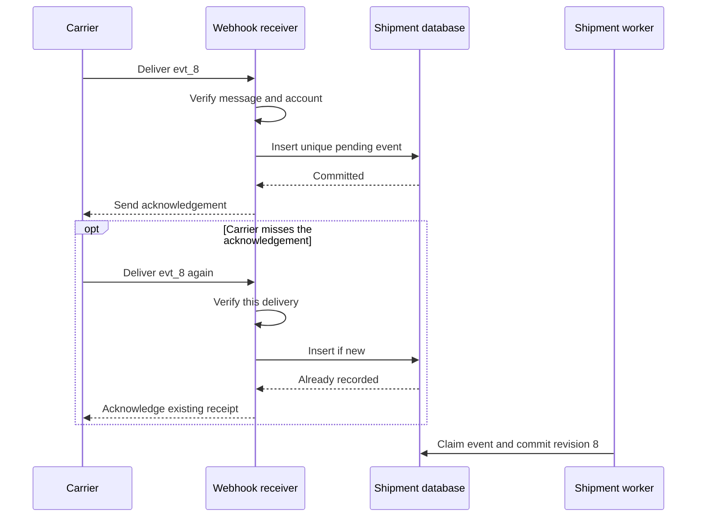

# 14 · Server-side requests and webhooks

Dana opens shipment `S42` and selects **Refresh tracking**. A worker contacts the carrier. Later, the carrier sends a webhook saying the shipment is in transit. The dashboard sees one status change even though the carrier delivers that event twice. What gave the worker permission to contact the carrier, and what let the receiver apply the update only once?

In this example, the worker needs **one carrier tracking service**. The application maps Dana’s authorized shipment to a configured carrier destination and credential. An outbound gateway enforces which network connections the worker can make. In the other direction, the webhook receiver verifies the carrier’s message, binds it to the right account, and durably records its event ID before acknowledging delivery. The shipment processor uses the event’s revision to decide whether to change the record.

**Jump to** · [Request directions](#1-trace-who-calls-whom) · [Worker permissions](#2-give-each-worker-a-destination-policy) · [URLs, DNS and redirects](#3-follow-a-url-to-the-actual-connection) · [Egress and response limits](#4-enforce-egress-and-bound-the-response) · [Sender verification](#5-verify-the-sender-and-the-event) · [Replays and duplicates](#6-make-delivery-safe-to-repeat) · [Outbound delivery](#7-publish-and-retry-outgoing-webhooks) · [Diagnosis](#8-diagnose-a-failed-delivery) · [Offline exercises](#9-run-two-offline-checks) · [Self-check](#10-check-your-understanding)

**Course connections** · [AppSec networking checklist](appsec-networking-checklist.md) · [06 · DNS and service discovery](06-dns.md) · [07 · TLS and HTTPS](07-tls-https-and-certificates.md) · [08 · URLs and HTTP](08-urls-and-http-semantics.md) · [11 · Cookies and credentials](11-cookies-and-credentials.md) · [12 · Proxies and gateways](12-proxies-and-gateways.md)

## 1. Trace who calls whom

A **server-side request** is an HTTP request initiated by a backend process. That process is the HTTP client for this exchange. It uses its own resolver, routes, proxy settings, TLS trust configuration and credentials. A **webhook** is an arrangement in which one system sends an HTTP request to a registered endpoint when an event occurs. **Ingress** means incoming traffic and **egress** means outgoing traffic, relative to the system you are examining.

| Exchange | HTTP client → HTTP server | Whose authority matters? |
| --- | --- | --- |
| Dana requests a refresh | Dashboard → shipment API | Dana’s session. The API checks her current permission for `S42` and looks up its carrier integration. |
| The worker reads current tracking data | Carrier integration worker → carrier tracking API | The worker’s approved destination and its read-only credential for North’s carrier account. |
| The carrier reports a change | Carrier delivery service → shipment webhook receiver | The carrier’s endpoint-specific signing identity, its account binding and its authority over this shipment. This request is outbound for the carrier and inbound for us. |
| North subscribes its own system to our shipment events | Our webhook delivery worker → North’s registered receiver | North’s active subscription, its approved endpoint and the event types and data North may receive. |

**Pull and push solve different problems.** A tracking `GET` lets us ask for the current state on demand. Polling repeats that read on a schedule. A webhook pushes a notification when the provider detects a change. A later authorized `GET` can reconcile state if a notification was missed or arrived late. The browser may separately receive a WebSocket update after the API commits the change. Carrier delivery and server processing continue after Dana closes the browser tab.

A browser’s same-origin policy and CORS govern browser behavior. A backend HTTP client makes its own connections, so its destination rules must be enforced on the server side. Similarly, permission to refresh `S42` authorizes a business operation. It does not grant Dana general use of the worker’s network or credentials.

## 2. Give each worker a destination policy

**Server-side request forgery (SSRF)** occurs when externally influenced input causes a server to make a request outside the destinations or operations its feature is meant to allow. The practical question is who controls the connection the server opens. A preview can create this risk even if the user sees only a title, because the worker still contacted the destination. [OWASP SSRF prevention guidance](https://cheatsheetseries.owasp.org/cheatsheets/Server_Side_Request_Forgery_Prevention_Cheat_Sheet.html) · [CWE-918](https://cwe.mitre.org/data/definitions/918.html)

Write down the legitimate request first. The four features below can share an HTTP library while needing markedly different permissions.

| Feature | Input the product actually needs | Application enforcement | Network enforcement |
| --- | --- | --- | --- |
| **Carrier tracking** | A local shipment ID, such as `S42` | Look up the authorized shipment’s carrier account and tracking reference. Build a `GET` on one configured HTTPS origin and route. Attach only that account’s tracking credential. | Permit the adapter’s external HTTP traffic only through the designated egress path to the approved carrier service on port 443. |
| **Importer** | For a managed feed, an approved source ID and object key | Resolve the source from a trusted registry. Stream and validate the expected format. Scope its credential to the feed or storage location. | Permit the registered feed or designated private storage service from the import workload. |
| **URL preview** | A link whose title or summary will be shown to a user | For a limited set of sites, allow those origins. If the feature genuinely supports arbitrary public sites, isolate that fetcher, allow only the required HTTPS behavior and use no ambient application credentials. | Give the isolated fetcher public-only egress through an enforcing gateway. Exclude internal services, workload-local destinations and cloud metadata. Bound traffic per job and tenant. |
| **Outgoing webhook** | An active, tenant-owned subscription ID | Retrieve its approved HTTPS endpoint and event scope from configuration. Recheck the subscription at delivery time. Send the fields and signing material for that recipient only. | Permit the delivery workload to use its controlled callback egress path. Apply public-destination restrictions or a dedicated private-partner route according to the contract. |

For `S42`, the shipment database maps North’s carrier integration to tracking reference `trk_81`. The integration registry supplies `https://api.carrier.example`. The worker constructs the route from a fixed template with the reference encoded as one path segment. Here are selected fields from that **outbound** request. The carrier-specific names and example records in this lesson are fictional.

```http
GET /v1/tracking/trk_81 HTTP/1.1
Host: api.carrier.example
Accept: application/json
Authorization: Bearer <north-carrier-read-token>
```

Dana’s browser session ends its role at the shipment API. The worker builds its own headers and uses a credential from the integration’s secret store. An external preview job has no reason to inherit that credential, Dana’s cookies, inbound authorization headers, or the ability to change the outbound method or proxy.

## 3. Follow a URL to the actual connection

A destination decision has to survive the entire path from input to socket. Follow the submitted URL, the hostname approved by policy, and the IP address to which the connecting component actually sends traffic. Each is observable at a different stage.

| Stage | What to do | Why it matters |
| --- | --- | --- |
| **Parse the URL** | Use a maintained URL parser consistent with the HTTP client. Inspect the parsed scheme, hostname, effective port and any user information. Apply the feature’s path and query rules. For the carrier, use its exact configured HTTPS origin and reject unexpected components. | Text that resembles an approved name is insufficient. The HTTP client acts on the parsed authority. A URL fragment never selects a network resource on the remote HTTP server. |
| **Resolve the name** | Use the resolver of the component that will make the external connection. Account for aliases and final IPv4 (`A`) and IPv6 (`AAAA`) answers. | A production worker and a laptop can see different answers. An approved hostname can acquire a new address during the lifetime of a queued job. |
| **Check address scope** | Classify every address the client could select, including alternatives it might try on fallback. Use maintained IP-address handling and the deployment’s own internal ranges. A conservative public-only policy rejects a mixed or unclassifiable set. | Both address families must satisfy the same business rule. A public-looking name or a single eligible answer leaves the other possible peers unchecked. |
| **Open the connection** | Have the enforcing connector choose an approved address from that resolution and connect to it, or have a controlled proxy perform both steps. Keep the intended hostname for TLS verification and HTTP authority. Reapply current policy for new connections and delivery attempts. | A check done at registration or on a separate DNS lookup can describe a different address from the one eventually contacted. A DNS TTL describes cache lifetime. |
| **Verify TLS** | Validate the certificate chain and the expected service hostname. If the integration requires mutual TLS, use the designated client identity only on the intended service connection. | TLS authenticates the named peer for this connection. Product policy determines whether that peer may receive the request, its credentials and its data. |

**What “public-only” excludes.** Loopback reaches the current network namespace. Private IPv4 and IPv6 unique-local ranges can reach organization services. Link-local addresses serve a local link, and cloud runtimes can expose **instance metadata** locally. Metadata may describe the workload or supply temporary credentials. The public preview role needs none of these destinations. Also account for reserved or otherwise non-routable ranges and for organization-owned services using public addresses. Global routability alone establishes no business permission. Enforce workload-local and metadata restrictions where those paths actually run, which can be the host or cloud platform. A perimeter firewall may never see them. [IANA IPv4 special-purpose registry](https://www.iana.org/assignments/iana-ipv4-special-registry/iana-ipv4-special-registry.xhtml) · [IANA IPv6 special-purpose registry](https://www.iana.org/assignments/iana-ipv6-special-registry/iana-ipv6-special-registry.xhtml)

For example, an operator can disable the EC2 Instance Metadata Service on an instance that has no need for it. Where it is needed, the platform can require its token-based mode, IMDSv2. Pair that configuration with workload isolation and a least-privileged role. A reviewer can inspect both the fetcher’s effective network policy and the instance’s metadata configuration. [EC2 instance metadata options](https://docs.aws.amazon.com/AWSEC2/latest/UserGuide/configuring-instance-metadata-options.html)

### A redirect is another destination decision

The carrier contract specifies one tracking endpoint and the webhook contract specifies one receiver. Both workers can turn off automatic redirect following and report a changed endpoint for review. A preview product might choose to follow a short redirect chain. It must resolve each `Location` against the current URL, apply scheme, port, hostname and address policy to the new target, and enforce a limit on hops and total time. An approved first request gives no authority to the next origin.

Redirects can change what is transmitted as well as where it goes. After a `POST`, `303` generally leads to a retrieval request. `307` and `308` preserve the method if followed, so the request body can travel again. Sending a signed event or a partner bearer token to a newly named recipient requires its own explicit authorization. In the course design, endpoint changes go through the subscription or integration configuration. [URL parsing standard](https://url.spec.whatwg.org/) · [HTTP redirect semantics](https://www.rfc-editor.org/rfc/rfc9110.html#section-15.4) · [TLS service identity](https://www.rfc-editor.org/rfc/rfc9525.html)

## 4. Enforce egress and bound the response

Imagine the application decision says **North’s tracking adapter may read the carrier’s tracking endpoint**. Three controls make that sentence meaningful in production.

1. **The application binds the operation to a principal.** Check Dana’s access to `S42`, choose North’s integration from trusted data, and construct the method, route, credential and small expected response. Persist the integration ID in the job and recheck that it is active before dispatch.
2. **The workload’s network policy limits its routes.** External HTTP traffic from the adapter must go through the approved egress gateway. List essential infrastructure dependencies separately, such as the designated resolver, queue and secret service. Give each dependency its own service identity and access rule. Limit direct egress on both IP families.
3. **The component opening the external connection enforces its destination.** If the proxy resolves names and connects, it must apply the destination and address rules there. The worker’s socket peer will be the proxy. Proxy telemetry provides evidence of the final peer. A transport firewall can enforce addresses and ports. A tunneling proxy can enforce the requested destination. The HTTP client or another authorized TLS terminator enforces the encrypted HTTP path and body policy. [OWASP network-layer controls](https://cheatsheetseries.owasp.org/cheatsheets/Server_Side_Request_Forgery_Prevention_Cheat_Sheet.html#network-layer) · [HTTP CONNECT tunnels](https://www.rfc-editor.org/rfc/rfc9110.html#section-9.3.6)

**Limit the amount of work a permitted destination can cause.** A partner can be slow, return an unexpectedly large document, or send a response of the wrong type. For a small tracking read, an illustrative policy might allow a two-second connection budget inside a five-second total deadline, zero redirects and at most 256 KiB of decoded JSON. Apply the deadline across resolution, connection, TLS and body reads. Enforce byte limits while streaming, including after decompression. A `Content-Length` field is only an early indication. Choose different limits for a scheduled bulk import.

Treat the returned content as external input. Validate its media type, schema, record count and relationship to the requested shipment before committing a change. A preview can render an escaped title instead of executing remote page content. Any secondary resource a product chooses to fetch needs the same outbound controls. Use bounded worker concurrency and per-tenant queues so a slow partner cannot occupy the entire delivery pool. [HTTP representation metadata](https://www.rfc-editor.org/rfc/rfc9110.html#section-8) · [Timeout and retry design](https://aws.amazon.com/builders-library/timeouts-retries-and-backoff-with-jitter/)

## 5. Verify the sender and the event

An inbound webhook is a request from another server. In ordinary HTTPS the sender verifies the receiver’s certificate. The receiver still needs a way to authenticate the message it receives. **Message authentication** asks who could have produced the signed content and whether it arrived intact. **Authorization** asks what that verified integration is allowed to change.

Suppose North’s carrier sends `POST /webhooks/carrier/north` to `api.example.com`. Its provider-specific signature travels in the request headers. The body below is shown for reading. The verifier uses the exact body bytes it received. The carrier contract in this example defines `revision` as increasing for snapshots of the same tracking record.

```json
{
  "id": "evt_8",
  "type": "shipment.status_changed",
  "account": "carrier_north",
  "tracking_ref": "trk_81",
  "revision": 8,
  "status": "in_transit"
}
```

1. **Select the known integration.** The registered HTTPS route maps to a provider, account, environment and trusted verification key or secret. Bound the request size and check the expected method. Keep test and production endpoints and secrets separate.
2. **Preserve the signed bytes.** Read the bounded raw request body before JSON middleware reserializes it. A whitespace or encoding change can produce different bytes for the same parsed object. Use the exact signed fields and byte representation in the provider’s contract. HTTP transfer framing and TLS records are handled by the transport stack.
3. **Verify with the provider’s SDK or maintained verifier.** A common scheme uses HMAC, a message authentication code computed with a secret shared by the provider and receiver. Other schemes use a public verification key. Pin the expected scheme and trusted key source. For a MAC use a timing-safe comparison. Check a signed delivery timestamp where the provider supplies one, and maintain an accurate receiver clock.
4. **Bind the verified event to a permitted action.** Validate its event type, schema, status values and account. The local integration `carrier-north` is configured for provider account `carrier_north`. Look up `trk_81` within that integration to find `S42`. A different carrier account could legitimately use the same tracking reference. An authenticated event can still be irrelevant, unsupported or outside the integration’s permissions.
5. **Accept it durably.** Record a new eligible event in a durable inbox or queue before returning the agreed success status. Verification or authorization failure stops processing. A valid duplicate with an existing durable record can receive a success acknowledgement.

### Two real providers use different signing contracts

| Provider | What the receiver verifies | Consequence for retries |
| --- | --- | --- |
| **GitHub** | `X-Hub-Signature-256` authenticates the raw payload using HMAC-SHA256 and the webhook secret. That body MAC does not cover a delivery timestamp or independently supplied headers. | GitHub retains `X-GitHub-Delivery` on a requested redelivery. It is useful for correlating and deduplicating deliveries. Bind processing to the verified integration and an idempotent business action as well. |
| **Stripe** | Its verifier takes the raw body, `Stripe-Signature` and the endpoint secret. The signature covers a signing timestamp and the payload. Stripe’s libraries document a default five-minute tolerance. | Stripe signs each retry with a new timestamp and signature. A delayed legitimate event can arrive with a recent delivery signature. The stable event ID in the verified payload is useful for deduplication. |

**Keep four questions separate.** A valid signature establishes authenticity and integrity under that signing scheme. A signed, recent timestamp establishes freshness within a window. A durable event record tells you whether this consumer has already accepted it. Tenant and resource checks decide what it may do. A timestamp window alone still permits two valid deliveries inside the same window.

During key rotation, use the provider’s documented overlap procedure, accept only the intended active keys for the endpoint, and retire old keys after the agreed transition. Keep secrets and replayable signed payloads out of ordinary logs. Source-IP admission or mutual TLS can strengthen an ingress policy. CORS settings, user-agent strings and a publicly reachable HTTPS route supply no equivalent proof of the signed content. [GitHub webhook validation](https://docs.github.com/en/webhooks/using-webhooks/validating-webhook-deliveries) · [GitHub delivery IDs](https://docs.github.com/en/webhooks/using-webhooks/best-practices-for-using-webhooks#use-the-x-github-delivery-header) · [Stripe signature verification](https://docs.stripe.com/webhooks/signature) · [Stripe webhook delivery behavior](https://docs.stripe.com/webhooks)

## 6. Make delivery safe to repeat

A **replay** presents a previously valid message again. Its signature can still verify. A **redelivery** is a sender’s intentional repeat attempt, often because it could not confirm receipt. The receiver can protect the business operation in both cases.

Suppose the receiver commits `evt_8` to its inbox, sends `202 Accepted`, and the connection closes before the carrier sees the acknowledgement. The carrier knows only that it lacks a successful response. Its next attempt can be perfectly authentic and fresh. **Idempotent handling** means that repeating this input produces the intended business effect once.



An **inbox** is a persistent record of events this consumer has accepted. Scope its unique key to the logical consumer and provider account or integration, plus the stable event ID. In our example, `(carrier-north, evt_8)` identifies one input for the shipment updater. Use a database uniqueness constraint or equivalent atomic operation. If two deliveries arrive simultaneously, a separate “did I see this?” read followed by an independent insert leaves a race.

| Question | Evidence or control |
| --- | --- |
| Has this event already been accepted? | An atomic inbox insert reports a new row or an existing one. A pending row counts as a durable receipt if a worker can resume it. |
| Has this local effect been applied? | The worker claims the pending row, applies the state change, and marks the event finished in one database transaction. A failure rolls the transaction back so the work remains available. |
| Could a distinct event describe the same business update? | Use an operation-specific guard. Here the shipment changes only when the incoming **source revision** exceeds the revision already stored for that carrier record. |
| What if an older event arrives last? | For a full status snapshot, revision 8 cannot overwrite revision 9. For an incremental event that depends on revision 8, a gap may require holding the event and reconciling before applying it. |
| What if the provider gives no reliable sequence? | Use its documented semantics. One option is to treat the notification as a hint and read current state through the configured, account-scoped carrier API. A URL inside a signed payload still goes through ordinary destination policy. |

**Use the right clock and ID.** Event occurrence time describes the business event. A signed delivery timestamp can describe the current attempt. Local receipt time measures when this receiver saw it. Arrival order and timestamps alone are unsafe substitutes for a provider-guaranteed resource version. Keep the deduplication record long enough for the provider’s automatic retries, supported manual redeliveries and the consequences of repeating the action. For a high-impact effect, keep a persistent business-level uniqueness rule as well. Where the contract lacks a signed timestamp, receiver arrival time alone cannot establish when the sender created the message.

If processing also sends an email or calls another service, a local database commit cannot make that external action atomic. Record the intent in the same transaction as the shipment update. A separate sender uses a stable operation key with an idempotent downstream API when available, or reconciles ambiguous outcomes before repeating the effect. [Transactional outbox and duplicate handling](https://docs.aws.amazon.com/prescriptive-guidance/latest/cloud-design-patterns/transactional-outbox.html) · [HTTP idempotency](https://www.rfc-editor.org/rfc/rfc9110.html#section-9.2.2)

## 7. Publish and retry outgoing webhooks

Now North wants our platform to send events to `https://hooks.north.example/events`. This reverses our role. We become responsible for choosing an authorized recipient, delivering a trustworthy event, and recovering from failures without flooding North’s service.

1. **Register the subscription.** Authorize the tenant administrator, validate the destination, and confirm the receiver’s control or consent using the integration’s enrollment procedure. Apply the same egress controls to any registration or verification contact. Record the tenant, endpoint, allowed event types, signing-key reference and subscription version. Require authorization for later changes.
2. **Commit the event with the business change.** An **outbox** is a durable record of a message we intend to send. Save the new shipment status and outbox event in the same database transaction. A rollback removes both. If the service restarts after commit and before delivery, the event is still pending.
3. **Create work for each eligible subscriber.** Give the logical event a stable ID. Track delivery state separately per subscription, and assign a separate identifier to each attempt. A failure at one subscriber should not stall unrelated tenants.
4. **Recheck and send.** Confirm the subscription is active and still permitted to receive this event. If its endpoint or ownership changed, apply the reapproval policy to queued work. Construct a minimal payload, sign it using the recipient’s agreed scheme, send over verified TLS, and record the outcome. The selected recipient and event identity stay explicit across retries.
5. **Recover deliberately.** Use bounded exponential backoff with jitter, a cap on attempts or delivery age, and a per-destination concurrency limit. Jitter spreads retries over time. Move exhausted deliveries to a visible failed-work queue for review or authorized redelivery.

For example, if North revokes its subscription at 11:00, a retry queued at 10:59 must observe the revocation before dispatch. Proving that a newly registered endpoint is under someone’s control is a separate decision from authorizing that recipient to receive historical shipment events.

| What the sender observes | Reasonable behavior for our sender |
| --- | --- |
| Agreed `2xx`, for example `202` or `204` | Record acknowledged delivery. Under an asynchronous contract, this means the receiver accepted responsibility for the event. Business processing may finish later. |
| Timeout, lost response or transient `5xx` | The receiver may already have committed. Retry within budget using the same logical event ID and destination scope. |
| `429` or temporary `503` with `Retry-After` | Respect the indicated delay within the delivery policy. If it exceeds the remaining delivery window, hold or expire the delivery instead of retrying immediately. |
| Persistent schema, authentication or authorization rejection | Surface the error for correction. Repeating unchanged credentials or an incompatible event is unlikely to help. |
| `3xx` on a fixed webhook endpoint or failed TLS identity check | Stop the attempt and review the configured receiver. Resume after the destination and trust configuration are correct. |

Treat a third-party sender’s behavior as part of its contract. For example, Stripe documents automatic retries for up to three days in live mode and also supports manual redelivery. GitHub documents that failed webhook deliveries require an explicit recovery action. A receiver that relies solely on automatic retries can therefore miss events from a provider that expects it to recover them. [Stripe retries and delivery ordering](https://docs.stripe.com/webhooks#automatic-retries) · [GitHub failed deliveries](https://docs.github.com/en/webhooks/using-webhooks/handling-failed-webhook-deliveries) · [HTTP Retry-After](https://www.rfc-editor.org/rfc/rfc9110.html#section-10.2.3)

## 8. Diagnose a failed delivery

For an outbound job, correlate the job ID, verified integration, approved origin, destination-policy decision, DNS/address-family outcome, final connection decision, TLS result, HTTP outcome, bytes, duration and attempt number. For an incoming webhook, correlate the verification result, trusted integration, event ID, inbox result, processing decision and affected resource revision. Use structured results and redact secrets, full signed URLs, cookies, authorization headers and sensitive payload fields.

| Symptom | First evidence to collect | How to interpret it |
| --- | --- | --- |
| The refresh works on a developer laptop but fails in the worker | Worker resolver result and egress decision for the integration | Split DNS, address-family selection or a different egress path can explain the difference. The resolver on the laptop is a separate observation point. |
| The worker approved a host but the carrier saw no HTTP request | Enforcement point, selected route or peer, connection result and TLS verification | An application approval can precede a network denial or failed handshake. If a proxy dials the carrier, collect its connection decision. |
| The importer receives `200` and rejects the job | Content type, decoded bytes, parse result and item count | A successful HTTP exchange can carry an invalid or oversized document. |
| An incoming webhook fails verification | Raw-body middleware ordering, endpoint and environment selection, active keys, and signed-time result where applicable | A body transformation, wrong secret, retired key or clock error can explain failure. Capture only the diagnostic facts needed. |
| A sender reports failure while the shipment changed | Attempt history and inbox commit time for the stable event ID | The acknowledgement may have been lost after commitment. A fresh signature on a retry can correspond to the same event. |
| The sender sees `2xx` but the dashboard has the old status | Inbox state, worker lag or retry, carrier revision, then the authorized dashboard read | Receipt, state change and UI refresh are three different observations. An older snapshot may have been correctly ignored. |

For the checklist’s destination question, a useful review artifact is one row of deployed policy and one correlated trace. For the tracking worker, the policy row establishes the approved partner, operation, credential and mandatory egress path. The trace establishes that **this** job used them. Review effective routing, workload-local controls and both address families to determine which other connections are possible.

For example, application logs for job `j42` can show `integration=carrier-north`, `operation=tracking.read` and `origin=api.carrier.example:443`. On the egress gateway, the corresponding connection record shows the calling workload, selected peer and allow decision. The worker’s TLS and HTTP records then show the verified service name and the `200` response that passed the tracking schema check. Correlate through an instrumented connection or attempt ID when tunneling hides the HTTP request from the gateway.

## 9. Run two offline checks

Both blocks run entirely offline with Python 3 in a macOS or Linux shell. The first checks signature verification against published reference data. The second starts after authentication and exercises the shipment consumer using fictional, authorized events and SQLite’s `ON CONFLICT` syntax (SQLite 3.24 or newer). [SQLite UPSERT](https://www.sqlite.org/lang_upsert.html)

### A. Verify a published webhook test vector

GitHub publishes a public test secret, exact payload bytes and expected signature so a receiver can check its implementation. The final comparison should print `True`. The fixture tests the body MAC only. [GitHub’s published test vector](https://docs.github.com/en/webhooks/using-webhooks/validating-webhook-deliveries#testing-the-webhook-payload-validation)

```sh
python3 - <<'PY'
import hmac

test_key = b"It's a Secret to Everybody"
received_body = b"Hello, World!"
published_mac = bytes.fromhex(
    "757107ea0eb2509fc211221cce984b8a37570b6d7586c22c46f4379c8b043e17"
)
expected_mac = hmac.new(test_key, received_body, "sha256").digest()
print("Published body signature verified:", hmac.compare_digest(expected_mac, published_mac))
PY
```

### B. Accept a retry and an out-of-order event

Predict three outcomes. How many inbox rows does a second receipt of `evt_8` create? Can an older `ready` snapshot reverse `delivered`? How many notification intents exist after two genuine advances? The exercise uses an in-memory SQLite database to make the transaction boundaries visible. A deployed receiver uses persistent storage before acknowledging events.

```sh
python3 - <<'PY'
import sqlite3

db = sqlite3.connect(":memory:")
db.executescript("""
PRAGMA foreign_keys = ON;
CREATE TABLE shipment (
    integration TEXT NOT NULL, ref TEXT NOT NULL, local_id TEXT NOT NULL,
    revision INTEGER NOT NULL, status TEXT NOT NULL,
    PRIMARY KEY (integration, ref)
);
CREATE TABLE inbox (
    integration TEXT NOT NULL, event_id TEXT NOT NULL, ref TEXT NOT NULL,
    revision INTEGER NOT NULL, status TEXT NOT NULL,
    done INTEGER NOT NULL DEFAULT 0 CHECK (done IN (0, 1)),
    PRIMARY KEY (integration, event_id),
    FOREIGN KEY (integration, ref) REFERENCES shipment (integration, ref)
);
CREATE TABLE notice_outbox (
    integration TEXT NOT NULL, ref TEXT NOT NULL,
    revision INTEGER NOT NULL, status TEXT NOT NULL,
    PRIMARY KEY (integration, ref, revision)
);
INSERT INTO shipment VALUES ('carrier-north', 'trk_81', 'S42', 7, 'ready');
""")

# The receiver obtained this integration from its verified endpoint configuration.
integration = "carrier-north"

def accept(event_id, ref, revision, status):
    with db:
        inserted = db.execute("""
            INSERT INTO inbox (integration, event_id, ref, revision, status)
            VALUES (?, ?, ?, ?, ?)
            ON CONFLICT (integration, event_id) DO NOTHING
        """, (integration, event_id, ref, revision, status))
        if inserted.rowcount == 1:
            return "queued"
        previous = db.execute("""
            SELECT ref, revision, status FROM inbox
            WHERE integration = ? AND event_id = ?
        """, (integration, event_id)).fetchone()
        if previous != (ref, revision, status):
            raise ValueError("Event ID conflicts with immutable event data")
        return "already recorded"

def process(event_id):
    key = (integration, event_id)
    with db:
        claimed = db.execute("""
            UPDATE inbox SET done = 1
            WHERE integration = ? AND event_id = ? AND done = 0
        """, key)
        if claimed.rowcount == 0:
            return "no pending work"
        ref, revision, status = db.execute("""
            SELECT ref, revision, status FROM inbox
            WHERE integration = ? AND event_id = ?
        """, key).fetchone()
        changed = db.execute("""
            UPDATE shipment SET revision = ?, status = ?
            WHERE integration = ? AND ref = ? AND revision < ?
        """, (revision, status, integration, ref, revision))
        if changed.rowcount == 0:
            return "older or equal revision"
        db.execute("INSERT INTO notice_outbox VALUES (?, ?, ?, ?)",
                   (integration, ref, revision, status))
        return "applied"

print("First receipt:", accept("evt_8", "trk_81", 8, "in_transit"))
print("Receipt after lost acknowledgement:", accept("evt_8", "trk_81", 8, "in_transit"))
print("First worker run:", process("evt_8"))
print("Repeated worker run:", process("evt_8"))
for event_id, revision, status in [("evt_9", 9, "delivered"), ("evt_7", 7, "ready")]:
    receipt = accept(event_id, "trk_81", revision, status)
    print(event_id, receipt, process(event_id))
shipment = db.execute("SELECT local_id, revision, status FROM shipment").fetchone()
print("Final shipment:", *shipment)
print("Inbox rows:", db.execute("SELECT count(*) FROM inbox").fetchone()[0])
print("Notification intents:", db.execute("SELECT count(*) FROM notice_outbox").fetchone()[0])
db.close()
PY
```

| Observation | Expected result | Why |
| --- | --- | --- |
| Two receipts for `evt_8` | `queued`, then `already recorded` | The composite unique key admits one inbox row. |
| Two worker runs for `evt_8` | `applied`, then `no pending work` | The claim, state update and notification intent commit together. |
| `evt_9` then delayed `evt_7` | `applied`, then `older or equal revision` | The update predicate requires a newer revision of the same carrier record. |
| Final database state | `S42 / 9 / delivered`, three inbox rows, two notification intents | Each distinct event has a receipt. Only two events advanced the shipment. |

The first SQL statement in `process` marks the event claimed. That change becomes permanent only when the enclosing transaction commits. If writing the notification intent fails, the claim and shipment update roll back together and a worker can retry the pending event. [SQLite transactions](https://www.sqlite.org/lang_transaction.html)

## 10. Check your understanding

1. Dana may refresh `S42`. Which destination does the tracking worker need, and which controls ensure that it can make only the intended external request?
2. A preview hostname was acceptable at registration. At delivery time, its production resolver returns a mix of eligible and internal addresses. What should the course policy do, and where must the decision be enforced?
3. The registered webhook destination returns `307` and a new location. Why does our sender stop here?
4. A webhook signature is valid and its signing timestamp is recent. Can the event still be a duplicate or outside North’s authority?
5. The receiver commits its inbox row but the sender sees a timeout. What happens on the next receipt, and what makes it safe to acknowledge?
6. A delivered shipment at revision 9 receives a snapshot at revision 7. How does the answer change if the provider sends incremental changes without a reliable sequence?
7. A private importer legitimately needs an internal storage service. How should that affect the URL preview worker’s policy?

### Answers

1. **One configured carrier HTTPS origin on port 443**, the tracking route, and North’s read credential for the authorized tracking reference. The application enforces the tenant, object, method, path and credential. The workload and egress gateway enforce where connections can actually go.
2. **Decline the external fetch under this public-only policy.** The component opening the external connection must resolve and check every eligible peer or constrain its connection to vetted addresses. Recheck on new connections and on any permitted redirect or retry.
3. **Following `307` can send the original method and body to another destination.** Our subscription authorizes one registered receiver. An endpoint change goes through enrollment and the destination checks before it receives events.
4. **Yes.** Two valid attempts can arrive inside the freshness window. Deduplicate the stable event ID and enforce account, event-type and resource authorization independently.
5. **Verify the delivery again and recognize the existing durable record.** The pending work can be recovered independently of the HTTP request. Return the agreed success response and use an atomic worker transaction to guard the local effect.
6. **Keep revision 9 for the snapshot contract.** For incremental updates, detect and recover gaps when the provider supports it. When order cannot be reconstructed reliably, reconcile with the authoritative current resource through the approved integration.
7. **Give the importer its own scoped exception and credential.** Keep the public preview workload isolated from private services. The two workers have different business purposes, input sources and permitted destinations.

---

[Previous · 13 HTTP caching](13-http-caching.md) · [Course checklist](appsec-networking-checklist.md) · [Next · 15 Firewalls and segmentation](15-firewalls-and-segmentation.md)
