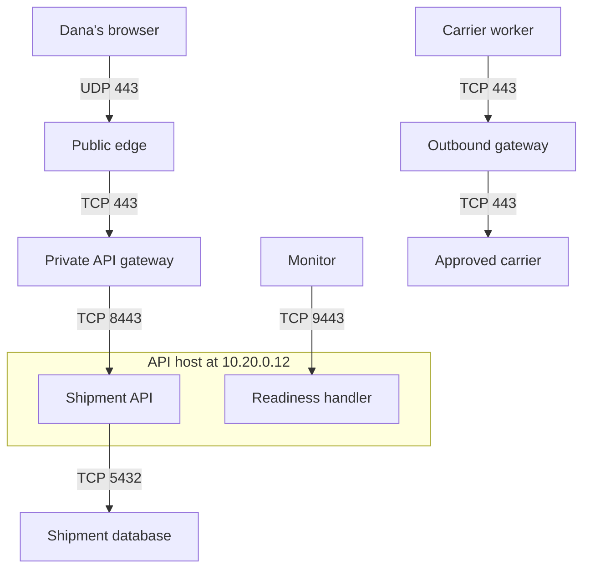

# 15 · Firewalls and segmentation

Dana, a dispatcher for North, opens shipment `S42`. Her browser connects to the public edge. A few milliseconds later, PostgreSQL serves the shipment API over a private connection. The API log names Dana, the database log names `shipments_reader`, and a firewall log shows two IP addresses. How would you use those records to explain who was allowed to do what?

**On this shipment read path, only the production API is intended to open a database connection.** The network admits its interface to the database’s TCP port `5432`. PostgreSQL verifies the API’s client certificate and maps its identity to a read-only role. The API checks Dana’s permission for the particular shipment. An IP address, a database role, and a user session each answer a different part of the question.

The course checklist asks, *“Which workloads can connect to the database, and how does the database authenticate the caller?”* The addresses, roles, and policies below form one fictional deployment that you can use to work out an answer. [AppSec networking checklist](appsec-networking-checklist.md)

**Jump to** · [Boundaries](#1-draw-the-boundaries) · [Reading rules](#2-read-a-firewall-rule) · [Connection state](#3-follow-the-request-and-the-reply) · [Enforcement points](#4-find-where-policy-is-enforced) · [Shipment policy](#5-design-the-shipment-policy) · [Database identity](#6-authenticate-the-workload-and-authorize-the-query) · [Evidence](#7-read-the-evidence) · [Offline exercise](#8-work-through-a-policy-offline) · [Self-check](#9-check-your-understanding)

## 1. Draw the boundaries

A **firewall** enforces a traffic policy at an observation point such as a router, virtual network interface, or host. A **segment** is a part of the network that you manage as a unit. A **zone** groups systems with similar access requirements, such as public-facing services or production data stores. **Segmentation** limits the communications permitted between those groups. Start by asking which component needs to initiate which operation. Draw the boundary where you can enforce the answer.

Suppose a carrier tracking worker needs to contact one carrier through an outbound gateway. The shipment API needs to read PostgreSQL. Giving the two workloads separate policies lets the worker do its job while keeping a direct database connection outside its permissions. That limits the **blast radius** of a worker fault or compromise. Applying controls as narrowly as two individual workloads, including within a shared subnet, is often called **microsegmentation**. [NIST guidance on firewall policy](https://csrc.nist.gov/pubs/sp/800/41/r1/final) · [NIST zero trust architecture](https://csrc.nist.gov/pubs/sp/800/207/final)

In this diagram, each arrow marks a permitted **new connection**, pointing from the initiator to the listener. The readiness handler runs on the API host and has a separate port. Ordinary reply packets and infrastructure dependencies are omitted.



**North–south** traffic crosses the boundary between the application environment and outside networks, as when Dana reaches the edge. **East–west** traffic travels between internal workloads, as when the API queries the database. **Ingress** and **egress** always name a direction relative to a particular point. The very same API-to-database packet is egress at the API and ingress at the database.

**Where can the traffic actually go?** A VLAN creates a separate link-layer broadcast domain. A subnet identifies an IP prefix. A router can forward between subnets, and a route table selects a next hop. Reachability depends on those paths, any filters they traverse, the return path, and a listening service. Hosts on one subnet can often communicate without touching a perimeter router. A private address, a VLAN name such as `prod`, or separate subnets alone cannot establish which workload may use a service. [Local networks](03-local-networks.md) · [Routing and NAT](04-routing-and-nat.md)

## 2. Read a firewall rule

Read a rule aloud as a sentence. *At the database interface, allow new inbound TCP connections from the production API group to this interface on destination port 5432.* Then check how the platform combines this rule with every other applicable rule.

| Question | What to look for | Example |
| --- | --- | --- |
| Where and in which direction? | The interface, subnet, or workload the rule applies to, and its ingress or egress direction | Ingress at the database interface |
| From whom? | The source address, CIDR prefix, or supported workload group as seen at that point | The interface associated with the production API group |
| To whom? | The destination address, group, or listener implied by the attachment | The private database interface, `10.30.0.20` |
| Using what? | The IP protocol and, for TCP or UDP, the relevant ports | TCP, destination `5432`. The API usually chooses a temporary source port |
| With what result? | Allow, deny, priority or combination rules, default action, and whether replies are tracked | Allow this connection. Other new callers need their own matching permission |

A TCP or UDP flow is commonly described by a **five-tuple** of source IP, source port, destination IP, destination port, and transport protocol. Direction adds the observer’s perspective. A layer 3 rule can match IP addresses. A layer 4 rule can distinguish `TCP/443` from `UDP/443`. The browser in this example uses HTTP/3 over QUIC on UDP `443`. The edge opens a separate TCP connection to the gateway on `443`. Opening only TCP on the public edge would exclude that HTTP/3 path.

Some traffic needs a different rule format. ICMP uses message types and codes in place of TCP or UDP ports. For example, an ICMPv6 *Packet Too Big* message tells the sender to reduce packet size for a path. Filtering all ICMPv6 can break transfers even when the intended TCP port is open. [IETF guidance on filtering ICMPv6](https://datatracker.ietf.org/doc/html/rfc4890#section-4.3.1)

**Check address scope.** `10.20.0.12/32` denotes one IPv4 address. `10.20.0.0/24` includes the edge egress, gateway, and API addresses used below, along with other possible hosts. `0.0.0.0/0` matches every IPv4 address. For IPv6, `/128` selects one address and `::/0` matches all IPv6 addresses. Review each enabled address family, listener, and policy. The private listeners in this example use IPv4. [IPv4, IPv6, and subnetting](02-ipv4-ipv6-and-subnetting.md)

**Check the default and the evaluation model.** In a first-match access control list (ACL), an early broad allow can make a later narrow deny ineffective. In an allow-only group model, a broad allow on *any* attached group can admit the traffic. **Default deny** means a new flow needs an explicit permission. A firewall that drops a packet silently can produce a timeout. A firewall configured to reject can return an error such as a TCP reset. Packet loss, a closed listener, and other faults can produce similar symptoms.

## 3. Follow the request and the reply

Consider a fresh database connection. The API at `10.20.0.12` chooses local TCP port `53024`. PostgreSQL is listening at `10.30.0.20:5432`. Assume direct routing, no address translation on this leg, and a configured API client port range of `52000–53999`. Other systems and NAT devices can use different ranges. [Ports, sockets, TCP, and UDP](05-ports-sockets-tcp-and-udp.md) · [AWS guidance on ephemeral ports](https://docs.aws.amazon.com/vpc/latest/userguide/custom-network-acl.html#nacl-ephemeral-ports)

| Packet | Source | Destination | At the API | At the database |
| --- | --- | --- | --- | --- |
| TCP connection request (SYN) | `10.20.0.12:53024` | `10.30.0.20:5432` | Egress | Ingress |
| TCP handshake reply (SYN-ACK) | `10.30.0.20:5432` | `10.20.0.12:53024` | Ingress | Egress |

### Stateful filtering

A stateful firewall remembers an admitted flow. After the API is allowed to initiate this connection, the database’s matching reply can pass a stateful control through its connection-tracking entry. The API does not need a rule admitting arbitrary new connections to port `53024`. A **new** connection initiated by the database would undergo its own policy decision. Application data can travel both ways over the established connection.

State has a lifetime. A long-idle connection in an application pool may outlive a firewall’s tracking entry. UDP has no TCP handshake, but stateful filters can temporarily associate return datagrams with a recent outbound flow. State also has a location. If the return takes another path through a stateful device that does not share the entry, it may drop the reply. Existing sessions can behave differently from new sessions after a rule edit. For example, AWS documents that tracked security-group connections can continue until they time out. [AWS connection tracking](https://docs.aws.amazon.com/AWSEC2/latest/UserGuide/security-group-connection-tracking.html)

### Stateless filtering

A stateless filter evaluates each packet independently. If both the API and database subnets use default-deny stateless ACLs, all four of these permissions are needed for the pictured exchange. In this example the ACL’s TCP port field matches the packet’s **destination** port. The “peer” column gives the destination for egress and the source for ingress.

| Subnet ACL | Direction | Peer CIDR | Protocol and destination ports | Packet it permits |
| --- | --- | --- | --- | --- |
| API subnet | Egress | `10.30.0.20/32` | TCP `5432` | Request to PostgreSQL |
| Database subnet | Ingress | `10.20.0.12/32` | TCP `5432` | Request from the API |
| Database subnet | Egress | `10.20.0.12/32` | TCP `52000–53999` | Reply to the API’s temporary port |
| API subnet | Ingress | `10.30.0.20/32` | TCP `52000–53999` | Reply arriving at the API |

If the database subnet allows outbound TCP only to destination `5432`, the SYN can arrive while the SYN-ACK to `53024` is dropped. The API can time out even with a healthy database and a correct database ingress rule. A stateless return-range rule matches *any* packet with the specified fields. A stateful control elsewhere can still distinguish a fresh connection from a reply. [AWS network ACL rules and examples](https://docs.aws.amazon.com/vpc/latest/userguide/custom-network-acl.html)

## 4. Find where policy is enforced

| Control | What it can decide | What to verify |
| --- | --- | --- |
| Routed firewall or subnet ACL | Which traffic may cross the boundary it observes | Which interfaces and paths traverse it, both directions, and rule order |
| Host firewall | Which packets the host accepts or sends, including traffic arriving from a same-subnet neighbor | Effective local policy, listener address, protocol, port, and address family |
| AWS VPC security group | Which new flows are allowed for an attached resource or network interface | Stateful and allow-only. Permissions from all attached groups combine. Audit ingress **and** egress, including broad defaults |
| AWS VPC network ACL | Which packets may enter or leave an associated subnet | Stateless. Inbound and outbound lists are separate. The lowest-numbered matching rule wins. An unmatched packet reaches the final deny |
| Kubernetes NetworkPolicy | Which connections selected pods may initiate or receive | The network plugin must enforce it. Standard allow policies are additive. If source egress and destination ingress are both isolated, both must allow the connection |
| Layer 7 proxy, WAF, or service mesh | What a supported application protocol or authenticated peer is allowed to do where the control can inspect it | Which component terminates TLS, which identity it validates, and whether every relevant path crosses it |

Every enforcement point along the path must admit the traffic it sees. For example, a security-group allow can coexist with a subnet ACL deny, and the subnet ACL will still drop the packet. In AWS, a VPC’s default network ACL initially allows inbound and outbound traffic. A newly created custom network ACL starts by denying both directions. Inspect the actual attachment and rules. [AWS default network ACL](https://docs.aws.amazon.com/vpc/latest/userguide/default-network-acl.html) · [AWS custom network ACLs](https://docs.aws.amazon.com/vpc/latest/userguide/custom-network-acl.html)

A security-group reference can follow a set of interfaces as replicas change. Its meaning depends on the provider and the network path. Review who can attach that group to another workload. A label or group association is evidence for network policy. The database needs its own evidence of possession of the expected workload credential. [AWS security-group rules](https://docs.aws.amazon.com/vpc/latest/userguide/security-group-rules.html) · [AWS network ACL behavior](https://docs.aws.amazon.com/vpc/latest/userguide/vpc-network-acls.html) · [Kubernetes NetworkPolicy](https://kubernetes.io/docs/concepts/services-networking/network-policies/)

An HTTP WAF at the public edge can inspect a decrypted shipment request. A packet filter at the database sees the socket addresses, transport, and port. It cannot tell from those fields whether Dana may read `S42`. A proxy opens a new upstream connection, so the firewall at each receiving service evaluates that connection’s peer. Source NAT can also change the peer address. An HTTP header such as `X-Forwarded-For` travels inside the application request and has no role in matching the database firewall’s source IP. [Proxies and gateways](12-proxies-and-gateways.md)

## 5. Design the shipment policy

Apply **least privilege** by granting each workload only the destinations and operations it needs for its job. Build a **flow matrix** from those requirements. Give each row an initiator, a destination listener, and a business reason. Then add the identity or authorization check at that listener. The table extends the earlier shipment example with a database at `10.30.0.20` in its own subnet. The private application tier and the database have a direct routed path. The API has one replica for this exercise.

| Initiator | Destination listener | Transport | Purpose and receiving check |
| --- | --- | --- | --- |
| Dana’s browser via office egress `198.51.100.24` | Public edge `203.0.113.80:443` | UDP, QUIC with TLS | The edge accepts the configured public hostname and shipment route. The browser verifies the public service certificate |
| Edge via private egress `10.20.0.5` | Private gateway `10.20.0.8:443` | TCP, TLS | Forward the API request. The gateway requires the `edge-prod` identity |
| Gateway `10.20.0.8` | API data listener `10.20.0.12:8443` | TCP, TLS | Deliver the request. The API authenticates `gateway-prod` and separately checks Dana’s session and shipment permission |
| Production shipment API `10.20.0.12` | Database `10.30.0.20:5432` | TCP, PostgreSQL over TLS | Read the shipment summary. PostgreSQL authenticates the `shipments-api-prod` workload |
| Designated monitor | API readiness listener `10.20.0.12:9443` | TCP, TLS | Check readiness using the monitoring identity. The listener serves a health handler |
| Carrier tracking worker `10.40.0.7` | Outbound gateway on `443` | TCP, TLS | Submit a carrier request using the worker identity. The gateway admits only its approved carrier destination |

**Translate the database row into network permissions.** Suppose the API interface belongs to security group `sg-api` and the database interface to `sg-db`. These are illustrative names. Restrict API egress to `sg-db` on TCP `5432` for this dependency. Allow database ingress from `sg-api` on TCP `5432`. There is no public database listener or public forwarding rule. The browser, edge, gateway, monitor, and worker have no direct database permission. The gateway’s right to call the API does not give it the API’s right to call PostgreSQL.

Before asserting “only the API,” check **effective** membership of `sg-api`, every group attached to the database, any host firewall, the subnet ACLs, and every exposed listener or proxy for that database. An additional rule permitting database ingress from `10.20.0.0/24` would admit more sources at the group layer. A narrower subnet ACL might still block those sources. Record both facts. A permitted interface can represent multiple processes, which is why the database also authenticates its client.

**Default-deny egress needs a dependency inventory.** The API may need an approved DNS resolver, credential or certificate issuer, telemetry collector, and database. A worker may need a queue and outbound gateway. Document the particular destination and protocol for each, including DNS over UDP and TCP when the resolver requires both. If several external sites share an IP, an IP-and-port rule cannot express “only this carrier.” The gateway in this design applies the destination policy described in [Server-side requests and webhooks](14-server-side-requests-and-webhooks.md).

**Separate operational access.** The table covers application reads. Schema migrations, restores, and administrative access need individually justified paths, identities, privileges, and audit records when the deployment supports them. Keep those powers out of the runtime reader role. Also restrict who can change routes, attach groups, edit a policy, or issue certificates. Those management permissions can change the answer to “who can connect?”

## 6. Authenticate the workload and authorize the query

A **workload identity** is a name assigned to a running service that it can prove using a credential. Authentication verifies that proof. Authorization determines what the authenticated principal may do. With **mutual TLS (mTLS)**, each endpoint presents its certificate and proves possession of the corresponding private key during the handshake. The private key stays with its holder. Each peer needs a trust configuration and a rule for which identity it expects. [TLS, HTTPS, and certificates](07-tls-https-and-certificates.md) · [NIST guidance on application service identities](https://csrc.nist.gov/pubs/sp/800/207/a/final)

| Decision | What happens in this example |
| --- | --- |
| Does the API trust the database? | The API connects as a PostgreSQL client to `db.shipments.example.com`. With `sslmode=verify-full` and its trusted CA, it validates the server certificate chain and verifies the requested hostname |
| Does the database trust the API? | The database requires a client certificate issued by its trusted workload CA and proof of the corresponding private key. It maps the expected certificate identity `shipments-api-prod` to the requested database role `shipments_reader` |
| May that role read or change data? | Its effective privileges allow login, connection to database `shipments`, use of schema `dispatch`, and `SELECT` on the `dispatch.shipment_summary` view. It has no write or schema-management privileges in this example |
| May Dana read this shipment? | The API resolves Dana’s session, checks her dispatch permissions, and scopes the lookup to her authorized tenant and shipment. The database connection can be shared by many requests under the same role |

### Read a real PostgreSQL identity mapping

These two excerpts show where the name check happens. Assume TLS is configured on both sides, the required CAs are trusted, and `shipments_reader` exists with `LOGIN`. In `pg_hba.conf`, the PostgreSQL server selects its authentication method using the connection type, target database, requested role, and source address.

```text
# pg_hba.conf
# TYPE   DATABASE   USER              ADDRESS         METHOD  OPTIONS
hostssl  shipments  shipments_reader  10.20.0.12/32   cert    map=shipment_services
```

With the `cert` method and its default client-name setting, PostgreSQL uses the verified client certificate’s common name (CN) for this mapping. In `pg_ident.conf`, the first field selects the map, the second gives the external identity, and the third names the database role it may use.

```text
# pg_ident.conf
# MAPNAME            EXTERNAL-IDENTITY   DATABASE-ROLE
shipment_services    shipments-api-prod  shipments_reader
```

Read the two entries together. An encrypted connection from `10.20.0.12` to database `shipments`, requesting role `shipments_reader`, must present a valid client certificate whose identity the named map accepts. A certificate for `carrier-worker-prod` fails that mapping even if it arrives through an admitted interface. PostgreSQL uses the **first matching** `pg_hba.conf` record. Authentication failure on that record ends the attempt. Also review other records for connections that do not match this one, including non-TLS connections and other address families. [PostgreSQL host-based authentication](https://www.postgresql.org/docs/current/auth-pg-hba-conf.html) · [Certificate authentication](https://www.postgresql.org/docs/current/auth-cert.html) · [User name maps](https://www.postgresql.org/docs/current/auth-username-maps.html) · [Client TLS verification](https://www.postgresql.org/docs/current/libpq-ssl.html)

**What happens on an actual read?** For `S42`, the API supplies the tenant from Dana’s authenticated authorization context and binds the requested shipment ID separately. For example, its permitted summary query can take this form.

```sql
SELECT shipment_id, status
FROM dispatch.shipment_summary
WHERE tenant_id = $1 AND shipment_id = $2;
```

With `$1` bound to `North` and `$2` to `S42`, the lookup can return North’s shipment. If Dana supplies the ID of a South shipment, that row falls outside the query. The role has permission to read the view, so this design depends on the API consistently applying the tenant and object checks. A database row-level security policy is another place to enforce row scope when the database receives trustworthy tenant context. Check all effective privileges, including inherited roles, grants to `PUBLIC`, and ownership. [PostgreSQL privileges](https://www.postgresql.org/docs/current/ddl-priv.html) · [PostgreSQL row security policies](https://www.postgresql.org/docs/current/ddl-rowsecurity.html)

**Keep the identity meaningful over time.** Issue a distinct credential per service and environment, limit who can obtain it, protect its private key, and rotate it before expiry. A read-only API and a migration job need different roles. Applications can also authenticate using a service-specific secret over verified TLS or a short-lived database token where supported. In every design, identify who issues the credential, which recipient accepts it, and what privileges follow. A pooled database session generally keeps the identity established when it logged in. Review existing sessions as well as fresh logins when access changes.

## 7. Read the evidence

Start with one concrete claim, such as “the production API can read a North shipment through a new connection.” Follow a known application transaction and compare its evidence with the **effective configuration**. A successful request shows one working path. Establishing which *other* workloads could connect requires examining rules, attachments, routes, listeners, and credentials.

| Evidence or symptom | What it establishes | What to examine next |
| --- | --- | --- |
| DNS returns `10.30.0.20` for the database name | The resolver returned that address at that time | Which address the application actually selected, its route, and the return path |
| A flow log records `ACCEPT` at the API interface for TCP to `10.30.0.20:5432` | That observation point accepted traffic with those fields | The other interface, subnet ACLs, return traffic, and the database listener |
| The client times out opening a new connection | The connection failed to complete before its deadline | First localize the failure. A route, packet filter, return ACL, or unavailable endpoint can all produce a timeout |
| The client reports a database certificate hostname mismatch | A TLS peer presented a certificate that fails the requested name check | DNS, expected service name, TLS termination point, and certificate names |
| PostgreSQL records a client-certificate identity mapping failure | The attempt reached PostgreSQL authentication, which rejected the requested identity-to-role mapping | The presented identity, trusted issuer, selected HBA record, requested role, and map |
| The authenticated role gets `permission denied` on a view | A database session exists. An authorization check denied the SQL operation | Effective role membership, schema and object grants, and the view being queried |
| Dana gets HTTP `403` from the API’s object-permission check | The API rejected her application operation | Its authenticated subject, tenant, and policy decision. It may have rejected the request before querying PostgreSQL |

Read flow records at the interface where they were collected. Useful fields include source and destination, ports, protocol, action, and time interval. Flow records can aggregate packets or have gaps. They do not identify Dana, a SQL role, or which row was returned. Correlate the API request ID with an application trace and its database operation, accounting for connection pooling. Keep certificate private keys, passwords, and session tokens out of those records. [AWS flow-log record fields and limits](https://docs.aws.amazon.com/vpc/latest/userguide/flow-log-records.html)

**Change review example.** A second API replica is scheduled at `10.20.0.13`. Group membership can give it the `sg-api` policy, but the example’s subnet ACLs and `pg_hba.conf` still name `10.20.0.12/32`. Update the narrowly scoped peer entries that need the new replica, arrange issuance of its authorized workload credential, and verify a fresh login and a normal read. Check that an unrelated worker still falls outside the admitted set. Review IPv6 separately if the replica enables it. Give each exception an owner, a purpose, and a removal condition.

## 8. Work through a policy offline

Take just the **database subnet ACL** from section 3. Assume rule `100` in each direction implements its allowed flow, followed by a default deny. For each packet below, predict the decision and the field that determines it. Cover the answer beneath the code while you work. You can do the exercise on paper or run the Python 3 example locally. It evaluates the four records entirely in memory.

| Packet | Direction at database subnet | Peer | Transport | Destination port |
| --- | --- | --- | --- | --- |
| API request | In | `10.20.0.12` | TCP | `5432` |
| Database reply | Out | `10.20.0.12` | TCP | `53024` |
| Carrier worker request | In | `10.40.0.7` | TCP | `5432` |
| Reply to a client using a different port range | Out | `10.20.0.12` | TCP | `55000` |

```python
from ipaddress import ip_address, ip_network

# Priority, direction, protocol, peer CIDR, low and high destination ports, action.
rules = [
    (100, "in",  "tcp", "10.20.0.12/32", 5432,  5432,  "ALLOW"),
    (100, "out", "tcp", "10.20.0.12/32", 52000, 53999, "ALLOW"),
]

def decide(direction, protocol, peer, destination_port):
    address = ip_address(peer)
    for priority, side, transport, cidr, low, high, action in sorted(rules):
        if side != direction or transport != protocol:
            continue
        if address in ip_network(cidr) and low <= destination_port <= high:
            return f"{action} (rule {priority})"
    return "DENY (default)"

packets = [
    ("API request", "in", "tcp", "10.20.0.12", 5432),
    ("Database reply", "out", "tcp", "10.20.0.12", 53024),
    ("Worker request", "in", "tcp", "10.40.0.7", 5432),
    ("Different return port", "out", "tcp", "10.20.0.12", 55000),
]

for label, direction, protocol, peer, destination_port in packets:
    decision = decide(direction, protocol, peer, destination_port)
    print(f"{label}: {decision}")
```

**Expected output**

```text
API request: ALLOW (rule 100)
Database reply: ALLOW (rule 100)
Worker request: DENY (default)
Different return port: DENY (default)
```

The worker used the right server port but had the wrong peer address. The last packet had the right peer but its destination port fell outside the allowed client range. Try changing only the last port to `53999` and then to `54000`. The first falls inside the inclusive range.

Now return to the real design decisions. Suppose the API request passes every network control, but the client presents a certificate for `carrier-worker-prod`. Which log would explain the failed login? PostgreSQL’s authentication log can show the rejected identity mapping. The offline evaluator will continue to say `ALLOW` because that packet meets the subnet rule. If the expected certificate is accepted and an `UPDATE` then fails, inspect the role’s SQL privileges.

## 9. Check your understanding

1. The monitor can reach `10.20.0.12:9443`. What would you need to show before claiming it can read shipment data?
2. The API and database security groups permit a new TCP connection. The client SYN reaches the database, but the database subnet’s outbound ACL permits only destination `5432`. Which packet is missing, and why?
3. An existing database session still returns rows after a rule change. What does that tell you about the ability to establish a new session?
4. A teammate proposes allowing all of `10.20.0.0/24` to simplify database access for future API replicas. Which other callers would the proposed rule match, and what would PostgreSQL still check?
5. PostgreSQL shows a successful `shipments_reader` login. What evidence would establish that Dana could read `S42` at the time of the request?

**Answer key**

1. The monitor is admitted to a dedicated readiness handler. To establish access to shipment data, identify a route and permission to a data-serving listener, an accepted service or user identity, and authorization for the requested shipment. The design gives the monitor readiness access only.
2. The database’s SYN-ACK is addressed to `10.20.0.12:53024`. An outbound rule for destination `5432` misses it. The database outbound and API inbound stateless ACLs must each admit the reply.
3. It shows the old session still works. A tracked connection or connection pool can outlive a rule change. Evaluate the effective policy for new connections and verify a fresh authorized connection separately.
4. The source prefix includes the edge egress at `.5` and the gateway at `.8` as well as the API at `.12`. Other enforcement points may still restrict the path. If a connection reaches PostgreSQL, the selected HBA record, certificate validation, and identity mapping determine whether the requested role can log in.
5. Correlate the API request with Dana’s authenticated session, her current tenant and object permission, and the tenant-scoped lookup and response for `S42`. A pooled database login identifies the service and may predate her request.

**Use the checklist on another application.** Pick one sensitive listener. Name every allowed initiating workload, its observed source, the destination, protocol, port, and direction. Explain how reply packets pass through connection tracking or explicit rules. Identify the credential the receiver verifies and the operation that identity can perform. Support the answer with the effective policy and a trace of one authorized operation.

---

[Previous · 14 Server-side requests and webhooks](14-server-side-requests-and-webhooks.md) · [Course checklist](appsec-networking-checklist.md) · [Next · 16 Cloud and container networking](16-cloud-and-container-networking.md)
