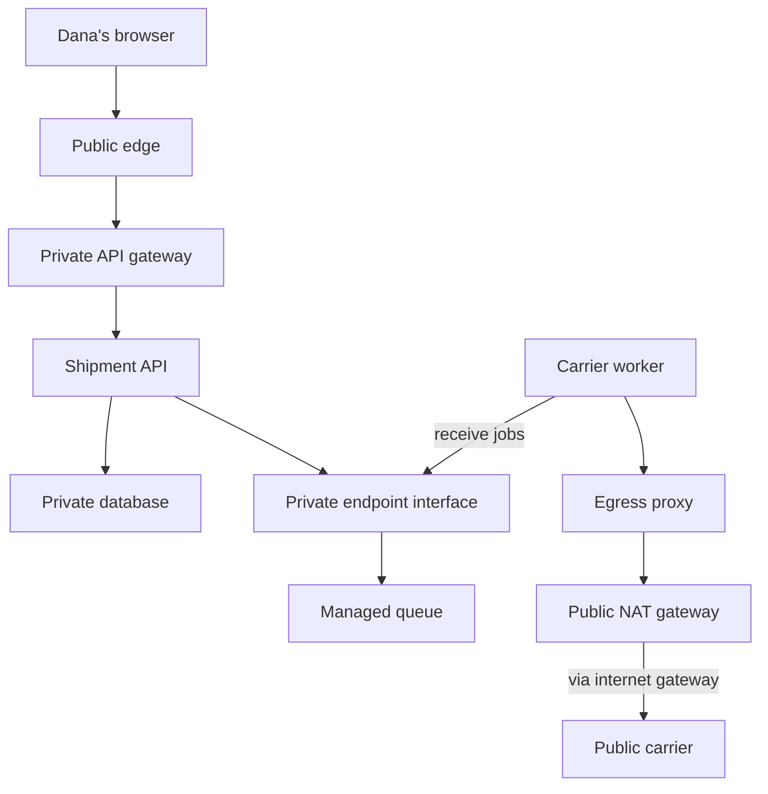

# 16 · Cloud and container networking

A developer opens `http://127.0.0.1:18080/status.txt` on a laptop and reads the shipment API’s response. A worker container on the same laptop needs `http://api:8080/status.txt` to read that same file. In production, Dana opens `https://api.example.com/shipments/S42` and reaches an API with a private IP address. How can all three connections work?

**Start with the caller.** Loopback reaches the calling process’s own network stack. On Linux, its network namespace determines which stack that is. The laptop reaches a port that Docker publishes on the host. The worker reaches the API’s own listener over a shared container network. Dana reaches a public edge that opens a separate, permitted connection toward the private application. Each caller has a different destination and path.

The course checklist asks, *“What does `localhost` refer to from the application process, and which configuration actually exposes the service?”* By the end of the chapter you should be able to answer with a caller, a destination address and port, the rules or forwarding that join the two, and evidence from the receiving process. [AppSec networking checklist](appsec-networking-checklist.md)

**Jump to** · [Loopback and listeners](#1-locate-the-calling-process) · [Virtual networks and subnets](#2-read-a-cloud-network) · [Three cloud paths](#3-trace-three-cloud-paths) · [Docker and Compose](#4-follow-a-docker-port) · [Kubernetes](#5-follow-a-kubernetes-service-to-a-pod) · [Exposure review](#6-decide-who-can-reach-a-listener) · [Troubleshooting](#7-find-where-a-connection-stops) · [Practice and answers](#8-practice-with-the-shipment-network)

## 1. Locate the calling process

A Linux **network namespace** gives processes their own view of interfaces, IP addresses, routes, sockets, and port numbers. Several processes can share one namespace. Two ordinary containers with separate namespaces can both listen on TCP `8080` without a conflict. Two processes in the same namespace generally need different ports or bind addresses to open independent listeners.

**Loopback** delivers traffic back into the caller’s own network stack. `127.0.0.1` is an IPv4 loopback address and `::1` is IPv6 loopback. The name `localhost` normally resolves to one or both. The process making the connection determines where those addresses lead. [Linux network namespaces](https://man7.org/linux/man-pages/man7/network_namespaces.7.html) · [Ports, sockets, TCP, and UDP](05-ports-sockets-tcp-and-udp.md)

| Where the client code runs | What its `localhost` reaches | How it reaches the intended service |
| --- | --- | --- |
| Browser JavaScript on Dana’s laptop | A listener on Dana’s laptop | Use the API’s public HTTPS name or a relative URL routed by the page’s own origin |
| A terminal on the Docker host | A listener or port published on that host’s loopback | Use `127.0.0.1:18080` for the local exercise |
| The API process in an ordinary Docker container | The API container’s own network namespace | Use `db:5432` for a database in a separate Compose service named `db` on the same network |
| A sidecar container in the same Kubernetes Pod as the API | The Pod’s network namespace, including the API’s loopback listener | Use `127.0.0.1` and the API’s listening port |
| A worker in a different ordinary Pod | The worker Pod’s network namespace | Use the API’s Kubernetes Service name and Service port |

This matters in a frontend application. A `fetch` that runs in the browser on Dana’s laptop and a `fetch` that runs during server-side rendering inside a container have different meanings for `localhost`. Identify the process that actually executed the request before changing DNS or firewall rules.

**Binding selects where a server accepts connections.** Binding to `127.0.0.1:8080` accepts IPv4 connections addressed to loopback in that namespace. Binding to `0.0.0.0:8080` listens on all local IPv4 addresses in that namespace, including its network interface. Clients use a concrete address or DNS name. For IPv6 the wildcard is `::`. Whether an IPv6 socket also accepts IPv4 connections depends on platform and socket settings. A Docker mapping or Kubernetes Service that forwards to a container or Pod IP needs an application listening on an address that accepts that traffic.

## 2. Read a cloud network

A **virtual private cloud** (AWS VPC) or **virtual network** (Azure VNet) provides an isolated address and routing space. You choose CIDR ranges, split them into subnets, and attach workload interfaces or managed services. A **subnet** is a range of addresses with associated network configuration. A **route table** tells the network where to send packets for particular destination prefixes. A **security group** or other filter decides which flows may pass. A route can exist even when policy denies the connection. [AWS subnets](https://docs.aws.amazon.com/vpc/latest/userguide/configure-subnets.html) · [Azure Virtual Network](https://learn.microsoft.com/en-us/azure/virtual-network/virtual-networks-overview)

The shipment roles carry over from lesson 15. The cloud example uses a fresh IPv4 address plan so that all four subnets fit inside one VPC, `10.60.0.0/16`. The public addresses are documentation examples. The layout shows the paths in one availability zone. An AWS subnet belongs to one zone, and a deployment can repeat tiers in other zones for availability.

| Subnet | Resources in this example | Effective routes used here |
| --- | --- | --- |
| Public edge, `10.60.1.0/24` | Edge VM at `10.60.1.10` with public mapping `203.0.113.80`. A separate public NAT gateway uses public IP `198.51.100.90` | `10.60.0.0/16 → local` and `0.0.0.0/0 → internet gateway` |
| Application, `10.60.2.0/24` | Gateway `10.60.2.8`, API `10.60.2.12`, carrier worker `10.60.2.40`, and a private endpoint interface at `10.60.2.70` | `10.60.0.0/16 → local` |
| Data, `10.60.3.0/24` | Database at `10.60.3.20:5432` | `10.60.0.0/16 → local` |
| Egress proxy, `10.60.5.0/24` | Outbound proxy at `10.60.5.8` | `10.60.0.0/16 → local` and `0.0.0.0/0 → public NAT gateway` |

In AWS, a subnet with a direct route to an **internet gateway** is called *public*. Direct IPv4 access to our edge VM also requires its public address mapping, permitting filters, and a listening application. A *private* subnet can have outbound access through NAT, private connectivity to other networks, or only local routes. The data subnet above has no internet default route. It still receives authorized database connections from the application subnet. [AWS internet gateways](https://docs.aws.amazon.com/vpc/latest/userguide/VPC_Internet_Gateway.html)

**Read a route from the sender’s subnet.** From `10.60.5.8`, both the local `/16` and the default `/0` match destination `10.60.3.20`. The more specific `/16` wins, so the packet stays inside the VPC. For the carrier address `192.0.2.44`, only the default route matches, so the proxy uses the NAT gateway. From the data subnet, the same carrier IP has no matching route. Check the return path separately. Peering or VPN connectivity also needs compatible address ranges, routes in the relevant networks, and permitting policy. Overlapping CIDRs can make the intended destination ambiguous. [AWS route priority](https://docs.aws.amazon.com/vpc/latest/userguide/route-tables-priority.html) · [Routing and NAT](04-routing-and-nat.md)

| Question | AWS | Azure |
| --- | --- | --- |
| Which path will a subnet use? | Inspect the subnet’s associated route table, including the main table if there is no explicit association | Inspect effective routes on the workload interface, including system routes, user-defined routes, and any propagated routes |
| Which traffic may pass? | Security groups on supported resource interfaces are stateful and allow-only. Their permissions combine. A subnet network ACL evaluates packets independently in each direction | Network security groups can apply at subnet and NIC level. They use prioritized allow and deny rules and track connections. Traffic must pass every applicable control |
| How can a client reach a managed service privately? | An interface VPC endpoint can provide private IPs in selected subnets. Some services also support a gateway endpoint | An Azure Private Endpoint places a network interface with a private IP in the VNet and connects it to the selected service resource |

Use the effective routes, addresses, filters, and frontends for the provider you are reviewing. The AWS subnet names in the example describe AWS routing behavior. For a dual-stack workload, trace the IPv6 destination and rules as well. For example, an AWS `::/0` route to an egress-only internet gateway permits workloads to initiate IPv6 internet traffic with return traffic. It is a separate design from IPv4 NAT. [AWS security groups](https://docs.aws.amazon.com/vpc/latest/userguide/vpc-security-groups.html) · [Azure effective routing](https://learn.microsoft.com/en-us/azure/virtual-network/virtual-networks-udr-overview) · [Azure network security groups](https://learn.microsoft.com/en-us/azure/virtual-network/network-security-groups-overview) · [AWS egress-only internet gateways](https://docs.aws.amazon.com/vpc/latest/userguide/egress-only-internet-gateway.html)

## 3. Trace three cloud paths

The arrows follow each request toward its destination. On the carrier path, the egress **proxy** is an application that can authorize the carrier destination. The **NAT gateway** translates network addresses and ports.



### Dana reads a shipment through the public edge

1. Dana’s browser resolves `api.example.com` to `203.0.113.80` and connects to TCP `443` using HTTPS. In this VM example the internet gateway maps the edge’s public IPv4 address to `10.60.1.10`. The edge security group, host policy, and HTTPS listener admit the request.
2. The edge terminates browser TLS and connects to the private gateway at `10.60.2.8:443`. The gateway opens its own TLS connection to `10.60.2.12:8443`. With mutual TLS on these legs, the gateway verifies the edge’s identity and the API verifies the gateway’s identity. Each leg also needs a local route and a matching private ingress permission.
3. The API checks Dana’s session and her permission for North’s shipment `S42`. It reads the database over `10.60.3.20:5432` using its workload identity. The private API and database can serve the public application while each accepts a much narrower set of direct callers. [Proxies and gateways](12-proxies-and-gateways.md) · [Firewalls and segmentation](15-firewalls-and-segmentation.md)

### A worker contacts the carrier through NAT

The carrier worker sends an authorized tracking request to the egress proxy at `10.60.5.8` over the VPC’s local route. The proxy opens the connection to the approved carrier. Its subnet routes the public destination to the NAT gateway, whose public subnet routes internet traffic through the internet gateway. The carrier sees `198.51.100.90` as the public source. Translation state directs replies back to the proxy’s connection. The proxy returns the result to the worker on their separate connection.

This explains two operational details. The worker can contact the carrier through the proxy even though the worker’s subnet has no internet default route. And the carrier can reply to the outbound connection without acquiring a public ingress path to the worker. A callback from the carrier would require its own published receiver and authentication. The NAT gateway does not decide which carrier URLs the application may use. [AWS NAT gateways](https://docs.aws.amazon.com/vpc/latest/userguide/vpc-nat-gateway.html) · [Server-side requests and webhooks](14-server-side-requests-and-webhooks.md)

### The API sends a message to a managed queue through a private endpoint

Use an Amazon SQS queue for tracking jobs. With private DNS configured, the queue service’s normal regional hostname resolves inside this VPC to the endpoint interface at `10.60.2.70`. The API connects to that private IP on TCP `443`, validates the service’s TLS name, and submits the job using its workload credentials. The endpoint’s security group can restrict incoming HTTPS. The applicable endpoint, identity, and resource policies determine whether the API may send to this queue and whether the carrier worker may receive jobs from it. This path needs neither the public NAT gateway nor an internet default route. [AWS interface endpoints and private DNS](https://docs.aws.amazon.com/vpc/latest/privatelink/privatelink-access-aws-services.html) · [Private connectivity for Amazon SQS](https://docs.aws.amazon.com/AWSSimpleQueueService/latest/SQSDeveloperGuide/sqs-internetwork-traffic-privacy.html)

Two details often change the answer during a review. An AWS **gateway endpoint**, available for S3 and DynamoDB, adds a service prefix-list route to selected route tables. It works differently from the private interface address above. And a private endpoint can coexist with a service’s public frontend. In Azure, for example, check the target resource’s public network access setting as well as its Private Endpoint, private DNS, and permissions. Verify DNS from the actual client’s network because internal and external resolvers may return different answers. [AWS gateway endpoints](https://docs.aws.amazon.com/vpc/latest/privatelink/gateway-endpoints.html) · [Azure Private Endpoint](https://learn.microsoft.com/en-us/azure/private-link/private-endpoint-overview) · [DNS and service discovery](06-dns.md)

## 4. Follow a Docker port

On a user-defined Docker **bridge network**, ordinary Linux containers have separate network namespaces and interfaces on a shared virtual network. Docker Compose creates a project network by default. Services attached to it can resolve each other by service name. A recreated container can get a new IP while keeping the same service name. A peer connects to the service name and **container port**.

In a typical Linux bridge setup, a virtual Ethernet pair connects the container’s interface to a bridge on the host. Same-network traffic can cross that bridge directly. Outbound traffic to other networks commonly uses source NAT on the host. Docker’s Linux **host networking** mode changes this arrangement by sharing the host’s network namespace. The process then binds in the host’s port space. [Docker bridge driver](https://docs.docker.com/engine/network/drivers/bridge/) · [Docker host driver](https://docs.docker.com/engine/network/drivers/host/)

For a client on the host, a Docker `ports` entry can publish an additional path. Read `127.0.0.1:18080:8080` from left to right as **host bind address, host port, container port**. Under the current default bridge configuration, a host connection to `127.0.0.1:18080` is forwarded to the container interface on TCP `8080`. Omitting the host address normally publishes on all host interfaces by default. The network, host firewall, and any upstream cloud policy determine who can reach those interfaces. [Docker port publishing](https://docs.docker.com/engine/network/port-publishing/) · [Compose networking](https://docs.docker.com/compose/how-tos/networking/)

| Configuration | Its effect |
| --- | --- |
| Application binds `0.0.0.0:8080` inside the container | The server can accept IPv4 connections arriving on its container interface and on its own loopback |
| Dockerfile `EXPOSE 8080` or Compose `expose` | Describes an intended container port. This alone creates no host mapping. Same-network peers can already reach a listening port under normal bridge rules |
| Compose `ports: ["127.0.0.1:18080:8080"]` | Adds an IPv4 host-loopback entry to container port `8080`. Same-network containers continue to call `api:8080` |
| The application binds only `127.0.0.1:8080` inside the container | A process there can call it through loopback. Forwarding to the container interface cannot deliver to that loopback-only socket |

The binding distinction also applies to a database. For a separate Compose `db` service, the API can connect to `db:5432` on their shared network without publishing PostgreSQL on the host. On Docker Desktop, Linux containers run behind a VM. Host publishing gives the laptop a usable entry point. For the opposite direction, Docker Desktop provides `host.docker.internal` for a container that legitimately needs a service on the laptop. That service must accept the connection on the destination address. [Dockerfile EXPOSE](https://docs.docker.com/reference/dockerfile/#expose) · [Docker bridge networks](https://docs.docker.com/engine/network/drivers/bridge/) · [Docker Desktop networking](https://docs.docker.com/desktop/features/networking/networking-how-tos/)

### Local exercise with one file and two callers

Save this as `compose.yaml` in a new directory. It serves one fictional status file and uses no host mounts or credentials. You can read both client paths directly from the file. To run them, use a local Docker Engine 28 or later with Compose and a free host port `18080`. The first container start may download the Python image.

```yaml
services:
  api:
    image: python:3.13-alpine
    command:
      - sh
      - -ec
      - |
        mkdir -p /tmp/lesson16
        printf '%s\n' 'S42 in transit' > /tmp/lesson16/status.txt
        exec python -m http.server 8080 --bind 0.0.0.0 --directory /tmp/lesson16
    ports:
      - "127.0.0.1:18080:8080"
  worker:
    image: python:3.13-alpine
    command:
      - python
      - -c
      - |
        from urllib.request import urlopen
        with urlopen("http://api:8080/status.txt", timeout=5) as response:
            print(response.read().decode().strip())
```

Run the following in that directory. `docker compose config` renders the effective configuration even when the engine is stopped. The remaining commands use the local engine.

```sh
docker compose config
docker compose up -d api
docker compose port api 8080
curl --noproxy '*' --fail --silent --show-error --retry 8 --retry-connrefused --retry-delay 1 http://127.0.0.1:18080/status.txt
docker compose run --rm --no-deps worker
docker compose down
```

**Expected observations.** The port lookup reports `127.0.0.1:18080`. Both HTTP clients print `S42 in transit`. The laptop used the published port. The worker used Compose DNS and container port `8080`. Predict what happens if you remove only the `ports` entry and recreate the API container. The worker’s request still has a direct path to `api:8080`. The host’s `127.0.0.1:18080` mapping is gone. [Compose configuration](https://docs.docker.com/reference/cli/docker/compose/config/) · [Running a one-off Compose service](https://docs.docker.com/reference/cli/docker/compose/run/)

## 5. Follow a Kubernetes Service to a Pod

A **Pod** is the network unit for ordinary Kubernetes workloads. Its containers share a network namespace, Pod IP addresses, loopback, and port space. A sidecar in the API Pod can connect to the API on Pod loopback. When the API and a worker run in different Pods, each Pod has its own loopback. A Kubernetes **Namespace** such as `dispatch` groups API objects and scopes their names. Merely placing two Pods in `dispatch` does not make them share `localhost` or create a traffic-isolation policy. [Kubernetes Pods](https://kubernetes.io/docs/concepts/workloads/pods/) · [Kubernetes networking model](https://kubernetes.io/docs/concepts/services-networking/)

A cluster network plugin, commonly integrated through the **Container Network Interface (CNI)**, provides Pod connectivity. Some clusters route Pod addresses directly on the underlying network. Others carry Pod traffic over an overlay between nodes. A **Service** gives callers a stable way to reach changing backends. For an ordinary `ClusterIP` Service, cluster DNS returns its virtual IP, and the Service data plane directs connections to eligible endpoints. When a Pod is replaced, the Service can retain its name and address while its endpoint set changes. [Kubernetes Services](https://kubernetes.io/docs/concepts/services-networking/service/) · [DNS for Services and Pods](https://kubernetes.io/docs/concepts/services-networking/dns-pod-service/)

### From a Service name to a listening socket

In this deployment variant, the public edge reaches the gateway through a private frontend. The gateway now runs **inside the cluster**. It can use an in-cluster Service for the shipment API. The database remains in the VPC at `10.60.3.20:5432`. The development Compose mapping belongs to the laptop deployment.

```yaml
apiVersion: v1
kind: Service
metadata:
  name: shipments-api
  namespace: dispatch
spec:
  type: ClusterIP
  selector:
    app: shipments-api
  ports:
    - name: https
      protocol: TCP
      port: 443
      targetPort: api-tls
```

| Step | Evidence from this example | Meaning |
| --- | --- | --- |
| Discover the Service | `shipments-api.dispatch.svc.cluster.local` resolves to `10.96.12.40` | This cluster uses the domain `cluster.local`. The gateway connects to `10.96.12.40:443` |
| Find eligible backends | A ready Pod in `dispatch` has label `app: shipments-api` and declares a TCP container port named `api-tls` with value `8443` | The Service selector matches the Pod. The named `targetPort` resolves to `8443` |
| Deliver the connection | The Service’s EndpointSlice includes ready endpoint `10.42.2.17:8443`. The API process listens on `0.0.0.0:8443` in that Pod | The data plane forwards to an address and port that the app accepts. Service port `443` and target port `8443` can differ |
| Authenticate | The gateway validates the API’s TLS certificate for the name it expects. The API authenticates the gateway and applies Dana’s authorization | Naming the port `https` and setting `protocol: TCP` describe the service. The application or an explicitly configured TLS proxy performs the handshake |

A `containerPort` declaration can supply a name for `targetPort`. The server process still has to bind its socket. If a sidecar succeeds at `127.0.0.1:8443` while the gateway cannot reach the Pod, check whether the app bound only to loopback. If the new Pod’s label or named port differs from the Service definition, inspect its EndpointSlices before investigating TLS. [Kubernetes EndpointSlices](https://kubernetes.io/docs/concepts/services-networking/endpoint-slices/) · [TLS, HTTPS, and certificates](07-tls-https-and-certificates.md)

**Which source reaches the database?** Suppose this cluster translates off-cluster Pod traffic to the node’s address `10.60.2.25`. The database then observes that node as its network peer. A different CNI configuration could preserve the Pod IP and require a return route to the Pod prefix. Check the observed source before carrying over a VM-era IP allowlist. The database can verify the API’s own workload credential even when several Pods share a translated source address.

### Ways a Kubernetes workload can be reached

| Mechanism | Entry it provides | What determines its audience |
| --- | --- | --- |
| `ClusterIP` | A virtual Service IP and port normally used inside the cluster | Cluster routing, policy, and any proxy or gateway that forwards requests from other callers |
| `NodePort` | A Service port allocated on eligible node addresses | Node address selection, routes, node or cloud firewalls, and Service forwarding |
| `LoadBalancer` Service | Asks the cluster’s load-balancer controller to provision or configure a frontend | The controller, public or internal frontend, actual listener, allowed sources, health, and backend wiring |
| Ingress or Gateway API | Hostname, path, or other listener and routing rules supported by a controller | A working controller and reachable frontend must implement the rules. Review its audience, TLS configuration, and referenced Service port |
| `hostPort` or `hostNetwork` | A selected Pod port on the node, or use of the node’s network namespace | The node’s interfaces and policy become part of the path. With `hostNetwork`, loopback refers to the node’s network namespace |

A headless Service (`clusterIP: None`) can return endpoint addresses through DNS without a virtual Service IP. A temporary `kubectl port-forward` normally listens on local loopback and uses an authorized Kubernetes API connection. A successful local forward demonstrates that particular path. Check the actual ingress listener or load balancer separately when assessing production reachability. [Service types](https://kubernetes.io/docs/concepts/services-networking/service/#publishing-services-service-types) · [Ingress](https://kubernetes.io/docs/concepts/services-networking/ingress/) · [Gateway API](https://kubernetes.io/docs/concepts/services-networking/gateway/) · [kubectl port-forward](https://kubernetes.io/docs/reference/kubectl/generated/kubectl_port-forward/)

## 6. Decide who can reach a listener

The statement “the API is exposed” needs an audience and an operation. In this example Dana can perform an authorized read through the public edge. Direct connections to the API listener have a smaller audience. A sidecar can reach a loopback-only diagnostic listener that neither the edge nor a different Pod can reach directly. Those are three distinct claims about the same application.

For the VM deployment, the edge permits public clients on TCP `443`. The gateway permits the edge group on TCP `443`. The API permits the gateway group on TCP `8443`, and the database permits the API group on TCP `5432`. Check outbound rules at each initiating workload as well. AWS security groups track admitted connections and permit their replies. Any stateless subnet ACLs on the path must admit traffic in both directions, including replies to the client’s temporary port. [AWS security groups](https://docs.aws.amazon.com/vpc/latest/userguide/vpc-security-groups.html) · [Firewalls and segmentation](15-firewalls-and-segmentation.md)

| Question to answer | Evidence to collect |
| --- | --- |
| Who initiates, and which name or address do they use? | Identify browser, host, container, Pod, or managed service. Record its namespace, DNS answer, address family, protocol, and destination port |
| Where is traffic forwarded? | Identify any public IP association, proxy request, Docker host-port mapping, cloud load-balancer listener and healthy targets, or Kubernetes Service and ready endpoints |
| Can the request and reply traverse the network? | Check effective routes, security groups, subnet or host filters, Docker network membership, and applicable Pod ingress and egress policy. Record the peer each receiving component actually sees |
| Which process receives it? | Check the running process’s bind address, port, and protocol in the receiving namespace. Verify the TLS endpoint and expected service identity |
| What can the caller do after connecting? | Check the authenticated workload or user, its permissions on the resource, and the application’s decision for the requested tenant and object |

In Kubernetes, standard **NetworkPolicy** applies at Pod level and needs a network plugin that enforces it. An ordinary Pod starts non-isolated in a direction until a policy selects it for isolation in that direction. Allowed flows are the union of the applicable allows. When the source is isolated for egress and the destination for ingress, both sides must permit a new connection. Containers that share a Pod also share loopback, so account for the trust you place in a sidecar. [Kubernetes NetworkPolicy](https://kubernetes.io/docs/concepts/services-networking/network-policies/)

## 7. Find where a connection stops

Follow one known, intended request from its actual caller. Use read-only configuration, application traces, and logs from the components that handle it. A successful test from a developer’s laptop is evidence for a different path from the one used by a Pod or a private worker.

| Observation | Where to look next |
| --- | --- |
| Host can read the Compose status file, worker reports name lookup failure for `api` | Verify the worker and API are attached to the same project network and that the worker used the service name. Host publication can keep working while service discovery fails |
| API answers its own loopback, but a peer cannot connect to its container or Pod IP | Inspect the API’s bind address and TCP port inside its namespace. If these match, continue with endpoint selection and network policy |
| A new TCP connection times out | Check selected IP and address family, forward and return routes, network policy, and endpoint health. A timeout alone cannot identify the filter or hop |
| A connection is refused promptly | Check the process and listener on the selected address and port. A host or firewall can also actively reject a connection |
| Gateway returns `503` and the Service has no ready endpoints | Compare the Service selector with Pod labels in the same namespace, then the named target port, Pod readiness, and controller status |
| TLS fails its hostname check after connecting | Check which endpoint terminated TLS, the DNS name the client expected, and the certificate presented on that leg |
| Queue service returns an authenticated access denial | Locate the denial in service audit logs and inspect the calling identity, endpoint policy, resource policy, and queue permissions. Changing a subnet route cannot grant a queue operation |

For the Kubernetes example, inspect the Service selector and `targetPort`, then the matching Pods’ labels, port declarations, and readiness. Finally compare the endpoint addresses, ports, and readiness conditions in the EndpointSlice. These commands read the deployed objects in the `dispatch` namespace of a cluster you administer. For a paper exercise, use the evidence table in section 5.

```sh
kubectl -n dispatch get service shipments-api -o yaml
kubectl -n dispatch get pods -l app=shipments-api -o yaml
kubectl -n dispatch get endpointslices -l kubernetes.io/service-name=shipments-api -o yaml
```

For the cloud VM path, compare the edge listener and access log, gateway upstream result, API authorization decision, and database login. For the carrier path, compare the worker’s proxy destination, proxy decision, egress route, and carrier’s observed public source. A cloud flow log can support a claim about addresses, ports, and traffic policy at its observation point. Application and database logs supply the identities and operations at their layers.

## 8. Practice with the shipment network

### Predict the next hop

Use the table in section 2. Predict the route for the API calling the interface endpoint, the proxy calling the database, the proxy calling the carrier, and the data subnet trying to call the carrier. Then run this Python 3 exercise if you want to check your answers. It uses the standard library and performs every lookup in memory.

```python
from ipaddress import ip_address, ip_network

vpc = (ip_network("10.60.0.0/16"), "VPC local")
default = ip_network("0.0.0.0/0")
tables = {
    "application": [vpc],
    "data": [vpc],
    "egress": [(default, "public NAT gateway"), vpc],
    "public": [(default, "internet gateway"), vpc],
}

def next_hop(subnet, destination):
    address = ip_address(destination)
    routes = sorted(tables[subnet], key=lambda route: route[0].prefixlen, reverse=True)
    for network, target in routes:
        if address in network:
            return target
    return "no matching route"

cases = [
    ("application", "10.60.2.70"),
    ("egress", "10.60.3.20"),
    ("egress", "192.0.2.44"),
    ("public", "192.0.2.44"),
    ("data", "192.0.2.44"),
]

for subnet, destination in cases:
    print(f"{subnet} to {destination}: {next_hop(subnet, destination)}")
```

**Expected output**

```text
application to 10.60.2.70: VPC local
egress to 10.60.3.20: VPC local
egress to 192.0.2.44: public NAT gateway
public to 192.0.2.44: internet gateway
data to 192.0.2.44: no matching route
```

The egress and public subnet results for `192.0.2.44` are successive decisions on the same carrier path. The local route to the database establishes only a possible network path. The shipment design grants database access to the API, and every other caller still needs its own network permission and accepted identity.

### Review questions

1. The laptop uses `127.0.0.1:18080`. After moving a server-rendered frontend into a sibling Compose container, which address should its server-side request use for the exercise API? What would browser-side code use on the developer’s laptop?
2. A VM in the public edge subnet has a TCP `443` listener and a permitting security group, but only a private IPv4 address. What else would provide a usable public IPv4 entry point?
3. A carrier sees `198.51.100.90` on an outgoing tracking request. Can it deliver a new webhook to the worker using that fact alone?
4. A Kubernetes sidecar reads an API listening on `127.0.0.1:8443`. The Service has the correct port mapping and the expected Pod IP in its EndpointSlice. Why can the gateway’s connection still fail?
5. A Service is `ClusterIP` and an Ingress controller publicly routes `/shipments` to it. Which callers can reach the application, and which control decides whether Dana can read `S42`?
6. The API sends a message to the queue using its private endpoint. What evidence supports both the private network path and permission to send?

**Answers**

1. The sibling frontend uses `http://api:8080/status.txt` on their shared Compose network. Browser-side code on that developer’s laptop can use the published `http://127.0.0.1:18080/status.txt`. A real user’s browser uses the application’s public origin or API name.
2. Direct access to the VM needs a public address mapping and a working path through the internet gateway. Alternatively, a public load balancer or reverse proxy with a permitted and healthy private backend can expose the application while the VM keeps its private address.
3. The observed address belongs to the NAT path. Reply traffic is associated with the existing connection. A new webhook needs a separately configured reachable receiver and sender verification.
4. The sidecar shares the Pod’s loopback. Service traffic arrives at the Pod IP. Bind the intended API listener to an address that accepts traffic on the Pod interface, then verify the required policies and TLS identity.
5. Permitted cluster callers can use the Service. External callers can reach the configured HTTP route through the public controller’s frontend. The API validates Dana’s session and her tenant and shipment permissions before returning data.
6. From the API’s network, show the service name resolving to the private endpoint IP and the connection using that endpoint with the expected TLS identity. For SQS, when CloudTrail data-event logging is enabled for the queue, use the successful `SendMessage` event to identify the calling principal and target queue. [SQS events in CloudTrail](https://docs.aws.amazon.com/AWSSimpleQueueService/latest/SQSDeveloperGuide/sqs-logging-using-cloudtrail.html)

**Apply the checklist to your own system.** Pick one endpoint and answer twice, first from a user’s device and then from a backend workload. For each, name what `localhost` means, the address and port actually dialed, the configuration that makes that path reachable, and the identity allowed to perform the operation.

---

[Previous · 15 Firewalls and segmentation](15-firewalls-and-segmentation.md) · [Course checklist](appsec-networking-checklist.md) · [Next · 17 Real-time connections](17-real-time-connections.md)
