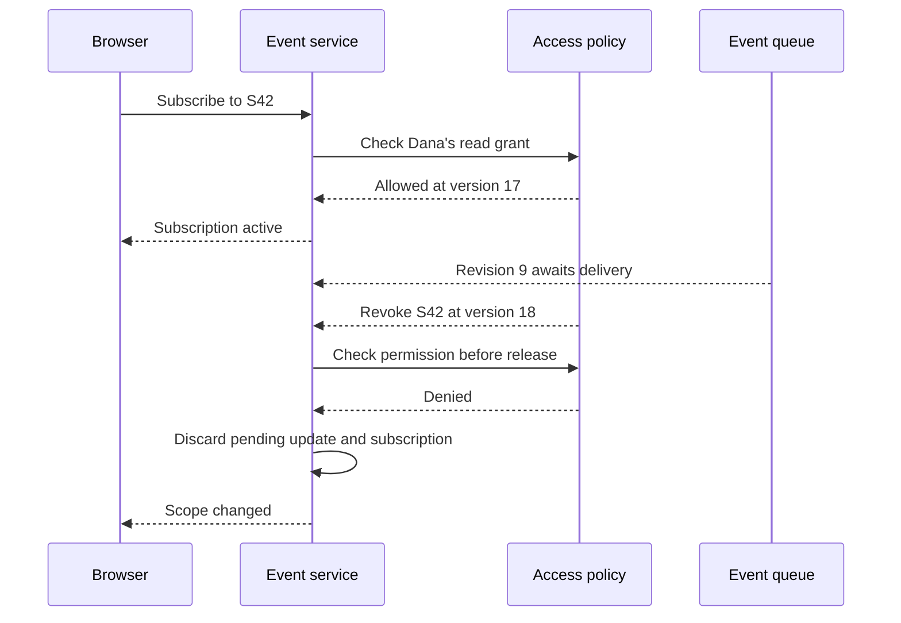

# 17 · Real-time connections

Dana is watching North’s shipment `S42`. At 09:04, a status update enters the queue for her dashboard. At 09:05, a supervisor removes her access to that shipment. Her WebSocket is still open, her session is valid, and the update has yet to leave the server. Should the server send it?

**The server should withhold the queued update and end Dana’s subscription to `S42`.** It can keep delivering other shipments she may still read. If she reconnects, the server must also apply her current permissions to the snapshot and any replay. Data already transmitted may still arrive or remain on her device. The security decision you can enforce is which data the server releases next.

The course checklist asks, *“What happens to a live subscription when the user loses access to its data?”* This chapter follows the shipment dashboard from its first request through disconnection, recovery, and revocation. The hostnames, event IDs, and access decisions are fictional. [AppSec networking checklist](appsec-networking-checklist.md)

**Jump to** · [Choose a transport](#1-choose-how-updates-travel) · [Read an SSE stream](#2-read-a-server-sent-event-stream) · [Follow a WebSocket](#3-follow-a-websocket-connection) · [Enforce permissions](#4-enforce-permissions-throughout-the-connection) · [Recover and update the UI](#5-recover-missed-events-and-update-the-dashboard) · [Handle slow clients](#6-handle-slow-clients-and-limit-resource-use) · [Diagnose a live path](#7-diagnose-a-live-connection) · [Run the local lab](#8-observe-an-sse-reconnect-locally) · [Review questions](#9-check-your-understanding)

## 1. Choose how updates travel

A dashboard needs a **snapshot** of the state the user can see now and a way to learn about later changes. The acceptable delay, the direction of messages, the number of clients, and the cost of recovering a missed change guide the transport choice. Any of these designs can keep writes on the ordinary HTTPS API.

| Mechanism | What happens on the wire | Good fit | Cost or behavior to account for |
| --- | --- | --- | --- |
| **Short polling** | The client periodically makes a new HTTP request. The server answers with the current state or changes since a cursor | A status page that can be a few seconds behind | Empty polls still need processing. Updates may wait nearly a full interval |
| **Long polling** | The server holds one HTTP request until data is available or a deadline expires. After the response, the client opens another | Mostly one-way updates where ordinary request/response HTTP is the available interface | The server holds waiting requests. A cursor covers the gap between one response and the next request |
| **Server-Sent Events (SSE)** | One HTTP response carries a sequence of text events from server to client | The dashboard receives many updates and sends occasional edits over HTTP | Browser `EventSource` reconnects automatically in recoverable cases. Useful replay requires support on the server |
| **WebSocket** | After an opening handshake, both peers can send messages independently over the connection | Frequent subscription changes, interactive collaboration, or a bidirectional protocol | The application must define its messages, authorization, recovery, and behavior when a peer falls behind |

**Estimate polling before choosing a more complex transport.** With 1,200 active dashboards polling every 15 seconds, the average is about 80 requests per second. If shipment changes occur uniformly between polls, the average wait until the next poll is about 7.5 seconds, plus request latency. Stagger the clients and avoid starting a second poll while the previous one is still running. A small operations board refreshed every minute might be well served by this design. [IETF guidance on long polling and streaming](https://datatracker.ietf.org/doc/html/rfc6202)

Where private storage is permitted, the client can send `If-None-Match` with the previous representation’s `ETag`. An authorized, unchanged representation can yield `304 Not Modified`, saving response bytes while still requiring a request. Recheck authorization before returning that result. The course’s sensitive shipment-detail route uses `Cache-Control: no-store`. For that route, get a fresh authorized snapshot when resynchronizing. [HTTP conditional requests](https://www.rfc-editor.org/rfc/rfc9110.html#name-if-none-match) · [HTTP caching](13-http-caching.md)

A carrier **webhook** sits on a different leg of the same system. The carrier calls a server endpoint, which verifies the message and commits the shipment change. A live dashboard can then learn about the committed change by polling, SSE, or WebSocket. The carrier’s permission to report an update and Dana’s permission to receive it are separate decisions. [Server-side requests and webhooks](14-server-side-requests-and-webhooks.md)

## 2. Read a Server-Sent Event stream

The browser opens an HTTP `GET`. On success, the server responds with status `200` and media type `text/event-stream`, then writes UTF-8 text as events become available. The connection can carry many events in the same response. For a sensitive feed, configure the streaming route and intermediaries to avoid shared caching and to flush data promptly. Here is part of a response body, with a blank line after each block.

```text
: heartbeat

id: c42
event: shipment
data: {"shipmentId":"S42","revision":8,"status":"In transit"}

```

| Field or delimiter | How the browser interprets it |
| --- | --- |
| `data:` | Adds one line to the event payload. Consecutive data lines in the same event are joined with newline characters. JSON parsing is an application choice |
| `event: shipment` | Dispatches a named event to a `shipment` listener. Omitting the field uses the default `message` event type |
| `id: c42` | Sets the event ID used by `EventSource` for resumption. The application defines what that cursor means and how long it is retained |
| `retry: 2000` | An integer in milliseconds that sets the reconnection time used by the browser. Browsers can also delay retries |
| A blank line | Completes the event block. A network packet or HTTP chunk can contain part of an event or several events |
| A line starting with `:` | A comment. It can keep an idle response active without dispatching a shipment event to JavaScript |

The course dashboard runs at `https://app.example.com` and the API owns its session cookie at `https://api.example.com`. For this cross-origin SSE request, the browser client can use `new EventSource("https://api.example.com/events", { withCredentials: true })`. The server authorizes the feed and returns the specific allowed `Access-Control-Allow-Origin` plus `Access-Control-Allow-Credentials: true`. Cookie scope, `Secure`, `SameSite`, and browser privacy settings still apply. Native `EventSource` takes a URL and credential option and has no arbitrary request-header option. [HTML EventSource specification](https://html.spec.whatwg.org/multipage/server-sent-events.html) · [Fetch CORS protocol and credentials](https://fetch.spec.whatwg.org/#cors-protocol-and-credentials) · [Cookies and credentials](11-cookies-and-credentials.md)

After a recoverable disconnect, the same `EventSource` object can issue another `GET` with `Last-Event-ID: c42`. The server authenticates this new request, checks the caller’s current scope, and can resume *after* that cursor. The header records progress in the browser’s event parser. It says nothing about whether a UI update or database write finished. A page reload creates a new object, so resuming across reloads needs an explicit application design. JavaScript can call `source.close()` to stop the feed. A server can answer a subsequent request with `204 No Content` to stop automatic reconnection. [SSE reconnection and event IDs](https://html.spec.whatwg.org/multipage/server-sent-events.html#server-sent-events)

## 3. Follow a WebSocket connection

Use `wss://` for a production browser connection. TLS protects traffic in transit to the TLS endpoint and lets the browser verify that endpoint’s certificate. If TLS ends at an edge proxy, the connection to the event service has its own transport and trust settings. Session authentication and shipment authorization still happen at the application boundary. [TLS, HTTPS, and certificates](07-tls-https-and-certificates.md) · [The WebSocket protocol](https://datatracker.ietf.org/doc/html/rfc6455)

| Opening path | What success looks like |
| --- | --- |
| HTTP/1.1 | A `GET` requests `Upgrade: websocket` using `Connection: Upgrade`. A successful server response is `101 Switching Protocols` with the corresponding upgrade fields. The `Sec-WebSocket-Key` and `Sec-WebSocket-Accept` exchange confirms the protocol handshake |
| HTTP/2 or HTTP/3 | When supported and negotiated on that hop, extended `CONNECT` with `:protocol` set to `websocket` opens a WebSocket stream. A successful response is `2xx`. Other HTTP streams may share the connection |

Inspect the version used **on each hop**. A browser-to-edge stream can use a different HTTP version from the edge-to-origin connection. An HTTP/1.1 upstream proxy must support forwarding the upgrade. An HTTP/2 or HTTP/3 path needs support for its own handshake. [WebSockets over HTTP/2](https://datatracker.ietf.org/doc/html/rfc8441) · [WebSockets over HTTP/3](https://datatracker.ietf.org/doc/html/rfc9220) · [HTTP versions and request boundaries](09-http-versions-and-request-boundaries.md)

### A transport connection and a shipment subscription

This browser code asks for one subscription once the transport opens.

```js
const socket = new WebSocket("wss://api.example.com/ws/events");
socket.addEventListener("open", () => {
  socket.send(JSON.stringify({ type: "subscribe", shipmentId: "S42" }));
});
```

The browser’s `open` event means the WebSocket is ready to exchange messages. Clients can optionally offer subprotocols, such as `shipments.v1`, so the server can select a supported message format during the handshake. The application defines the meaning of `subscribe`. Our event service checks permission and returns an application-level `subscribed` acknowledgment before sending updates. Here is one authorized message.

```json
{
  "type": "shipment.updated",
  "subscriptionId": "sub-1",
  "eventId": "e92",
  "cursor": "c42",
  "shipmentId": "S42",
  "baseRevision": 7,
  "revision": 8,
  "status": "In transit"
}
```

WebSockets carry text or binary **messages**. A message can span several protocol frames. Browser JavaScript receives a `message` event for the assembled message. Control frames include **Ping**, **Pong**, and **Close**. Browser JavaScript has no raw Ping/Pong API. A server library can use protocol heartbeats, or the application can define a small heartbeat message when its JavaScript client needs to observe liveness. A healthy heartbeat establishes transport activity and carries no proof of a current read grant. [WebSockets browser specification](https://websockets.spec.whatwg.org/) · [WebSocket framing](https://datatracker.ietf.org/doc/html/rfc6455#section-5)

The browser exposes `CONNECTING`, `OPEN`, `CLOSING`, and `CLOSED` states. A normal close can report code `1000`. A server can use `1008` for a policy violation and `1009` for a message too large to process. A browser may report `1006` when it did not receive a proper close frame. That value is reserved and cannot be sent in a Close frame. The standard browser WebSocket object does not automatically reconnect. [WebSocket close status codes](https://datatracker.ietf.org/doc/html/rfc6455#section-7.4.1)

## 4. Enforce permissions throughout the connection

The opening request, the subscription, a later action, and the release of each protected update have different inputs. A connection opened while Dana had broad rights can still be alive after those rights change.

| Decision | What the service checks for the shipment dashboard |
| --- | --- |
| **Accept a browser connection** | Require the intended production endpoint, `wss://api.example.com/ws/events`. Before accepting the handshake, validate the browser `Origin` and authenticate the session. Bind the connection to the server-derived user, tenant, session ID, and expiry |
| **Subscribe or change filters** | Resolve the requested shipment, tenant, topic, or filter against Dana’s current read permissions. For a tenant-wide feed, filter individual events and fields when object permissions differ |
| **Perform an action** | Authorize the command just as the HTTPS API would. A dispatcher who may read `S42` may still lack permission to reassign its driver. Validate message type, fields, sizes, and business preconditions before applying a change |
| **Release an update** | Use current session and policy state for live fan-out, unsent queues, snapshots, and replay. Check the actual resource named by the event. Remove stale subscriptions and pending items when access changes |
| **Expire or revoke a session** | Enforce the server’s expiry on active connections, including quiet ones. On logout or administrative session revocation, invalidate that session’s connections across instances. Authenticate a replacement connection afresh |

**What `Origin` tells the server.** When the page at `https://app.example.com` opens `wss://api.example.com/ws/events`, the expected browser `Origin` is `https://app.example.com`. Compare the parsed origin’s scheme, host, and effective port against an explicit allowlist. For this browser-only endpoint, reject missing, opaque (`null`), or unapproved origins. Non-browser clients need their own authenticated client policy. An approved origin identifies an allowed calling page. A valid session identifies Dana. Her current grant determines whether she can read `S42`. [Browser security](10-browser-security.md) · [OWASP WebSocket security guidance](https://cheatsheetseries.owasp.org/cheatsheets/WebSocket_Security_Cheat_Sheet.html)

**How the browser authenticates.** The browser can attach eligible cookies to a WebSocket handshake. Its WebSocket constructor accepts a URL and optional subprotocols, with no API for setting an arbitrary `Authorization` header. A cookie-based design can use a narrowly scoped `Secure`, `HttpOnly` session cookie and the explicit origin check above. Check the cookie’s path too. One restricted to `/api` will be absent on `/ws/events`. CORS response headers and a normal Fetch preflight do not provide WebSocket admission control. Keep reusable credentials out of URL query strings, subprotocol names, and logs. Cookie expiry in the browser does not automatically terminate an already-open socket. [WebSocket opening handshake](https://websockets.spec.whatwg.org/#opening-handshake) · [WebSocket constructor](https://developer.mozilla.org/en-US/docs/Web/API/WebSocket/WebSocket)

### The queued update at 09:05



The event service needs a way to find affected subscriptions across all instances. It can index them by session and resource, consume policy changes, and discard queued application data for the revoked scope. A generic scope-change notice can tell the dashboard to clear the old detail and revalidate its list. The server enforces the restriction even if a client ignores that notice. If only `S42` was revoked, Dana can continue receiving another authorized shipment. When the whole session expires, close or disable all of that session’s subscriptions.

Apply the same reasoning to HTTP transports. Check permissions on every short poll. For a held long poll, check again before releasing a response if access may have changed while it waited. An SSE response can stay open for hours, so enforce revocation on writes to the existing stream as well as on the next `GET`.

**Define when revocation takes effect.** For a strict cutoff, order the authoritative policy change and the final decision to release data so that a send using an older permission cannot win after revocation takes effect. A one-time lookup followed by an unchecked queue write leaves a race. Distributed invalidation messages alone can arrive late. If a system accepts a bounded propagation delay, document and measure that window. Pause sensitive deliveries when the service cannot establish current authority. Bytes already handed to the transport can still arrive, and application code cannot retract data a client has already received.

## 5. Recover missed events and update the dashboard

A connection delivers messages while it works. An application that promises recovery needs a history or an authoritative snapshot. Even on an ordered WebSocket, a disconnect can happen after the server sends an event but before the client applies it. Across separate connections or two independent feeds, arrival order is insufficient to establish business order.

| Value in the example | Question it answers |
| --- | --- |
| `shipmentId: S42` | Which resource changed? |
| `eventId: e92` | Have I already applied this particular event? |
| `revision: 8` | Which version of `S42` does this update describe? It can be compared with another revision of **that shipment** under the application’s contract |
| `cursor: c42` | Where can this particular feed resume? Treat cursors as opaque and bound to their feed and scope |
| Acknowledgment | What did the peer confirm? Define whether an acknowledgment means received, applied, or durably committed |

### Take a snapshot without leaving a gap

1. The server returns Dana’s authorized snapshot and a cursor from the **same consistent point**. For example, the snapshot shows `S42` at revision `7` through cursor `c41`.
2. The client subscribes or reconnects with `after: c41`. The server rechecks the session and scope, replays eligible retained events after that point, then continues live without a gap at the replay-to-live handoff.
3. Event `e92` updates `S42` to revision `8` at cursor `c42`. The client applies it once and records its application checkpoint after applying the update. Receiving `e92` again after a reconnect leaves the state at revision `8`.
4. If the cursor is too old, belongs to a different feed, or can no longer be resumed safely under the current scope, return an explicit *resync required* result. Fetch a new authorized snapshot and its cursor. Old cursors confer no right to replay revoked data.

If you fetch a snapshot and only then start listening **from now**, a change can fall between the two operations. Pairing the snapshot with a resumable cursor closes that gap. A durable event log can support replay across server instances. A transient publish/subscribe channel alone may lose events while a client is disconnected. A skipped cursor value in a filtered feed is normal when the server omits events outside the user’s scope.

For WebSocket reconnects, use capped exponential backoff with jitter so clients recover at different times. One example chooses a random delay between zero and `min(cap, base × 2^attempt)`. Retry transient failures while the view still needs updates. After logout, session expiry, or a terminal policy denial, wait for fresh authentication or an explicit change of scope. Native SSE already has a retry loop. Avoid creating additional `EventSource` objects on every error. [WebSocket recovery after abnormal closure](https://datatracker.ietf.org/doc/html/rfc6455#section-7.2.3) · [Using server-sent events](https://developer.mozilla.org/en-US/docs/Web/API/Server-sent_events/Using_server-sent_events)

### Should React patch the list or refetch it?

The message in section 3 carries a change to the status field from revision `7` to `8`. If the cached detail is at revision `7`, update the status and revision while preserving fields such as the driver’s name. Now suppose Dana is watching page 2 filtered to **In transit**, sorted by **last updated**, and a later event says `S42` was delivered. Simply removing the row from page 2 leaves an unanswered question about which shipment now belongs at the bottom of that page.

| What the event guarantees | Appropriate client response |
| --- | --- |
| A complete, authorized shipment snapshot at a newer revision | Replace the cached detail for that shipment. Patch a visible row if membership, ordering, and pagination stay valid |
| A delta with a stated base revision that matches the cached revision | Apply the delta once. If the base is missing or differs, fetch an authorized snapshot |
| A change to a filter, sort key, deletion, or a paged collection’s membership | Mark the affected list queries stale. Group nearby changes into one revalidation so the server supplies the order, total, and replacement rows |
| Duplicate or older update under the feed’s revision contract | Leave the newer detail intact. Honor the checkpoint rules separately |
| An access change or sign-out | Remove restricted data, terminate the affected subscription, and cancel or ignore in-flight requests from the old authorization context |

Give the connection a clear owner per authenticated scope. Release listeners, timers, and streams when that scope ends. If the dashboard has separate shipment and telemetry feeds, keep a cursor and recovery state for each. Coalesce replaceable status or position updates before rendering. Preserve business transitions when their individual effects matter. For actions sent over a socket, a network failure can also hide a successful write. A command ID with server-side deduplication and a recorded result makes a retry safe when the operation supports it. [URLs and HTTP semantics](08-urls-and-http-semantics.md)

## 6. Handle slow clients and limit resource use

**Backpressure** is the mechanism by which a slow consumer causes an upstream producer to slow or pause. The standard browser `WebSocket` API has no receive-side backpressure control for JavaScript. If 600 telemetry updates arrive each second and the UI can process 200, the backlog grows by 400 updates per second. At one KiB per update, that is roughly 23.4 MiB per minute before object and rendering overhead. A responsive network connection can coexist with a frozen interface. [MDN WebSocket API](https://developer.mozilla.org/en-US/docs/Web/API/WebSocket)

`socket.bufferedAmount` measures **outgoing** data the browser queued via `send()` that has yet to be transmitted. It cannot measure incoming UI work or tell you that the other application processed a command. Track pending application work separately. Server-side streaming also needs bounded queues for slow SSE or WebSocket clients. [WebSocket bufferedAmount](https://developer.mozilla.org/en-US/docs/Web/API/WebSocket/bufferedAmount)

| Pressure point | Control and reason |
| --- | --- |
| Connections and subscriptions | Set per-user or per-tenant limits plus a service-wide capacity limit. Bound subscriptions per connection and pending unauthenticated handshakes. Shared NAT addresses make IP-only limits a poor measure of users |
| Incoming messages | Limit complete message size, including reassembled fragments and decompressed output if compression is enabled. Validate the schema and bound command frequency and expensive work per principal |
| Server fan-out | Bound queued bytes, item count, and waiting time per connection. Let one slow consumer fall behind independently of other clients. On overflow, coalesce complete replaceable states or require a fresh snapshot |
| Browser processing | Keep receive handlers short. Batch state changes and renders, retain the latest complete telemetry value per shipment where allowed, and cap the number of pending items or keys |
| Loss-sensitive events | Preserve ordered events in a durable history if the product requires every transition. Use a bounded acknowledgment window or application-level credits when both ends support them. A client beyond retention must resync |

Choose the overflow policy from the event’s meaning. Ten complete GPS positions can become one latest position on a map. Ten inventory adjustments cannot safely become only the last adjustment. If an application cannot keep up and has no safe coalescing rule, stop accumulating, mark its state stale, and recover through the agreed snapshot or replay path. [OWASP WebSocket resource controls](https://cheatsheetseries.owasp.org/cheatsheets/WebSocket_Security_Cheat_Sheet.html#denial-of-service-protection)

## 7. Diagnose a live connection

The path may include a browser, CDN or reverse proxy, API gateway, event service, and broker. Confirm each hop’s support for the chosen transport. For SSE, response buffering can hold small writes and release them together. Use route-specific streaming controls and flush complete event blocks. For WebSockets, check handshake forwarding and idle timeouts on both legs. Set heartbeat traffic to arrive comfortably before the shortest relevant idle timeout, measure the result, and use a separate authentication deadline. [NGINX response buffering](https://nginx.org/en/docs/http/ngx_http_proxy_module.html#proxy_buffering) · [NGINX WebSocket proxying](https://nginx.org/en/docs/http/websocket.html) · [Proxies and gateways](12-proxies-and-gateways.md)

| Observation | Evidence to collect |
| --- | --- |
| SSE response is `200`, but updates arrive in bursts | Check `Content-Type`, the terminating blank line, server flush times, proxy buffering, and the times at which the browser dispatched events |
| WebSocket opens, but no shipment updates appear | Separate handshake acceptance, subscription acknowledgment, current permissions, and broker publication. Verify that the client listens for the correct message type |
| A quiet connection closes at similar intervals | Compare idle timeouts, heartbeats, session expiry, and proxy logs. A browser’s generic close or error alone rarely identifies the closing component |
| A reconnect shows duplicates or skips a change | Compare the last applied event ID, feed cursor, retention window, shipment revision, and snapshot boundary. Check each feed independently |
| The browser becomes sluggish while the connection stays open | Measure message rate and size, pending work, memory, and render time. Inspect server per-client queue depth and dropped or coalesced update counts |
| Updates continue after a role change | Trace the policy change, its propagation to each serving instance, pending queues, the final release decision, and any delivery already in flight |

During deployments, drain connections deliberately and let clients resume on another healthy instance. Keep the authorization state and recovery data available to whichever instance accepts the reconnect. Useful metrics include active connections by tenant, subscription denials, queue age and bytes, reconnects, replay failures, and revocation propagation time. Correlate events using non-secret connection and request identifiers. Keep session cookies, bearer tokens, and sensitive shipment bodies out of routine logs.

## 8. Observe an SSE reconnect locally

This exercise uses Node.js 24, an ordinary browser, and two fictional updates. Everything runs on your machine with no npm dependencies. The server binds to IPv4 loopback on a free port. It deliberately ends each response after one event so you can see exactly how the next request resumes. The page and its stream share an origin.

Save the following as `sse-demo.mjs`.

```js
import { createServer } from "node:http";

const page = String.raw`<!doctype html>
<meta charset="utf-8">
<title>Shipment stream</title>
<h1>Shipment S42</h1>
<pre id="updates"></pre>
<script>
  const output = document.querySelector("#updates");
  const feed = new EventSource("/events");
  feed.addEventListener("shipment", (event) => {
    const update = JSON.parse(event.data);
    output.textContent += event.lastEventId + " | " + update.shipmentId
      + " r" + update.revision + " | " + update.status + "\n";
  });
</script>`;

const nextByCursor = new Map([
  ["",    { cursor: "c41", revision: 7, status: "Ready" }],
  ["c41", { cursor: "c42", revision: 8, status: "In transit" }],
]);

const server = createServer((request, response) => {
  if (request.url === "/") {
    response.writeHead(200, { "Content-Type": "text/html; charset=utf-8" }).end(page);
    return;
  }
  if (request.url !== "/events") {
    response.writeHead(404).end();
    return;
  }

  const previous = request.headers["last-event-id"] ?? "";
  const next = nextByCursor.get(previous);
  if (!next) {
    response.writeHead(previous === "c42" ? 204 : 400, { "Cache-Control": "no-store" }).end();
    return;
  }

  const data = { shipmentId: "S42", revision: next.revision, status: next.status };
  response.writeHead(200, { "Content-Type": "text/event-stream", "Cache-Control": "no-store" });
  response.end([
    "retry: 500",
    "id: " + next.cursor,
    "event: shipment",
    "data: " + JSON.stringify(data),
    "",
    "",
  ].join("\n"));
});

server.listen(0, "127.0.0.1", () => {
  console.log("Open http://127.0.0.1:" + server.address().port);
});
```

Run `node sse-demo.mjs` and open the printed URL. The page should display these two lines.

```text
c41 | S42 r7 | Ready
c42 | S42 r8 | In transit
```

In browser DevTools, open **Network**, reload the page, and filter for `/events`. The first request has no `Last-Event-ID` and receives `c41`. The next carries `Last-Event-ID: c41` and receives `c42`. The third carries `Last-Event-ID: c42` and receives `204`, ending the retry loop. Reloading starts a fresh `EventSource` and repeats the two events. Stop the local server with `Ctrl+C`.

## 9. Check your understanding

### Test the last decision before delivery

Use this small model to predict what happens to a queued `S42` update, another permitted shipment, and the session at expiry. The clock is in minutes after 09:00. The subscription entry for `S42` briefly survives the grant change, as it could on a busy service. Save as `delivery-check.mjs` and run `node delivery-check.mjs`. This models the decision in one process. A distributed system also needs the ordering and policy propagation described in section 4.

```js
import assert from "node:assert/strict";

const session = { tenant: "North", expiresAt: 30, revoked: false };
const subscriptions = new Set(["S42", "S51"]);
const currentReads = new Set(["S42", "S51"]);
const pending = { tenant: "North", shipmentId: "S42" };
const other = { tenant: "North", shipmentId: "S51" };

function decide(minute, update) {
  if (session.revoked || minute >= session.expiresAt) return "close session";
  if (update.tenant !== session.tenant) return "withhold";
  if (!subscriptions.has(update.shipmentId)) return "withhold";
  if (!currentReads.has(update.shipmentId)) return "withhold";
  return "deliver";
}

assert.equal(decide(4, pending), "deliver");
currentReads.delete("S42");
assert.equal(decide(5, pending), "withhold");
subscriptions.delete("S42");
assert.equal(decide(6, other), "deliver");
assert.equal(decide(7, { tenant: "South", shipmentId: "S51" }), "withhold");
assert.equal(decide(30, other), "close session");
console.log("5 delivery checks passed");
```

The first assertion asks what *would* be allowed at 09:04. The second is the decision that matters if the item is still queued at 09:05. Replaying that item later needs the same current authorization check. Try setting `session.revoked = true` immediately before the third assertion and predict which decision changes.

### Review questions

1. A dashboard needs low-latency server updates and changes a shipment only when a user submits a form. Which transport could carry the updates, and how could the form submit its write?
2. The browser reports an open WebSocket, and Dana can read `S42`. What evidence would establish that she can reassign its driver?
3. An HTTP/2 trace shows an extended `CONNECT` for `websocket` and `:status 200`. Did the connection fail because there is no `101`?
4. An SSE client receives `c42`, then its update handler fails before saving state. Can you treat an automatic resume after `c42` as proof that the dashboard has applied revision `8`?
5. Two live feeds update a server-paginated shipment list. A status event moves `S42` out of the current filter while a telemetry event supplies a newer position. What should the client update?
6. The browser’s `bufferedAmount` is zero while incoming events make scrolling slow. Which measurements and controls address the problem?
7. Dana loses access to `S42` while an update is queued, then reconnects using yesterday’s cursor. What should the server release?

**Answers**

1. SSE fits a one-way update feed and can be paired with an authenticated HTTPS write. Short polling also fits if the latency budget permits it. Choose WebSocket when bidirectional messaging earns its additional protocol and recovery work.
2. Check authorization for the specific reassignment action, shipment, tenant, and current session, plus the command’s business preconditions. A handshake and a read subscription establish different facts.
3. This is a successful opening pattern for negotiated extended `CONNECT`. `101` is the HTTP/1.1 upgrade response. Check the application subscription acknowledgment separately.
4. No. Browser progress and application progress can differ. Recover from a verified application checkpoint or compare with a fresh authorized snapshot.
5. Apply a valid newer position to the appropriate detail or map state using the telemetry feed’s contract. Revalidate the affected paginated list so the server supplies correct membership, totals, and order. Track the feeds’ progress independently.
6. Measure incoming rate, pending items and bytes, handler time, and render time. Bound application queues, batch rendering, and coalesce replaceable values. Use replay or resync when a slow client cannot safely retain every event.
7. Withhold the pending `S42` update, remove that subscription, and enforce current grants on replay and snapshots. Continue only the data still permitted in a valid session. When the session itself expires, end its subscriptions and authenticate the next connection.

---

[Previous · 16 Cloud and container networking](16-cloud-and-container-networking.md) · [Course checklist](appsec-networking-checklist.md) · [Next · 18 Availability and retries](18-availability-and-retries.md)
