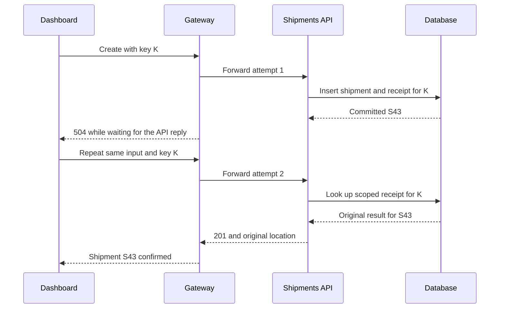

# 18 · Availability and retries

Dana, a dispatcher for North, submits **Create shipment**. The database commits shipment `S43`, but the gateway times out waiting for the API’s reply. Her dashboard shows an error. If she presses **Try again**, what prevents a second shipment?

**The client must identify both attempts as the same intended create, and the server must enforce that identity durably.** In this example the client reuses one idempotency key. In one database transaction, the API creates `S43` and records which result belongs to that key. An authorized retry with the same inputs retrieves the original receipt. The timeout establishes that the gateway stopped waiting. The durable receipt establishes what happened to the shipment.

The course checklist links this problem to a second one. When a dependency slows down, every waiting request occupies resources, and every retry asks the system to do more work. A good design protects both the user’s intended outcome and the service’s ability to serve its other users. [AppSec networking checklist](appsec-networking-checklist.md)

**Jump to** · [Availability and bottlenecks](#1-measure-availability-from-the-users-side) · [Timeouts and deadlines](#2-give-the-whole-operation-a-deadline) · [Limits and overload](#3-limit-the-resource-that-is-running-out) · [Idempotent creates](#4-make-a-shipment-create-safe-to-repeat) · [Retry decisions](#5-decide-whether-another-attempt-is-safe) · [Backoff and jitter](#6-bound-retries-with-backoff-jitter-and-a-budget) · [Recovery and diagnosis](#7-recover-the-dashboard-and-read-the-evidence) · [Local lab](#8-run-the-lost-reply-exercise) · [Review questions](#9-check-your-understanding)

## 1. Measure availability from the user’s side

For a shipment dashboard, availability means an authorized user can complete a useful operation correctly and in time. A gateway can accept TCP connections while every database query waits for a free connection. A create can return `201` quickly but create two shipments for one submission. An uptime check alone misses both failures.

A **service-level indicator (SLI)** measures an outcome. A **service-level objective (SLO)** gives it a target and a window. For example, “Over 30 days, 99.9% of eligible shipment reads return the correct authorized representation within 500 ms.” With exactly 10,000 eligible reads, at most 10 may be bad and still meet that target. Define eligibility in advance. A valid read shed during overload is a user-visible failure even if the service produced its error response quickly. For writes, measure timely confirmation and duplicate business effects separately. [Google SRE on implementing SLOs](https://sre.google/workbook/implementing-slos/)

### Is the link full, or is the application busy?

**Bandwidth** is the data rate a path can carry. **Throughput** is the work actually completed per unit time, measured here in bytes per second or requests per second. **Latency** is elapsed time for one operation. **Saturation** means a resource is at or near its usable capacity. The same symptom, “the dashboard is slow,” can arise at different resources.

| What the shipment team observes | Likely constraint | Evidence that distinguishes it | Matching response |
| --- | --- | --- | --- |
| Attachment downloads slow down together. The API spends little time preparing each response | Network link or egress bandwidth | Bytes per second near the path limit, increased transfer time, and stable application processing time | Reduce bytes, serve permitted content closer to the reader, or add bandwidth at the constrained path |
| Small filtered-list requests wait a long time for the first byte. The network has headroom | Expensive query or application work | Query duration and rows examined, CPU, database pool wait, and route-specific latency | Bound page size and query cost, improve the query, and cap concurrent expensive work |
| The API’s CPU is mostly idle, but creates pile up waiting on one dependency | A saturated pool, lock, or slow downstream service | Active slots, queue age, lock waits, and per-dependency latency | Limit admission, shorten queues, isolate the dependency, and stop work that no longer has time to finish |

For scale, 32 completed downloads per second at 256 KiB each require **8 MiB/s**, about **67 Mbit/s** of payload before protocol overhead. A 50 Mbit/s link cannot sustain that demand. A few hundred bytes requesting a report can occupy a database worker for seconds. A request-body limit would help protect the parser but would do little for that query. [Google SRE on latency, traffic, errors, and saturation](https://sre.google/sre-book/monitoring-distributed-systems/)

## 2. Give the whole operation a deadline

For a fresh HTTPS call, the client may wait for DNS, a transport connection, TLS, upload, gateway admission, application processing, and the response body. A reused connection can skip much of the setup. **Time to first byte** measures a different interval from total download time. Record the start and end of each measurement. A slow first byte alone cannot distinguish a network delay from a database wait. [DNS and service discovery](06-dns.md) · [TLS, HTTPS, and certificates](07-tls-https-and-certificates.md)

| Timer | What it bounds | Detail that affects diagnosis |
| --- | --- | --- |
| Connection-pool acquisition | Time waiting for a local client or database connection slot | This wait can happen before a network connection attempt begins |
| Connect timeout | Time allowed to establish the connection according to that client library | DNS and TLS may have separate timers. Verify what the library covers and measure cold connections as well as reused ones |
| Write or upload timeout | Time allowed to send request data, often measured as inactivity between writes | Some bytes may already have reached the peer when it fires |
| First-byte or response-header timeout | How long the caller waits for the response to begin | The server may already have performed the requested work |
| Read or idle timeout | How long the reader waits for more response data | Some implementations restart the timer after each successful read. Such a timer can allow a long response to run for minutes |
| End-to-end deadline | Latest time the logical operation can usefully finish | Includes queueing, setup, attempts, response processing, and any delay between attempts |

For example, NGINX’s `proxy_read_timeout` measures the gap between successive reads from the upstream. An event stream that sends data regularly can stay open beyond that interval. A two-second interactive operation instead needs a total deadline. [NGINX upstream read timeout](https://nginx.org/en/docs/http/ngx_http_proxy_module.html#proxy_read_timeout) · [Real-time connections](17-real-time-connections.md)

Choose timers from a latency distribution for the relevant route. If its healthy p50 is 70 ms and p99 is 450 ms, about half of the measured attempts finish within 70 ms and about 99% within 450 ms. A 100 ms timeout chosen from the median can discard many healthy requests. Measure cold connections, slow regions, and the fraction of requests that already timed out. A database-only p99 excludes browser, gateway, and transfer time.

**Pass the remaining time downstream.** If Dana’s request has 2,000 ms in total and 600 ms have elapsed at the gateway, at most 1,400 ms remain for *all* remaining work. Reserve time for the response before setting the API or database limit. At each hop, use the smaller of the caller’s remaining budget and the service’s own limit. Track elapsed time locally with a monotonic clock. Propagating a remaining duration avoids assuming unrelated machines’ clocks agree. Enforce a local ceiling even when a caller asks for a very long deadline. [gRPC deadline propagation and cancellation](https://grpc.io/docs/guides/deadlines/) · [AWS on choosing timeouts](https://aws.amazon.com/builders-library/timeouts-retries-and-backoff-with-jitter/)

**Cancellation is cooperative.** A browser abort stops its `fetch` or response reader from continuing to wait. A gateway can cancel an upstream call, and an API can pass cancellation to a database driver or job. Each component has to honor the signal. A transaction that already committed remains committed. If the work legitimately takes longer than an interactive deadline, an API can durably accept it, return `202 Accepted` with an authorized status URL, and let the client check progress. A `202` receipt establishes acceptance. Completion requires a later terminal result. [Fetch cancellation](https://developer.mozilla.org/en-US/docs/Web/API/AbortController/abort) · [HTTP 202 semantics](https://datatracker.ietf.org/doc/html/rfc9110#section-15.3.3)

## 3. Limit the resource that is running out

**Rate** counts arrivals per interval. **Concurrency** counts work currently in progress. Suppose a stable service completes 40 list reads per second and each spends an average of 0.1 seconds inside the service. It has about `40 × 0.1 = 4` reads in flight on average. Sustaining the same throughput at 1.5 seconds per read would require about `40 × 1.5 = 60`. This relationship, Little’s law, uses means over a stable interval and the same boundary for throughput and elapsed time. During a growing backlog, measure the queue directly. [AWS worked concurrency examples](https://docs.aws.amazon.com/lambda/latest/dg/lambda-concurrency.html)

| Control | How it works | Shipment example |
| --- | --- | --- |
| **Rate limit** | Admit a bounded number of arrivals over time. A token bucket allows short bursts and refills at a configured rate | A bucket with 10 tokens and a refill of 5 per second can admit 10 immediately when full. Scope limits fairly by authenticated principal or tenant |
| **Concurrency limit** | Occupy a slot while the protected work is active. Release it on completion or cancellation | Reserve a bounded number of database-heavy reports so short shipment reads can still acquire a connection |
| **Bounded queue** | Cap how many requests can wait and how long they may wait | Remove an expired request from the report queue before allocating a database worker. Reject new work early when its deadline is no longer achievable |
| **Request and operation size limits** | Cap headers, body bytes, decoded content where relevant, item counts, and costly query dimensions at the point that handles them | Check declared body size early when available and count actual bytes while reading. Enforce batch length, page size, and report complexity in the API. Return `413 Content Too Large` for an oversized body |
| **Load shedding and isolation** | Decline lower-priority work before it consumes a critical resource. Separate resource pools for unrelated workloads where practical | Delay an optional export while keeping the shipment form usable. Preserve authorization checks on every fallback |

A limit at the edge protects resources behind that edge. Verify that internal callers and workers encounter appropriate limits too. A shared office NAT address can represent many dispatchers. For per-user quotas, use authenticated identity, and trust client-address metadata only from your designated proxy. A client response with `429 Too Many Requests` can describe a caller’s rate limit. Temporary service-wide overload can warrant `503 Service Unavailable`. [Throttling patterns](https://learn.microsoft.com/en-us/azure/architecture/patterns/throttling) · [Load shedding](https://aws.amazon.com/builders-library/using-load-shedding-to-avoid-overload/) · [Proxies and gateways](12-proxies-and-gateways.md)

Limits also add up across replicas. Four API replicas with ten report slots each can offer forty concurrent reports to one shared database. Size the per-replica limits against that shared capacity. Enforce byte ceilings while reading at the gateway and API, then apply operation-specific limits after parsing. [Cloud and container networking](16-cloud-and-container-networking.md) · [NGINX request-body limit](https://nginx.org/en/docs/http/ngx_http_core_module.html#client_max_body_size) · [OWASP REST input validation](https://cheatsheetseries.owasp.org/cheatsheets/REST_Security_Cheat_Sheet.html#input-validation)

A **circuit breaker** helps when a dependency persistently fails. While closed it allows calls and observes outcomes. When open it fails calls quickly or uses an acceptable degraded result. After a cooldown, a half-open breaker admits a small number of trial calls to decide whether to recover. A separate **bulkhead** isolates capacity, such as reserving separate worker pools for interactive reads and exports. Neither mechanism changes whether a write can safely be repeated. [Circuit breaker pattern](https://learn.microsoft.com/en-us/azure/architecture/patterns/circuit-breaker) · [Bulkhead pattern](https://learn.microsoft.com/en-us/azure/architecture/patterns/bulkhead)

## 4. Make a shipment create safe to repeat

Keep three identities separate. Dana’s **operation key** represents one intended shipment, each HTTP **attempt ID** identifies an individual request for tracing, and `S43` is the **resource ID** assigned by the server. A second intentional shipment gets a fresh operation key even if its destination and driver are identical.



### An explicit API contract

The shipment API at `https://api.example.com` accepts an `Idempotency-Key` header for `POST /shipments`. The client generates an opaque random value, such as a UUID, **once when it accepts the user’s intent**. It preserves the key and the normalized request data across retries of that submission. Header support, retention, and the exact replay response belong to the endpoint’s contract. Adding a header to an arbitrary API gives no assurance that the receiver acts on it. [AWS on client request identifiers](https://aws.amazon.com/builders-library/making-retries-safe-with-idempotent-APIs/)

For example, attempts `a1` and `a2` both carry `Idempotency-Key: 6e47433d-70c4-4416-9b36-a4e66737b320` and the body `{"origin":"Tabriz","destination":"Tehran"}`. Generating a UUID inside the retry callback would give `a2` a different identity. Knowing the key alone gives no access to the receipt. Authenticate and authorize every create, replay, and status lookup.

For the cross-origin dashboard, the API’s preflight response allows `Content-Type`, `Idempotency-Key`, and `X-CSRF-Token` on the credentialed create. If dashboard code reads the receipt’s `Location` or a backoff hint in `Retry-After`, the component returning that response must also expose the relevant headers with `Access-Control-Expose-Headers`. This applies to a gateway-generated `429` as well as an API-generated `201`. [Credentialed requests and preflights](10-browser-security.md#4-predict-when-a-preflight-runs)

| Request arriving at the shipment API | Behavior promised by this example |
| --- | --- |
| New key, authenticated and authorized caller, valid input | Create the shipment, persist the receipt, and return `201 Created` with `Location: /shipments/S43` |
| Same scoped key and equivalent input after commit | Verify current authorization to see the result. Return the original creation receipt and location without creating another shipment |
| Same scoped key, different effect-bearing input | Reject the conflict. This API uses `409 Conflict`. A corrected, genuinely new intent gets a new key after the earlier outcome is resolved |
| Concurrent copies of the same create | A unique database constraint and transaction choose one winner. Other copies can wait within their budget for its receipt or receive a documented “operation in progress” result |
| Database confirms that the first transaction rolled back | No shipment or receipt from that transaction persists. A later authorized attempt using the same key can finish it. A client timeout alone does not establish a rollback |

**Enforce the contract at the write boundary.** Authenticate the caller, validate the request, and scope the key to trusted tenant, principal, and operation. Store the canonical effect-bearing inputs or a reliable fingerprint of them. In one transaction, enforce uniqueness on that scope and key, create the shipment, and persist its stable receipt. The commit is the point at which both the effect and the replay answer become durable. A separate cache lookup followed by an unrelated insert lets concurrent requests both observe “absent.” A successful insert followed by a crash before an independently written receipt leaves the next attempt unable to recognize the first. [Atomic idempotent API operations](https://aws.amazon.com/builders-library/making-retries-safe-with-idempotent-APIs/)

If two transactions contend for the key, the losing transaction must abandon any provisional new shipment before returning the winner’s receipt. Use an authoritative lookup for that decision. A lagging read replica may briefly show no receipt even though the primary committed it. During the supported retention window, one scoped key can produce **at most one committed local create**. If every attempt rolls back, it can produce zero. [PostgreSQL on asynchronous replication](https://www.postgresql.org/docs/current/warm-standby.html)

**Define what survives a retry.** Store the minimal result needed to identify the operation. Keep a creation receipt distinct from the shipment’s current status, which may have changed by the time Dana retries. Limit key size and record retention, and keep receipts across the longest *supported* retry and replay window. If the receipt has expired, reconcile through a durable operation ID or a business reference before submitting another create. To recover after a lost first response, the client must already know that reference or be able to resolve it through the original key. A business rule such as “one shipment per external booking ID” needs its own uniqueness constraint if it must hold indefinitely or across different operation keys.

**Account for downstream effects.** If creation also publishes `shipment.created`, write an **outbox** entry in the same transaction. A worker can publish it after commit. It might publish twice if it loses the acknowledgment after the first send, so downstream consumers record the stable event ID with their local effect. For a carrier booking or payment, use the provider’s own supported idempotency key or reconcile its recorded outcome. A local database transaction alone cannot guarantee one remote booking or charge. [Transactional outbox](https://docs.aws.amazon.com/prescriptive-guidance/latest/cloud-design-patterns/transactional-outbox.html) · [Server-side requests and webhooks](14-server-side-requests-and-webhooks.md)

## 5. Decide whether another attempt is safe

Ask two questions separately. **Could this failure clear soon?** **What if the first attempt already succeeded?** A transient failure can still be unsafe to repeat. Conversely, an idempotent operation can keep failing because its input is invalid.

| Operation | What repetition means |
| --- | --- |
| `GET` or `HEAD` for a shipment | The requested operation is read-only and idempotent. A retry can return newer data and can still consume substantial resources |
| `PUT` replacing a resource or `DELETE` removing it | The intended effect of identical requests is idempotent under HTTP semantics. The responses may differ. A second delete might return `404` after the first returned `204` |
| `POST` creating a shipment or `PATCH` changing one | The method alone gives no idempotency guarantee. Repetition needs a specific contract, such as the scoped create key, or evidence that the first request was never applied |
| An edit using `If-Match` | The condition protects against overwriting an unexpected resource version. A retry may receive `412 Precondition Failed` if the first edit committed or somebody else changed the record. Read the current authorized state and reconcile |

A TCP retransmission resends transport data for the existing connection. An HTTP retry starts another application request that may execute the operation again. HTTP permits automatic retry of idempotent requests on certain communication failures and urges restraint even then. A generic proxy must not automatically retry a non-idempotent request. Let the component that understands the shipment contract own its retry policy. [HTTP safe and idempotent methods](https://datatracker.ietf.org/doc/html/rfc9110#section-9.2) · [URLs and HTTP semantics](08-urls-and-http-semantics.md) · [Ports, sockets, TCP, and UDP](05-ports-sockets-tcp-and-udp.md)

| Signal | What it tells the caller | Response under this chapter’s policy |
| --- | --- | --- |
| Connection reset, client timeout, or lost reply | The caller lacks a usable response. A write’s outcome may be unknown | Retry a repeatable operation only if there is time and capacity. For an unprotected create, reconcile its status first |
| `408 Request Timeout` | The responding server timed out receiving the complete request | Treat it as a possible transient failure. Apply the endpoint’s replay rules before repeating a write |
| `429 Too Many Requests` | A rate policy was reached | Respect `Retry-After` when supplied and slow the relevant caller or queue. Repeated immediate attempts consume more quota |
| `502`, `503`, or `504` | Respectively, a gateway received an invalid upstream response, the service is temporarily unavailable, or a gateway timed out waiting upstream | Use a bounded retry for a repeatable operation when the failure is plausibly transient. For `503`, also check `Retry-After`. None of these statuses proves a create rolled back |
| `400`, `413`, or `422` | The request is malformed, too large, or cannot be processed as supplied | Fix the input or show actionable validation feedback. Sending the identical request again usually repeats the failure |
| `401` or `403` | The request lacks acceptable authentication or the caller is denied | Renew credentials through the normal flow when appropriate and recheck the user’s intent. Stop an unauthorized action |
| `409` or `412` | The operation conflicts with state or a precondition failed | Read the documented reason. A mismatched idempotency key, an operation in progress, and a stale edit need different responses |
| `500 Internal Server Error` | The server encountered an unexpected failure | Use service-specific guidance and trace evidence. A deterministic error will recur. Some APIs even replay a saved `500` for the same key |

HTTP statuses describe the responding component’s view. A `504` from the gateway and a later commit logged by the API can both be correct. As one example of contract variation, Stripe documents that its API v1 can retain the first result, including a `500`, for an idempotency key once execution begins. Changing a key solely to get a different response can create a new operation. [HTTP status semantics](https://datatracker.ietf.org/doc/html/rfc9110#section-15) · [HTTP 429](https://datatracker.ietf.org/doc/html/rfc6585#section-4) · [Stripe’s idempotent request contract](https://docs.stripe.com/api/idempotent_requests)

## 6. Bound retries with backoff, jitter, and a budget

Start another attempt only if the outcome may improve, the operation is safe to repeat, the request body can be reproduced, and there is enough time and capacity for useful work. A JSON form can be serialized again from the saved intent. A consumed upload stream needs a replayable source. Count **total attempts including the original**. A policy of two total attempts allows one retry. For an interactive create in this example, the client owns that one retry and the gateway forwards each attempt once.

**Backoff** increases the wait after successive failures. **Jitter** varies the wait across callers. With full jitter, let `k = 1` for the first retry. Compute `upper = min(cap, base × 2^(k−1))` and draw a delay uniformly between zero and `upper`. If 1,000 dashboards all wait exactly one second, they can all return together to a recovering service. Spreading their attempts reduces that synchronized demand. A retry budget and an attempt cap are still necessary. [AWS on exponential backoff and jitter](https://aws.amazon.com/blogs/architecture/exponential-backoff-and-jitter/)

**Read `Retry-After` before scheduling.** It can be an HTTP date or a nonnegative number of **seconds** after receipt. Here the client treats a valid server hint as the earliest acceptable retry time. Wait at least the larger of that delay and the locally chosen backoff. When many clients receive the same hint, a little additional jitter after that time can spread their return. Account for clock skew when interpreting a date. If the wait plus useful work exceeds the deadline, surface the pending or unavailable outcome. A later background attempt needs its own authorization, budget, and still-valid operation key. [HTTP Retry-After](https://datatracker.ietf.org/doc/html/rfc9110#section-10.2.3)

### Work through a two-second budget

Dana’s operation has a 2,000 ms end-to-end budget, an 800 ms per-attempt cap, a 100 ms reserve to return a usable result, and two total attempts. For this example at least 300 ms of execution time must be available to justify a retry. These values illustrate the arithmetic. Production values should reflect measured latency, acceptable false timeouts, and the user’s wait budget.

| Elapsed time | Decision |
| --- | --- |
| `0 ms` | Start attempt 1 with at most 800 ms |
| `800 ms` | Attempt 1 times out. This create has a durable key and a replayable body. The retry budget has capacity |
| `800–920 ms` | Draw a 120 ms wait from the first full-jitter window of `0–200 ms` |
| `920 ms` | Remaining time after the reserve is `2,000 − 920 − 100 = 980 ms`. Attempt 2 gets `min(800, 980) = 800 ms` |
| `1,720 ms` | If attempt 2 also times out after the full 800 ms, the attempt cap is exhausted. Reconcile the existing create according to the API contract |

Now change only the first outcome to `429` with `Retry-After: 3` at `800 ms`. The earliest retry would begin at `3,800 ms`. End the interactive attempt here. Cutting the server’s delay to fit the UI deadline would defeat the rate policy.

### Control amplification across callers and layers

A per-operation cap limits one caller. A **shared retry budget** controls extra attempts across many callers, such as a bounded pool of retry tokens per dependency. Spend a token only when starting a retry. When that pool is empty, preserve capacity for original work. A rate limit on user submissions alone may miss retry traffic generated inside the service.

Stacked retries multiply. If the browser, gateway, and SDK each make up to two attempts per invocation, one user operation can generate up to `2 × 2 × 2 = 8` calls at the deepest dependency. Assign a retry owner for each path, inventory SDK and proxy defaults, and propagate one deadline. During a persistent failure, use admission control, load shedding, and recovery checks. Retries cannot create more dependency capacity. [Google SRE on cascading failures and retry budgets](https://sre.google/sre-book/addressing-cascading-failures/) · [AWS on retry placement](https://aws.amazon.com/builders-library/timeouts-retries-and-backoff-with-jitter/)

## 7. Recover the dashboard and read the evidence

**Give the user a truthful state.** While the request is in flight, disable accidental duplicate submission. If the outcome becomes unknown, show “Checking whether your shipment was created” and keep the original operation key. A supported retry sends the same intent, or the client calls an authorized operation-status endpoint. On confirmation, show `S43` and refresh the relevant shipment list. Button disabling is useful for the UI, while the server’s unique key also covers double clicks that got through, reconnects, and lost responses.

In browser JavaScript, `fetch()` normally resolves with a `Response` for HTTP errors such as `429` or `503`. Inspect `response.ok`, `response.status`, and the API’s error body where available. A rejected or aborted `fetch` may leave a write ambiguous. If retries must survive reload, retain the scoped intent reference for the supported window, protect any stored form data, and clear it on account changes. An authorized live event correlated to the operation can help update the view. Searching an uncorrelated list for an identical destination is unreliable when two shipments can look the same. [Using Fetch](https://developer.mozilla.org/en-US/docs/Web/API/Fetch_API/Using_Fetch) · [Real-time connections](17-real-time-connections.md)

| Evidence | What it helps establish |
| --- | --- |
| A stable, non-secret operation reference and separate per-attempt trace IDs | Whether several requests represent one intent, where they originated, and which component retried |
| DNS, connect, TLS, pool wait, queue time, first byte, and last byte | Where time was spent, whether fresh connections differ from reused ones, and which timer fired |
| In-flight work, queue age, database waits, body sizes, egress bytes, and shed counts | Which resource saturated and which admission rule acted. Compare successful and failed request latency separately |
| Operation receipt, committed resource ID, and outbox event ID | Whether the business write committed and whether its event was durably recorded. A gateway log alone cannot answer either question |
| Attempt count, total retry delay, remaining deadline, and retry-budget exhaustion | Whether retry traffic aided recovery or displaced first attempts |

Measure operations and attempts separately. Suppose 100 logical operations produce 90 first-attempt successes. Ten retry once and seven recover before the user deadline. That is **97 successful operations out of 100**, **110 attempts**, and **1.10 attempts per operation**. Counting only final successes hides the extra load. Counting only individual attempt errors hides the seven users who recovered. Protect logs by recording correlation references and decisions while keeping credentials and shipment bodies out of routine telemetry. [Google SRE on monitoring](https://sre.google/sre-book/monitoring-distributed-systems/)

## 8. Run the lost-reply exercise

This exercise uses Python 3 and SQLite from the standard library. It makes no network requests. A temporary database starts empty, so the first shipment has ID `1`. The authenticated scope is a fixture, and the destination is the only effect-bearing input. The `create_receipts` table belongs to the create operation. In this small model a stored shipment ID is sufficient to reconstruct its creation receipt.

Save as `retry_lab.py` and run `python3 retry_lab.py`. Before running it, predict the number of shipments, receipts, and outbox entries after the two retries. Then predict what happens when two callers concurrently submit a fresh key with the same destination.

```python
import sqlite3
from concurrent.futures import ThreadPoolExecutor
from contextlib import closing
from pathlib import Path
from tempfile import TemporaryDirectory
from threading import Barrier

SCHEMA = """
CREATE TABLE shipments (
    id INTEGER PRIMARY KEY, tenant TEXT NOT NULL, destination TEXT NOT NULL
);
CREATE TABLE create_receipts (
    tenant TEXT NOT NULL, actor TEXT NOT NULL, request_key TEXT NOT NULL,
    destination TEXT NOT NULL, shipment_id INTEGER NOT NULL REFERENCES shipments(id),
    PRIMARY KEY (tenant, actor, request_key)
);
CREATE TABLE created_outbox (
    shipment_id INTEGER PRIMARY KEY REFERENCES shipments(id)
);
"""

def create_shipment(path, scope, key, destination, *, lose_reply=False):
    tenant, actor = scope
    with closing(sqlite3.connect(path, timeout=3, isolation_level=None)) as db:
        db.execute("PRAGMA foreign_keys = ON")
        db.execute("BEGIN IMMEDIATE")
        saved = db.execute(
            "SELECT destination, shipment_id FROM create_receipts "
            "WHERE tenant = ? AND actor = ? AND request_key = ?",
            (tenant, actor, key),
        ).fetchone()

        if saved is None:
            row = db.execute(
                "INSERT INTO shipments (tenant, destination) VALUES (?, ?)",
                (tenant, destination),
            )
            shipment_id = row.lastrowid
            db.execute(
                "INSERT INTO create_receipts "
                "(tenant, actor, request_key, destination, shipment_id) "
                "VALUES (?, ?, ?, ?, ?)",
                (tenant, actor, key, destination, shipment_id),
            )
            db.execute("INSERT INTO created_outbox VALUES (?)", (shipment_id,))
        else:
            original_destination, shipment_id = saved
            if original_destination != destination:
                raise ValueError("key already used with different input")

        db.execute("COMMIT")

    if lose_reply:
        raise TimeoutError("reply lost after commit")
    return shipment_id

def concurrent_pair(path, scope, key, destination):
    start = Barrier(2)

    def submit():
        start.wait(timeout=5)
        return create_shipment(path, scope, key, destination)

    with ThreadPoolExecutor(max_workers=2) as pool:
        first = pool.submit(submit)
        second = pool.submit(submit)
        return [first.result(), second.result()]

def counts(path):
    with closing(sqlite3.connect(path)) as db:
        return db.execute("""
            SELECT (SELECT COUNT(*) FROM shipments),
                   (SELECT COUNT(*) FROM create_receipts),
                   (SELECT COUNT(*) FROM created_outbox)
        """).fetchone()

def run():
    with TemporaryDirectory() as folder:
        path = Path(folder) / "shipments.sqlite"
        with closing(sqlite3.connect(path)) as db:
            db.executescript(SCHEMA)
        scope = ("North", "u17")
        key = "demo-intent-1"

        try:
            create_shipment(path, scope, key, "Tehran", lose_reply=True)
        except TimeoutError as error:
            print("First attempt:", error)
        else:
            raise AssertionError("expected the first response to be lost")

        replay_ids = concurrent_pair(path, scope, key, "Tehran")
        assert replay_ids == [1, 1] and counts(path) == (1, 1, 1)
        print("Same-key replays:", replay_ids, "stored counts:", counts(path))

        try:
            create_shipment(path, scope, key, "Rasht")
        except ValueError as error:
            print("Changed destination:", error)
        else:
            raise AssertionError("expected the key conflict")

        fresh_ids = concurrent_pair(path, scope, "demo-intent-2", "Tehran")
        assert fresh_ids == [2, 2] and counts(path) == (2, 2, 2)
        print("Fresh-key submissions:", fresh_ids, "stored counts:", counts(path))

if __name__ == "__main__":
    run()
```

The expected output lists the stored counts in the order of shipments, receipts, and outbox entries.

```text
First attempt: reply lost after commit
Same-key replays: [1, 1] stored counts: (1, 1, 1)
Changed destination: key already used with different input
Fresh-key submissions: [2, 2] stored counts: (2, 2, 2)
```

The placement of `raise TimeoutError` is the point of the exercise. It executes after `COMMIT`. The next call opens a different database connection and can still find the receipt. `BEGIN IMMEDIATE` acquires SQLite’s write transaction before the lookup, so two first arrivals cannot both pass the “new key” decision. Closing a connection with uncommitted work rolls that transaction back. Real services with multiple writers should implement equivalent atomicity with their database’s uniqueness and transaction semantics, and bound lock waits by the remaining deadline. The two competing calls in the lab exercise that invariant independently of the interactive client’s retry limit. [SQLite transactions](https://www.sqlite.org/lang_transaction.html) · [SQLite connection close and rollback](https://www.sqlite.org/c3ref/close.html)

## 9. Check your understanding

1. A 300-byte report request takes five seconds, database workers are full, and the network is quiet. A teammate proposes increasing link bandwidth. Which evidence would you collect first, and which control would address the observed pressure?
2. An upstream sends a small response chunk every 250 ms. The proxy has a 400 ms idle read timeout. Can the operation still exceed the UI’s two-second wait budget?
3. A caller is allowed 20 starts per second. Requests that used to finish quickly now hold a database connection for seconds. Why can the rate limit still leave other users waiting?
4. The first create reached the API. The gateway returned `504`, the shipment exists, and the response never reached the browser. What must a retry preserve, and what server evidence establishes the outcome?
5. At 800 ms into a 2,000 ms deadline, the service sends `Retry-After: 3`. What should the interactive client do? What changes if the failure is a `422` caused by an invalid destination?
6. The browser, gateway, and SDK each allow one retry. How many deepest-dependency calls can one operation produce? What protects the service when many users hit the same failure?
7. Dana intentionally creates two shipments with identical fields. A carrier worker later receives the first shipment’s creation event twice. Which identities distinguish those cases?

**Answers**

1. Inspect time to first byte, query duration, pool waits, CPU, and rows examined. Bound or optimize the report and isolate its concurrency. Additional bandwidth will not release a busy database worker.
2. Yes. Every chunk can reset the inactivity timer. An end-to-end deadline bounds the entire wait, including all chunks and any retries.
3. A rate limit controls arrivals. Longer occupancy increases concurrent demand and queue time. Bound active work at the database boundary and cap the wait for an available slot.
4. Preserve the operation key, trusted scope, and effect-bearing inputs. The database must atomically associate that key with the committed shipment and its receipt. After checking current authorization, the retry can return the original reference.
5. Waiting three seconds puts the earliest new attempt beyond the deadline. Surface the appropriate outcome and reconcile an ambiguous write without inventing a new intent. For a validation `422`, show the field error and correct the input according to the endpoint’s key policy.
6. Up to eight calls can reach the deepest dependency. Use a designated retry owner, an operation deadline, per-operation caps, and a shared retry budget. Add admission controls for the scarce resource.
7. The two intentional creates have distinct operation keys and distinct shipment IDs. The duplicate event deliveries share one event ID. The carrier worker associates that event with its recorded local effect and uses a provider idempotency key or reconciliation for any external booking.

**Apply the checklist to a real operation.** Pick one user action. Name its useful outcome, deadline, constrained resource, retry owner, and maximum attempts. Then identify the durable record you would consult if the client lost its response one millisecond after commit.

---

[Previous · 17 Real-time connections](17-real-time-connections.md) · [Course checklist](appsec-networking-checklist.md) · [Next · 19 Diagnosis and observability](19-diagnosis-and-observability.md)
