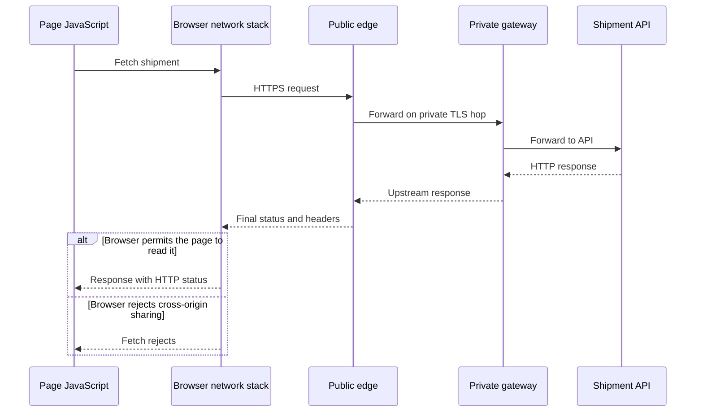

# 19 · Diagnosis and observability

Dana opens shipment `S42`. The dashboard says “Couldn’t load shipment.” Its JavaScript console reports `TypeError: Failed to fetch`. In the same second the public edge logged both a `200` and a `403`. Which request failed, and where?

**Start with the actual request in the affected browser’s Network panel and the matching Console message.** Record the method, destination, time, initiator, and any request ID. Then follow that attempt across the edge, gateway, and application. An API can successfully return data while the browser refuses to expose it to the page. An adjacent `403` can belong to a completely different operation.

The course checklist asks, *“Can you distinguish DNS failure, connection refusal, a TLS validation error, an HTTP 403, and a response blocked by browser policy?”* The examples below use the shipment dashboard to show what each observer can establish, what remains uncertain, and which observation would settle it. [AppSec networking checklist](appsec-networking-checklist.md)

**Jump to** · [Start with one attempt](#1-start-with-one-attempt) · [Browser evidence and timing](#2-read-the-browser-evidence) · [Five failure classes](#3-distinguish-the-five-failure-classes) · [DNS, sockets, and TLS](#4-check-dns-sockets-and-tls-at-the-caller) · [Packets and encrypted hops](#5-read-packets-and-flow-logs-in-context) · [Logs, metrics, and traces](#6-connect-logs-metrics-and-traces) · [Worked diagnosis](#7-reconstruct-the-shipment-incident) · [Local lab](#8-observe-three-outcomes-on-loopback) · [Review questions](#9-check-your-understanding)

## 1. Start with one attempt

**Monitoring** tells you that a known indicator changed, such as the fraction of successful list views. **Observability** is the ability to use the evidence a system emits to answer questions about its behavior, including questions you did not anticipate. **Diagnosis** uses that evidence to explain a particular symptom and test competing explanations.

For the course example, the page at `https://app.example.com` calls `https://api.example.com/shipments/S42` using a session cookie. A public edge terminates browser TLS, a private gateway forwards the request, and the API checks Dana’s permission to read the shipment. These hostnames are cross-origin even though they are same-site. The example below assumes a cache bypass for this private route. [Browser security](10-browser-security.md) · [Cookies and credentials](11-cookies-and-credentials.md)



1. **Describe the user outcome.** “Dana’s shipment detail failed to render after one click” is specific enough to investigate. Record the environment, route, release, time with timezone, and affected population. Distinguish the user action from every HTTP attempt it generated.
2. **Name the caller and the hop.** Browser on a laptop, server-rendered frontend in a container, and worker in a private subnet can use different DNS, routes, credentials, and trust stores. An edge log describes its own connection or upstream request.
3. **Find the last confirmed milestone.** Examples include an answer from the caller’s resolver, a TCP connection, a validated TLS peer, an HTTP response at the edge, or a response delivered to JavaScript. Look for evidence from the next milestone.
4. **Compare one thing at a time.** Prefer the same read operation, role, origin, address family, and network path. If a command-line read succeeds, record which of those changed. For an ambiguous write, retrieve its operation status before attempting it again.
5. **Write down the remaining uncertainty.** “The client received a TCP reset for this connection. We still need the listener and firewall evidence to identify the source” is a usable finding. “The network is broken” gives the next engineer little to test. [Cloud and container networking](16-cloud-and-container-networking.md) · [Availability and retries](18-availability-and-retries.md)

## 2. Read the browser evidence

Open DevTools **Network** before the action. Preserve the log if navigation or redirects will clear it. Capture a normal attempt before changing cache settings. Filter to the relevant request, and inspect its **Initiator**, **Headers**, **Timing**, and the matching **Console** entry. Browser versions differ in the labels and in how much of a blocked response they display.

| Question | Evidence to record |
| --- | --- |
| Was this the request the user intended? | Method, scheme, host, path template, initiator, redirect chain, and whether the row is an `OPTIONS` preflight or the actual method |
| Which connection did it use? | Selected remote address and port, negotiated HTTP version, connection reuse when available, and whether the response came from memory, disk cache, or a service worker |
| Which browser context applied? | Page origin, target origin, credentials mode, cookie inclusion or exclusion reason, and the exact policy diagnostic. Record relevant cookie attributes or exclusion reasons without copying session values |
| What did the endpoint return, and what did code see? | Network status and pertinent headers where visible, request ID, the `Response.status` seen by JavaScript, or the exception that preceded a response becoming readable |

**HTTP and Fetch have different outcomes.** When the response is accessible, native `fetch` normally resolves even for `403` or `500`. The application reads `response.status` and `response.ok`. An application wrapper may then throw its own error. DNS, connection, TLS, or CORS failures can all produce a rejected Fetch promise. The JavaScript exception alone rarely distinguishes them. [Chrome DevTools Network reference](https://developer.chrome.com/docs/devtools/network/reference) · [Fetch API behavior](https://developer.mozilla.org/en-US/docs/Web/API/Window/fetch)

### Read a waterfall without double-counting

Queueing or stalled time can precede network work. Then consider name lookup, connection setup, TLS, request transmission, waiting for the first response byte, and body download. Time to first byte (TTFB) can include round-trip latency, proxy or server queueing, application work, and upstream dependencies. Download time can include a slow sender or receiver as well as a slow link. Check where the tool starts its TTFB clock and whether it includes TLS within its connection interval before adding the bars.

Here is an illustrative `curl --write-out` result for one fresh HTTPS request over TCP, with no redirect or explicit proxy. The numbers are **cumulative seconds from the beginning**. They use a different clock origin from a DevTools bar labeled “Waiting.”

| curl milestone | Example value | Interval inferred for this request |
| --- | ---: | --- |
| `time_namelookup` | 0.020 | 20 ms until name resolution completed |
| `time_connect` | 0.055 | 35 ms from resolution to TCP connection |
| `time_appconnect` | 0.105 | 50 ms from TCP connection to TLS completion |
| `time_pretransfer` | 0.106 | 1 ms more until the transfer was ready to begin |
| `time_starttransfer` | 0.305 | 199 ms from transfer readiness to first response byte, including the request and remote wait |
| `time_total` | 0.345 | 40 ms from first byte to completion, 345 ms overall |

That 199 ms is a reason to look at matching edge and application durations. It does not identify 199 ms of database time. DNS caching, a reused connection, a redirect, an HTTP proxy, or HTTP/3 changes the interpretation. HTTP/3 uses QUIC over UDP and integrates TLS with its handshake. A successful HTTP/3 request will not show a TCP three-way handshake. [curl timing variables](https://curl.se/docs/manpage.html#-w) · [HTTP versions and request boundaries](09-http-versions-and-request-boundaries.md)

Page-side `PerformanceResourceTiming` has privacy restrictions. Detailed cross-origin timestamps can be zero when the server has not opted into timing disclosure with `Timing-Allow-Origin`. Reuse or caching can also leave phases with zero duration. `Timing-Allow-Origin` governs access to timing detail. `Access-Control-Allow-Origin` participates in deciding whether the page may read a cross-origin response. [W3C Resource Timing](https://www.w3.org/TR/resource-timing/) · [Fetch CORS protocol](https://fetch.spec.whatwg.org/#cors-protocol)

## 3. Distinguish the five failure classes

Work down the table for the **particular attempt and hop**. A browser may reach the edge successfully while the edge itself has trouble resolving or connecting to the origin.

| Failure class | Evidence that distinguishes it | Next check |
| --- | --- | --- |
| **DNS failure** | The affected resolver returns `NXDOMAIN` for the expected name, or a recorded resolver error prevents an address from being selected. The browser reports a name-resolution failure | Confirm the exact hostname, resolver, record type, VPN or split-DNS context, and cache state. A DNS timeout has a different meaning from an explicit negative answer |
| **TCP connection refusal** | An address was selected. The client records `ECONNREFUSED` and a capture shows its initial SYN answered by a reset on that tuple | Check the intended listener’s bind address, port, network namespace, and any active rejection on the path. The reset alone cannot identify the process or device that originated it |
| **TLS validation failure** | Transport reached a TLS peer. The client’s verifier reports a specific error such as a hostname mismatch, expired certificate, or untrusted issuer | Compare the expected identity, presented chain, client trust store and clock, and the component that terminated this TLS leg |
| **HTTP `403 Forbidden`** | An HTTP responder understood the request and refused it. If browser policy permits access, JavaScript receives a `Response` with status `403` | Match the request ID to edge, gateway, and application decision logs. A `403` alone does not identify which layer denied it or whether a user session was established |
| **Browser policy blocked the operation or response** | A Console diagnostic identifies a browser rule. A CORS-blocked actual `GET` may already have a logged HTTP response. A failed preflight can stop the actual method from being sent. A CSP `connect-src` decision can block a connection before it starts | Match the origin, method, preflight, and final response headers to the specific diagnostic. Check which requests actually reached the edge |

**A timeout is less specific than a refusal.** A connection timeout without a reply could reflect a route, a filter, loss, or an unavailable endpoint. A client read timeout after a completed TLS handshake points to a later stage. A gateway-generated `504` means that gateway timed out waiting upstream. It says nothing conclusive about whether a database transaction committed. [HTTP 403 semantics](https://datatracker.ietf.org/doc/html/rfc9110#section-15.5.4) · [Availability and retries](18-availability-and-retries.md)

**Separate the two CORS paths.** For a credentialed actual `GET`, inspect the requesting `Origin` and the final response’s `Access-Control-Allow-Origin` and `Access-Control-Allow-Credentials`. In this example they must allow `https://app.example.com` and credentials. For a preflighted request, inspect `OPTIONS`, `Access-Control-Request-Method`, any requested headers, and the corresponding permissions. Even a `204` preflight response can fail that check. Conversely, a previously cached preflight may explain why a new `OPTIONS` row is absent. An API denial and a CORS error can coexist if a `403` response also lacks the necessary sharing headers. [CORS diagnostics](https://developer.mozilla.org/en-US/docs/Web/HTTP/Guides/CORS/Errors)

## 4. Check DNS, sockets, and TLS at the caller

### DNS answers and the address actually used

Inspect the one hostname used by the failing client. With `DNS_NAME` set to that service name, `dig "$DNS_NAME" A` and `dig "$DNS_NAME" AAAA` show the resolver’s answer for each family. Keep the response status, answering resolver, alias chain, addresses, TTLs, and observation time. `NXDOMAIN` reports a missing name in that resolver’s view. If the answer includes a CNAME chain, the missing name can be its final target. `NOERROR` with no address of the requested type can mean the name exists without that record type. `SERVFAIL` means the resolver could not produce a successful answer. A timeout means you observed no timely answer.

An answer to `dig` establishes what that resolver returned at that time. Compare it with the address the browser or worker actually selected. A browser using encrypted DNS, a corporate VPN with split DNS, OS or browser caches, or a proxy resolving names on the client’s behalf may take another path. A missing AAAA record by itself does not rule out a usable IPv4 address. [DNS terminology](https://www.rfc-editor.org/rfc/rfc9499.html) · [DNS and service discovery](06-dns.md)

### Socket state and routing

On the host or workload that owns a known service, inspect the listening socket. With `PORT` set to that service’s port, use `ss -ltnp "sport = :$PORT"` on Linux or `lsof -nP -iTCP:"$PORT" -sTCP:LISTEN` on macOS. Process details depend on what the current user may see. Read the local address, address family, port, and process. In a container, inspect the relevant network namespace. A listener on the host’s loopback and one on a Pod’s loopback belong to different network stacks.

`LISTEN` shows an accepting local TCP socket. `SYN-SENT` shows an active open awaiting completion. `ESTABLISHED` shows a TCP connection, which can remain open across many HTTP requests. None of these states records an HTTP authorization decision. For a remote subnet, inspect the caller’s selected route and return-path policy. A valid route and a local listener are each only one part of end-to-end reachability. [Linux ss](https://man7.org/linux/man-pages/man8/ss.8.html) · [Ports and sockets](05-ports-sockets-tcp-and-udp.md)

### TLS identity and a comparable HTTP client

For a documented TLS-over-TCP service you operate, set `TLS_HOST` to its expected DNS name and `TLS_PORT` to its actual listening port. Use the trust configuration appropriate to that client. This example both sends the name for server selection and verifies it.

```sh
openssl s_client -connect "$TLS_HOST:$TLS_PORT" \
  -servername "$TLS_HOST" -verify_hostname "$TLS_HOST" \
  -verify_return_error -showcerts -alpn 'h2,http/1.1' </dev/null
```

Record the verification result, the expected name and relevant certificate subject alternative names, the validity dates, the issuer, the TLS version, and the negotiated application protocol if any. `-showcerts` shows what the peer sent. A certificate chain displayed in the output has not necessarily been accepted. `-verify_return_error` makes verification failures terminate this diagnostic handshake. A browser certificate viewer shows what that browser received on its own leg. A gateway connecting to a private origin may see a different certificate and use a different trust store. [OpenSSL s_client](https://docs.openssl.org/3.0/man1/openssl-s_client/) · [TLS service identity](https://www.rfc-editor.org/rfc/rfc9525.html) · [TLS, HTTPS, and certificates](07-tls-https-and-certificates.md)

Use `curl` for a known, read-only HTTP request from the relevant network. Match the method and path, and account for any legitimate differences in credentials, DNS, redirects, TLS trust, and proxy settings. By default curl can complete successfully as a transfer while reporting HTTP `403`. A displayed HTTP code of `000` means no HTTP status was available in that result. Check stderr and the exit code. For example, curl code `6` means host resolution failed, `7` means connection failed, `28` means a timeout, and `60` indicates peer verification failed. Code `7` alone cannot distinguish every reason a connection failed. [curl error codes](https://curl.se/libcurl/c/libcurl-errors.html) · [curl write-out](https://everything.curl.dev/usingcurl/verbose/writeout.html)

## 5. Read packets and flow logs in context

Before interpreting a record, draw the TLS endpoints for that hop. On the public connection, the browser and a TLS-terminating edge can read HTTP. On a separate encrypted origin connection, the edge is the TLS client and the origin-side terminator is the TLS server. A device that forwards encrypted bytes at layer 4 has a different view from a reverse proxy that terminates TLS.

| Observation point | What it can establish | What requires another observer |
| --- | --- | --- |
| Page JavaScript and browser DevTools | The page knows whether Fetch resolved and what it could read. DevTools can also report browser policy, selected connections, network responses, and cache behavior | The origin’s internal authorization decision or the database outcome |
| DNS resolver | Query name and type, reply or resolver error, and TTLs where recorded. With encrypted DNS, the resolver endpoint can still process the lookup | Which address the client ultimately used or which HTTP path it requested |
| Passive capture on one interface | Observed endpoints, protocol, packet size, order, relative time, and TCP flags. Some handshake metadata may also be visible | HTTP path, cookies, status, body, and application request ID on a normally encrypted HTTPS hop |
| Cloud flow log | A summarized flow at a particular interface, with addresses, ports, protocol, time window, volume, and a policy action where supported | An individual HTTP request, which user initiated it, or which application rule allowed it |
| Layer 4 load balancer or TLS-terminating edge | A layer 4 balancer can report connections and chosen backends. A terminating edge can also report method, route, final status, cache result, and upstream attempts if instrumented | A client-facing `200` alone cannot establish that the origin handled this read. A cache hit can be served locally |
| Application and database | The app can record its authorization decision, handler outcome, and dependency calls. A durable operation record can establish whether a write committed | Whether the final response reached the browser or JavaScript was permitted to read it |

### Interpret a short packet sequence

Suppose a client-side capture shows `192.0.2.25:54102 → 203.0.113.80:443` with TCP `SYN`. Four milliseconds later the reverse direction shows `RST, ACK`. That supports an active refusal on this TCP attempt. Seeing repeated SYNs with **no observed reply** leaves more explanations open, including an unreachable service, filtering, loss, or an incomplete capture. Seeing a completed handshake followed by encrypted data moves the investigation forward to TLS or HTTP evidence at an endpoint. [TCP specification](https://www.rfc-editor.org/rfc/rfc9293.html)

For an existing capture of the relevant connection, `tcpdump -nn -r incident.pcap 'tcp port 443 or udp port 443'` reads the file offline and prints numeric addresses and ports. In Wireshark, `tcp.flags.reset == 1` is a **display filter** for TCP resets. Check the interface, capture interval, packet drops, and whether both directions were visible. Apparent retransmissions or checksum warnings can also reflect how and where packets were recorded. [tcpdump manual](https://man7.org/linux/man-pages/man8/tcpdump.8.html) · [Wireshark display filters](https://www.wireshark.org/docs/wsug_html_chunked/ChWorkDisplayFilterSection.html)

Correlate a transport flow with its **five-tuple** of protocol, source IP and port, and destination IP and port, plus the time window and observation point. NAT can rewrite an address or port. A proxy creates another connection, and HTTP/2 or HTTP/3 can multiplex several requests on one connection. Matching a five-tuple gets you to a candidate connection. A request ID or application trace is usually needed to identify the individual HTTP exchange. [Routing and NAT](04-routing-and-nat.md) · [QUIC transport](https://www.rfc-editor.org/rfc/rfc9000.html)

In a full TLS 1.3 certificate handshake, the server sends its certificate under encryption after `ServerHello`. An ordinary ClientHello can reveal a requested server name through Server Name Indication (SNI). Encrypted ClientHello can conceal the inner name. HTTP/3 uses QUIC, so a TCP-only capture misses it. A decoder may inspect some QUIC Initial information without gaining access to HTTP headers or content. Use endpoint diagnostics to answer certificate or HTTP questions. [TLS 1.3 handshake](https://datatracker.ietf.org/doc/html/rfc9846#section-2) · [Encrypted ClientHello](https://www.rfc-editor.org/rfc/rfc9849.html) · [TLS in QUIC](https://www.rfc-editor.org/rfc/rfc9001.html)

### Interpret a cloud flow record

An AWS VPC Flow Log with `action=ACCEPT`, `protocol=6`, and `dstport=443` describes TCP traffic accepted at the observed interface during its aggregation window. Check the interface, direction, source and destination, start and end times, packet and byte counts, and `log-status`. A `REJECT` can help locate a network-policy decision. An HTTP `403` is produced by an HTTP responder, a different layer. A record marked `SKIPDATA` indicates a collection gap. Even an `ACCEPT` in each direction leaves TLS validation, HTTP authorization, and browser delivery to be established separately. Field names, aggregation, and coverage vary by provider. [AWS flow log fields](https://docs.aws.amazon.com/vpc/latest/userguide/flow-log-records.html) · [Firewalls and segmentation](15-firewalls-and-segmentation.md)

## 6. Connect logs, metrics, and traces

| Signal | Question it answers | Shipment example |
| --- | --- | --- |
| **Metric** | How often does the symptom occur, over what period, and for which bounded group? | Fraction of shipment-detail views that render, and p95 latency for `GET /shipments/{id}` |
| **Structured log** | What did a particular component observe or decide? | Edge logs final and upstream status separately. API logs a read-authorization decision and handler duration |
| **Distributed trace** | Which instrumented operations belonged to this request, and how did their timings relate? | Parent gateway span with an API child and a database child of the API span |
| **Browser telemetry** | What did real users experience after the network response? | A real-user monitoring event records a view failure. A synthetic browser check repeats a fixed read from a known origin and role |

### Follow one request across services

Give each incoming edge attempt an opaque request ID. Log it at the edge, forward the trusted value to the gateway and the API, and return it on responses when appropriate. Components can keep their own local IDs alongside it. Treat client-provided identifiers as untrusted input. An identifier correlates records and grants no authority. For cross-origin JavaScript to read a custom `X-Request-ID` response header, the response must pass CORS and expose the header, for example through `Access-Control-Expose-Headers: X-Request-ID`. Even when JavaScript cannot read it, an operator may find it in DevTools or in the edge log. Adding a custom *request* header to a cross-origin reproduction can trigger a preflight and change the sequence you are investigating. [Fetch CORS protocol](https://fetch.spec.whatwg.org/#cors-protocol)

A **trace** groups related work. A **span** describes one timed operation within that trace. W3C Trace Context propagates identifiers between services. In `traceparent: 00-7d0efc2b917340a6b0b4f487eb23a91c-463afb461c722a91-01` the fields are the version, 32-hex-digit trace ID, 16-hex-digit parent span ID, and flags. Here the sender has set the sampled flag. A receiving service can create a child span and propagate its own span ID onward. Sampling, export failures, and missing instrumentation can still leave gaps. If a 200 ms request contains a 120 ms query and an 80 ms permission check that overlap, adding all three durations counts some work twice. Look at the timeline to see which work held up completion. [W3C Trace Context](https://www.w3.org/TR/trace-context/) · [OpenTelemetry context propagation](https://opentelemetry.io/docs/concepts/context-propagation/) · [Trace sampling](https://opentelemetry.io/docs/concepts/sampling/)

Record event time with a UTC offset, service and environment, method, normalized route, status or error stage, local duration, request ID, and trace/span IDs when available. At a proxy add the upstream target or pool, upstream attempt count and status, cache outcome, and final status. At the API add a stable decision reason such as `role_denied`. Distinguish event time from log ingestion time. Use synchronized clocks to compare hosts and local monotonic durations for elapsed time. Adjacent wall-clock timestamps alone are weak evidence of a match. For retries, keep the logical operation ID stable and record a distinct attempt number or request ID for each try. [OpenTelemetry log data model](https://opentelemetry.io/docs/specs/otel/logs/data-model/) · [NGINX upstream variables](https://nginx.org/en/docs/http/ngx_http_upstream_module.html#var_upstream_status)

If a search returns no API log, check whether the edge forwarded this attempt, whether the selected replica logs this route, and whether those logs reached storage. An explicit `upstream_attempts=0` at the edge is stronger evidence that forwarding stopped there than a fruitless search at the API.

### Count what users experience

Track traffic, errors, latency, and saturation at the relevant layer. Compare a **user-facing success rate** (rendered shipment views divided by attempted views) with an **API success rate** (successful responses divided by requests received). A browser policy change can lower the first while the second stays healthy. A retry can turn one user action into several API requests. Report the window and observation count with a percentile such as p95, the value at or below which roughly 95% of observations fall. Correlate rising latency with queue depth, connection-pool use, or upstream duration before assigning a cause. [Google SRE monitoring guide](https://sre.google/sre-book/monitoring-distributed-systems/)

Use bounded metric labels such as service, environment, normalized route (`/shipments/{id}`), method, and status class. A separate metric series for every shipment, session, or trace ID can overwhelm the metrics system. Keep per-attempt IDs in access-controlled logs and traces. Record credential presence or a decision reason where needed. Exclude cookie and bearer values, sensitive query strings, request bodies, and personal data from routine telemetry. Review HAR files before sharing them. Even a sanitized export can contain sensitive URLs, custom headers, or response bodies. [OpenTelemetry HTTP attributes](https://opentelemetry.io/docs/specs/semconv/http/http-spans/) · [Prometheus instrumentation](https://prometheus.io/docs/practices/instrumentation/) · [OWASP logging guidance](https://cheatsheetseries.owasp.org/cheatsheets/Logging_Cheat_Sheet.html) · [Chrome HAR export](https://developer.chrome.com/docs/devtools/network/reference)

## 7. Reconstruct the shipment incident

Return to Dana’s failed detail view. The following fictional records describe a single page load. The dashboard also checks whether an optional export is available. Dana has the viewer role for tenant North. The service is configured to share authorized shipment details with this dashboard origin.

| Observer | Evidence during the same second |
| --- | --- |
| Browser | The detail component initiated `GET /shipments/S42` with credentials from `https://app.example.com`. The Console identifies a missing `Access-Control-Allow-Origin` for that URL. The Network panel in this example shows edge request ID `r71`. A second initiator requested `GET /exports` |
| Public edge, request `r71` | `GET /shipments/S42`, cache bypass, one upstream attempt, upstream `200`, final `200`. A scoped diagnostic at upstream response receipt recorded the approved dashboard origin and `Access-Control-Allow-Credentials: true`. At final edge egress the allow-origin header was absent |
| Private gateway and API, request `r71` | The gateway forwarded the read and recorded an upstream `200`. The API recorded `shipment.read`, tenant North, `decision=allow`, HTTP `200` |
| Public edge, request `r72` | `GET /exports`, final `403`, zero upstream attempts, `decision=viewer_export_denied`. The edge generated this response under its export policy |

**Finding.** Shipment read `r71` succeeded at the API. Its sharing header was present when the edge received the upstream response and absent when the edge sent the final response. That pair of observations localizes the loss to edge response handling. The browser enforced the resulting policy and the detail component could not read the data. The `403` belongs to `r72` and explains the optional export denial. If all we had were the Console and an API `200`, the origin of the missing header would still be open.

**Verify the repair.** Restore the shipment route’s intended sharing policy for the exact dashboard origin, keep its private-response cache policy, and repeat the same credentialed read from that origin. Check that the page renders `S42`, the final response has both required CORS headers, and the viewer still receives the intended export denial. Compare the browser outcome and final edge record under the new attempt ID. This tests both the user-visible fix and the permission boundary. [Proxies and gateways](12-proxies-and-gateways.md) · [HTTP caching](13-http-caching.md)

Two nearby symptoms require different evidence.

- **The list loads, but live updates stop.** For an HTTP/1.1 WebSocket upgrade, `101` confirms the switch to WebSocket. Follow the connection ID to the authorized subscription, last event ID received, close time and code if available, and the reconnect or resume attempt. A successful upgrade can precede a subscription denial or a later idle timeout. [Real-time connections](17-real-time-connections.md)
- **A shipment creation appears to time out.** A gateway `504` and an empty UI leave the write outcome unknown. Correlate the attempt with the logical operation and the durable shipment or idempotency record. Check whether the first attempt committed before deciding whether the operation can be safely retried. [Availability and retries](18-availability-and-retries.md)

## 8. Observe three outcomes on loopback

This exercise runs two small HTTP servers on your own computer. The dashboard and API both use `127.0.0.1`, but different ports make them different origins. The fixture models a viewer who may read one fictional shipment and may not export. A third route serves a harmless notice intended to be readable by pages on the API’s own origin. The dashboard sends plain GETs with no cookies or custom request headers. This isolates response sharing from the credential checks in the production example.

**Predict before running.** For each route, write down the status you expect the API to log, whether the Fetch promise will resolve, and whether dashboard JavaScript will be able to read the request ID.

Save the block below as `observe.mjs` and run `node observe.mjs` with Node.js 24. It uses only the built-in HTTP module and prints the two loopback URLs.

```js
import { createServer } from "node:http";

const routes = new Map([
  ["/shipments/S42", { status: 200, share: true, reason: "shipment_visible", body: { id: "S42" } }],
  ["/exports", { status: 403, share: true, reason: "viewer_export_denied", body: { error: "export denied" } }],
  ["/notice", { status: 200, share: false, reason: "public_notice", body: { notice: "Local pickup hours" } }],
]);
const missing = { status: 404, share: false, reason: "missing", body: { error: "unknown route" } };
let dashboardOrigin;
let apiOrigin;
let sequence = 0;

const api = createServer((request, response) => {
  const known = request.method === "GET" && routes.has(request.url);
  const entry = known ? routes.get(request.url) : missing;
  const id = "d" + (++sequence);
  const headers = {
    "Content-Type": "application/json",
    "Cache-Control": "no-store",
    "Vary": "Origin",
    "X-Request-ID": id,
  };
  if (entry.share && request.headers.origin === dashboardOrigin) {
    headers["Access-Control-Allow-Origin"] = dashboardOrigin;
    headers["Access-Control-Expose-Headers"] = "X-Request-ID";
  }
  console.log(JSON.stringify({
    id, method: request.method, route: known ? request.url : "other",
    status: entry.status, decision: entry.reason,
  }));
  response.writeHead(entry.status, headers);
  response.end(JSON.stringify(entry.body));
});

const dashboard = createServer((request, response) => {
  if (request.url !== "/") {
    response.writeHead(404).end();
    return;
  }
  response.writeHead(200, { "Content-Type": "text/html; charset=utf-8", "Cache-Control": "no-store" });
  response.end(String.raw`<!doctype html>
<html lang="en"><meta charset="utf-8"><title>Shipment read evidence</title>
<h1>Shipment read evidence</h1><pre id="out"></pre>
<script>
  const base = ${JSON.stringify(apiOrigin)};
  const out = document.querySelector("#out");
  async function observe() {
    for (const path of ["/shipments/S42", "/exports", "/notice"]) {
      let line;
      try {
        const response = await fetch(base + path);
        await response.text();
        line = path + " HTTP " + response.status + " ok=" + response.ok
          + " id=" + response.headers.get("X-Request-ID");
      } catch (error) {
        line = path + " fetch rejected (" + error.name + ")";
      }
      out.textContent += line + "\n";
    }
  }
  observe();
</script></html>`);
});

function listen(server) {
  return new Promise((resolve, reject) => {
    server.once("error", reject);
    server.listen(0, "127.0.0.1", () => {
      resolve("http://127.0.0.1:" + server.address().port);
    });
  });
}

dashboardOrigin = await listen(dashboard);
apiOrigin = await listen(api);
console.log("Dashboard " + dashboardOrigin + "\nAPI " + apiOrigin);
```

1. Open the printed **Dashboard** URL. Open DevTools, select Network, and reload once so the complete sequence is recorded. Match each row to the API terminal by path and request ID where visible. IDs change on every request.
2. Compare the page, the Console, and the API log. The three actual GET requests reach the API. Their sharing rules produce three distinct outcomes.

   | Route | API terminal | Dashboard JavaScript |
   | --- | --- | --- |
   | `/shipments/S42` | `200`, `shipment_visible` | Fetch resolves. The page prints `HTTP 200 ok=true` and a request ID |
   | `/exports` | `403`, `viewer_export_denied` | Fetch resolves. The page prints `HTTP 403 ok=false` and a request ID |
   | `/notice` | `200`, `public_notice` | Fetch rejects with `TypeError`. The page gets no response object or request ID. The Console identifies the cross-origin sharing failure |

   On a fresh run verified in Chrome, the page displayed request IDs `d1` and `d2` for the first two rows. The API logged `{"id":"d3","method":"GET","route":"/notice","status":200,"decision":"public_notice"}` for the third. Only the browser could show that the dashboard failed to read that response.

3. In a second terminal, set `API` to the exact **API** URL printed at startup. Run the following command first for `/shipments/S42` and then for `/notice`. Compare the second HTTP result with what the dashboard observed. curl can read the notice over HTTP. The browser page is subject to cross-origin response sharing. This fixture uses plain HTTP on loopback, so `time_appconnect` shows zero.

   ```sh
   API='http://127.0.0.1:51021'  # Replace this example with the printed API URL.
   curl --noproxy '*' --max-time 5 -sS -o /dev/null \
     -w 'http=%{response_code} peer=%{remote_ip} version=%{http_version} dns=%{time_namelookup} connect=%{time_connect} tls=%{time_appconnect} first_byte=%{time_starttransfer} total=%{time_total}\n' \
     "$API/shipments/S42"
   ```

4. Stop the servers with Ctrl+C. Write a one-sentence conclusion for `/notice` naming the last confirmed milestone and the observer that explained the failure.

## 9. Check your understanding

Try each case before reading the answers. Give both a conclusion you can defend and one observation that would reduce the remaining uncertainty.

| Case | Evidence | Question |
| --- | --- | --- |
| 1 | A laptop gets `NXDOMAIN` for the API name. An in-cluster worker gets a private A record | Which DNS evidence would explain the difference? |
| 2 | A client selects an address, sends a SYN, and receives a reset. A colleague calls it a certificate error | What stage did this attempt actually reach? |
| 3 | A TLS client connects, receives a certificate valid for another name, and reports hostname verification failure. The origin has no HTTP access record | Why can those observations coexist? |
| 4 | The browser logs a denied preflight for a `PATCH`. The edge logged `204` for `OPTIONS` and nothing for `PATCH` | Which fields would you compare, and did the edit reach this edge? |
| 5 | A dashboard receives a readable `403`. The edge logs final `403`, one upstream attempt, and upstream `403` | Which component can you identify as the original decision maker? |
| 6 | A VPC flow log reports `ACCEPT`. The HTTP/2 connection served 20 requests and one was slow | What evidence can tie the delay to a particular shipment read? |
| 7 | A chart shows 99.9% API success, but fewer users see their shipment details after a frontend release | How could both measurements be accurate? |

### Answers

1. Compare the exact queried name and type, resolver and network context, time and TTL, and cache state at each caller. A private DNS view is a plausible explanation. The two results alone do not establish whether that split was configured intentionally.
2. The evidence supports active TCP refusal for that address and port. TLS negotiation normally follows a successful connection on this HTTPS-over-TCP path. Examine the destination listener and any device that can return a reset.
3. The client rejected the peer identity during TLS. A normal HTTPS request can stop before an HTTP handler or access logger sees anything. Check the hostname the caller intended, the name it sent for TLS selection, and the certificate at the component terminating that leg.
4. Compare the preflight’s `Origin`, `Access-Control-Request-Method`, and `Access-Control-Request-Headers` with the response’s allowed origin, methods, headers, and credentials policy as applicable. The denied browser preflight prevented that browser attempt from sending the `PATCH`. The `204` alone does not demonstrate permission.
5. The edge received its `403` from upstream. The immediate upstream could have generated it or forwarded a deeper denial. Follow the same request ID to gateway and application decision records to identify the owner.
6. The flow record establishes an accepted flow within a time window. Match the specific browser attempt or request ID to the edge’s upstream timings and a trace. Use span timing to test whether queueing, a dependency, or body transfer explains the delay.
7. The measurements have different populations and completion points. For example, the API can send `200` while CORS prevents the page from reading it, or a frontend change can fail while parsing a readable response. Match one failing view to Network, Console, and the API record. Then compare rates over the same release, route, and window.

**A short incident handoff** can fit in four lines. Record the user-visible symptom and affected scope, the exact attempt and observer, the last milestone confirmed by evidence, and the unresolved question with the next observation that would answer it. For Dana’s case, “At the edge, `r71` arrived from upstream with the approved origin and left without it” tells the next engineer both why the browser failed and where to inspect the response configuration.

---

[Previous · 18 Availability and retries](18-availability-and-retries.md) · [Course checklist](appsec-networking-checklist.md) · [Final self-check](appsec-networking-checklist.md#a-practical-self-check)
